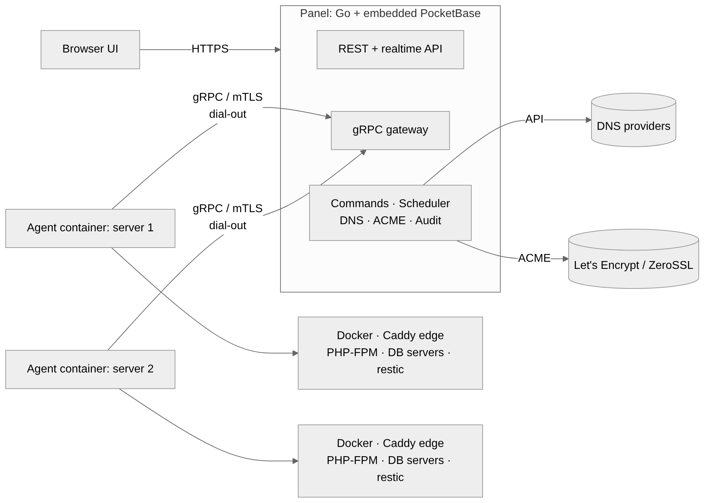

# PocketCloud

Self-hosted control panel for a homelab or a few VPS: servers, Docker containers and Compose stacks, shared databases, static and PHP websites with automatic DNS and TLS, backups and a full change audit – all from one web UI.

PocketCloud is a single Go binary built on [PocketBase](https://pocketbase.io) (embedded as a library) with a React UI. Every managed server runs a small **agent container** that dials out to the panel over gRPC with mutual TLS, so servers behind NAT need no open ports. Agent updates are done by a short-lived updater container with automatic rollback.

> **Status: early development.** The foundations and the agent connection work (milestones M0 and M1 of the [Roadmap](https://github.com/oldbear24/PocketServerManager/issues/40)): servers connect with one command, report their state and containers, and run commands, with a full change audit and diagnostics. Milestone M2 is built – container actions, Compose stacks with revisions and import, live logs, metrics, a web terminal, the server page, and shared MariaDB and PostgreSQL servers with a database per application – but it has only run against the fake Docker engine described below, not on a real host yet. Sites, domains, backups and the rest are still to come, and their pages say so.


## What it will do

- **Servers and agents** – connect a Docker host with one `docker run` and a one-time token; live heartbeat, resource usage and events; one-click agent updates through a temporary updater container that rolls back if the new agent does not come up.
- **Containers and stacks** – Docker inventory and actions, Compose editor with revisions and encrypted secrets, live logs, web terminal.
- **Static sites** – deploy from Git, a ZIP upload or an empty placeholder; builds run in a throwaway container; atomic releases and instant rollback.
- **PHP sites** – WordPress, Laravel or Nette in an isolated PHP-FPM container per site behind the same edge proxy; PHP 8.2–8.5, Composer builds, atomic releases, persistent data outside releases, cron, outgoing mail through a relay.
- **Databases** – shared MariaDB and PostgreSQL servers per host, so apps don't each need their own instance; one database, one user and one private network per app, password rotation, Adminer on demand, per-database backups.
- **Domains and TLS** – connect DNS providers (Cloudflare first); records and certificates (Let's Encrypt or ZeroSSL, HTTP-01 or DNS-01, wildcards) are created, renewed and pushed to the servers automatically. Containers get a domain through a `pocketcloud.domain` label.
- **Backups** – restic jobs for volumes, folders and per-database dumps to S3/B2, SFTP or a backup server; retention, integrity checks, restore tests, and a backup of the panel itself.
- **Overview and alerts** – what needs attention, the command queue, notifications via e-mail, ntfy, Gotify or webhooks.
- **Diagnostics** – a PocketBase plugin with live gRPC connection health per agent, a message trace, agent self-checks, debug bundles and an optional Prometheus endpoint.
- **Change audit** – every configuration change from the UI, the API or the PocketBase dashboard with author, source and field-level diff; append-only, hash-chained, exportable, with one-click revert.
- **Import from Coolify** – read a Coolify installation into a reviewed plan and move it in place (reusing the volumes) or onto a new server, with rollback.

## Architecture



Every action becomes a record in the `commands` collection – the command history and the delivery queue at once – and every configuration change lands in an append-only audit log. Logs and terminal sessions stream agent → panel → browser without touching the database.

- [docs/architecture.md](docs/architecture.md) – components, enrollment, gRPC API, command lifecycle, Compose stacks, logs and terminal, metrics, sites/DNS/TLS flow, PHP sites, database servers, backups, diagnostics, change audit, security model
- [docs/data-model.md](docs/data-model.md) – PocketBase collections, those built and those planned
- [docs/migration-from-coolify.md](docs/migration-from-coolify.md) – how a Coolify installation moves to PocketCloud, by hand or with the importer

## Design

Thirteen screens: overview, server detail, Compose stack, static site, new-site wizard (static or PHP), domains & certificates, backups, connecting a server, diagnostics, change audit, PHP site, databases, import from Coolify. See [design/README.md](design/README.md) for screenshots, clickable static previews and the canvas sources.

## Roadmap

| Milestone | Focus |
|---|---|
| [M0 · Foundations](https://github.com/oldbear24/PocketServerManager/milestone/1) | repo and CI, gRPC contract, PocketBase schema, change audit, panel and UI skeletons, key technical decisions |
| [M1 · Agent & connectivity](https://github.com/oldbear24/PocketServerManager/milestone/2) | internal CA and mTLS, agent container, enrollment, command queue, heartbeats, updates, diagnostics plugin, audit page |
| [M2 · Containers, stacks & databases](https://github.com/oldbear24/PocketServerManager/milestone/3) | inventory and actions, Compose stacks, live logs, metrics, terminal, server page, shared database servers |
| [M3 · Sites, domains & TLS](https://github.com/oldbear24/PocketServerManager/milestone/4) | edge proxy, static and PHP sites, DNS providers, ACME, new-site wizard, scheduled tasks, container and LAN domains |
| [M4 · Backups](https://github.com/oldbear24/PocketServerManager/milestone/5) | targets and jobs, retention, restore, integrity checks, per-database backups, panel backup |
| [M5 · Overview, alerts & hardening](https://github.com/oldbear24/PocketServerManager/milestone/6) | dashboard, alerts, search, roles and API tokens, security review, i18n, install guide |
| [M6 · Import from Coolify](https://github.com/oldbear24/PocketServerManager/milestone/7) | migration plan from a Coolify installation, in-place cutover or move to a new server, rollback |

The [Roadmap issue](https://github.com/oldbear24/PocketServerManager/issues/40) tracks every issue by milestone.

## Run the panel locally

You need Go 1.27 and Node 22. [Task](https://taskfile.dev) is the task runner (`go install github.com/go-task/task/v3/cmd/task@latest`).

```sh
task panel                                        # builds the UI and the panel into bin/
mkdir -p dev-data
bin/panel keygen --out dev-data/master.key        # once; the panel does not start without a master key
bin/panel serve --dir dev-data/pb_data --master-key-file dev-data/master.key \
  --http 127.0.0.1:8090 --public-url http://127.0.0.1:8090 --grpc-addr 127.0.0.1:9443
```

The panel opens no browser by itself. On the first start its log prints a link with a one-time token: open it to create the first administrator. The panel listens on port 8090 for the UI and the API, and on port 9443 for agents. PocketBase's dashboard is at `/_/`; it needs a superuser, which you create with `bin/panel superuser upsert EMAIL PASSWORD`.

| Flag | Environment variable | Default | Purpose |
|---|---|---|---|
| `--dir` | `POCKETCLOUD_DATA_DIR` | `pb_data` next to the binary | Data directory |
| `--master-key-file` | `POCKETCLOUD_MASTER_KEY_FILE` | `master.key` | The key that encrypts stored secrets; keep a copy elsewhere |
| `--public-url` | `POCKETCLOUD_PUBLIC_URL` | – | The URL people use |
| `--grpc-addr` | `POCKETCLOUD_GRPC_ADDR` | `:9443` | Where the gateway listens |
| `--grpc-public-addr` | `POCKETCLOUD_GRPC_PUBLIC_ADDR` | public URL's host + gRPC port | What agents dial |
| | `POCKETCLOUD_DIAGNOSTICS` | on | `0` turns the diagnostics plugin off |
| | `POCKETCLOUD_METRICS_TOKEN` | – | Enables the Prometheus endpoint `/metrics` with this bearer token |

### Without Docker

An agent needs a Docker Engine, but developing does not. `cmd/fakedocker` is an in-memory engine with a few example containers that write a sample log line every 2 seconds (`-chatter 0` turns that off); it is enough for the inventory, container actions, logs and terminals, and it answers the agent's database scripts with made-up numbers. `cmd/fakecompose` stands in for `docker compose`: it reads Compose files with compose-go and creates their containers on that engine, so stacks and database servers can be deployed.

```sh
go build -o bin/fakecompose ./cmd/fakecompose
go run ./cmd/fakedocker &
PANEL=127.0.0.1:9443 CA_PIN=sha256:… TOKEN=ENR-… NAME=dev-box ROLES=docker \
  STATE_DIR=dev-data/agent DOCKER_HOST=tcp://127.0.0.1:2399 DOCKER_CLI=$PWD/bin/fakecompose \
  go run ./cmd/agent run
```

The values for `CA_PIN` and `TOKEN` come from the “Connect a server” page. The agent reads host facts and metrics through its host mount, `/host`; without one it reads the machine's own `/proc`, which only Linux has. For working on the UI, `task dev:panel` and `task dev:web` run the panel and Vite with hot reload.

Both fakes only prove that the panel, the agent and the UI work together and call Docker as intended. They say nothing about how real Docker, Compose, MariaDB or PostgreSQL behave.

### Tests and checks

```sh
task test    # Go and web tests; internal/e2e runs a real panel and real agents over mTLS
task lint    # golangci-lint, buf lint, ESLint
task proto   # regenerates gen/go after changing proto/
task tools   # installs the pinned buf, protoc plugins and golangci-lint
```

## Repository layout

```
cmd/panel       panel binary (PocketBase + gRPC gateway + UI)
cmd/agent       agent (runs as a container)
cmd/updater     temporary container that swaps the agent on update
cmd/fakedocker  in-memory Docker Engine for development and tests
cmd/fakecompose stand-in for `docker compose` against cmd/fakedocker
proto/          gRPC API (buf)
gen/go/         generated code, committed (docs/adr/0005)
migrations/     PocketBase collections as Go migrations
images/         Dockerfiles of the agent, updater and panel images
plugins/        PocketBase plugins: diagnostics
internal/       shared Go packages
web/            React UI (Vite + TypeScript)
design/         UI design: screenshots, static previews, sources
docs/           architecture, data model, decisions (docs/adr/)
```

## License

Not chosen yet.
