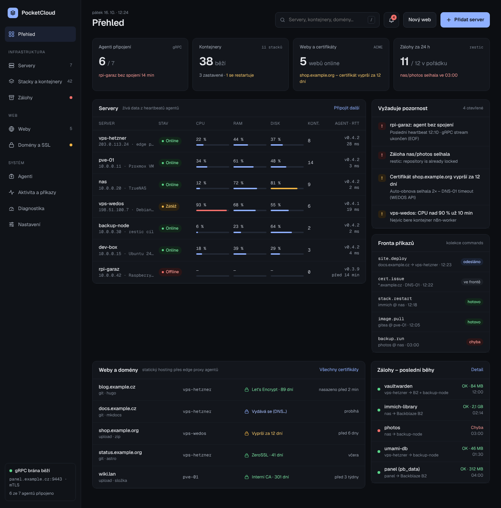
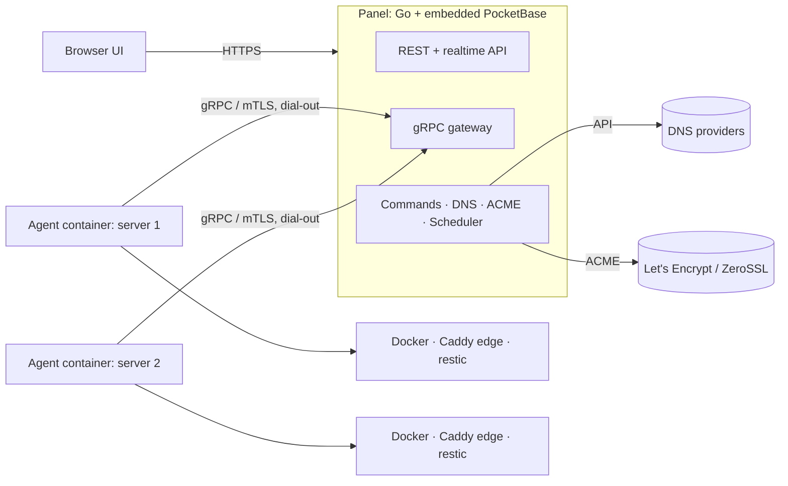

# PocketCloud

Self-hosted control panel for a homelab: servers, Docker containers and Compose stacks, static websites with automatic DNS and TLS, and backups – all from one web UI.

PocketCloud is a single Go binary built on [PocketBase](https://pocketbase.io) (embedded as a library) with a React UI. Every managed server runs a small **agent container** that dials out to the panel over gRPC with mutual TLS, so servers behind NAT need no open ports. Agent updates are done by a short-lived updater container with automatic rollback.

> **Status: design phase.** This repository holds the UI design, the architecture notes and the backlog. No code yet – start with the [Roadmap](https://github.com/oldbear24/PocketServerManager/issues/40).



## What it will do

- **Servers and agents** – connect a Docker host with one `docker run` and a one-time token; live heartbeat, resource usage and events; one-click agent updates through a temporary updater container that rolls back if the new agent does not come up.
- **Containers and stacks** – Docker inventory and actions, Compose editor with revisions and encrypted secrets, live logs, web terminal.
- **Static sites** – deploy from Git, a ZIP upload or an empty placeholder; builds run in a throwaway container; atomic releases and instant rollback.
- **Domains and TLS** – connect DNS providers (Cloudflare first); records and certificates (Let's Encrypt or ZeroSSL, HTTP-01 or DNS-01, wildcards) are created, renewed and pushed to the servers automatically. Containers get a domain through a `pocketcloud.domain` label.
- **Backups** – restic jobs for volumes, folders and database dumps to S3/B2, SFTP or a backup server; retention, integrity checks, restore, and a backup of the panel itself.
- **Overview and alerts** – what needs attention, the command queue, notifications via e-mail, ntfy, Gotify or webhooks.
- **Diagnostics** – a PocketBase plugin with live gRPC connection health per agent, a message trace, agent self-checks, debug bundles and an optional Prometheus endpoint.

## Architecture



Every action becomes a record in the `commands` collection – the audit trail and the delivery queue at once. Logs and terminal sessions stream agent → panel → browser without touching the database.

- [docs/architecture.md](docs/architecture.md) – components, enrollment, gRPC API, command lifecycle, sites/DNS/TLS flow, backups, security model
- [docs/data-model.md](docs/data-model.md) – proposed PocketBase collections

## Design

Nine screens: overview, server detail, Compose stack, static site, new-site wizard, domains & certificates, backups, connecting a server, diagnostics. See [design/README.md](design/README.md) for screenshots, clickable static previews and the canvas sources.

## Roadmap

| Milestone | Focus |
|---|---|
| [M0 · Foundations](https://github.com/oldbear24/PocketServerManager/milestone/1) | repo and CI, gRPC contract, PocketBase schema, panel and UI skeletons, key technical decisions |
| [M1 · Agent & connectivity](https://github.com/oldbear24/PocketServerManager/milestone/2) | internal CA and mTLS, agent container, enrollment, command queue, heartbeats, updates, diagnostics plugin |
| [M2 · Containers & stacks](https://github.com/oldbear24/PocketServerManager/milestone/3) | inventory and actions, Compose stacks, live logs, metrics, terminal, server page |
| [M3 · Static sites, domains & TLS](https://github.com/oldbear24/PocketServerManager/milestone/4) | edge proxy, site deployments, DNS providers, ACME, new-site wizard, container and LAN domains |
| [M4 · Backups](https://github.com/oldbear24/PocketServerManager/milestone/5) | targets and jobs, retention, restore, integrity checks, panel backup |
| [M5 · Overview, alerts & hardening](https://github.com/oldbear24/PocketServerManager/milestone/6) | dashboard, alerts, search, roles and audit, security review, i18n, install guide |

The [Roadmap issue](https://github.com/oldbear24/PocketServerManager/issues/40) tracks every issue by milestone.

## Repository layout

```
cmd/panel     panel binary (PocketBase + gRPC gateway + UI)      – planned
cmd/agent     agent (runs as a container)                         – planned
cmd/updater   temporary container that swaps the agent on update  – planned
proto/        gRPC API (buf)                                      – planned
plugins/      PocketBase plugins, e.g. diagnostics                – planned
internal/     shared Go packages                                  – planned
web/          React UI (Vite + TypeScript)                        – planned
design/       UI design: screenshots, static previews, sources
docs/         architecture and data model
```

## License

Not chosen yet.
