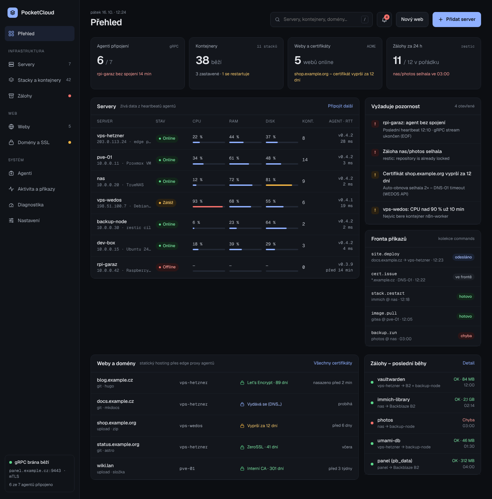
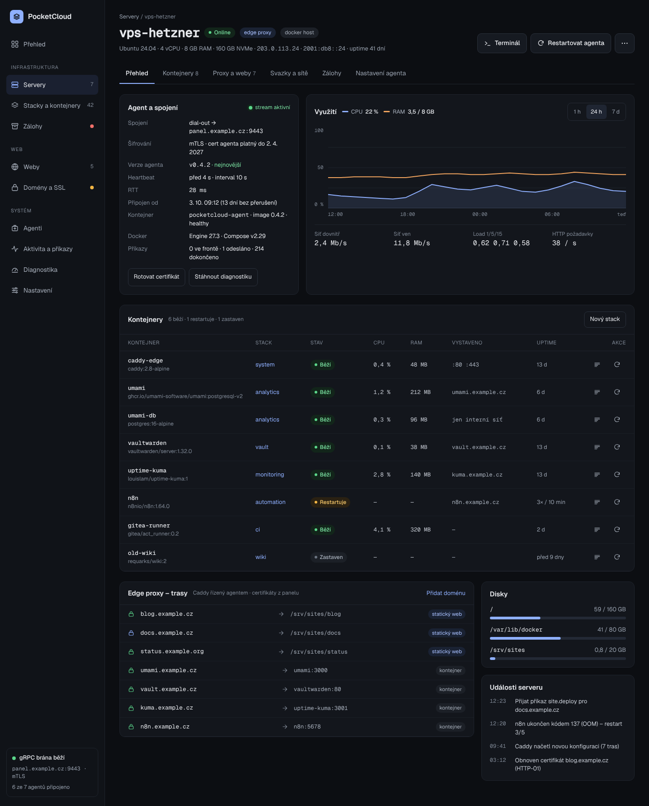
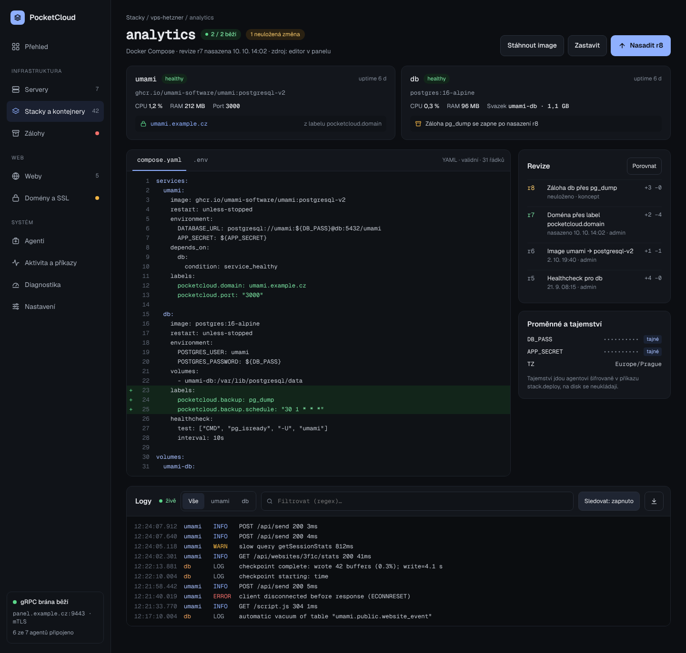
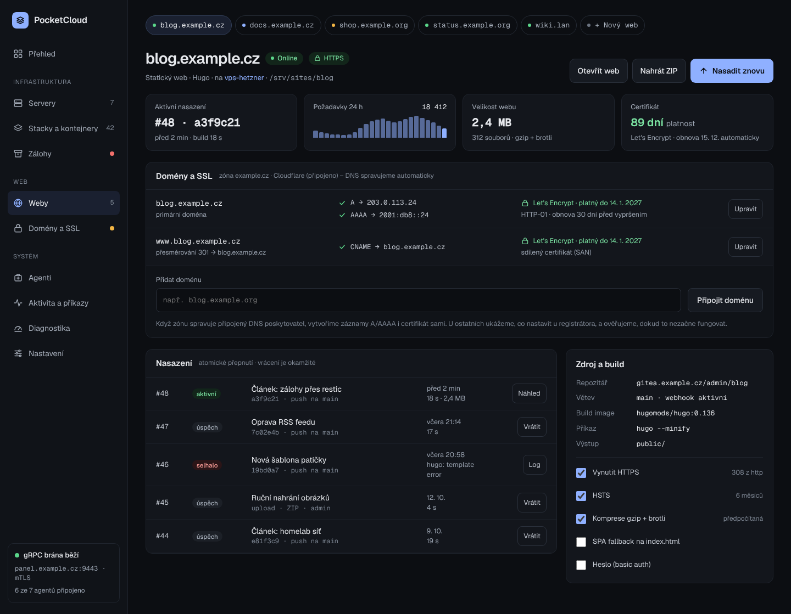
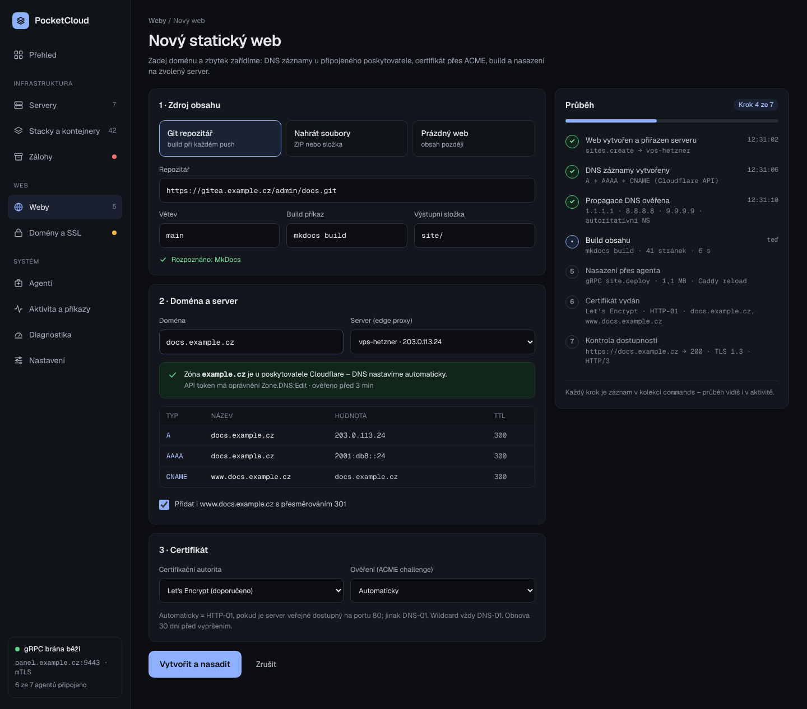
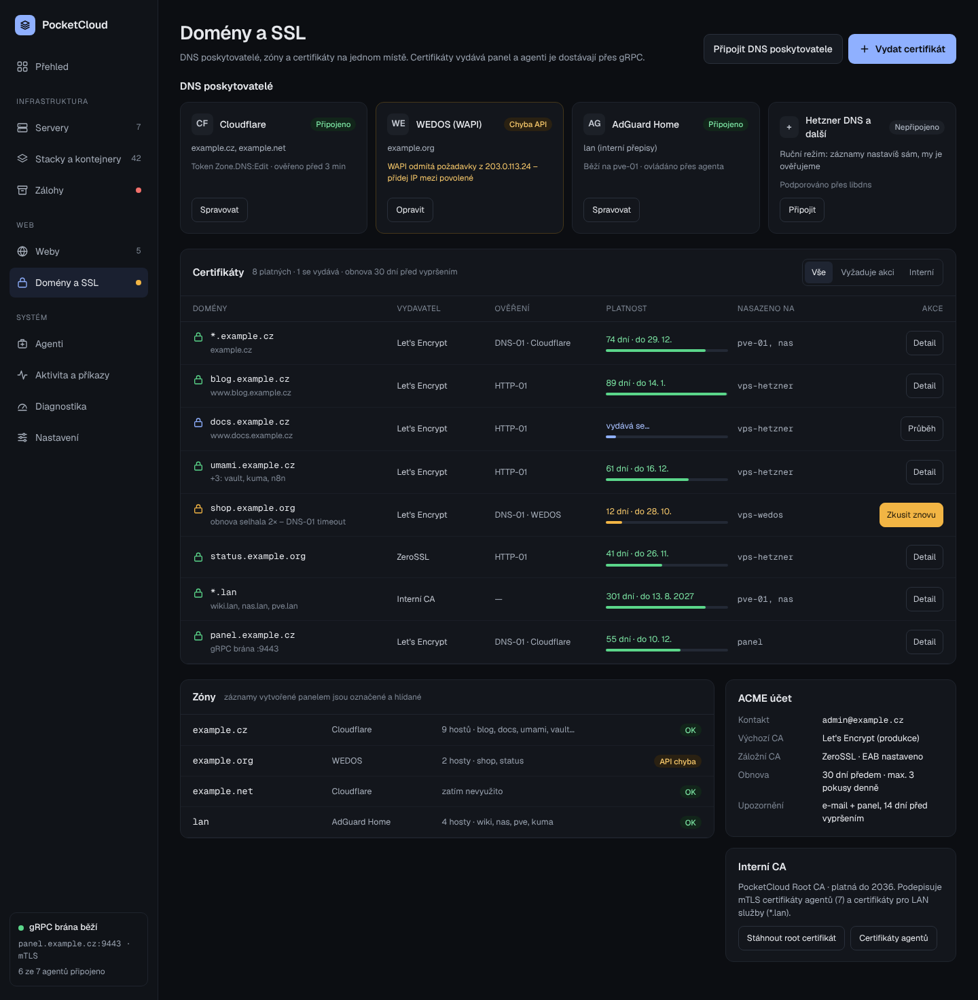
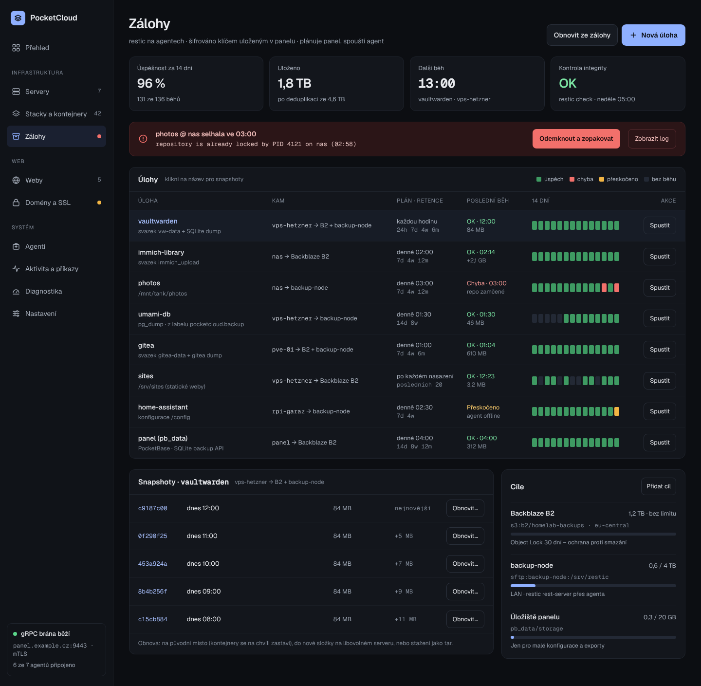
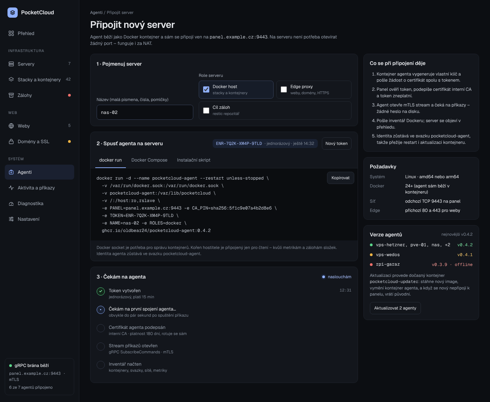
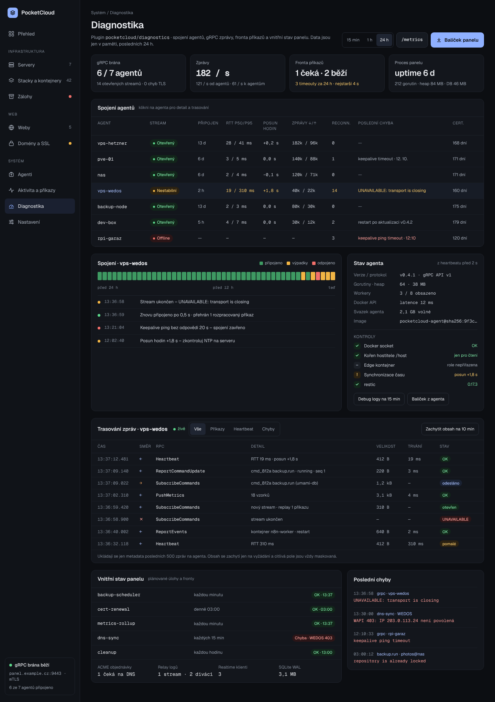

# Design

UI design for PocketCloud: nine screens in a dark console style. The UI copy is Czech; English strings come with the localisation issue (milestone M5).

| Folder | What it is |
|---|---|
| [`screenshots/`](screenshots/) | Full-page PNGs at 1440 px – the quickest way to look at the design on GitHub |
| [`preview/`](preview/) | Static HTML pages; open `preview/index.html` locally – screens link to each other like the prototype |
| [`source/`](source/) | Source artboards (`*.dc.html`) and the canvas layout (`canvas.json`) from Claude Design, including the interactive parts (log filters, wizard progress, install command tabs) |
| [`tools/`](tools/) | Scripts that regenerate `preview/` and `screenshots/` from `source/` |

The editable canvas lives in Claude Design: <https://claude.ai/artifact/Ei8hKsA6eYJGcDUG8kfTRA> (private to the owner). After changing it, copy the artboards into `source/` and regenerate the previews.

## Screens

### 1. Overview – [preview](preview/Main.html) · [source](source/Main.dc.html)
Agents, containers, sites/certificates and backups at a glance; servers with live load, “needs attention”, command queue, sites and domains, recent backup runs.



### 2. Server detail – [preview](preview/Server.html) · [source](source/Server.dc.html)
Agent connection (dial-out gRPC, mTLS, heartbeat, RTT), usage chart, containers with actions, edge proxy routes, disks, server events.



### 3. Compose stack – [preview](preview/Stack.html) · [source](source/Stack.dc.html)
Service cards, `compose.yaml` editor with unsaved changes, revisions, secrets, live logs with service filter. `pocketcloud.domain` and `pocketcloud.backup` labels connect a stack to domains and backups.



### 4. Static site – [preview](preview/Sites.html) · [source](source/Sites.dc.html)
Deployments with instant rollback, domains with DNS and certificate state, build source, HTTPS options.



### 5. New site wizard – [preview](preview/SiteNew.html) · [source](source/SiteNew.dc.html)
Source, domain + server and certificate in one form. Typing a domain detects its zone at a connected DNS provider (automatic) or switches to manual mode with the records to set. The timeline shows provisioning step by step.



### 6. Domains, DNS and certificates – [preview](preview/Domains.html) · [source](source/Domains.dc.html)
DNS providers with fix-it hints, certificates with validity and challenge type, zones, ACME account, internal CA.



### 7. Backups – [preview](preview/Backups.html) · [source](source/Backups.dc.html)
Jobs with a 14-day history strip, failed-run banner with a fix action, snapshots for restore, backup targets.



### 8. Connect a server – [preview](preview/Enroll.html) · [source](source/Enroll.dc.html)
One-time enrollment token, Docker install (`docker run`, Compose snippet or a wrapper script) that updates with name and roles, live connection checklist, agent versions with a note on the updater container.



### 9. Diagnostics – [preview](preview/Diagnostics.html) · [source](source/Diagnostics.dc.html)
Served by the diagnostics plugin: gRPC connection health per agent (stream state, RTT, clock skew, reconnects, last error), a 24-hour connection strip with events, agent runtime state and self-checks, a live message trace with filters and optional payload capture, panel internals (cron jobs, queues) and recent errors.



## Design tokens

| Token | Value | Use |
|---|---|---|
| `bg` | `#0C0E12` | page background |
| `nav` | `#101318` | sidebar, inset areas |
| `surface` | `#13161C` | cards and tables |
| `border` | `#1F242D` / `#2A303B` | dividers / control borders |
| `text` | `#E6E8EC` | primary text |
| `text-2` | `#A7AFBB` / `#98A1AE` | secondary text |
| `text-3` | `#7E8794` | labels, captions |
| `accent` | `#8FB0FF` | primary actions, links, charts |
| `ok` | `#5BD68A` on `#12251A`, text `#7BE3A2` | healthy, success |
| `warn` | `#F2B544` on `#2A2112`, text `#F5C76A` | degraded, expiring |
| `err` | `#F2706B` on `#2B1517`, text `#F79A95` | offline, failed |
| `off` | `#6B7380` on `#1C2027` | stopped, pending |

- Type: **Geist** for UI text, **Geist Mono** for hostnames, IPs, versions, code and numbers.
- Radius: 12 px cards, 8–9 px controls, pills fully rounded. Controls are at least 40–44 px tall.
- Status is never colour-only: every status colour comes with a text label.

## Regenerating previews and screenshots

```sh
cd design/tools
npm install
npm run build   # = render (source -> preview) + screenshots (preview -> screenshots)
```

`render.mjs` evaluates each artboard's `renderVals()` and expands `{{holes}}`, `<sc-for>` and `<sc-if>` into plain HTML (initial state only). `screenshot.mjs` uses Playwright Chromium and the `geist` font package, so screenshots render the same offline.
