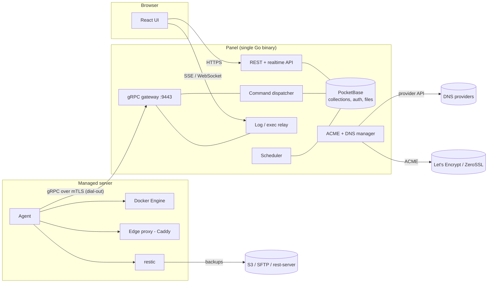
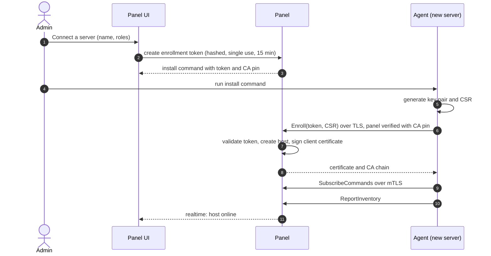
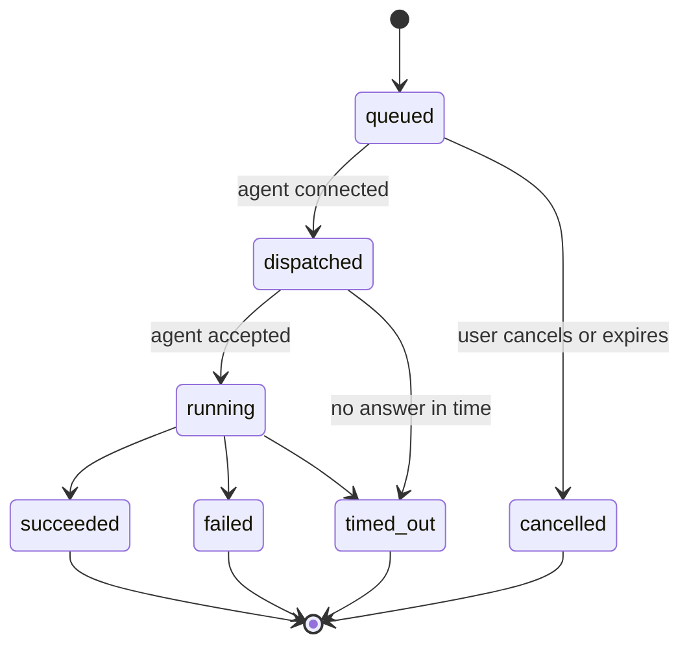
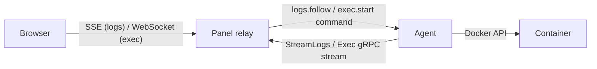
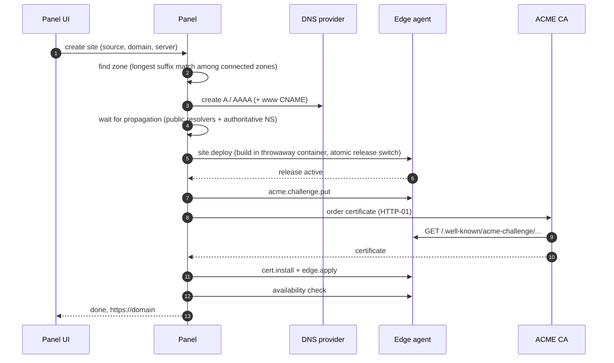

# Architecture

> Status: proposal. Decisions marked **(spike)** are settled in the spike issue in milestone M0 and recorded as ADRs in `docs/adr/`.

PocketCloud has two binaries:

- **Panel** – one Go process: [PocketBase](https://pocketbase.io) embedded as a library (auth, collections, REST + realtime API, files, cron), the React UI, a gRPC gateway for agents, and the managers for commands, DNS, certificates and backups.
- **Agent** – one small Go process per managed server. It dials out to the panel, executes commands (Docker, Compose, edge proxy, site deploys, restic) and streams data back.

## Principles

1. **Agents dial out.** The panel never opens connections to servers. Servers behind NAT work and need no inbound ports (except 80/443 on servers with the `edge` role).
2. **The panel is the source of truth.** Agents keep only their identity and what they need to keep serving when the panel is down (edge config, certificates).
3. **Every action is a command.** UI actions and scheduled jobs create records in `commands`. The collection is both the audit trail and the delivery queue. Delivery is at-least-once; agents deduplicate by command id.
4. **Streams bypass the database.** Logs, terminal sessions and command output are relayed agent → panel → browser and never stored in PocketBase.
5. **Secrets are encrypted at rest** with a master key kept outside the database, and are sent to an agent only inside the command that needs them.

## Ports

| Component | Port | Purpose |
|---|---|---|
| Panel | 443 (or behind a reverse proxy) | UI and REST/realtime API |
| Panel | 9443 | gRPC gateway for agents (mTLS) |
| Agent | – | no inbound ports |
| Agent with `edge` role | 80, 443 | static sites and exposed containers |

## Agent identity and enrollment

The panel runs an internal CA. Agents authenticate with client certificates; no passwords or API tokens live on servers.

- Certificate SAN `pocketcloud://host/<hostId>` identifies the host on every call.
- Agent certificates are valid for 180 days and renewed over the existing connection when 30 days remain (`RenewCertificate`).
- Removing a host revokes its certificate (serial denylist checked on connect).

## gRPC API (v1, draft)

| RPC | Kind | Purpose |
|---|---|---|
| `Enroll` | unary | token + CSR → client certificate (only RPC without client certificate) |
| `SubscribeCommands` | server stream | long-lived command delivery; request carries version, capabilities, recently finished ids |
| `ReportCommandUpdate` | unary | progress and results, idempotent by command id + sequence |
| `Heartbeat` | unary | every 10 s; vitals, RTT, clock skew |
| `ReportInventory` / `ReportEvents` | unary / client stream | Docker inventory and incremental events |
| `PushMetrics` | client stream | batched metrics |
| `StreamLogs` | client stream | log chunks for an active `logs.follow` |
| `Exec` | bidi stream | terminal sessions |
| `FetchArtifact` | server stream | agent downloads uploads and site releases |
| `RenewCertificate` | unary | identity rotation |

Command payloads are a `oneof` per type: `container.*`, `image.*`, `stack.*`, `logs.*`, `exec.*`, `site.*`, `edge.*`, `cert.*`, `acme.*`, `backup.*`, `agent.*`. Agents advertise supported types in `capabilities`, which keeps old agents working while new command types are added.

## Command lifecycle

- The dispatcher reacts to new records (`OnRecordAfterCreateSuccess`) and to agent connects.
- Commands touching the same resource (stack, site, backup repository) run in order; others in parallel.
- After a reconnect the panel re-sends commands that were dispatched but never finished; the agent acknowledges ids it has already completed without running them again.
- Multi-step flows (new site, restore) are a parent command with children sharing a correlation id, which drives the progress timelines in the UI.

## Logs and terminal

The relay is a custom route registered in `OnServe`; it checks the PocketBase auth token, fans one agent stream out to all viewers and stops it when the last viewer leaves.

## Static sites, domains and TLS

Servers with the `edge` role run Caddy **(spike: managed container vs embedded)**. The panel generates each edge's complete route table from sites, domains and container labels and sends it with `edge.apply`; the agent validates it, loads it and keeps the last good config.

Certificates are issued **centrally by the panel** **(spike: certmagic vs lego)**, stored encrypted and distributed with `cert.install` to every edge that serves the names. One ACME account, wildcard reuse across servers, and a single place to see expiry.

- **HTTP-01**: the panel asks the edge agent to answer `/.well-known/acme-challenge/<token>`.
- **DNS-01**: the panel creates the TXT record through the DNS provider API (required for wildcards and non-public names).
- Renewal 30 days before expiry; alert at 14 days or on failure.

New site provisioning (one parent command):

If the zone is not at a connected provider, the wizard shows the records to create at the registrar and polls until they resolve.

Site releases live in `/srv/pocketcloud/sites/<site>/releases/<n>` with a `current` symlink; rollback switches the symlink without rebuilding.

LAN-only names use DNS rewrites (AdGuard Home, Pi-hole) and certificates from the internal CA.

## Backups

- The panel owns targets, credentials, repository passwords and schedules; agents run restic.
- `backup.run` carries repository URL, credentials, sources and optional pre-hooks (database dumps via `restic backup --stdin-from-command`).
- Retention with `restic forget --prune`; weekly `restic check --read-data-subset`.
- The panel backs up its own `pb_data`; the master key is exported separately. Restoring the panel keeps the CA, so agents reconnect without re-enrollment.

## Security model

- Trust boundaries: browser ↔ panel (HTTPS + PocketBase auth), agent ↔ panel (mTLS), panel ↔ external APIs (DNS, ACME, storage).
- A compromised agent can only act as its own host: it receives only its own commands and the secrets those commands need.
- Enrollment tokens are single use, short-lived, stored hashed and rate limited; the install command pins the panel CA.
- Terminal access is admin-only and audited; host shells are opt-in per agent.
- Roles: admin, operator, viewer.

A full threat model is tracked in the security review issue (milestone M5).
