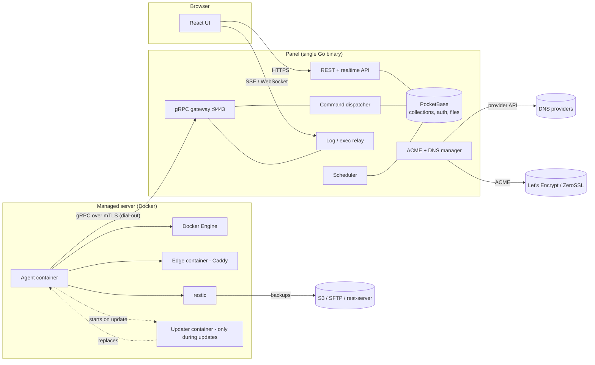
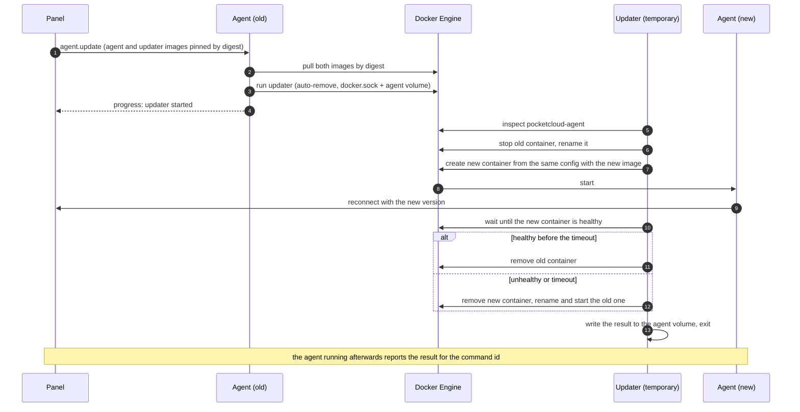
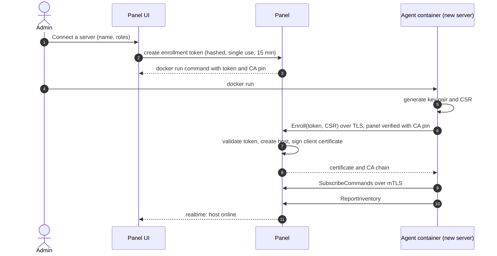
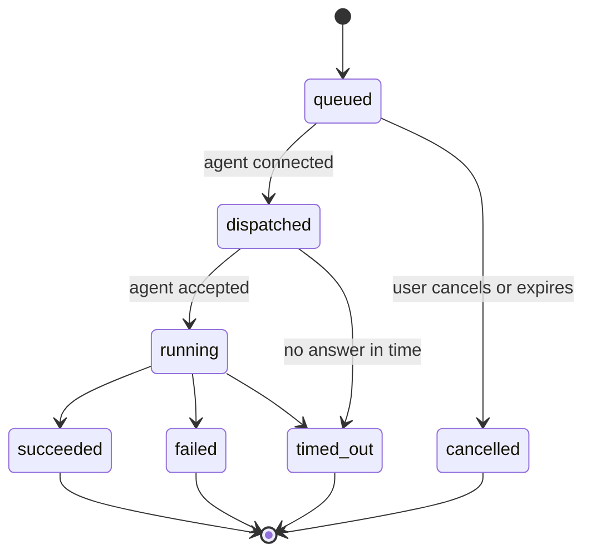
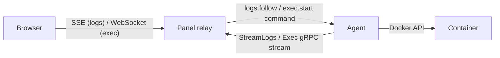
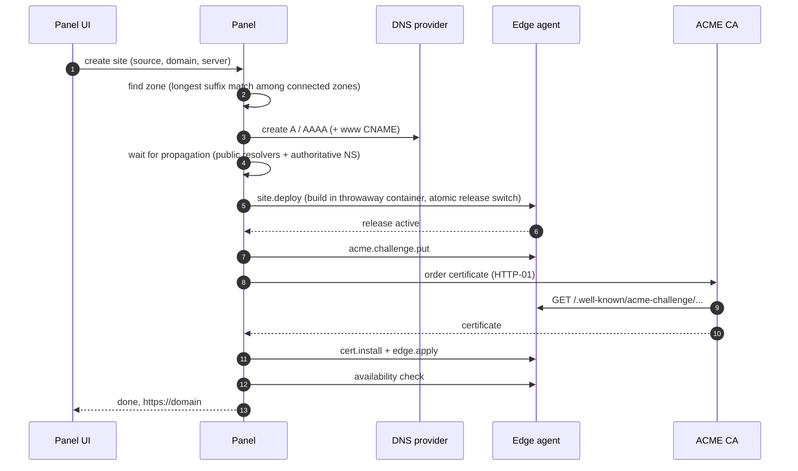
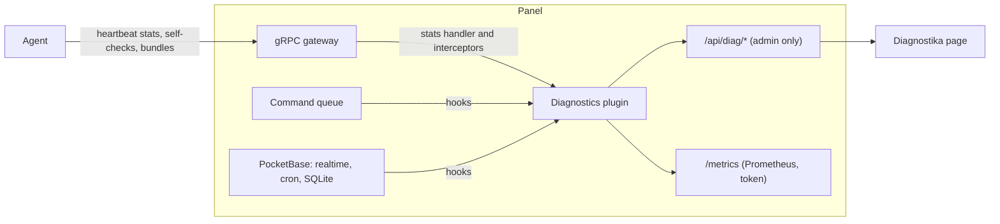

# Architecture

> Status: proposal. Decisions marked **(spike)** are settled in the spike issue in milestone M0 and recorded as ADRs in `docs/adr/`.

PocketCloud has two binaries:

- **Panel** – one Go process: [PocketBase](https://pocketbase.io) embedded as a library (auth, collections, REST + realtime API, files, cron), the React UI, a gRPC gateway for agents, and the managers for commands, DNS, certificates and backups.
- **Agent** – a small container (`pocketcloud-agent`) on every managed server. It dials out to the panel, executes commands (Docker, Compose, edge proxy, site deploys, restic) and streams data back. It never replaces itself: updates are done by a short-lived **updater** container (`pocketcloud-updater`).

## Principles

1. **Agents dial out.** The panel never opens connections to servers. Servers behind NAT work and need no inbound ports (except 80/443 on servers with the `edge` role).
2. **The panel is the source of truth.** Agents keep only their identity and what they need to keep serving when the panel is down (edge config, certificates).
3. **Every action is a command.** UI actions and scheduled jobs create records in `commands`. The collection is both the audit trail and the delivery queue. Delivery is at-least-once; agents deduplicate by command id.
4. **Streams bypass the database.** Logs, terminal sessions and command output are relayed agent → panel → browser and never stored in PocketBase.
5. **Secrets are encrypted at rest** with a master key kept outside the database, and are sent to an agent only inside the command that needs them.
6. **Everything on a server is a container.** The agent, the edge proxy, site builds, backup and restore jobs and the updater all run in Docker; the agent never updates itself in place.

## Ports

| Component | Port | Purpose |
|---|---|---|
| Panel | 443 (or behind a reverse proxy) | UI and REST/realtime API |
| Panel | 9443 | gRPC gateway for agents (mTLS) |
| Agent container | – | no inbound ports |
| Edge container (`edge` role) | 80, 443 | static sites and exposed containers |

## Agent container

The agent ships as a multi-arch image (`ghcr.io/oldbear24/pocketcloud-agent`, linux/amd64 and linux/arm64) with the agent binary, the Docker CLI with the Compose plugin, and restic. It is started once with `docker run` (or a Compose snippet) and managed by PocketCloud afterwards.

| Mount | Mode | Why |
|---|---|---|
| `/var/run/docker.sock` | read-write | manage containers; start edge, job and updater containers |
| volume `pocketcloud-agent` → `/var/lib/pocketcloud` | read-write | identity (key, certificate), config, idempotency state, updater results |
| `/` → `/host` | read-only, `rslave` | host metrics (`/host/proc`, `/host/sys`), disk usage, reading host paths for backups |

- First start reads `PANEL`, `CA_PIN`, `TOKEN`, `NAME` and `ROLES` from the environment, enrolls, and stores its identity in the volume. The token is single use, so leaving it in the container environment is harmless.
- The image `HEALTHCHECK` reports healthy only while the agent is connected to the panel; the updater relies on it.
- The agent labels everything it runs with `pocketcloud.role` (`agent`, `updater`, `edge`, `job`) so the inventory can recognise and protect these containers.
- Work that needs more access than the read-only host mount – writing restored files, building sites, backing up a volume – runs in short-lived **job containers** that mount exactly what they need.

## Agent updates

A container cannot safely replace itself: stopping its own container kills the process halfway through. The agent therefore starts a tiny, purpose-built `pocketcloud-updater` container (a static Go binary on `scratch`) that swaps the agent container and exits.

- Images are always pulled by digest; the panel release defines which agent and updater digests belong to it.
- The new container keeps the old one's environment, mounts, networks, restart policy and labels (recreate from inspect).
- If the updater itself dies mid-way, the old container still exists (stopped and renamed); recovery is a documented one-liner, and the panel shows the host as offline until then.
- Restarting the agent does not need the updater – a plain `docker restart` from the agent is enough.

## Agent identity and enrollment

The panel runs an internal CA. Agents authenticate with client certificates; no passwords or API tokens live on servers.

- Certificate SAN `pocketcloud://host/<hostId>` identifies the host on every call.
- Agent certificates are valid for 180 days and renewed over the existing connection when 30 days remain (`RenewCertificate`).
- Removing a host revokes its certificate (serial denylist checked on connect).

## gRPC API (v1, draft)

| RPC | Kind | Purpose |
|---|---|---|
| `Enroll` | unary | token + CSR → client certificate (only RPC without client certificate) |
| `SubscribeCommands` | server stream | long-lived command delivery; request carries version, capabilities, recently finished ids |
| `ReportCommandUpdate` | unary | progress and results, idempotent by command id + sequence |
| `Heartbeat` | unary | every 10 s; vitals, RTT, clock skew |
| `ReportInventory` / `ReportEvents` | unary / client stream | Docker inventory and incremental events |
| `PushMetrics` | client stream | batched metrics |
| `StreamLogs` | client stream | log chunks for an active `logs.follow` |
| `Exec` | bidi stream | terminal sessions |
| `FetchArtifact` | server stream | agent downloads uploads and site releases |
| `UploadArtifact` | client stream | agent uploads diagnostics bundles and restore downloads to the panel |
| `RenewCertificate` | unary | identity rotation |

Command payloads are a `oneof` per type: `container.*`, `image.*`, `stack.*`, `logs.*`, `exec.*`, `site.*`, `edge.*`, `cert.*`, `acme.*`, `backup.*`, `agent.*`. Agents advertise supported types in `capabilities`, which keeps old agents working while new command types are added.

## Command lifecycle

- The dispatcher reacts to new records (`OnRecordAfterCreateSuccess`) and to agent connects.
- Commands touching the same resource (stack, site, backup repository) run in order; others in parallel.
- After a reconnect the panel re-sends commands that were dispatched but never finished; the agent acknowledges ids it has already completed without running them again.
- Multi-step flows (new site, restore) are a parent command with children sharing a correlation id, which drives the progress timelines in the UI.

## Logs and terminal

The relay is a custom route registered in `OnServe`; it checks the PocketBase auth token, fans one agent stream out to all viewers and stops it when the last viewer leaves.

## Static sites, domains and TLS

Servers with the `edge` role run Caddy in its own container (`pocketcloud-edge`) managed by the agent, so agent updates never interrupt traffic **(spike confirms the integration details)**. The panel generates each edge's complete route table from sites, domains and container labels and sends it with `edge.apply`; the agent validates it, loads it and keeps the last good config.

Certificates are issued **centrally by the panel** **(spike: certmagic vs lego)**, stored encrypted and distributed with `cert.install` to every edge that serves the names. One ACME account, wildcard reuse across servers, and a single place to see expiry.

- **HTTP-01**: the panel asks the edge agent to answer `/.well-known/acme-challenge/<token>`.
- **DNS-01**: the panel creates the TXT record through the DNS provider API (required for wildcards and non-public names).
- Renewal 30 days before expiry; alert at 14 days or on failure.

New site provisioning (one parent command):

If the zone is not at a connected provider, the wizard shows the records to create at the registrar and polls until they resolve.

Site releases live on the `pocketcloud-sites` volume shared by the agent and the edge container (`<site>/releases/<n>` with a `current` symlink); builds run in job containers; rollback switches the symlink without rebuilding.

LAN-only names use DNS rewrites (AdGuard Home, Pi-hole) and certificates from the internal CA.

## Backups

- The panel owns targets, credentials, repository passwords and schedules; agents run restic.
- Docker volumes are backed up by short-lived job containers that mount the volume read-only; host paths are read through the read-only `/host` mount; restores run in job containers with only the destination mounted read-write.
- `backup.run` carries repository URL, credentials, sources and optional pre-hooks (database dumps via `restic backup --stdin-from-command`).
- Retention with `restic forget --prune`; weekly `restic check --read-data-subset`.
- The panel backs up its own `pb_data`; the master key is exported separately. Restoring the panel keeps the CA, so agents reconnect without re-enrollment.

## Diagnostics

Detailed diagnostics live in a separate PocketBase plugin, `plugins/diagnostics`, registered the same way as PocketBase's own plugins (`diagnostics.MustRegister(app, diagnostics.Config{…})`). When it is disabled it adds no overhead.

- **Collection** – a gRPC `stats.Handler` (connection begin/end, payload sizes, RPC timing) plus unary and stream interceptors (status codes, command ids); command-queue hooks (depth, dispatch and completion latency, retries, replays, timeouts); PocketBase internals (realtime clients, cron jobs, SQLite and WAL size); Go `runtime/metrics`.
- **Per agent** – connected since, remote address, TLS version and certificate expiry, RTT p50/p95, clock skew, messages and bytes in/out, reconnects with classified reasons (EOF, keepalive timeout, TLS error, revoked certificate), last error.
- **Storage** – in memory only: counters, histograms and a ring buffer of the last 500 message metadata entries per agent, 24 h window. Connection events also go to the `events` collection so they survive restarts.
- **Agent side** – heartbeats carry light runtime stats (goroutines, heap, worker pool, Docker API latency, free space on the agent volume); periodic self-checks (Docker socket, host mount, edge container, restic, time sync); `agent.diagnostics` builds a bundle uploaded with `UploadArtifact`; `agent.set_log_level` enables debug logging for a limited time.
- **Payload capture** – off by default. An admin can capture message payloads of one agent for 10 minutes; fields marked with a custom `sensitive` proto field option are always masked.
- **Output** – the Diagnostika page (System section of the UI), an optional token-protected Prometheus endpoint, and downloadable debug bundles (`diagnostic_bundles`, with expiry).

## Security model

- Trust boundaries: browser ↔ panel (HTTPS + PocketBase auth), agent ↔ panel (mTLS), panel ↔ external APIs (DNS, ACME, storage).
- A compromised agent can only act as its own host: it receives only its own commands and the secrets those commands need.
- Access to the Docker socket is root-equivalent on that host. This is inherent to managing Docker; the host root is mounted read-only and writes go through job containers with explicit mounts.
- Enrollment tokens are single use, short-lived, stored hashed and rate limited; the install command pins the panel CA.
- Terminal access is admin-only and audited; host shells are opt-in per agent.
- Roles: admin, operator, viewer.

A full threat model is tracked in the security review issue (milestone M5).
