# Architecture

> Status: M0 and M1 are implemented. M2 – inventory and container actions, Compose stacks, live logs, metrics, the web terminal, the server page and database servers – is implemented, tested against `cmd/fakedocker` and `cmd/fakecompose`, and has run on a real Docker Engine (29.9, Ubuntu 24.04, amd64, cgroup v1) in a cloud VM, together with the agent's enrollment and updates; arm64, cgroup v2 and a host behind NAT are not checked yet. The edge proxy of M3 (#20) is implemented and tested against a fake of Caddy's admin API; the rest of M3 is planned. The backups of M4 – targets, jobs, restores, integrity checks, the panel's own backup (#28–#32) and per-database backups with restore tests (#53) – are implemented and tested against `cmd/fakedocker` and a fake of restic, with what restic 0.17.3 prints captured from the real binary; #53's database servers against `internal/testutil/fakedb`, which answers their clients' scripts with the privileges of the user a script signs in as. #53's checks on a real Docker Engine run separately. Sections about later milestones describe what is planned. Decisions are recorded as ADRs in [`adr/`](adr/).
>
> Diagrams are PNG renders of the Mermaid sources in [`diagrams/`](diagrams/), so they show up everywhere, including the GitHub mobile app. Edit the `.mmd` file and run [`diagrams/render.sh`](diagrams/render.sh).

PocketCloud has two binaries:

- **Panel** – one Go process: [PocketBase](https://pocketbase.io) embedded as a library (auth, collections, REST + realtime API, files, cron), the React UI, a gRPC gateway for agents, and the managers for commands, DNS, certificates and backups.
- **Agent** – a small container (`pocketcloud-agent`) on every managed server. It dials out to the panel, executes commands (Docker, Compose, edge proxy, site deploys, PHP and database containers, restic) and streams data back. It never replaces itself: updates are done by a short-lived **updater** container (`pocketcloud-updater`).

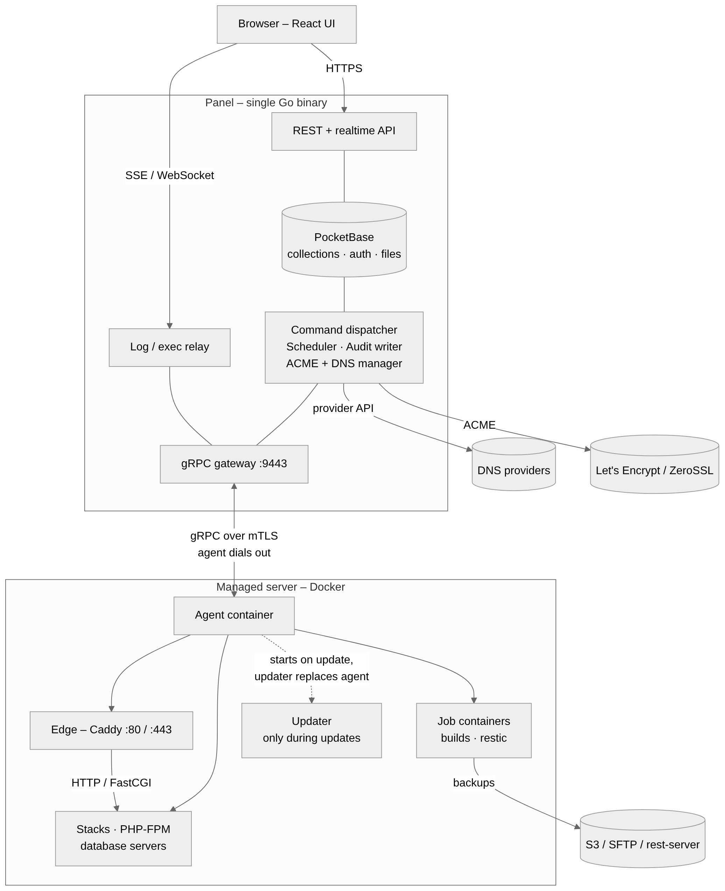

## Principles

1. **Agents dial out.** The panel never opens connections to servers. Servers behind NAT work and need no inbound ports (except 80/443 on servers with the `edge` role).
2. **The panel is the source of truth.** Agents keep only their identity and what they need to keep serving when the panel is down (edge config, certificates).
3. **Every action is a command.** UI actions and scheduled jobs create records in `commands`. The collection is both the command history and the delivery queue. Delivery is at-least-once; agents deduplicate by command id.
4. **Streams bypass the database.** Logs, terminal sessions and admin tool sessions are relayed agent → panel → browser and never stored in PocketBase. A command's output streams live the same way and is stored once, as a file of the command, when it ends.
5. **Secrets are encrypted at rest** with a master key kept outside the database, and are sent to an agent only inside the command that needs them.
6. **Everything on a server is a container.** The agent, the edge proxy, PHP runtimes, database servers, site builds, backup and restore jobs and the updater all run in Docker; the agent never updates itself in place.
7. **Every change is audited.** Configuration changes – from the UI, the API, the scheduler or the PocketBase dashboard – are written to an append-only, hash-chained audit log with field-level diffs.

## Ports

| Component | Port | Purpose |
|---|---|---|
| Panel | 443 with `--https-addr` (and 80 for HTTP-01 and the redirect), or plain HTTP behind a reverse proxy | UI and REST/realtime API |
| Panel | 9443 | gRPC gateway for agents (mTLS) |
| Agent container | – | no inbound ports |
| Edge container (`edge` role) | 80, 443 | static and PHP sites, exposed containers |
| PHP-FPM and database containers | – | internal Docker networks only |

## Agent container

The agent ships as a multi-arch image (`ghcr.io/oldbear24/pocketcloud-agent`, linux/amd64 and linux/arm64) with the agent binary, the Docker CLI with the Compose plugin, and restic. It is started once with `docker run` (or a Compose snippet) and managed by PocketCloud afterwards.

| Mount | Mode | Why |
|---|---|---|
| `/var/run/docker.sock` | read-write | manage containers; start edge, job and updater containers |
| volume `pocketcloud-agent` → `/var/lib/pocketcloud` | read-write | identity (key, certificate), config, idempotency state, updater results |
| `/` → `/host` | read-only, `rslave` | host metrics (`/host/proc`, `/host/sys`), disk usage, reading host paths for backups |

- `rslave` lets mounts and unmounts on the host reach the agent's view, so the agent never holds on to a disk the host wants to detach. It needs `/` to be a shared mount, which systemd sets up; on hosts without systemd (Alpine, WSL) `docker run` refuses the mount until `mount --make-rshared /` has run, at every boot. Without it, an agent that ran before does not start again after a reboot: Docker says `/` is not a shared or slave mount.
- Host facts come through the `/host` mount. The addresses are read from `/host/proc/1/net`, the network namespace of the host's init rather than the agent container's, and skip Docker's and other container interfaces.
- First start reads `PANEL`, `CA_PIN`, `TOKEN`, `NAME` and `ROLES` from the environment, enrolls, and stores its identity in the volume. The token is single use, so leaving it in the container environment is harmless.
- The image `HEALTHCHECK` reports healthy only while the agent is connected to the panel; the updater relies on it.
- The agent labels everything it runs with `pocketcloud.role` (`agent`, `updater`, `edge`, `job`) so the inventory can recognise and protect these containers.
- Work that needs more access than the read-only host mount – writing restored files, building sites, backing up a volume – runs in short-lived **job containers** that mount exactly what they need.

## Agent updates

A container cannot safely replace itself: stopping its own container kills the process halfway through. The agent therefore starts a tiny, purpose-built `pocketcloud-updater` container (a static Go binary on `scratch`) that swaps the agent container and exits.

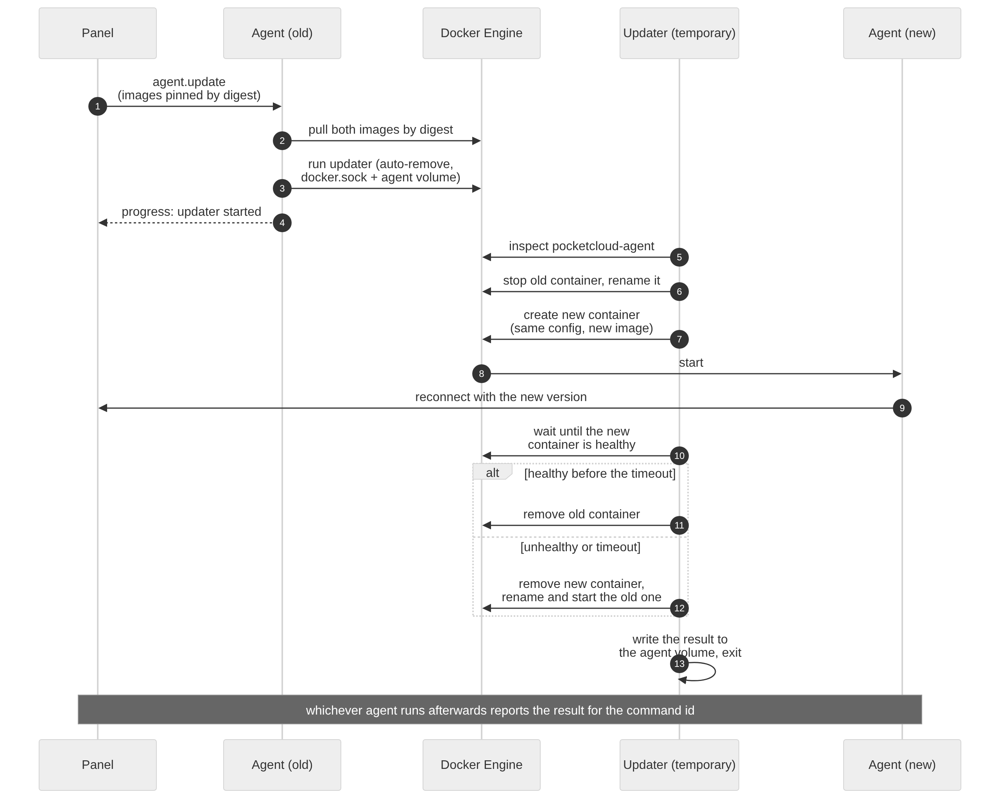

- Images are always pulled by digest; the panel release defines which agent and updater digests belong to it.
- The new container keeps the old one's environment, mounts, networks, restart policy and labels (recreate from inspect).
- If the updater itself dies mid-way, the old container still exists (stopped and renamed to `pocketcloud-agent-old`), and the panel shows the host as offline until it is back. To recover by hand:

  ```sh
  docker rm -f pocketcloud-agent; docker rename pocketcloud-agent-old pocketcloud-agent; docker start pocketcloud-agent
  ```
- The new agent must turn healthy within three minutes. One that exits, or keeps being restarted by the restart policy it took over, counts as failed at once, so a release that cannot start is rolled back in seconds.
- The updater writes its outcome to the agent volume (`updates/<command id>.json`), and whichever agent runs afterwards reports it for the command.
- Batch updates go one host at a time, and a failed update stops the batch.
- Restarting the agent does not need the updater – a plain `docker restart` from the agent is enough.

## Agent identity and enrollment

The panel runs an internal CA. Agents authenticate with client certificates; no passwords or API tokens live on servers.

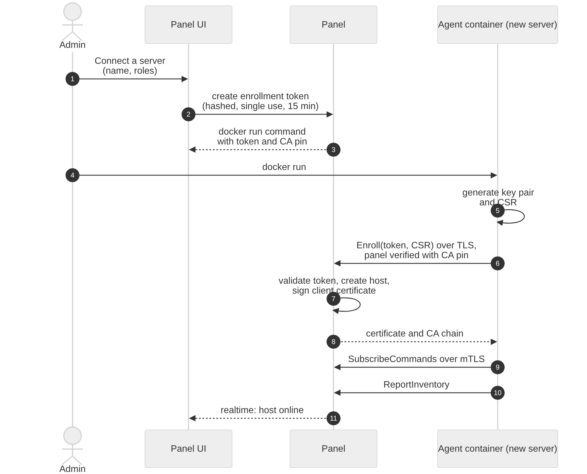

- Certificate SAN `pocketcloud://host/<hostId>` identifies the host on every call.
- Agent certificates are valid for 180 days and renewed over the existing connection when 30 days remain (`RenewCertificate`). The previous certificate stays valid until the agent first calls with the new one, so a lost response cannot lock it out.
- Removing a host revokes its certificate. The serial denylist is checked on every call, so a revoked certificate stops working on connections that are already open too. A command stream is authenticated when it opens, so the removal also ends the host's open stream at once.
- Agents identify the panel by its pinned CA and the name `pocketcloud://panel`, not by host name ([ADR 0006](adr/0006-agents-pin-the-panel-ca.md)); the gateway keeps the internal CA when the panel serves HTTPS with a certificate from ACME ([ADR 0007](adr/0007-the-gateway-keeps-the-internal-ca.md)).
- The CA is a root (ECDSA P-256, 20 years), an intermediate for the agents' certificates, the gateway's server certificate, and an intermediate for the certificates of LAN names (*PocketCloud LAN*, #26, see *Certificates*). Their keys are sealed with the master key in `internal_ca`. The root is public: `GET /api/pc/ca.pem` and `/api/pc/ca.crt` (DER, as Windows, macOS, iOS and Android open it) serve it without an account, as the gateway sends it to anyone anyway.

## gRPC API (v1)

The contract is in [`proto/pocketcloud/agent/v1`](../proto/pocketcloud/agent/v1). The generated Go code is committed ([ADR 0005](adr/0005-generated-code-is-committed.md)), and CI checks it and runs `buf breaking` against `main`.

| RPC | Kind | Purpose |
|---|---|---|
| `Enroll` | unary | token + CSR → client certificate (only RPC without client certificate) |
| `SubscribeCommands` | server stream | long-lived command delivery; request carries version, capabilities, recently finished ids |
| `ReportCommandUpdate` | unary | progress and results, idempotent by command id + sequence |
| `Heartbeat` | unary | every 10 s; vitals, RTT, clock skew; with `probe` (#32: `repoint` and the diagnostics' round trip) only authenticated and answered with the panel's time, nothing kept |
| `ReportInventory` / `ReportEvents` | unary / client stream | Docker inventory and incremental events |
| `PushMetrics` | client stream | batched metrics |
| `StreamLogs` | client stream | log chunks for an active `logs.follow` |
| `Exec` | bidi stream | terminal sessions |
| `FetchArtifact` | server stream | agent downloads uploads and site releases |
| `UploadArtifact` | client stream | agent uploads diagnostics bundles, imported Compose files and SQL dumps to the panel; a snapshot download (kind `backup_download`) is live: the panel passes each chunk on to the browser as it arrives and stores nothing |
| `Relay` | bidi stream | admin-only connections to a temporary tool container (Adminer); opened by a command and bound to one browser session, like `Exec`. One stream carries every connection of the session, numbered by `conn_id` |
| `RenewCertificate` | unary | identity rotation |

Command payloads are a `oneof` per type: `container.*`, `image.*`, `stack.*`, `logs.*`, `exec.*`, `site.*` (static and PHP), `task.*` (scheduled tasks), `db.*`, `edge.*`, `cert.*`, `acme.*`, `backup.*`, `agent.*`. Each field is named after its type with dots as underscores. Agents advertise supported types in `capabilities`, which keeps old agents working while new command types are added; a type the agent does not support fails at once with a message saying so.

Fields holding secrets carry the `sensitive` option from `proto/pocketcloud/options/v1`, and message traces never show them.

## Command lifecycle

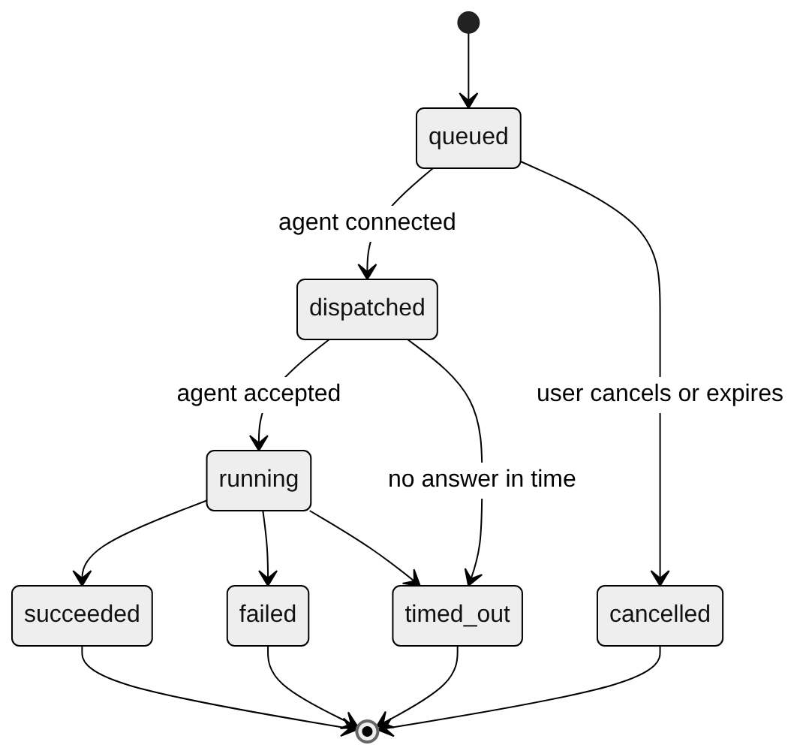

- The dispatcher reacts to new records (`OnRecordAfterCreateSuccess`) and to agent connects.
- Commands touching the same resource (stack, site, backup repository) run in order; others in parallel.
- After a reconnect the panel re-sends commands that were dispatched but never finished; the agent acknowledges ids it has already completed without running them again.
- A command runs **at most once**. The agent records a command in its volume before running it. If it was killed in the middle, the replay does not run the command again: it reports a failure saying the result may be incomplete. Whether to try again is up to whoever asked for it.
- Queued commands for an offline host expire after `command_queue_ttl_s`; dispatched and running ones time out per command type. No command stays open forever.
- The panel's own fields of a command (status, attempts, results, the cancel mark) cannot be set through the API, and the state machine holds for every save, superusers included.
- Multi-step flows (new site) are a parent command with children sharing a correlation id, which drives the progress timelines in the UI. A restore is one agent command: the agent stops the destination's users, restores and starts them again itself (#30).
- **Commands the agent settles** (`Spec.SettledByAgent`: `backup.restore`, `backup.dump`) still have work to do after a cancel, such as starting again the containers a restore stopped. A queued one is cancelled at once, as any other. Once it left the queue, a cancel does not finish it: the panel sets `cancel_requested_at` and `cancel_reason`, shows the step `cancelling`, tells the agent to stop, moves its deadline to at most five minutes away and answers `202 {"stopping":true}`; asking again changes nothing but telling the agent again. The five minutes start only once the agent can be told: while its server is not connected, the command keeps its deadline (an agent that is away may still be restoring, and a timeout would free the stack), and when the agent reconnects, the replay sends the command and then its `CommandCancel`, and moves the deadline then, as does a cancel asked again once it is back. While the mark is set, every progress report is answered with `cancel`, which repeats a lost `CommandCancel`. The agent's final report, or its list of finished commands at a reconnect, finishes the command as cancelled, with `cancel_reason` as its error and the agent's result kept (as succeeded, if it had succeeded first), and only then frees its ordering key. An update is saved onto the command as it is stored, in one transaction, so a cancel asked for while the update was on its way stays. An agent that does not report in time leaves it timed out: "The agent did not stop the command in time."
- **Commands the panel runs itself** (`commands.PanelSpecs`), such as the steps of a new site, are commands too, so the history shows them, but have no agent payload. They start as running with their own timeout, are never dispatched nor replayed to an agent, an agent's report on one is refused, and the panel settles them (`Manager.Settle`; `Manager.Report` stores progress and moves the deadline). A parent of this kind is settled by its flow, not when its children have ended. None can be created through the API.

## Compose stacks

A stack is a Compose project on one host. The panel keeps its Compose file, its env file and its secrets; the agent has them only while it deploys.

- **Revisions** – a save that changes the files adds a `stack_revisions` entry. `current_revision` is the latest saved, `deployed_revision` the one that runs; a rollback deploys an old revision as a new one.
- **Validation** – the panel checks a file while it is edited (`internal/stacks` with compose-go) and points at the line of each problem; a relative bind mount gets a warning, because it would resolve inside the agent's volume. The agent checks again with `docker compose config` before it deploys.
- **Secrets** – values are sealed in `secrets`, their names listed in `secret_keys`. The env file may refer to them, and to the passwords of databases, as `${secret:name}`. The command's stored payload holds only the references: the panel adds the values when it delivers `stack.deploy`.
- **Deploy** – the agent writes `compose.yaml`, the env file and, if the stack uses database servers, `compose.pocketcloud.yaml` to `stacks/<name>/` on its volume, and runs `docker compose --project-name <name> … config`, `pull` when asked, and `up --detach --remove-orphans`. The env file holds the secrets only during the deploy; a clean copy replaces it afterwards, and on the next start if the agent died in between. Output streams to the command, with secret values of four or more characters masked.
- **Stop, down, restart** – use only the project name, so a missing secret cannot block them and projects started outside PocketCloud work too.
- **Import** – Compose projects already running on a host are found by their Compose labels in the inventory. `stack.import` reads the Compose file and `.env` through the read-only host mount and uploads them as an artifact, not in the command's result, because they may hold passwords. The panel moves variables with secret-looking names (password, secret, token, key, …) into sealed secrets, rewrites relative bind mounts to absolute paths so the data stays where it is, and saves the stack as `imported` until its first deploy. A project started from several Compose files, or without the label that names its file, cannot be imported, and the page says why.

## Logs and terminal

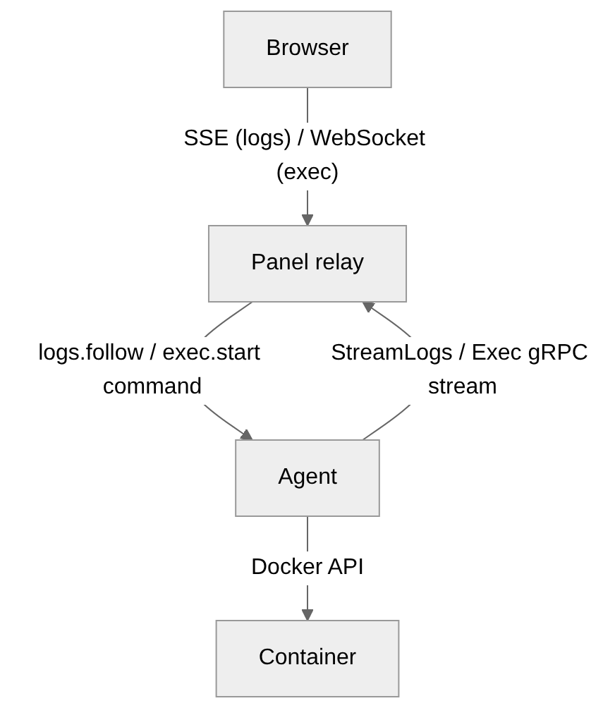

The streams are custom routes registered in `OnServe` that check the PocketBase auth token. Nothing that passes through them is stored: the database sees only the commands that open and close them.

- **Logs** – `/api/pc/hosts/{id}/logs` (chosen containers) and `/api/pc/stacks/{id}/logs` (every container of a stack) are server-sent events. The first viewer of a set of containers queues `logs.follow` with a random session id, and the agent opens `StreamLogs` with it, in batches of at most 200 lines. Later viewers share that stream and start with up to 1,000 recent lines. A viewer that reads too slowly loses lines instead of holding up the others, and is told how many. The stream starts with an `open` event, so the page shows it as live before the first line arrives. The last viewer to leave queues `logs.stop`.
- **Command output** – `/api/pc/commands/{id}/output` streams what a running command writes, such as a deploy, and ends with its final state; for a finished command it sends the stored output.
- **Terminal** – admins only. `POST /api/pc/hosts/{id}/terminal` checks what may be opened and returns a ticket that works once within 30 seconds, because a WebSocket cannot carry an `Authorization` header and a token in a URL ends up in logs. The browser opens `/api/pc/terminal/socket` with the ticket, the panel queues `exec.start`, and the agent joins with an `Exec` stream to `docker exec` with a TTY. The socket accepts the origin of the public URL and of `localhost` (for a Vite dev server), a session without input or output ends after 30 minutes, and its start and end are security events in the audit.
- **Host shells** – opt-in per agent (`HOST_SHELL_ENABLED=1`, stored as `host_shell_enabled`). The agent then starts a short-lived privileged helper container (`alpine`, host PID namespace) and runs `nsenter -t 1 -m -u -i -n -p -- /bin/sh -l` in it; the helper is removed with the session.

## Metrics

Every 10 seconds the agent samples the host (CPU, memory, load, network, usage of each mount) from `/host/proc` and `/host/sys`, and its running containers from the Docker API, and sends the batch with `PushMetrics`. The panel writes it to `pb_data/metrics.db`, outside PocketBase, and rolls it up to 1 minute and 1 hour ([ADR 0003](adr/0003-metrics-storage.md)). `/api/pc/metrics/hosts/{id}` and `…/containers/{docker id}` return a window of 1 hour, 24 hours or 7 days. The same database keeps, by the hour for 48 hours, each hostname's requests and their durations, in the buckets of Caddy's `request_duration` histogram, with the 5xx count, which a site's page turns into p50, p95 and the share of errors; the latest values stay on the `hosts` record from the heartbeat. A host's CPU is a share of all its cores; a container's is on the scale of `docker stats` and `top`, where 100 % is one core, so a busy container on a four-core host can show up to 400 %.

## Static sites, domains and TLS

Servers with the `edge` role run Caddy in its own container (`pocketcloud-edge`) managed by the agent, so agent updates never interrupt traffic ([ADR 0002](adr/0002-edge-proxy-integration.md)). The panel generates each edge's complete route table from sites, domains and container labels and sends it with `edge.apply`; the agent loads it through Caddy's admin API on a Unix socket, which keeps the last good config when a new one is invalid.

### Edge proxy

- **Image** – the official Caddy image, pinned by the digest of its multi-platform index in `internal/version` (`EdgeImage`, `EdgeVersion`, `EdgeDigest`), because the panel generates configs for exactly that version. CI loads the generator's golden configs into the pinned image with `caddy validate`. A panel release with a newer pin replaces every edge container: the panel regenerates every edge's config when it starts. Each edge is then down for about three seconds (2.8 s measured on a VM under load): the old Caddy stops taking connections as its 2-second grace period for requests under way begins, and the new one serves its saved config a few tenths of a second after it starts.
- **Container** – created by the first `edge.apply`, named `pocketcloud-edge`, labelled `pocketcloud.role=edge` (protected like the agent), on the network `pocketcloud-edge`, publishing 80/tcp, 443/tcp and 443/udp (HTTP/3), with every capability dropped but binding low ports, without new privileges, restarted unless stopped. It runs `caddy run --resume`.
- **Shared directories** – the edge mounts four directories of the agent's own volume, and nothing else of it: `edge/run` (the admin socket), `edge/certs` and `edge/acme` (read-only), and `edge/config` (Caddy's autosave, so a new container resumes the last config by itself). They are volume subpaths on Engine 26 and newer, and binds of the volume's directory on older engines; after creating the container the agent checks that the engine mounted exactly that, as an engine that ignored a subpath would expose the agent's identity. The agent's own mounts stay as they were, so updates and the install command are unchanged.
- **Config** – the panel builds it from the edge's domains (`internal/edge`): port 80 answers ACME HTTP-01 challenges from `edge/acme` first, then redirects to HTTPS or serves the route; port 443 exists only when certificates are installed, loaded from files, with automatic HTTPS off, so Caddy never obtains or renews anything by itself. Routes are sorted by name, exact names before wildcards. `reverse_proxy` keeps WebSockets through a reload (`stream_close_delay` 24 h), there is no grace period, so requests under way finish, and Caddy's request metrics are on. The agent always sets its own admin block, so no config can move the admin API out of its reach.
- **Applying** – the panel sends `edge.apply` when a domain, a certificate or the edge role changes, and when a heartbeat shows the edge serving another config than the one it wants (the heartbeat carries its digest), as after a reinstall or a command that expired while the server was away. A certificate goes there with `cert.install` before the config that uses it; both are ordered by the edge's resource. A newer config replaces a queued one, and a config the edge refused is not sent again by itself: the server page's Apply again sends it anyway. Without the edge role the edge is removed, with its keys; the role cannot be taken while domains need it.
- **On the agent** – a refused config fails the command with Caddy's error and the old one stays active. A new image replaces the container, and the old one comes back if the new Caddy refuses the config. Ports already taken are named in the error, by the container that holds them when there is one, and the container that could not start is removed. The agent keeps the last config, brings back a missing or stopped edge when it starts, and puts upstream containers back on the edge's network when Compose recreates them. The edge's self-check reads the agent's own edge state, not the roles of its enrollment.
- **Domains** – a domain names its edge, a container of that server and its port, or a redirect, and its TLS: `auto` serves it over HTTPS when a certificate covers it, `off` keeps it on plain HTTP. HTTPS redirect, HSTS and compression are options. Until #25 a container reaches the edge's network through `edge.apply`'s list of upstreams, which the agent connects; containers on that network can reach each other.
- **Certificates** – besides those from ACME (see *Certificates* below), admins upload a chain and its key (`POST /api/pc/certificates`): they must belong together, name hostnames and not have expired. The key is sealed and hidden from the API, and reaches an agent only inside the `cert.install` it needs, filled in at delivery. The files on an edge are named after the record and the leaf's fingerprint, so a renewal is a new config; `cert.remove` refuses files a config still uses, as Caddy would not start again without them.
- **Server page** – every route with the TLS state it is served with (valid until a date, expiring within 14 days, expired, being installed, or HTTP only), the edge's state and its requests per second.

### Domains from Compose labels

A service is published with a label in its `compose.yaml`, not with a separate reverse-proxy setup (#25):

```yaml
services:
  umami:
    image: ghcr.io/umami-software/umami:postgresql-v2
    labels:
      pocketcloud.domain: umami.example.com, www.umami.example.com
      pocketcloud.port: "3000"          # needed unless the service names one port in expose or ports
      pocketcloud.tls: acme             # the default; off keeps it on plain HTTP
      pocketcloud.auth: "bob:$$2y$$05$$…" # optional: user:bcrypt-hash, separated by commas
```

- **Deploy** – after every deploy that succeeds, the panel reads the labels of the deployed revision, with its variables and secrets, and makes the stack's *label domains* what they say: a domain of the stack's server for each hostname, to the service's first container (`<stack>-<service>-1`, or its `container_name`) and port. From there a label domain is a domain like any other: its DNS records (#22), its certificate (#23) and its route on the edge follow, and the edge attaches the container to the `pocketcloud-edge` network. The same labels again change nothing.
- **What is wrong** – a label that cannot be used is reported on the stack page with its line, and in the editor as a warning while it is typed: a missing or ambiguous port, a hostname that is not one, a hostname that another service or domain has already (a label never takes a domain added by hand, or another stack's), a password that is not a bcrypt hash. The editor checks the services that `COMPOSE_PROFILES` turns on; a label whose value comes from a secret is checked at the deploy, when the secret is known. `pocketcloud.tls=internal` gives the domain a certificate of the internal CA, for a LAN name (#26).
- **A label with a mistake** – holds its service's domains as they are until it is fixed: a mistake does not take a service off its domains, and does not count as a removed label.
- **Backups** – `pocketcloud.backup` and its companions make backup jobs of the stack's services the same way, after every deploy that succeeds (see *Backups*).
- **Removing a label** – removes nothing by itself: the domain stays and the edge keeps serving it, marked on the stack page and the Proxy tab, until an operator removes it, or keeps it as a domain of its own (on either page). A removed stack leaves its label domains the same way. A label domain cannot be changed or removed through the domains API while its label is there: the label is changed in the Compose file and deployed.
- **Passwords** – `pocketcloud.auth` puts HTTP basic authentication in front of the service. The hashes are bcrypt's (`htpasswd -nB user`, `caddy hash-password`; a `$` is written `$$` in a Compose file) and user names are letters, digits and `. _ @ + -`. A route that asks for a password is never served over plain HTTP: it redirects to HTTPS, and answers 503 until it has its certificate.
  - The hashes are sealed with the master key in `domains.basic_auth`, and the API never shows them.
  - The edge config that `edge.apply` stores names each password by a reference (`pocketcloud-secret:<id>`). The panel fills the hashes into the command's sensitive `secrets` field when it delivers it, so they are never stored with the command, and the agent puts them into the config just before Caddy loads it.
  - The inventory stores a container's labels with the value of `pocketcloud.auth` hidden.
  - A domain kept with a password keeps it, and so stays the domain of a container behind HTTPS; removing the domain drops the password.

### DNS providers and zones

The panel keeps a domain's A and AAAA records itself, through the provider's API (#22, [ADR 0001](adr/0001-acme-and-dns-libraries.md)); only the DNS servers of a LAN are reached through an agent. `internal/dns` puts the providers behind one interface:

- **Providers** – Cloudflare through libdns/cloudflare, Hetzner DNS and WEDOS through adapters of their own: libdns/hetzner deletes and updates records by name and type alone, so it could remove someone's own record of the same name, and libdns/wedos sends the zone with its final dot and returns no error when WAPI refuses a request, so a refused IP address looked like an empty zone. A *manual* provider has no API. Admins connect one under Domains & TLS; its credentials are sealed with the master key and never leave the panel. "Test" asks the API and says in words what failed (a refused token, a missing permission, WEDOS's allow-list). The Hetzner adapter uses the API of the Hetzner DNS Console (`dns.hetzner.com`), which Hetzner is moving into its Cloud Console: watch for its end. Cloudflare records that are proxied (orange cloud) keep their proxy, so they never resolve to the server's address: turn the proxy off for names PocketCloud manages.
- **Zones** – Cloudflare lists them, through every page (libdns/cloudflare asks for the first 20 only); Hetzner's and WEDOS's are named when they are connected and checked by reading their records. A zone is *managed* by default; one that is not keeps its records, and PocketCloud forgets the ones it made there. A hostname belongs to the longest zone that is the name or one of its parents.
- **Records** – a domain in a managed zone gets an A record for its server's public IPv4 address and an AAAA record for its IPv6 address (`hosts.public_ip4/6`, set on the server's Proxy tab: the addresses the agent reports are its interfaces', which may be private behind NAT; an address the internet cannot reach is refused). They are set by PocketCloud itself, not with the providers' SetRecords, which differ: the missing records are added first, then every other A or AAAA record of the name goes (an old AAAA of a server without IPv6 too), and nothing else in the zone is touched; and they are tracked in `dns_records` by zone, name, type and value, as libdns does not expose the providers' record ids. A domain that moves, or whose server's addresses change, gets new records and loses the old ones; a removed domain takes its records along. A sync of a domain whose records are all set already changes nothing, drift included.
- **Manual mode** – a domain in no managed zone, or in a zone of a manual provider, shows the exact records to create (`GET /api/pc/domains/{id}/dns`).
- **Propagation** – every minute the panel asks the public resolvers (1.1.1.1, 8.8.8.8) and the zone's own name servers, found by walking up the name, about the records of domains that wait for them, set just now or created by hand. It sends raw DNS queries for the fully qualified name, not through the system's resolver, which would answer from `/etc/hosts`. The domain is done once every server answers exactly the wanted values. A domain whose records could not be set is tried again every five minutes.
- **Drift** – every 15 minutes the records of managed zones are read back; one that was removed or changed outside PocketCloud, or another address next to PocketCloud's, marks its domain *changed outside*, with an event, until the zone is right again. "Set the records again" puts them back. The same check retries the removal of records whose domain is gone, if it failed.
- **Alerts** (#27) – a provider whose API fails, for itself or for one of its managed zones, has an open alert (`dns_provider_failed`, its target the provider), with what failed: "WEDOS (WAPI): WAPI refuses requests from …". For a kind that cannot list its zones (Hetzner, WEDOS, AdGuard Home, Pi-hole) the API is asked about each zone, and only the managed ones count, or any when none is managed. The alert resolves when the provider and its managed zones answer again, a failing zone is no longer managed or is removed (the provider is asked again then), or the provider is removed. The drift check asks a failing provider again every 15 minutes (a DNS server of a LAN once an hour), so one that answers again recovers without anyone pressing Test.
- **DNS servers of a LAN** (#26) – AdGuard Home (its DNS rewrites, `/control/rewrite/*`, with the username and password of its web interface) and Pi-hole v6 (its local DNS records, `dns.hosts` and `dns.cnameRecords` of `/api/config`, with a session that is signed in with its password and closed after each change, as Pi-hole has few seats; an app password needs `webserver.api.app_sudo`; a change of `dns.cnameRecords` restarts Pi-hole's DNS server, even with `?restart=false`, so the agent waits until its uptime says it is back before the next request). The panel usually cannot reach them, so each is connected with a server on its network (`dns_providers.host`), and every read and change is a `dns.rewrite` command of that server's agent (`internal/dns/rewrite`); the panel adds the address and the credentials when it delivers the command, so neither is stored with it, and fails at once while the server is offline. Their zones are named by hand, and one label is enough (`lan`, `home`, or `home.arpa`). A name in such a zone points at its server's address on its network as its agent reports it (`hosts.ip4/6`, private addresses allowed), and follows it when it changes; the server that took a record answers it at once, so the domain's DNS is ok without a propagation check, and its drift is read once an hour, which keeps the command history readable. Only A, AAAA and CNAME records can be rewrites, so these zones never answer DNS-01: the zone around them does. A list that came back from the agent without its result is an error, not an empty zone.
- **Tests** run libdns/cloudflare's own code against a fake of Cloudflare's API (`internal/dns/fakecloudflare`), the Hetzner and WEDOS adapters against fakes of their APIs, the AdGuard Home and Pi-hole clients against fakes of theirs (`internal/dns/rewrite/rewritetest`), and the DNS queries against a local DNS server. No real Cloudflare, Hetzner or WEDOS account has been used; AdGuard Home v0.107.65 and Pi-hole 2025.08.0 were checked in containers.

### Certificates

Certificates are issued **centrally by the panel** with lego ([ADR 0001](adr/0001-acme-and-dns-libraries.md)), stored encrypted and distributed with `cert.install` to every edge that serves the names (#23), and the panel's own for its UI and API (#63). One ACME account, wildcard reuse across servers, and a single place to see expiry. `internal/acme` registers an account or issues one certificate when it is asked to; the panel decides when, for which names and how.

- **Accounts** – admins set them in Settings (`PUT /api/pc/acme-accounts/{primary|fallback}`): a CA (Let's Encrypt, its staging CA for trying things out, ZeroSSL, or any ACME directory over HTTPS) and a contact email, plus the EAB key ID and HMAC key that ZeroSSL hands out. Saving registers the account at the CA, agreeing to its terms; one the CA refuses is not kept, and the CA's answer says why. The account key (ECDSA P-256) and the HMAC key are sealed with the master key. A change of CA, email or binding is a new account with a new key. An account the CA has forgotten, as after a reset of a staging CA, is registered again with its key. The fallback account is tried when the primary one fails, or cannot be used, in the same attempt. An admin's request can name one of them (`account`), and is then asked of that CA alone, without the other, for its renewals too (#27). Removing an account leaves the certificates asked of it to the accounts there are, in turn; one whose account is gone otherwise fails, says which account it needs, and raises the alert. An account change cannot be reverted from the audit log, as the key and the registration would not come back: it is set again.
- **What gets a certificate** – every domain with automatic TLS that no certificate valid now covers gets an order of its own as soon as it is saved (`auto`; the edge serves it over plain HTTP until then), unless one from ACME covers it already. Admins request others, such as a wildcard or several names in one (`POST /api/pc/certificates/acme`, with `issuer: internal` for the internal CA). An order for a domain that went away before it was issued goes with it; an issued `auto` certificate that no domain needs any more is not renewed. Without an account, orders wait and say so.
- **Challenges** – *auto* takes HTTP-01 when every name is served by an edge whose server has a public address, and DNS-01 for wildcards and for names an edge cannot answer for, when their zone is managed through a connected provider (#22); either can be asked for instead. **HTTP-01**: the panel sends `acme.challenge.present` to the edges that serve the name, which write the answer into the directory Caddy serves at `/.well-known/acme-challenge/<token>` on port 80, waits until they did, and removes it after with `acme.challenge.cleanup`; it starts only once the edge serves its current config and, for a domain in a managed zone, once the A and AAAA records PocketCloud set for it are visible; if an edge does not put the answer in place, the others remove theirs. **DNS-01**: the panel adds a TXT record `_acme-challenge.<name>` at the provider next to any others (a name and its wildcard share one), waits until every name server of the zone answers it (asking the public resolvers would make them cache its absence), and removes it after. lego does not follow a CNAME of `_acme-challenge` into another zone.
- **Renewal and failures** – a certificate renews 30 days before it expires, or a third of its lifetime before for a short one, in place: the same record gets the new chain and key, the edges install the new files, then serve them, and the old files go. A failed attempt keeps what the edges serve and is tried again after 5 and 15 minutes, 1, 4, 12 and 24 hours (3 hours at least after the CA's rate limit), and at most 5 times a day; Retry starts one now, past the backoff but not past the daily limit, for a certificate that needs one: a certificate that is fine is not issued again, which would use up the CA's rate limits (Let's Encrypt issues the same names 5 times a week). Each attempt checks again that it is due and that its domain is still there. The certificate keeps the CA's or the provider's own words, one line per name, with a hint of what to check, and its last 20 attempts (`history`). Every minute the panel looks for what is due; at most two certificates are issued at once.
- **Alerts and events** – `certificate.issued`, `certificate.renewed` and `certificate.failed` events; an alert when an attempt fails (critical when the certificate it would replace expires within 7 days), and one for every certificate an edge serves a domain with that expires within 14 days, whoever issued it, which turns critical within 7. Both resolve with a new certificate, when the certificate is removed, and, for the second, when the edges serve a newer one.
- **LAN names** (#26) – a domain with internal TLS (`tls = internal`, or the label `pocketcloud.tls=internal`) gets a certificate of the internal CA: the *PocketCloud LAN* intermediate signs it at once, without an ACME account or a check of the name, for 397 days (browsers allow public CAs 398, Apple's platforms a root a user installed 825), and it renews like one from ACME. A domain takes only certificates of its kind: internal TLS one of the internal CA, automatic TLS any other, as a certificate that only some devices trust must not replace a public one; on the edge each name's handshake serves the certificate its route has (a TLS connection policy per name), not any loaded one that covers it. The internal CA signs only names of the LAN, as it checks nothing and every device with the root installed would trust what it signs: names under `home.arpa`, `internal`, `local`, `lan`, `home` or `localdomain`, under a top-level name the Public Suffix List does not know, or in a zone of AdGuard Home or Pi-hole (split horizon). A domain with internal TLS for any other name is refused, whether an operator or a label asks, and so is such a request by an admin; the panel checks the names again before it signs. A wildcard of a public suffix or of a top-level name (`*.lan`, `*.home.arpa`, `*.co.uk`) is refused, as Chrome refuses it; `*.home.lan` works. The internal CA does not wait for the slots of ACME issuances. Browsers trust the certificates once the root is installed: the internal CA's card on Domains & TLS offers the root and the steps for Windows, macOS, Linux, iPhone and iPad, Android and Firefox, with the root's SHA-256 fingerprint to compare (`GET /api/pc/ca`). A device that trusts the root trusts every certificate the panel signs, for any name, so it belongs only on one's own devices.
- **Domains & TLS** (#27) – the page of the design:
  - **DNS providers** as a grid of cards: each with its zones, its state, and either what it uses and when it was checked, or what failed and how to fix it, with *Manage* or *Fix*. A last card names the kinds not connected yet, and is the way to connect the first one.
  - **The panel of a provider** (Manage): its state and error, what its kind needs, the server whose agent reaches a DNS server of the LAN, its zones (managed or not; for kinds that do not list them, added and removed by hand), new credentials, which replace the old ones and are tested at once, Test and Remove.
  - **Certificates**: names, issuer, how they were checked, the validity left as a meter with its days, the edges that have it, and one action: *Detail* (the chain, the dates and the history), *Progress* while it is issued, or *Retry* when it failed, next to Detail; filters for all, those that need action, and those of the internal CA (#26).
  - **Zones**: the provider, how many names PocketCloud keeps in each and which, and its state.
  - **Issue certificate**: names, the CA (the ACME accounts in turn, the default, which asks one set later too; one of them alone; or the internal CA) and the challenge.
  - **Warnings lead here**: an alert about a certificate or a provider on the Overview links to it (`/domains?certificate=<id>` opens its details, `/domains?provider=<id>` brings its card into view), and the navigation marks Domains & TLS while one is open.
- **The panel's own** (#63) – with `--https-addr` the panel serves its UI and API over HTTPS with a certificate for its public URL's name. It is a certificates record like an edge's, with `panel` set, ordered once an account is set and renewed, retried, alerted about and shown on Domains & TLS the same way, but never sent to an edge nor chosen for a domain. The listener PocketBase serves on is wrapped in TLS (PocketBase's own `--https` and autocert are not used, and refused beside `--https-addr`); `--http` becomes the panel's plain port, which answers the CA's HTTP-01 for the panel's name and redirects everything else to the public URL. *Auto* takes HTTP-01 unless the plain port listens on a loopback address only or an edge serves the name as a domain (its port 80 is the edge's), and DNS-01 then, through the zone's provider; `--https-challenge http-01` is tried on a loopback address too, for a port forward or a proxy that reaches it, and the CA's answer says if nothing does. The plain port's redirect keeps the path and query only, so no request target can lead to another host. Each handshake for the panel's name gets the ACME certificate as stored at that moment, so a renewal is served at once; any other name, and the time before the first certificate, gets the internal CA's gateway certificate. The gRPC gateway keeps the internal CA ([ADR 0007](adr/0007-the-gateway-keeps-the-internal-ca.md)).
- **Tests** run lego against Pebble, the ACME server Let's Encrypt publishes for testing clients, in the test's process (`internal/acme/acmetest`), with a DNS server of the test's own that answers from the fake Cloudflare: HTTP-01 through a real agent's edge files and through the panel's plain port, DNS-01 for a wildcard and for the panel, a renewal of a 30-second certificate, failures, the daily limit and the fallback CA. No real CA has been used: issuing from Let's Encrypt's staging CA needs a public edge and a real DNS zone.

New site provisioning (one parent command):

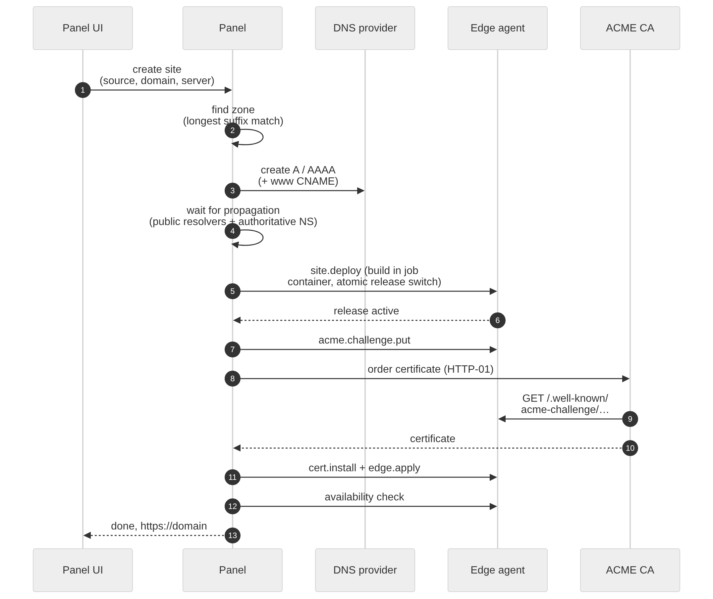

The wizard (`/sites/new`, #24) sends the site, its name on the web, whether `www` goes with it and the certificate's challenge to `POST /api/pc/sites/provision`; while the name is typed, `GET /api/pc/dns/preview` says which zone holds it, whether the records are set at a connected provider or by hand, and which records they are. The panel creates the site and runs the rest as one parent command, `site.provision`, with a child command per step, one after the other:

1. `site.create` – the site, on its server. It does not start the first deployment a new site starts by itself; a ZIP sent with it is recorded and held until its step.
2. `site.dns` – its domain, and for `www` an alias domain that redirects to it permanently (308, which keeps the method, where the design said 301) with a CNAME to its name; the records at the zone's provider, or in manual mode the records to make at the registrar. One certificate is ordered for both names, under the ACME manager's planning lock, so it orders none per domain; the order waits for the certificate step. A domain left from an earlier attempt has its records set again.
3. `site.propagation` – until the public resolvers and the zone's name servers answer the records: every few seconds at first, then once a minute after five minutes, for up to 48 hours, as records made by hand can take a while.
4. `site.deploy` – the first deployment, the agent's own command; the timeline shows its build and its release from its progress.
5. `site.certificate` – the step asks the CA itself, past what an earlier attempt said but not past the CA's daily limit, and ends once a valid certificate for both names is on the edge, whichever certificate the edge picked.
6. `site.check` – an HTTPS request at the server's public address with the site's name, as a visitor's once the name resolves there, with the system's roots; it must not answer an error (401 counts, a site may have a password), and the `www` name must redirect to it. It asks every 3 seconds for a minute.

A name in a zone of a DNS server of the LAN (#26), such as `wiki.lan` at AdGuard Home, is set up the same way with three differences: its domains have internal TLS, so the certificate comes from the internal CA at once and no ACME account is needed; propagation ends as soon as the DNS server took the records; and the check asks the server's address on its network, trusting only the internal CA's root.

A step that fails pauses the setup for up to a day, and so does a step that cannot even start, such as a deployment of a site whose source became an upload meanwhile: Retry (`POST /api/pc/provisions/{id}/retry`) runs it again as a new command, once even when asked twice at once, and the history keeps the failed one. A setup that is cancelled, or not retried in time, cancels the step under way and removes the domains it created, and with them their DNS records; the site stays, to be deployed or removed. Setups go on after a panel restart.

### Static sites

A site lives on one edge server (#21). Its releases are on the `pocketcloud-sites` volume: `<site>/releases/<n>`, one directory per deployment that succeeded, and `<site>/current`, a symlink to the release the edge serves. The edge mounts the volume read-only at `/srv/sites`; the agent's own container does not mount it, and changes it through job containers.

- **Sources** – a Git branch over HTTPS (with an access token for a private repository), a ZIP upload, or a placeholder page that says the site has no content yet. A site from Git or with the placeholder is deployed when it is made.
- **Deployment** (`site.deploy`, one command per deployment, in order per site):
  1. `pocketcloud-agent site-tool source` runs in a job container from the agent's own image, with the volume mounted. It makes `<site>/.build/<n>/src` and fills it: a shallow `git clone` of the branch with its submodules (the token goes to Git in its environment, never on a command line or into the log, and as a header for the repository's own HTTPS server only, so a submodule elsewhere never gets it), the upload fetched from the panel with `FetchArtifact` and checked by digest (unpacked from inside its folder when it holds one; symlinks and paths that leave it are refused), or the placeholder.
  2. It picks the build: the site's own image, command and output, or what the files say: Hugo (`hugo --minify` in `ghcr.io/gohugoio/hugo:v0.152.2`), MkDocs (`mkdocs build` in `squidfunk/mkdocs-material:9.6.14`), Astro and npm projects with a build script (`npm ci`, or `npm install` without a lock file, then `npm run build`, in `node:22.20.0-alpine3.22`), or none, serving the files as they are.
  3. The build runs in a job container from that image, as root in the container but with only the capabilities package managers need (file ownership, setuid and setgid, kill), no new privileges, at most 4096 processes, 1 CPU and 2 GiB unless the site says otherwise, and only its own source mounted, through a volume subpath. Its output is the deployment's log.
  4. `site-tool release` moves the output (`dist`, `build`, `out`, `public`, `_site` or `site` with an index.html, unless the site names one) into `releases/<n>` without `.git` or symlinks, adds gzip copies of the files that compress, renames a new symlink over `current`, keeps the newest releases (5 by default) and the one served, and removes the build directory.
     - A build must leave its output: when none is found, the deployment fails instead of serving the source with its dependencies. Only a site served as it is serves its source.
     - The output must be a real directory inside the source: one reached through a symlink, which a repository or a build can make, could take another site's files from the volume.
     - Once the switch happened, a cancel or a failed clean-up no longer turns the deployment into a failure.
  A deployment that fails anywhere removes what it left, a release that never went live included, and keeps the served release; the panel records the error and an event. An agent that stopped during a deployment removes, when it starts again, the job containers and the build directories it left.
- **Rollback** (`site.rollback`) renames `current` to a release still on the server, without a build; the panel offers it only for those. On the edge it is a single rename, so the next request gets the older release.
- **Webhooks** – `POST /api/pc/hooks/sites/{id}` takes a push without an account: GitHub and Gitea or Forgejo sign the body with the site's secret (`X-Hub-Signature-256`, `X-Gitea-Signature`), and GitLab sends the secret (`X-Gitlab-Token`). A push to the site's branch deploys it, with the commit and its message; anything else is answered 202 and ignored.
- **Serving** – a domain with the site as its target gets a route that serves `/srv/sites/<site>/current`, with the site's options for all of its domains: HTTPS redirect, HSTS, compression (the release's gzip copies, or zstd and gzip on the fly), a fallback to `/index.html` for single-page applications, its own 404 page (for the errors of its own route only, not of a site under its wildcard), response headers and cache times per path, and basic auth. Switching a release needs no reload of Caddy.
  - A site with a password needs HTTPS on every domain: a plain HTTP domain and a password are refused together.
  - A server keeps its edge role while sites are on it.
- **Requests** – Caddy counts requests per hostname (`per_host` metrics), once per request under the first handler of its route, each heartbeat reports what each hostname had since the previous one, and the panel keeps them per hour for two days in the metrics database, for the site's chart of the last 24 hours. A wildcard domain counts the names one label below it, except names that another domain on the same edge serves.
- **Uploads** – kept by the panel with their deployment while its release is on the server; the newest one stays, as deploying again uses it.
- **Secrets** – the Git token and the passwords are hidden from the records API: they are set with the create or update of the site, or through `/api/pc/sites/{id}/credentials`, and only the users' names and whether a token is set are shown.
- **Removal** – removing a site removes its domains, its deployments with their uploads, and with `site.remove` its directory on the server. A PHP site's backup job `<site>-files` stays, disabled, with its snapshots (#53).

LAN-only names use DNS rewrites (AdGuard Home, Pi-hole) and certificates from the internal CA (see *DNS providers and zones* and *Certificates*).

## PHP sites

A PHP site is a site with `type = php`. Its code is deployed exactly like a static site (releases and a `current` symlink on the `pocketcloud-sites` volume); requests for PHP scripts are executed by a dedicated PHP-FPM container per site, everything else is served by the edge directly.

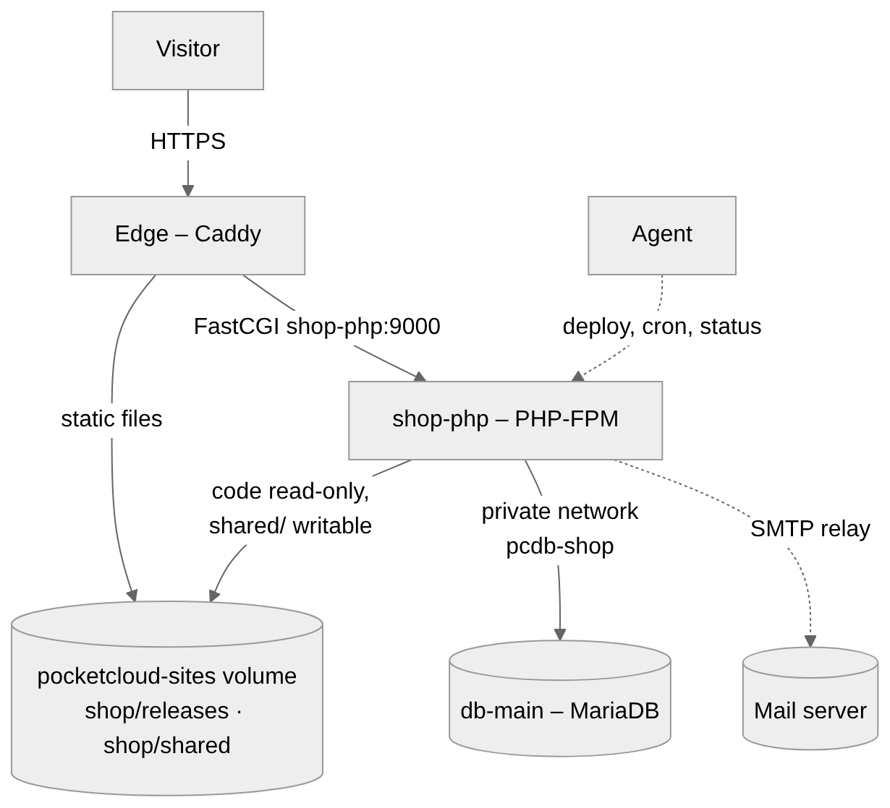

- **Runtime image** – `ghcr.io/oldbear24/pocketcloud-php:<version>-fpm`, built in CI from the official `php:<version>-fpm` images for every supported PHP version (currently 8.2–8.5; the UI warns before a version reaches end of life), multi-arch. It adds the common extensions (opcache, mysqli, pdo_mysql, pdo_pgsql, gd, intl, zip, exif, imagick, redis, bcmath, and pcntl for queue workers such as Laravel's), `msmtp` as `sendmail`, WP-CLI, Composer and a small status helper that reports the FPM pool and OPcache state. Sites that need more extensions use an image derived from it.
- **Versions and their support** – `images/php/versions.json` lists every PHP version an image is built for, with the dates its active and security support end and the Debian release of its official base. CI (`.github/workflows/php.yml`) builds an image for each version that still has security support: daily when the official base image changed, weekly regardless, each rebuild passing `images/php/smoke-test.sh` (WordPress and Laravel served through Caddy's `php_fastcgi`) and a Trivy scan before it is pushed and signed with cosign; a release records the digests current at the time in `image-digests.json`. The panel embeds the same manifest (`internal/php`, `GET /api/pc/php/versions`) and warns from 90 days before a version's security support ends: PHP 8.2's ends on 31 December 2026.
- **Inside the image** – FPM runs as `www-data` with `pm = ondemand`, workers' output and PHP's errors on stderr, `php.ini-production` with `expose_php = Off` and a tuned OPcache. FPM's status page and ping are at paths made up anew at every start and known only inside the container (FPM answers them on the pool's port too, as it has no way to keep them to its status listener, but a client outside cannot know the paths, and the edge sends only `.php` scripts to FPM); `pocketcloud-php-status` reads them over a Unix socket in the container and OPcache's statistics as one JSON object for the agent, and `-ping` is the health check. `mail()` goes through `msmtp` to the relay given in `POCKETCLOUD_SMTP_*`; the password is written to a file and unset before FPM starts. WP-CLI runs with `WP_CLI_MEMORY_LIMIT` (512 MB) rather than FPM's limit.
- **One container per site** – `<site>-php`, labelled `pocketcloud.role=site`, on a network of its own, `pcsite-<site>` (labelled `pocketcloud.role=site-network`), under the alias `<site>-php`; the edge joins every such network, and nothing else does. The design first put these containers on `pocketcloud-edge`, but every container there could then reach port 9000, and FastCGI lets a client pass any PHP setting (`PHP_ADMIN_VALUE`, `auto_prepend_file`), which would run code as that site: so the network is the site's own. The container runs as `www-data` with CPU and memory limits (1 CPU and 512 MB by default), a PID limit, every capability dropped and `no-new-privileges`, without the Docker socket and without published ports; it stops with `SIGQUIT`, which lets requests finish. Its seccomp profile is Docker's default without `symlink` and `symlinkat` (`internal/agent/seccomp`), and so is the release hook's: the edge mounts the whole sites volume and follows links, so a link that a site's code made in its uploads could otherwise serve another site's files. The links PocketCloud makes (`current`, the shared paths) are made by the site tool, which works through an `os.Root` of the site's directory, so a link in `shared/` cannot lead it into another site either. The agent acts only on containers and networks that carry the site's labels: a container someone else named `<site>-php` is left alone. It mounts only its own site directory from the sites volume (Docker volume subpaths, Engine 26+) at the same path the edge uses (`/srv/sites/<site>`), read-only, with `shared/` mounted read-write on top; the agent checks the mounts before it starts the container, as an engine that ignores subpaths would mount the whole volume. The pool (`zz-pocketcloud-site.conf`) and `php.ini` lines (`zzz-pocketcloud-site.ini`) are copied in before the start; `open_basedir` is limited to the site directory and `/tmp`, and temporary files, uploads and sessions go to `/tmp`. A site with a database also joins `pcdb-site.<site>`, the database network its server joins.
- **Modes** – in `releases` mode (the default) the code is read-only and PHP writes only in the shared paths; `classic` mode, for applications that write into their own code, mounts the site directory read-write and keeps one release.
- **Applying settings** – `site.php.apply` makes the container match the settings: it pulls the image (an image the server already has serves on while its registry cannot be reached), and when anything changed it renames the running container to `<site>-php-old`, starts the new one, waits for its ping and stops the old one, so the alias always answers. The settings' state (`pending` / `running` / `failed`), the image as pinned by its digest and the last error are kept on `site_php`.
- **Edge route** – Caddy's `php_fastcgi` as `caddy adapt` writes it: a 308 for a directory without its slash, a rewrite to `index.php` for paths that are no file, `reverse_proxy` over FastCGI to `<site>-php:9000` with `root /srv/sites/<site>/current/<docroot>` and `resolve_root_symlink`, so switching a release is atomic and OPcache never mixes files from two releases, and `file_server` for the rest, which hides dotfiles. The proxy retries a failed dial for up to 10 seconds, so a request that arrives while PHP-FPM is being replaced waits for the new one instead of getting a 502.
- **Deployments** – the build runs as `www-data` in a job container from the site's runtime image, so PHP version and extensions match production (`composer install --no-dev --optimize-autoloader` when the source has `composer.json`, or the site's own command). The release links the shared paths (a path the first release has moves into `shared/`; later releases' copies are dropped), and the release hook, such as `php artisan migrate --force`, runs in a job container from the runtime image in the new release, with the site's environment, secrets and database network, before the switch: if it fails, the release does not go live. After the switch, PHP-FPM reloads gracefully (`USR2`, with `process_control_timeout` letting requests finish); a rollback switches back and reloads. Persistent paths (`wp-content/uploads`, Laravel `storage/`, Nette `log/`) live in `<site>/shared/` and are symlinked into every release.
- **Configuration** – PHP version, FPM pool (`pm`, `pm.max_children`, `pm.max_requests`, `request_terminate_timeout`), `php.ini` lines, environment variables, the site's own secrets (sealed in `site_php`), limits, web root, shared paths and release hook are changed through `/api/pc/sites/{id}/php` and `/php/secrets`, each change applied at once. Secrets referenced as `${secret:name}` (the site's own) or `${secret:db/<name>}` (its database's password) are resolved by the panel when a command is delivered, and are never stored in a command. A secret the environment refers to cannot be removed.
- **Changing the PHP version** – deploys the live release again as a new deployment, built on the new image. On an upgrade the new PHP-FPM starts before the switch, on a downgrade after it, so the code always runs on a PHP at least as new as the one it was built for; a rollback to a release of another version does the same. The deployment builds the live release's own commit (or upload) again, not the branch's newest. A deployment that fails keeps the site on the live release's version, unless a later deployment decides. A rollback to a release of another version carries the PHP-FPM change in the same command, so the agent orders it with the switch and a failure leaves the site as it was. In `classic` mode a version change only replaces PHP-FPM, as a new release would replace what the application wrote into its code.
- **Classic mode** – for sites that update themselves (e.g. WordPress managed from wp-admin) the code directory can be writable without release history; its backup job (#53) then covers the whole site directory, `/srv/sites/<site>`, without `.build`.
- **Scheduled tasks** – a task (`scheduled_tasks`) is a command with a cron schedule in UTC (five fields, or `@hourly`, `@daily` and the like) and a timeout (5 minutes by default, a day at most), in a PHP site's container (`wp cron event run --due-now`, `php artisan schedule:run`) or in a running container of a stack's service, as a user it may name. Every minute the panel sends `task.run` for the tasks that are due; `POST /api/pc/tasks/{id}/run` runs one now. The agent runs the command with `docker exec`, in a PHP site as `www-data` in its live release, through `timeout -s KILL`, which kills it and its children at the timeout (after busybox's, which kills the command alone, the rest of its group goes too), and returns the exit code, the duration and the end of the output, which the task keeps. Viewers read that output, so the panel adds the values of the container's secrets to the run when it is delivered (a PHP site's own, its database's and the relay's password, or a stack's), never to the stored command, and the agent masks them, also a part of one left where the output was cut. A run has a process group of its own (`setsid`, or `timeout`'s), and one that is cancelled, or given up on past its timeout where the container has no `timeout`, is killed with what it started by the process id it left in a file only its user reads, as that user, who may signal its own processes where the container has no capabilities; a cancelled run is no failure. A run never starts while the one before it is still going (a warning event); a failed or timed-out run is a warning event and three in a row a critical one; the commands of runs are their history for 7 days. A schedule with both a day of the month and a weekday runs on either, as cron runs it.
- **Mail** – outgoing mail goes through the SMTP relay of the settings (`PUT /api/pc/settings/smtp`, admins), which needs a sender, the envelope sender of every message (msmtp of the image takes none from the mail; the image turns mail off without one); port 465 defaults to TLS, others to STARTTLS. Every PHP site's PHP-FPM gets `POCKETCLOUD_SMTP_*`, the password as a secret delivered with the apply, and the runtime image writes msmtp's settings for `mail()`, with a 30-second timeout. msmtp logs one line per message to FPM's log, from `mail()` and from a task alike; `site.php.mail` counts the mail sent and failed in the last day, or since PHP-FPM started when that is later, and the site page shows the latest failures with their reason. A change of the relay restarts every PHP site's PHP-FPM, without dropping requests.
- **Observability** – `site.php.status` runs the status helper in the site's container and adds the image's extensions and the sizes of the shared paths (`GET /api/pc/sites/{id}/php/status`; the workers' last requests are left out, and the command is deleted once read, as the page reads it every minute); the latency percentiles and the 5xx rate come from Caddy's `request_duration` histogram per hostname, which the agent sends with each heartbeat and the panel keeps by the hour (rather than from the JSON access log, which would mean reading every request); the PHP error log is the container's log, streamed like any other (`/php/logs`); WP-CLI or `artisan` through the web terminal as `www-data`.
- **Templates** (#52) – WordPress, Laravel and Nette are templates, YAML in `internal/phpapps/templates/` that both the panel and the agent embed. A template says how its framework's site is laid out and run: the web root, the shared paths and what backups leave out (`backup_exclude` on `site_php`, which the site's `<site>-files` job passes to restic as `--exclude`, #53), the release hook, links PocketCloud makes in each release, its scheduled tasks, `php.ini` lines, environment (rendered with the site's address) and its own new secrets, a health path, the paths that recognise its source, and for some a fresh install, an update and a worker. A site made with a template gets its defaults in its PHP settings, which can be changed after; its tasks are added once its first release is live. What a template asks of each release is read from it at every deployment: files a source lacks (WordPress's `wp-config.php`, which reads `DB_*`, `WP_HOME`, `WP_SITEURL` and keys derived from `WP_SALT` from the environment), relative links that PHP of a site cannot make under its seccomp profile (Laravel's `public/storage` → `storage/app/public`, made by the site tool through an `os.Root` of the release), shared paths emptied once the release is live (Nette's `temp/`), and an environment file written from the site's environment and secrets before the release hook (Laravel's `.env`, `KEY="value"` lines with `\`, `"` and `$` escaped, readable by `www-data` alone; PocketCloud's own `POCKETCLOUD_*` variables are left out).
  - **Recognising a source** – the wizard asks `POST /api/pc/sites/detect`: an upload's file names are read by the panel, a repository's by the agent (`site.detect`), which clones it without its files' contents (`--filter=blob:none --no-checkout`) and lists them; the Git token goes to the agent with the command, never into it. Laravel's `artisan` wins over WordPress's `wp-load.php`, `wp-includes/version.php` or `wp-config.php` and Nette's `app/Bootstrap.php`. The wizard shows "Detected: Laravel" and takes that template until one is chosen; a deployment's log says it too.
  - **WordPress** – needs a database, of MariaDB (the wizard offers only those servers, and the panel refuses others). Without a source of its own it is installed fresh: WP-CLI's `wp core download --locale=…` is the first release's build (`site_php.fresh_build`; an upload of the site's own later builds as any other), and the release hook runs `wp core install` with the title, administrator and language the wizard asked for; the administrator's password is a secret of the site (`install-admin-password`) until the release is live, added to the hook's environment when the deployment is delivered and forgotten after. Later deployments of such a site build a copy of the live release (`base_release`), as it has no source to build. In releases mode `wp-config.php` sets `DISALLOW_FILE_MODS`, lifted only in a release hook (`POCKETCLOUD_RELEASE=building`, which neither PHP-FPM nor a task has), `AUTOMATIC_UPDATER_DISABLED`, so WordPress's cron never tries to update the read-only release, and `DISABLE_WP_CRON`, and the panel runs `wp cron event run --due-now` every 5 minutes. A template's file that still carries `@pocketcloud-template` in its first KiB is written anew at every release, as a copied release carries the old one; one of the source's own is kept. "Update WordPress" (`POST /sites/{id}/php/update`, trigger `update`) builds a copy of the live release and runs `wp core update`, `wp plugin update --all` and `wp theme update --all`, with plugins and themes to add (slugs or ZIP addresses), before the release hook, which updates the database: the old release stays on the server, one rollback away.
  - **Laravel** – web root `public/`, `storage/` shared, `.env` from the panel's environment with a new `APP_KEY` (`base64:` and 32 random bytes), `APP_URL`, `LOG_CHANNEL=stderr`, and file sessions, cache and a sync queue for a site without a database (a database adds `DB_CONNECTION`, `DB_DATABASE` and `DB_USERNAME` besides PocketCloud's own `DB_*`); the release hook runs `php artisan migrate --force` when there is a database and `php artisan optimize`, which caches the configuration, routes, views and events, so a change of the environment or the secrets deploys a copy of the live release again with the new one, and PHP-FPM with it; `php artisan schedule:run` runs every minute. Its worker (`queue_worker`) is `<site>-worker`, a container from the same image with PHP-FPM's environment, mounts, limits and networks, running `php artisan queue:work` in the live release, once the site has one (the image has `pcntl` for its timeouts), started anew after each switch and rollback, in the background as it first finishes its job (`SIGTERM`, up to 60 seconds), without an alias on the site's network. The release hook clears Laravel's cached configuration before it migrates, as a copy of a release carries the old one.
  - **Nette** – web root `www/`, `log/` and `temp/` shared; `temp/` is left out of backups and emptied once a new release is live.
  - **Health** – after each release goes live, and after a rollback, the panel asks the health path of a name of the site (Laravel's `/up`, `/` for WordPress and Nette), over HTTPS, or over HTTP for a name served without TLS, as a new site's availability check does, every 3 seconds for up to a minute until it answers below 400; the deployment keeps the answer, a site that does not answer is a warning event (`site.unhealthy`), and the site's page shows it with a button back to the release before. A new site's own availability check asks the health path too.

## Database servers

Applications on the same host share a database server instead of each running its own instance. Each application still gets its own database, its own user and its own network path to the server.

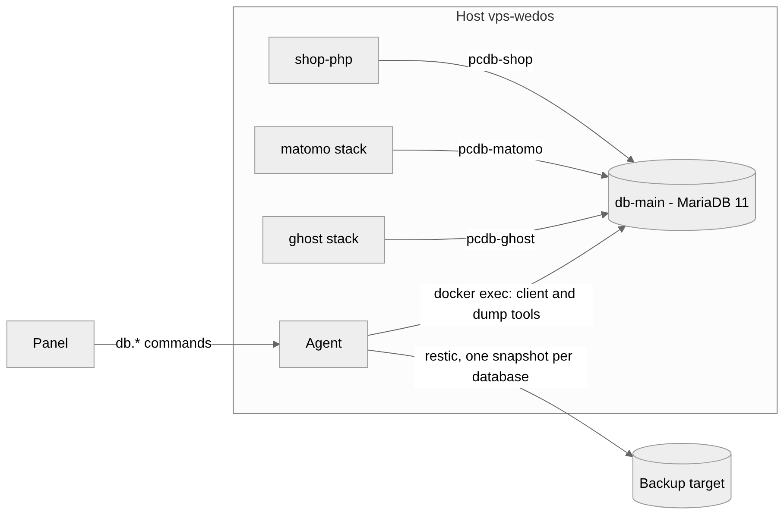

- **Servers** – a shared server is a stack of its own (`source` `db_server`) that the panel generates: one service from the official image of a series the panel offers (MariaDB 11.8 or 11.4, PostgreSQL 17, 18 or 16; the first of each is the default), its data in the volume `pcdb-<server>-data` (mounted at `/var/lib/postgresql` for PostgreSQL 18, which keeps its data in a directory of its major version), a health check, labelled `pocketcloud.role=db`, no published ports. The cache (`innodb_buffer_pool_size`, `shared_buffers`) is an eighth of the host's memory, from 128 MiB to 2 GiB; `max_connections` is 200 for MariaDB and 100 for PostgreSQL. The administrator's password is generated by the panel, sealed, and reaches the container as `${secret:db-admin/<server>}`, which only the server's own stack can use. A server is removed only once it holds no databases: its stack goes down, and its volume only when someone asks for that.
- **Dedicated servers** – database containers inside stacks (MariaDB, MySQL, PostgreSQL and its variants with extensions such as PostGIS, pgvector or VectorChord) are recognised by their image and offered for linking. The stack's Compose file suggests the administrator and the variable with the password; once linked, the server's databases are listed from its statistics as the stack's own: export and Adminer work, while users and passwords stay the stack's business. Unlinking leaves the container alone. A dedicated server without extensions says when a shared server of the same engine and the same or a newer major version runs on its host.
- **Networking** – each application that uses a server gets an internal network `pcdb-<stack>`. `db.network.attach` creates it and attaches the server under its name and the application's running containers. Every later deploy keeps them there through `compose.pocketcloud.yaml`, an override the panel generates with the network as external, and so does the server's own deploy, which joins every network of its applications; the agent creates the networks before Compose runs. Applications reach `db-main:3306`, but not each other.
- **Databases and users** – `db.database.create` creates a database and a user with privileges on that database only (PostgreSQL also revokes `PUBLIC`'s access), with a password the panel generates and keeps as the secret `db/<database>`; database names are unique per host. Connecting a stack adds `DB_HOST`, `DB_PORT`, `DB_NAME`, `DB_USER` and `DB_PASSWORD=${secret:db/<database>}` (and `DATABASE_URL` for PostgreSQL) to its env file as a new revision, attaches its network and redeploys it if it runs. References resolve per host: any stack of the host can name any database there, as operators manage every stack anyway.
- **Operations** – rotate a password (the new one waits in `pending_password` until the server has taken it, then the application is redeployed with it), clone a database, export it as gzipped SQL (uploaded with `UploadArtifact`, kept 7 days, admins only), restore it from one of its backups (#53, below), drop it after a final dump that is kept 30 days; nothing is dropped when the dump fails. Its temporary copies, a restore test's and the data a PostgreSQL restore in place replaced, go with it, and its backup job stays, disabled, with its snapshots, which a restore puts into a new database (#53). A drop also takes the variables the panel added out of the stack's env file, as a new revision, since a reference to the dropped database's secret would make the stack's next deploy fail; lines someone changed stay. The agent runs the server's own client inside its container with `docker exec`: passwords and SQL travel in the exec environment, never on a command line, and error messages are masked.
- **Adminer** – admins only, for 30 minutes. `db.adminer.start` starts `adminer:4`, listening on IPv4 because its default `[::]` fails where containers have no IPv6, on an internal network of its own (`pcadm-…`), which the server joins under its name and the agent joins to reach it, with a small plugin that signs in with credentials from the container's environment: the database's own user, or the administrator for a dedicated server. The panel serves it under `/api/pc/adminer/<session>/` through the `Relay` stream, one numbered connection per request. The link carries a one-time ticket that becomes an HttpOnly, SameSite=Strict cookie for that path, and the proxy passes on neither the panel's token nor that cookie. Nothing is published on a port and other containers cannot reach it; only processes on the host itself can, as with every Docker bridge network. The agent removes the container and network when the session ends, when the panel ends it (a panel restart ends every session), and on its next start whatever a previous run left behind.
- **Monitoring** – `db.stats` reports the server's version, size, connections and `max_connections`, and the size and connections of each database: hourly, and when an operator opens the server on the Databases page. Alerts on connection saturation and disk usage come with alerts (#34).
- **Consolidation** – a linked dedicated server without extensions moves into a shared server of the same engine and the same or a newer release series on its host (the major version for PostgreSQL, major.minor for MariaDB, whose 11.4 is older than 11.8). The panel loads the stack's Compose file as a deploy would, with its variables and secrets, and takes the user and password Compose gives the database service (an application that signs in as the administrator is refused: a shared server keeps that user for itself). It also loads the file with the override the stack will get after the move, and refuses the move when the service would not stay off (a `COMPOSE_PROFILES=*` turns on every profile) or another service would still need it, including through `extends`, merged mappings or a shared `network_mode`, `pid`, `ipc`, `uts` or `cgroup`. As every shared server answers to `db` on a stack's network, the name may lead to one server only: a move that would add a second one to a stack that reaches a server as `db`, either way round, is refused, and so is connecting such a stack to another server. The panel refuses a move that brings a database or a user named like a database or a user the target has, either way round, as a user named like another application's database would be taken for that database's (#53). `db.server.move` checks that each user signs in to the old server with the password it will keep, over the container's own address where the server checks passwords, that no database or user of the same name, nor a database named like a user it brings or a user named like a database it brings (#53), waits on the target, and that the move names every database the server has (and, for PostgreSQL, that the application keeps no tables in `postgres`, which a shared server keeps for itself), stops the containers of the stack's Compose project as they are at that moment, and for each database dumps it to the agent's volume, creates it on the target with the application's user and password, copies the dump into the target container through the archive API, restores it as that user, and compares the number of tables. A failure drops what the move created and starts the application again; the move keeps the first 2000 characters of the error. Before each create the agent checks the target again, as a create would quietly reuse a database of the same name. Until the last database is copied, a timeout or an agent shutdown undoes the move, as does too little time left before the command's deadline to finish; from then on it finishes, and the panel does not cancel a move once it has left the queue. A gzipped copy of each database stays with the panel for 30 days. The old container then gets the restart policy `no` and leaves its networks, so that nothing reaches the old data even if it is started, and the panel refuses to start it from the table; while a move runs, it refuses changes to the stack's files and secrets, its removal, deploys and commands of the stack and of the servers' own stacks, starts of their containers, new databases for the stack or under a name the move claims on the target, another move claiming the same names, and changes to the moving databases and to the other databases of the stack, as those would deploy it. The panel then points the database and its user at the shared server, marks the password as the application's own, and deploys the stack again: its override puts the old database service in the profile `pocketcloud-moved`, which nothing activates, so Compose leaves its container stopped on `up`, `stop` and `down`; drops it from `depends_on` (`!override`, or `!reset []` when nothing is left); and puts the application on `pcdb-<stack>`, where the shared server also answers to the old service's name and container name. The application's settings stay as they were. A restart of the stack by name names the other services, as `compose restart` alone would start the stopped container too. Seven days later the panel removes the old container, asking again each day until the inventory no longer shows it; its volume stays. A stack that did not run before the move is not deployed after it; its next deploy keeps the old database stopped. A move whose command ended without the panel recording how, as when the panel stopped in between, is marked failed a minute later instead of holding up the next one.
- **Upgrades** – Update pulls the newest image of a shared server's series and recreates its container with the same data, not while a restore of one of its databases or a restore test runs in it (#53); MariaDB upgrades its system tables as it starts (`MARIADB_AUTO_UPGRADE`). The panel asks the server its version 15 seconds after any deploy of it. A new major version of PostgreSQL is a new server: each database moves there with `db.server.move`, keeping its user, password and secret, and the stack is deployed again. The stack's variables are switched to the new server only where its env file holds all the lines the panel wrote for that database; otherwise the move is refused, as the application would go on looking for the old server. So is a move that would leave a variable, or a setting of a service as Compose resolves it, pointing at the old server once the application leaves it (as a URL's host, after `@` or `host=`, or as the value of a setting whose name says it holds a host), one of a database whose secret another stack refers to, and one during a rotation of any password of the stack. Dropping a database later drops its user only when that user owns nothing else; one that owns more, as an application's own user that came with several databases does, stays and loses its privileges on the dropped database, which MariaDB would otherwise keep for a later database of the name. An application that reaches its databases under the name of its old database service keeps that name: all its databases on the server move together, and the new server answers to the name on the application's network. The old server drops its copies, the databases first and then their users, so that a later database of the same name there cannot quietly reuse one, and leaves the application's network once it serves the application nothing.
- **Backups** (#53) – every ready database of a shared server has a backup job of its own, which dumps that database alone with the server's own client. It is restored back into itself or into a new database, always as its own user, or downloaded as SQL, and a weekly restore test restores its newest backup into a temporary database. See [Per-database backups and restore tests](#per-database-backups-and-restore-tests-53). A dedicated server is backed up by its stack's jobs.

## Backups

- The panel owns targets, credentials, repository passwords and schedules; agents run restic.
- **Targets** (#28) – an S3-compatible bucket (Backblaze B2, MinIO, AWS; path-style for MinIO), a directory on an SFTP server, a restic rest-server, or a directory of a server (a local target). Each names the server whose agent reaches it. A new target is saved first, waiting, with its sealed credentials and its repository's password, which is the admin's (to add an existing repository, or to keep a copy) or one PocketCloud makes (32 random bytes, never shown: that repository then opens only with this panel's database and master key, or with the recovery kit, which holds the master key and the panel backup's targets, #32). That agent then runs `restic cat config`, and `restic init` where there is no repository yet (a missing S3 bucket included, which init makes); a target restic refuses is removed again with restic's last lines as the answer, and one whose check did not end within two minutes, or ended without restic's answer, stays waiting, to be checked again, so that a repository the check may have made never loses its password; it is not changed while that first check runs. New credentials, another host key or another server are checked the same way before they replace the old ones; the kind and the place never change, and a change made from what another change replaced meanwhile is refused. A check of a target that has a repository only opens it: a repository that is gone, or another one, is the target's failure, never a reason to make a new one. Every check's result is kept by the check's finisher, as the command ends and before the target's next command is delivered. What a repository holds (`restic stats --mode raw-data`, which reads every snapshot) is measured afterwards, without anyone waiting: after a target is added or checked again, and hourly for every target of a connected server; a measure runs beside the target's other commands, and on the agent in a slot of its own, never in those of a check someone waits for; one completed with credentials or a server that changed since, or sent again after a reconnect once they changed, is not kept. A change whose check a panel restart interrupted is not completed with the stored settings: it is made again. A local target also says how much room its file system leaves. Admins add, change, check and remove targets, audited as themselves; viewers see them without their secrets. Removing a target leaves its repository where it is, but PocketCloud forgets its password with it; a removed target is not brought back by a revert in the audit log, as it would come back without its secrets. A server whose agent reaches targets is not removed until they move to another server or are removed.
- **Secrets** – a target's credentials and its repository's password are sealed with the master key and leave the panel only in a `backup.*` command, added by its enricher as the command is delivered to the agent of the target's server (of the job's server, for a backup run): the stored command names the target and the repository's URL only. The agent runs restic in a job container of its own image (`pocketcloud-agent backup-tool`), with the password and the storage's credentials in the job's environment, an SFTP key and the server's pinned host keys in files copied in before it starts (`ssh -o StrictHostKeyChecking=yes`, with timeouts, the key without a passphrase; a host key may be pasted as `ssh-keyscan` prints it), all capabilities dropped and `no-new-privileges`. Every job covers `/var/lib/pocketcloud`, which the agent's image declares a `VOLUME`, with an empty read-only tmpfs, so that the Engine gives the job no anonymous volume there, writable and left behind (#30). Every job but an integrity check's (#31) mounts restic's cache (`pocketcloud-restic-cache`, which holds each repository's apart and as encrypted as the repository, and drops what was not used for 30 days); a local target's directory is the only other mount of a target's check (`backup.init`) and of an integrity check (a backup adds what it backs up, below), bind-mounted at `/repo` and made if it is missing, without a network, and its job may use the directory whoever owns it (`DAC_OVERRIDE`, `FOWNER`), but for the first pass of an integrity check, which binds it read-only with `DAC_OVERRIDE` alone; an integrity check keeps restic's cache in its own `/tmp` instead, which goes with the job. restic's output and errors leave the job with those secrets replaced by `***`, and ssh's reason for refusing a server leads restic's own error. A target's commands run one after another.
- **Jobs** (#29) – a job backs up one thing of one server: a Docker volume, a directory of the server (absolute; not `/`, not a directory the job container needs for itself — `/bin`, `/sbin`, `/lib`, `/usr/bin`, `/usr/sbin`, `/usr/lib`, `/usr/local/bin`, `/tmp`, `/run/pocketcloud`, `/var/lib/pocketcloud`, `/cache`, `/repo`, `/volumes` — nor one that holds one, such as `/usr` or `/var`, and nothing under `/proc`, `/sys`, `/dev`, `/cache`, `/repo`, `/volumes`, `/run/pocketcloud` or `/var/lib/pocketcloud`: the panel refuses these as a job is saved, and the agent again before it runs one), every named volume of a stack (those the inventory's `volumes` labels `com.docker.compose.project` with the stack's name), or a database dump made in the running container of a stack's service; the panel itself makes a job for each database of a shared server and for each PHP site's `shared/` (#53). It backs up to up to ten targets, each a run of its own; a local target is a directory of its own server, so only that server's jobs back up to it. Its schedule is cron in UTC (`*/15 * * * *`, `@daily`; naming both a day of the month and a weekday runs on either, as cron does), and its retention says how many snapshots restic keeps. Admins add, change and remove jobs through `/api/pc/backup-jobs`, audited as themselves; operators run them now (`POST /api/pc/backup-jobs/{id}/run`, a run per target, leaving out a target whose run before is still going, refused while the server is offline); viewers see them. Removing a job removes its runs, while its snapshots stay in the repositories; removing a server removes its jobs with their runs. A target that jobs back up to is not removed until it is taken out of them. A job an admin made of a stack's volumes or of a dump of its database is disabled when the stack is removed, as it would fail at each run, with the problem "Its stack was removed." and an event; the admin points it at something else, which clears the problem as the job is checked again, or removes it. A job an admin saves has no problem but having no target. The jobs the panel makes (origin `database` and `site`, #53) sit beside label jobs: their schedule, targets and retention follow their server's defaults (`hosts.auto_backup_*`) unless an admin gave them their own, what they back up follows their database or site, and the API neither adds them nor removes one while its database or site exists.
- **Runs** – each run is a `backup.run` for the agent of the job's server: the target's repository (its secrets added at delivery), the volumes, the paths, or the dump's command and container, the tags `pocketcloud` and `job:<id>`, which never change for a job, and for a job of a database or a site the extra tags `db:<name>` and `dbserver:<server>`, or `site:<name>` (`extra_tags`, #53), which a database's move to another server changes, restic's `--host` (the server's name) and the retention. The agent runs restic in a job container that mounts only what it backs up, read-only: each volume at `/volumes/<name>` (one that does not exist is refused before any job, so Docker never makes an empty one), a directory bind-mounted at its own path (a deliberate change from reading it through the agent's `/host`: restic never runs in the agent, and snapshots name the real path), a dump nothing, and a PHP site's `shared/` its subpath of the sites volume, at `/srv/sites/<site>/shared` (#53). The agent first resolves a directory through its read-only view of the server (`/host`), one component at a time, following symbolic links inside it (an absolute link starts again at its root, at most 40 links, never out of it), checks the resolved path against the directories it refuses, and binds that one at its own path: a link cannot lead the job into `/proc` or PocketCloud's own directories. The run's log says when the directory resolved to another one, and one that does not exist is refused ("the directory X does not exist on this server"). So is one whose resolved path goes through a symbolic link of the job's image, the agent's own (Alpine), such as `/var/spool/cron/crontabs`, a link to `/etc/crontabs` there: Docker would mount it where the link leads. The agent says to back up the nearest directory above it that is no link, such as `/var/spool/cron`. Only the resolved path counts: `/var/spool/mail` on a Debian server, a link to `/var/mail`, is backed up as `/var/mail`. Where the Docker Engine's API is 1.44 or later and its kernel 5.12 or later, a directory is mounted recursively read-only (`ReadOnlyForceRecursive`), so the mounts under it are read-only too; elsewhere only its top is, and the run's log says so ("X is mounted read-only at its top only: this Docker Engine or kernel cannot make the mounts under it read-only."). Volumes have no such option. The job has no capabilities but `DAC_OVERRIDE`, to read files of any owner, while what it backs up is mounted read-only; not `DAC_READ_SEARCH`, with which Docker's seccomp profile allows `open_by_handle_at`, a way to files outside the mounts. A local target adds `FOWNER`, and no network. A dump's job mounts nothing and gets no capability but a local target's (#53). At most two backups run at once on a server. A backup job that is cancelled is stopped with 30 seconds to end (`docker stop`) before it is removed, and restic in it with SIGTERM and 30 seconds, so that restic removes its own lock. A run is queued, running once the agent starts it, then succeeded, failed, skipped or cancelled; it keeps restic's snapshot id, the bytes added and read, the new and changed files, the snapshots forgotten, its duration, restic's error and the end of the job's output, with the target's secrets hidden. A run may wait up to 12 hours: for its server, and for the runs before it of the same target from the same server, which run one after another, so that one job's retention, which needs the repository to itself, does not meet another job's backup. A run that waited its whole time and never started (its command expired in the queue, or the agent gave up on it as it waited for one of its two backup workers) did not happen: it is skipped ("It waited 12 hours while the server X stayed offline, and never started." when the server has no connection or is marked offline as its time is up, delivered or not, or "was busy with other backups" when it is connected) with a `backup_skipped` alert. Only a run someone cancelled is cancelled, one whose target left its job, or whose job's label went, before it was delivered, and one whose command is gone. Runs older than 60 days are removed daily, except each job's newest. Restores run in job containers with only the destination mounted read-write.
- **Scheduler** – every minute the panel starts the enabled jobs that have a target and whose schedule names that minute, a run per target, so a run starts within the minute it is due, unless a run to the same target from the same server is still going. A server marked offline then (its agent was silent for 30 seconds) gets a skipped run per target ("The server X was offline at 15:04 UTC.") and a `backup_skipped` alert, once the panel has run for two minutes: after a restart of the panel, agents reconnect within a minute. Until then, and for a server that is only between two connections, the runs are queued: they are delivered when the agent is back, and are skipped with the alert if they never start. A target whose run before is still going gets a skipped run and an event. The first pass after the panel starts catches up what it missed while it was down: an enabled job whose next run passed less than a day ago runs once, for that minute (its `scheduled_at`), unless it is due at this very minute too. A run whose command ended without its finisher, as across a panel restart, is settled from the command before the next one starts. After each pass and each save a job's `next_run_at` is the next due minute (none for a job that does not run, or whose schedule does not come within a year), and `last_run_at` and `last_status` follow its newest run.
- **Dumps** – a dump runs with Docker exec in the running container of the job's service, with the engine's own tools and the container's own environment, so no password is in the command: `pg_dump --format=custom --compress=0` as `$POSTGRES_USER` of `$POSTGRES_DB` (`<stack>-<service>.pgdump`), `mariadb-dump` or `mysqldump --single-transaction --routines --triggers --events --hex-blob --all-databases` as root with `$MARIADB_ROOT_PASSWORD` or `$MYSQL_ROOT_PASSWORD` (`.sql`), or for a SQLite file `sqlite3 -readonly <file> 'PRAGMA quick_check'` and then `sqlite3 -readonly <file> .dump` (`.sql`; the image needs `sh` and `sqlite3`), each waiting up to a minute for a writer's lock (`.timeout 60000`). sqlite3 exits 0 when it cannot read the database, with only an error comment in the dump, and makes an empty file where none is; an older sqlite3 (3.45, as in Ubuntu 24.04) dumps a database with a damaged page the same way. So the file is opened read-only and never made; what the check prints, its errors included, fails the dump with its words unless it is exactly `ok`, as for a damaged page, a missing file, one that is no database or one still locked after the minute; and anything the dump's sqlite3 says on its standard error fails the dump too. The agent attaches to the job container's standard input before it starts it, and runs the dump with Docker exec only once restic has started the relay (the backup tool says so on its standard error as the relay connects, a line the run's log leaves out; a job that ends before that never starts the dump), and writes the dump's output there in frames; inside the job, `restic backup --stdin-from-command` runs `backup-tool relay`, which turns the frames back into the dump on its standard output, and ends with the dump's exit code. So the dump is the snapshot's one file, and a dump that fails is the run's failure ("the dump failed with exit code N, and restic saved no snapshot: …", with what the dump said), and saves nothing. A database's job (#53) dumps its one database in the shared server's container, as the administrator with the password of that container's own environment, so its runs carry no database password either: `pg_dump --format=custom --compress=0 --lock-wait-timeout=10min` (`<db>.pgdump`), or `mariadb-dump` or `mysqldump --single-transaction --routines --triggers --events --hex-blob --skip-extended-insert --no-autocommit --order-by-primary --skip-dump-date --default-character-set=utf8mb4` of the named database (`<db>.sql`), the administrator and the database as the script's arguments; never `--databases` or `--all-databases`, so the dump holds no `CREATE DATABASE` and no `USE`. The flags beyond the issue's list keep a changed row on a line of its own and the rows and the footer where they were, so that restic finds the rest of the dump again, and keep the restore of one-row INSERTs at one transaction per table. As for every dump, restic's `--stdin-from-command` runs the relay, not the dump: the issue's `--stdin-from-command <dump>` would need a client of the server's version in the job, and the database's network and credentials ([ADR 0009](adr/0009-database-restores-run-as-the-database-user.md)).
- **Retention** – after a backup that succeeded, `restic forget --prune --tag pocketcloud,job:<id> --group-by tags` keeps the job's snapshots its retention names (`--keep-last`, `--keep-hourly`, `--keep-daily`, `--keep-weekly`, `--keep-monthly`, `--keep-yearly`); the tags select the job's own snapshots, so other jobs' in the same repository are not its to forget. A run with extra tags (#53) groups with `--group-by ''` instead: the two tags still select the job's own snapshots, and one group keeps them however their `dbserver:` tag changed with a move. `restic backup` waits up to 30 minutes for a lock another server holds, as during a prune, and `forget`, which needs the repository to itself, up to 5 minutes. When either ends as the repository is locked (restic's exit code 11), the backup tool runs `restic unlock`, which removes only the locks restic deems stale (not refreshed for 30 minutes, as one a killed job left; never `--remove-all`), and tries once more. A forget still locked out, as by another server's backup to the same repository, postpones the retention: the run succeeds with its snapshot, its `retention` is `deferred`, and the next run tries again; that is an event, and a `backup_retention` warning only once the retention has stayed postponed for three days: the oldest run of the job to that target that postponed it since the newest one that applied it (or since the first run, if none did) finished three days ago or more, whatever the job's age, so that a target new to an old job, or a weekly job, gets its three days too. A retention that fails otherwise leaves the run succeeded with `retention` `failed` and the alert at once; one that is applied (`applied`) resolves it. A backup that saved its snapshot but could not read every file (restic's exit code 3) is a failed run that keeps the snapshot's id, and forgets nothing.
- **Alerts** – a failed run raises `backup_failed` with restic's error, keyed by job and target (`<job>:<target>`): a warning while PocketCloud tries the run again, which says when (" PocketCloud tries again at 15:04 UTC (attempt 2 of 4)."), and critical once it does not (#31); an open critical `backup_failed` stays critical, whatever a later failure plans. The next run of that job to that target that succeeds resolves it and `backup_skipped`, and `backup_retention` once the retention works again. Integrity checks (#31) raise `backup_check_failed` (critical) when a check confirmed errors and `backup_check_unverified` (warning) when a check could not tell or did not complete, when an agent cannot check, and when no check verified a target for twice the longest time between two checks of the schedule and a day, both keyed by the target and resolved by a check that found nothing; removing the target resolves them, and turning the checks off resolves the warnings. Failures, skips and retention failures are events of the server too. A job's alerts to a target are resolved when nothing would resolve them any more: when the target is taken out of the job (by an admin or by its labels) or removed, when the job is removed, and when a label's job loses its label or its stack. A run queued before its target was taken out of the job, or before the job's label went, is not delivered, so the server gets none of that target's secrets; it is cancelled, saying that the target is no longer one of the job's targets, or that the job's `pocketcloud.backup` label is gone, and a job alerts about no target it no longer backs up to. A run its agent had already, running or waiting for a free worker, is sent again as the agent reconnects as before, and ends as the backup does. Restore tests (#53) raise `backup_restore_test_failed` (critical) when a test could not restore the backup, and `backup_restore_test_unverified` (warning) when a test could not tell after its last retry or no test of a job passed lately, both keyed by the job; `db_temporary_left` (warning) says that the panel failed twice to drop a temporary database. A restore of a database raises #30's `backup_restore` keyed `<host>:database:<database id>`.
- **Labels** – a service's `pocketcloud.backup` label makes a job of the stack's server at every deploy that succeeds, named `<stack>-<service>` (with a number after it when taken):

  ```yaml
  services:
    app:
      image: ghcr.io/example/app:1
      volumes: [uploads:/srv/uploads]
      labels:
        pocketcloud.backup: volumes              # or true: the service's named volumes
        pocketcloud.backup.schedule: "0 3 * * *" # cron in UTC; 0 3 * * * by default
        pocketcloud.backup.target: b2, nas       # target names; optional
        pocketcloud.backup.retention: 24h 7d 4w 6m 2y  # or a number: the last N; 7d 4w 6m by default
    db:
      image: postgres:17
      labels:
        pocketcloud.backup: postgres             # mysql, mariadb, or sqlite:/data/app.db
  ```

  What a label's job backs up and its server always come from its labels; its schedule, targets and retention only where the labels give them (the job's `label_sets` lists which), so what an admin sets where they say nothing stays, and the API refuses to change what they set; its name and whether it is enabled are the admin's. A label naming a target that is none, or another server's local target, is a problem on the stack page and the job's; a job without a target says so and does not run. A label that cannot be used holds its job as it is, and the editor warns of it while it is typed. A label that is gone, or a removed stack, leaves its job disabled and marked until someone removes it; while its label is there, a label's job is not removed through the API, as the next deploy would bring it back, and one whose label is gone does not run by hand. `pocketcloud.backup: false` is no label.
- **Per-database backups** (#53) – every ready database of a shared server gets a job of its own, which dumps that database alone (`pg_dump --format=custom --compress=0`, or `mariadb-dump --single-transaction --skip-extended-insert …` of one named database), uncompressed and a row per line so that restic deduplicates, tagged `db:<name>` and `dbserver:<server>`. It is restored back into the database or into a new one, always as the database's own user, so a restore of one application's database cannot touch the others, or downloaded as SQL. A weekly restore test restores each job's newest dump into a temporary database, compares the tables and drops the copy two hours later. See [Per-database backups and restore tests](#per-database-backups-and-restore-tests-53) and [ADR 0009](adr/0009-database-restores-run-as-the-database-user.md).
- **PHP sites** (#53) – each PHP site gets a job `<site>-files` with its first live release, which backs up its `shared/` read-only (a classic site's whole directory, without `.build`) and leaves out the template's `backup_exclude`; its code comes back from its releases and sources.
- **Integrity checks** (#31) – every target's repository is checked on one schedule for the whole panel, Sundays at 05:00 UTC unless an admin changes it, by its own server's agent: pass 1 runs `restic --no-lock check --read-data-subset=n/t` with a local `/repo` bound read-only, so it takes no lock and keeps no backup waiting; only when it finds errors does pass 2 read the same group again under restic's exclusive lock, which a prune running meanwhile cannot fool. Each check reads group n of t (20 by default, 0 for the structure only), the next one only after a check found nothing, so t checks read every pack. Confirmed errors raise `backup_check_failed` (critical); a check that could not tell or did not complete, and a target no check verified for twice the longest gap between two checks of the schedule and a day, raise `backup_check_unverified` (warning).
- **Locks** (#31) – every backup job container's hostname is `pc-<command id>`, so a lock restic reports names the PocketCloud command and server that hold it; the agent reads restic's lock message into a structured lock, which a run that failed on it keeps. "Unlock and retry" is a retry whose own job runs plain `restic unlock` first (never `--remove-all`), refused while the holder still runs, and planned for when restic counts a young lock as stale.
- **Retries** (#31) – a run that failed on a lock, in restic, or because its agent restarted is tried again after 5 minutes, 30 minutes and 2 hours, 4 attempts in all, unless the job's next run comes first; each retry is claimed in one transaction with its command. `backup_failed` is a warning while a retry is planned and critical once none is left. See [Integrity checks, locks and retries](#integrity-checks-locks-and-retries-31).
- **Panel backup and recovery** (#32) – the panel backs itself up as a job whose source is `panel`, carried by another server's agent: each run, the panel copies its database and stored files, seals the copy with keys derived from the master key, and the carrier streams it into restic, never seeing its contents unencrypted (each stored file's path and size stay readable: see the [security model](#security-model)). The master key leaves the panel only in the recovery kit, sealed with a passphrase, which an admin downloads and checks by uploading it back. On a new machine `pocketcloud-agent panel-recovery fetch` takes the copy out of the repository in the agent's own job container, `panel recover` checks it with the kit's key and puts pb_data and the key in place before PocketBase opens anything, and the first start finishes the restore. The CA is the backup's, so the servers reconnect with their own certificates to the same address. See [Panel backup and disaster recovery](#panel-backup-and-disaster-recovery-32), the guide [disaster-recovery.md](disaster-recovery.md) and [ADR 0008](adr/0008-the-panel-backup-is-sealed-and-the-kit-breaks-the-loop.md).

### Restore (#30)

This section is the contract that the agent, the panel and the web UI of #30 code against: the commands and their payloads, the progress and the results the agent reports, the folder rules, the REST API and the `backup_restores` records. Field names are the proto's (`UseProtoNames`), as the stored payloads have them.

- **What it does.** A job's snapshots are listed per target. An operator browses one, previews a restore and restores it to the original location on the job's server: the containers that use the destination stop, the snapshot is restored, and they start again. An admin restores a folder of a snapshot into a new folder of any server (a local target's snapshots only on the target's own server), or downloads it as a tar, or one file as it is, streamed live from the repository to the browser. Everyone lists the snapshots. A restore that writes needs a preview first, at most 30 minutes old, and an overwrite is confirmed three times: in the UI, by `confirm_overwrite` at `/start` (409 without it), and by the agent and the backup tool, which refuse a destination that is not empty unless the command says `overwrite`.
- **Commands.** The panel's routes create them; none can be requested through the API. Each carries `repository` with `target_id` and `url` only: the enricher adds the target's secrets as it delivers the command, after the delivery checks below.

  | Type | Timeout | Ordering key | Settled by the agent | Agent worker slots |
  |---|---|---|---|---|
  | `backup.snapshots` | 5 min | none | no | `backup-read`, 4 |
  | `backup.browse` | 5 min | none | no | `backup-read`, 4 |
  | `backup.restore`, preview (`dry_run`) | 12 h | none | yes | `backup-read`, 4 |
  | `backup.restore` | 12 h | `stack:<stack>` when `stack` is set; else `volume:<original[0].volume>`, `path:<original[0].path>` or `path:<target_path>` | yes | `backup.restore`, 2 |
  | `backup.dump` | 12 h | none | yes | `backup.dump`, 2 |

  ```jsonc
  // backup.snapshots: the job's snapshots in one target, newest first
  {"repository": {"target_id": "<target>", "url": "s3:https://s3.example.com/backups"},
   "tags": ["pocketcloud", "job:<job id>"], "limit": 500}                // 500 when 0, at most 1000

  // backup.browse: one folder of a snapshot, a page at a time
  {"repository": {…}, "snapshot_id": "<64 hex>", "path": "/volumes/vw_data",
   "offset": 0, "limit": 200,                                           // 200 when 0, at most 1000
   "match": "", "job_tag": "job:<job id>"}                              // match: a case-insensitive part of a name

  // backup.restore, preview of a restore to the original location (a stack's volumes)
  {"repository": {…}, "snapshot_id": "<64 hex>", "restore_id": "<backup_restores id>", "job_tag": "job:<job id>",
   "original": [{"source": "/volumes/notes_pgdata", "volume": "notes_pgdata"},
                {"source": "/volumes/notes_appdata", "volume": "notes_appdata"}],
   "replace": true, "stack": "notes", "dry_run": true}
  // a volume job: "original": [{"source": "/volumes/<v>", "volume": "<v>"}]
  // a directory job: "original": [{"source": "", "path": "<job.source>"}]; the preview finds the snapshot's path

  // backup.restore, preview of a restore to a new folder
  {"repository": {…}, "snapshot_id": "<64 hex>", "restore_id": "…", "job_tag": "job:<job id>",
   "target_path": "/srv/restored/notes", "source": "/volumes/notes_appdata",   // "/" is the whole snapshot
   "include": ["/volumes/notes_appdata/uploads"], "dry_run": true}

  // backup.restore, the real one: the same builder from the record once someone started it
  {…as its preview, without "dry_run",
   "overwrite": true,                                     // the record's: always for the original location
   "original": [{"source": "/srv/app", "path": "/srv/app"}],  // the preview's roots in the snapshot, sources resolved
   "confirmed_stops": ["notes-db-1", "notes-app-1"]}      // the names of preview.would_stop

  // backup.dump: a folder as a tar, or a file as it is
  {"repository": {…}, "snapshot_id": "<64 hex>", "path": "/volumes/vw_data", "restore_id": "…",
   "file_name": "vaultwarden-3f9a1c2e-20261110-1200.tar", "job_tag": "job:<job id>"}
  ```

  proto3 JSON leaves out false and empty fields, so compare payloads as decoded messages, never as text. `target_volume` is not used: the agent refuses a restore that sets it. The agent refuses a restore without `restore_id`, whose snapshot id is not 64 lowercase hex characters, whose `job_tag` is not `job:` and 15 lowercase letters or digits, that sets both `original` and `target_path` or neither, with more than 32 roots or more than 100 includes (each absolute, clean, and under its root's source), or that sets `replace` with an include. A real restore also needs `overwrite` for `replace` and for the original location; a preview does not, as it changes nothing: it always compares as `--overwrite always`, with `--delete` for `replace`.
- **Delivery checks** (the panel's enricher). `backup.restore` and `backup.dump` get the target's secrets only when the command is the record's own (`preview_command` for a preview, `command` otherwise), the record names the command's target and server, the target is not pending, a local target is restored on its own server only, the payload equals what the record builds (snapshot, `job_tag`, `source`, `target_path`, roots, includes, `overwrite`, `replace`, `stack`, `dry_run`, and `confirmed_stops` against `preview.would_stop`), and an `overwrite` has a confirmer. On its first delivery only, the record must be `previewing` (a preview) or `queued` (a restore or a download), and its requester or confirmer must still have the role of its mode; a command sent again after a reconnect keeps its secrets. `backup.snapshots` and `backup.browse` go to the target's server, or to the server of the job named by `job_tag` when the job backs up to the target and the target is remote, or local on that server. The panel links `preview_command` and `command` on the record, with the id it generated, before it creates the command, as the command may be delivered at once.
- **Folders.** `backup.RestorePath` (internal/backup/restore.go) takes a server's folder that a restore writes into: absolute and clean (no `.` or `..`, no slash at the end or twice), at most 1000 characters of valid UTF-8 with no control character, and not `/`; not one of the system's directories that a local target may not be in either (`/proc`, `/sys`, `/dev`, `/run`, `/var/run`, `/var/lib/docker`, `/boot`, `/etc`, `/bin`, `/sbin`, `/usr`, `/lib`, `/lib64`) nor under one; not PocketCloud's own (`/var/lib/pocketcloud`, `/run/pocketcloud`, `/cache`, `/repo`, `/volumes`, `/restore`, `/host`) nor under one; and not a folder that holds one of them, such as `/var` or `/var/lib`. Its error is a sentence without its capital and full stop, which the panel's `sentence` completes. The panel checks the folder of a restore to a new folder as it is given; the agent checks every destination path again, before and after it follows its links. The Engine follows a folder's links again as the job starts, so the job says, right before its ready mark, the device and inode of what it mounts at each `/restore/<i>` (a progress line `{"step":"ready","mounts":[{"dev","ino"}]}`); before anything stops, the agent opens each destination folder again on the server, name by name without following a link, and a folder that is not that one, as when a link was put in its place or above it in between, refuses the restore: "<folder> changed after it was checked: preview again.". A directory job of a folder these rules refuse, such as `/etc/nginx`, is restored to a new folder only. `backup.Overlap(a, b)` says whether two folders share files, either way round, for the checks against backups, other restores and local targets. The cases are in internal/backup/testdata/restore_paths.json, which the web's `validRestorePath` is held to as well.
- **Progress.** An agent's `CommandProgress` gains `done`, `total` and `unit` (`bytes` or `files`), and the command's `progress` keeps them: `{"step", "message", "percent", "done", "total", "unit"}`; zero and empty mean not counted. A real restore goes through the steps `check` (5 %), `stop` (10), `restore` (10 to 95, weighted by root; `done` and `total` in bytes over all roots), `start` (97) and `verify` (99); its stop and start steps are left out when nothing stops. A preview says `check`, then `preview` with -1. A download says `download`, with the bytes sent as `done` and the size as `total` when known (0 otherwise), at most every 2 seconds. Listings say nothing. The agent forwards at most one progress every 5 seconds, and a new step at once. While a stop is asked for, the panel shows the step `cancelling` with -1.
- **Results.** Lists are `[]any` of `map[string]any`: `structpb` refuses typed slices, and the whole result would be lost. Numbers reach the panel as JSON numbers.

  ```jsonc
  // backup.snapshots, at most 160 KB
  {"snapshots": [{"id", "short_id", "time", "hostname", "paths" /* ≤20 */, "tags",
                  "size_bytes" /* summary.total_bytes_processed */, "added_bytes" /* summary.data_added */,
                  "files" /* summary.total_files_processed */, "program_version"}],
   "total"}                                                   // newest first; total before the limit
  // backup.browse, at most 200 KB
  {"path", "total", "dirs", "files", "offset",
   "entries": [{"name", "type", "size", "mtime", "mode", "bad_name"}]}   // directories first, then by name
  // backup.restore, preview, at most 64 KiB
  {"dry_run": true, "snapshot": {"id", "time", "paths"},
   "roots": [{"index", "source", "destination", "in_snapshot", "exists", "entries", "entries_capped", "uid", "gid", "free_bytes"}],
   "not_in_job": [paths], "counts": {"new", "updated", "unchanged", "deleted"}, "bytes": {"new", "updated", "deleted"},
   "samples": {"new": […], "updated": […], "deleted": […]}, "truncated": {"new", "updated", "deleted"},
   "would_stop": [{"name", "project"}], "total_files", "total_bytes", "notes": […]}
  // backup.restore, real, at most 32 KiB
  {"dry_run": false,
   "roots": [{"source", "destination", "files_restored", "files_skipped", "files_deleted", "bytes_restored", "total_bytes", "done"}],
   "files_restored", "bytes_restored", "files_deleted", "errors", "error_sample": [/* ≤20 */],
   "app_stopped": [{"id", "name"}], "app_started": [names], "app_not_running": [names], "start_errors": […],
   "partial", "refused": "not_empty" | "", "log"}
  // backup.dump
  {"bytes", "file_name"}
  ```

  Times are RFC 3339 in UTC. `type` is restic's node type (`dir`, `file`, `symlink`, `dev`, `chardev`, `fifo`, `socket`), `mode` the Unix permission bits, `bad_name` a name that is not valid UTF-8 (restic shows U+FFFD), which cannot be picked. A root's `entries` counts what the destination holds, up to 10,000; `entries_capped` says it holds more. `samples` are paths relative to their root, at most 300 characters, up to the preview's `--sample` (50) per action; `truncated` counts the paths of each action left out. A restore an agent restart interrupted is settled at the agent's next start as failed, "The agent restarted during the restore, so the destination may hold only part of the snapshot. It started the application again (N of M containers).", with `{"interrupted": true, "app_started", "start_errors"}`; one stopped is cancelled with the result, "The restore was stopped before it was complete: the destination holds part of the snapshot. The application was started again." A preview and a listing keep no result in the agent's `commands.json`, and the panel removes a listing's and a preview's command once it has read it.

  What the agent's results hold besides (restic 0.17.3 as captured in internal/agent/testdata/restic-0.17.3): a snapshot made by a restic before 0.17 has no summary, and its `size_bytes`, `added_bytes` and `files` are left out rather than 0. The counts of a preview and of a restore are restic's, which counts folders with files. With several roots a sample starts with its root's last name (`notes_pgdata/PG_VERSION`). A real restore's `roots` are those it restored: a root that none of the picks is in is left out. A preview's root of a directory job with `source` "" gets the snapshot's only path as its `source`, or `in_snapshot` false when the snapshot holds several. Picks are absolute paths of the snapshot in the payload; the backup tool hands restic each relative to its root, as restic takes them after `<id>:<source>`, with a backslash before each `\`, `*`, `?` and `[`, which restic's `--include` globs would read as a pattern: a picked `file[1].txt` restores that file, not `file1.txt`. A restore stopped before the go, or while the containers it stops stop, fails with "The restore was stopped before anything changed."; one stopped once its job ended well, as the application starts again, has succeeded, with its result; and one whose job ran out of time with "The restore ran out of time: the destination holds part of the snapshot." and, when it stopped containers, "The application was started again."; a container the preview did not show refuses it with "<name> started using the destination after the preview: preview again.", and a PocketCloud container that writes the destination refuses a preview too. A container writes a destination folder when one of its read-write bind mounts holds the folder or is in it, by the source it names or where that source's symbolic links lead on the server, a file's as a folder's. A container has one restore that stops it and starts it again: the restore claims the containers it stops as it lists them, once its job is ready, and lets go of its own only as it ends; a container another restore holds, stopped or not, refuses a restore and its preview before anything changes, "<name> is stopped by another restore under way: restore once it ends.". A restore whose restic restored what it could but not every item (exit code 1 with errors) fails with its result, `partial` true: "restic could not restore N items, so the destination holds part of the snapshot; the first: …", as a backup that could not read everything does. A download's progress has no `total`.
- **REST API** (signed in, but for the download's GET). Errors are sentences.

  | Route | Role | Body or query | Responses |
  |---|---|---|---|
  | `GET /api/pc/backup-jobs/{id}/snapshots?target=T[&refresh=1]` | everyone | — | `200 {target, host, fetched_at, cached, total, truncated, snapshots:[{id, short_id, time (RFC3339 UTC), hostname, paths, size_bytes, added_bytes, files, run:{id, trigger}\|null}]}`; `202 {pending:true}`; 404 "The job does not exist." / "The target does not exist."; 400 "The job never backed up to that target."; 409 "The server X is offline: its agent lists the snapshots." / "Neither X nor Y is online: one of their agents lists the snapshots."; 502 the redacted error + "."; 504 "The agent of X did not answer in time: restic may still be reading the repository. Try again." |
  | `GET /api/pc/backup-jobs/{id}/snapshots/{snapshot}/files?target=&path=&offset=&limit=&match=` | operators | — | `200 {path, total, dirs, files, offset, entries:[…]}`, or 202 as above; 400 "Choose a snapshot." / "Give an absolute path in the snapshot."; 409, 502, 504 as above. |
  | `POST /api/pc/backup-jobs/{id}/restores` | operators for `original`, admins for `path` | `{target, snapshot, mode:"original"\|"path", host?, path?, source?, include?:[], replace?:bool}` | `202 {restore}` (status `previewing`). See the checks below. |
  | `POST /api/pc/backup-restores/{id}/start` | the role of the mode | `{confirm_overwrite:bool}` | `200 {restore}` (queued); 409 "The preview is not ready yet." / "The preview is older than 30 minutes: preview again." (sets `expired`) / the first preview problem; 409 "The destination already holds files: confirm that the restore overwrites them." when `needs && !confirm_overwrite` (acceptance criterion 3). |
  | `POST /api/pc/backup-restores/{id}/cancel` | operators | — | `200 {restore}` for one that was queued ("Cancelled before it started: nothing was stopped or changed."); `202 {stopping:true}` for one that is running; 400 for one that is final ("The restore has ended.") or a draft ("This is a draft: discard it instead."). |
  | `DELETE /api/pc/backup-restores/{id}` | operators (admins for path or download) | — | 204. Only for drafts (`previewing`, `previewed`, `expired`, a failed preview); cancels a preview that is running. |
  | `POST /api/pc/backup-jobs/{id}/downloads` | admins | `{target, snapshot, path, kind:"dir"\|"file"}` | `201 {restore, url:"/api/pc/backup-downloads/<id>?ticket=<hex>"}`; 400 "Choose a snapshot." / "Give an absolute path in the snapshot." / "Download a folder or a file."; 409 when no server that reads the target is online ("The server X is offline: its agent sends the download.", or "Neither X nor Y is online: …"). |
  | `GET /api/pc/backup-downloads/{id}?ticket=` | ticket (public route) | — | A streamed body; see the download below. |

  `{restore}` is the `backup_restores` record as the collection API shows it. A snapshot list is cached per job and target for 10 minutes (`refresh=1` reads it again; a backup of the job that ends drops it, and a listing under way then answers its own requests but is not kept, as it may have read the repository before the backup saved its snapshot: the next request, a refresh included, lists again), and one request per job and target goes to an agent at a time: a route waits up to 25 seconds for it, then answers `202 {pending:true}`, and the UI asks again every 2 seconds. A folder's page is cached for 6 hours, as snapshots never change. A listing that failed is answered as it failed for 30 more seconds, so that a request that stopped waiting still learns of it; what listings gave is kept in memory only, about 32 MiB of each kind, the least recently used going first. A listing's command goes to the target's server, or for a remote target whose server is offline to the job's server when the job backs up to the target; it waits two minutes in the queue, and its error is answered with the target's secrets hidden, without the queue's "failed to prepare the command: ". A restore is created after these checks, in order: the job exists (404 "The job does not exist."); the mode is `original` or `path` (400 "Choose where the snapshot goes: its original location or a new folder."), and an operator's restore to a new folder is 403 "Only admins restore to a new folder.", before anything else of the body is looked at; the snapshot is 64 hex characters (400 "Choose a snapshot."); the target exists (404 "The target does not exist.") and is one of the job's or of its runs (400 "The job never backed up to that target."); it is not pending (409 "The target is still being added: restore from it once its check ends."); at most 100 includes, each absolute and clean (400 "Pick at most 100 items, or a whole folder." / "Pick each item by its absolute path in the snapshot."); `replace` with includes is 400 "Replace works for the whole snapshot only."; for `original`, a dump job is 400 "A database dump goes back into its database with the database's own restore: restore it to a folder, or download it.", the server is the job's (400 "A restore to the original location goes to the job's server."), a local target must be on it, and the roots come from the job as it is now (a volume, a stack's volumes, or a directory), with `stack_name` the job's stack, or for a volume job its volume's Compose project, and each include lies in a root (400 "Pick only items of what the job backs up."); for `path`, the server is required and must exist, the folder passes `RestorePath` (its sentence is the 400), it does not overlap a local target's directory on that server ("X is the repository of the target Y: restore elsewhere."), a local target needs its own server ("The target B2 is a folder of backup-node: only that server restores from it."), and `source` defaults to the snapshot's one path, or `/`, and holds each include (400 "Pick only items in the folder of the snapshot that is restored."); then 409 when the server is offline ("The server X is offline: its agent restores the snapshot."), when a backup of the job to any target is running in original mode ("A backup of <job> is running: restore when it ends."), when another restore that was started, queued or running, writes the same data on that server: the same volume, or a folder that is, holds or lies in the other's ("A restore into X is already under way."; drafts do not count), or while the databases of its `stack_name` move ("Databases of X are moving to Y: restore once the move ends.": the move stops the application and deploys it once it ends, which the restore would hold). The record is saved as `previewing`, good for 30 minutes, and its preview queued for 5 minutes. `/start` checks the server, the backup, the other restores and the moves again, a move of any stack whose container the preview stops included, whatever the mode; it needs the confirmation when the mode is `original`, or a root holds entries, or the preview would update or delete files; it moves the record from `previewed` to `queued` once, with `overwrite` set to that need, the confirmer, and the preview's roots, and with `replace` only when it overwrites: an empty destination holds nothing to delete, and the agent replaces only what it overwrites; its command waits at most 30 minutes in the queue, so that an application never stops long after someone asked. Starting a restore and redeeming a download are audited as security events `backup_restore` and `backup_download`.
- **Records.** A `backup_restores` record (see docs/data-model.md) is the plan, the preview, the authorization to deliver the target's secrets, and the history. A restore goes `previewing` → `previewed` (or `failed`, a preview that failed) → `queued` (`/start`; or `expired` after 30 minutes) → `running` (its agent started it) → `succeeded`, `failed` or `cancelled`; one queued that never starts fails ("It waited 30 minutes while the server X stayed offline or was busy, and never started: nothing was stopped or changed."), and one cancelled while queued is cancelled at once. A download starts `queued` and goes the same way from there. The panel never queues a stack command for a restore: the agent stops and starts the containers. While a restore is queued or running, the stack it restores to the original location is held, and so is every stack of whose containers its preview's `would_stop` names one, whatever the restore's mode (a directory job's restore, or a restore into a new folder that a stack mounts, names no stack of its own): edits, deploys, removal and REST `stack.*` commands, and `container.start`, `container.restart` and `container.remove` of its containers are refused with "The stack X is being restored from a backup: this waits until that is done." (409, but 400 for an edit through the save and deploy routes, as for a move; so are a change of the stack's databases, a database connected or added to it, and a move of its databases: "The stack X is being restored from a backup: move once that is done."), and so is the start, restart or removal of any other container a started restore stops, as its preview showed ("A restore is writing this container's data: it starts again when the restore ends."); a scheduled backup of data being restored is skipped ("A restore into its data is under way on X."), one by hand is refused, and the job, its target, the target's server and the job's server are not removed while a restore or a download of theirs is open, wherever it runs, nor is a server one runs on ("A restore from it is under way."): a server's jobs, and their restores, go with it.
- **Download.** `POST /api/pc/backup-jobs/{id}/downloads` saves a record in mode `download` (status `queued`, `download_name` `<job>-<short id>-<YYYYMMDD-HHMM>.tar`, or the file's own name, each with its control characters (C1 ones, U+0080 to U+009F, included), its slashes and its backslashes made `-`, as the agent refuses such a name; `download_kind` `dir` or `file`) and gives a ticket: 32 random bytes in hex, used once, good for 60 seconds, bound to the record and the user, kept in memory. The UI opens the URL in a hidden frame and shows what an answer that is no file says: the `message` of the panel's JSON error (its 403s and 404s), or the text of a `text/plain` one. `GET /api/pc/backup-downloads/{id}?ticket=` answers 403 "This download link has been used or has expired: start the download again." to a wrong, used or expired ticket; otherwise it queues the `backup.dump` (2 minutes in the queue) and waits up to 120 seconds for its first bytes, answering 502 `text/plain` with the command's error if none come. Then it sends `Content-Type: application/x-tar` (`application/octet-stream` for a file), `Content-Disposition: attachment; filename="…"; filename*=UTF-8''…`, `Cache-Control: no-store`, `X-Content-Type-Options: nosniff` and `X-Accel-Buffering: no`, without `Content-Length` and without the server's write timeout. The agent streams `restic dump` through `UploadArtifact` with kind `backup_download`, on a gRPC connection of its own, in chunks of at most 1 MiB, and commits only once restic ended well; the panel passes each chunk on as it reads it, so a slow browser slows restic down and nothing is stored on the way. A failure after the first byte aborts the response, so that the browser marks the download failed rather than keep a cut tar; a browser that leaves stops the job, and the record is `cancelled` ("The browser stopped the download."). A ticket of an admin who is one no more gets 403 "Only admins download snapshots.", and is used all the same. A download whose link nobody used fails a minute after its ticket's time ("The download link was not used in time: start the download again."); one whose browser's request a panel restart cut is stopped and fails ("The panel restarted during the download.").
- **Events and alerts.** A restore that ends logs `backup.restored` (info), `backup.restore_failed` (critical), `backup.restore_stopped` (warning) and, when a container did not stay up or could not be started again, `backup.restore_app_down` (warning); a download that succeeded logs `backup.downloaded` (info). A failure, or an application that did not stay up, raises the alert `backup_restore` of the server's data, keyed `<host>:<stack:name | volume:name | path:folder>` like the restore's ordering key (hashed past 255 characters), or `<host>:database:<database id>` for a restore of a database (#53): "The restore of vaultwarden into vw_data failed: …. The application was started again." The next restore of that data that goes well resolves it, and so does removing the last restore of it that went wrong, as when its job or target is removed with their restores.
- **Healing and history.** At its start and every minute the panel settles a restore whose command ended without its finisher, as when the panel stopped in between; one whose command is gone fails ("The restore ended without the panel recording how: check the application on X.", or for a preview "The preview ended without the panel recording it: preview again."); one someone stopped tells its agent again; a preview older than 30 minutes expires. Daily, drafts nobody started go after a day, and restores and downloads older than 90 days go, but each job's newest restore that was started, to the original location or to a new folder, however it ended: a newer draft or download does not count, so a job keeps its last restore.

### Integrity checks, locks and retries (#31)

This section is the contract that the agent, the panel and the web UI of #31 code against: the commands and their payloads, the jobs, what restic prints and how it is read, the answers, the REST API and the records. The Go types of the answers and of the lock are in internal/backup (check.go, lock.go); what restic 0.17.3 printed for each case is in internal/agent/testdata/restic-0.17.3, which internal/testutil/resticcapture reads. Field names are the proto's (`UseProtoNames`), as the stored payloads have them.

- **What it does.** Every target's repository is checked on one schedule for the whole panel, `0 5 * * 0` (Sundays at 05:00 UTC) unless an admin changes it, by a `backup.check` on the target's own server. A check has two passes. Pass 1 (`free`) runs `restic --no-lock check --read-data-subset=n/t` in a job whose local `/repo` is bound read-only: it takes no lock, writes nothing and keeps no backup waiting, and it reads one group of the data packs, the next one each time. Only when pass 1 says "repository contains errors" does pass 2 (`confirm`) read the same group again under restic's exclusive lock, which a prune running meanwhile on another server cannot fool: a prune that deletes packs while pass 1 reads gives errors that pass 2 does not see (check-nolock-concurrent-prune.txt). A critical alert needs errors that pass 2 confirmed. Every backup job container is named after its command as restic sees it, hostname `pc-<command id>`, so a lock says which PocketCloud command holds it. A run that failed is tried again by the panel after 5 minutes, 30 minutes and 2 hours (4 attempts in all) when the failure may pass by itself; a run that a lock kept out is tried again by a run whose job runs `restic unlock` first, never `--remove-all`.
- **Commands.** The panel creates them; none can be requested through the API (`backup.check` and `backup.run` carry a target's secrets).

  | Type | Timeout | Queue | Ordering key | Settled by the agent | Agent worker slots |
  |---|---|---|---|---|---|
  | `backup.check` | 12 h | 6 h | `backup-integrity:<target>` (only another check of the target waits for it; the target's runs, its measure and a change of it never wait behind it) | no | `backup.check`, 1 |
  | `backup.run`, a retry | 12 h | 12 h | `backup:<target>`, as every run | no | `backup.run`, 2 |

  ```jsonc
  // backup.check: the target's own server
  {"repository": {"target_id": "<target>", "url": "<the located URL, as a measure has it>"},
   "read_data_subset": "3/20"}            // group n of t; "" checks the structure only and reads no data
  // backup.run, the retry of a run that found the repository locked: as the job's run, and
  {…, "unlock": true}                     // restic unlock before the backup; removes only stale locks
  ```

  `read_data_subset` is `n/t` with 1 ≤ n ≤ t ≤ 256 and no leading zero, or empty (`backup.ParseSubset`; `backup.Subset(n, t)` makes it, taking a group out of range as 1): a pack is in group n when its first byte modulo t is n−1, so a group is the same packs every time and t checks read every pack. restic's `x%` and size forms pick packs at random and are refused by the agent, as pass 2 would read other packs than pass 1. The panel's enricher gives a check its target's secrets only on the target's server, as for any target command but a run, a restore or a listing. `backup.unlock` (226) stays unused.
- **Jobs.** Every backup job container (init, run, snapshots, browse, restore, dump, check) has the hostname `pc-<command id>` (`backup.JobHost`; `backup.CommandOfHost` reads it back, `^pc-([a-z0-9]{15})$`) and the label `pocketcloud.command`. A command's jobs run one after another, and pass 1 takes no lock, so no two holders of a lock share a hostname: restic's rule that a lock of its own host with a dead PID is stale then never meets another container's PID. Snapshots keep naming the server, as backup passes `--host`. A check's jobs mount no restic cache volume: the backup tool gives restic `--cache-dir /tmp/pocketcloud-check-cache --cleanup-cache`, in which check makes its own `restic-check-cache-N` and removes it as it ends ("using temporary cache in …"), and a killed job leaves it in the container. Pass 1 binds a local target's directory at `/repo` with `"ReadOnly": true`, and its capabilities are `DAC_OVERRIDE` only (none for a remote target, on the bridge network); pass 2 binds it writable with `DAC_OVERRIDE` and `FOWNER`, as today, since restic writes, refreshes every 5 minutes and removes its lock file. Pass 2 must never get the read-only bind: restic retries writing its lock for 15 minutes, then fails "unable to create lock in backend: open /repo/locks/…-tmp-N: read-only file system", exit code 1 (check-readonly.txt). A check's jobs keep a json-file log of at most 10 MB, and are stopped with 30 seconds' grace: a pass 2 that is killed leaves its exclusive lock for 30 minutes. When the agent's clock is more than 5 minutes off the panel's (`|lastSkew|`), every backup tool call gets `--no-unlock`, and the tool's unlocks log "The server's clock is off by N min from the panel's: restic judges a lock's age by it, so no lock is removed" and remove nothing.
- **restic, as the backup tool runs it.**

  | What | restic's arguments (after the tool's globals and `-o` options) |
  |---|---|
  | pass 1 | `--cache-dir /tmp/pocketcloud-check-cache --cleanup-cache --no-lock check [--read-data-subset=n/t]` |
  | pass 2 | `--cache-dir /tmp/pocketcloud-check-cache --cleanup-cache --retry-lock 30m check [--read-data-subset=n/t]`; on exit code 11, `restic unlock` and pass 2 once more |
  | a retry with `unlock` | `unlock`, then `backup` as every run (with its own unlock and second try on exit code 11, as #29 has it) |

  Never `--quiet` or `--json` for check: restic 0.17.3's check has no JSON, so its text is read, and the tool refuses a restic that is not 0.17 ("PocketCloud reads restic 0.17's check output; this image has restic X"). Check prints with `RESTIC_PROGRESS_FPS=0.2`.

  The standard output, line by line (each becomes a progress mark of the tool, never a line of the log, except as said):

  | Line | Meaning |
  |---|---|
  | `using temporary cache in DIR`, `no errors were found` | the log |
  | `create exclusive lock for repository`, `repo already locked, waiting up to 30m0s for the lock` | step `lock` (pass 2) |
  | `load indexes` | step `index`, 0–5 % |
  | `check all packs` | step `packs`, 5–15 % |
  | `check snapshots, trees and blobs` | step `snapshots`, 15–45 % (15–100 % for the structure only) |
  | `read group #n of X data packs (out of total T packs in G groups)` | step `read`, 45–100 %; `packs_read` X, `packs_total` T |
  | `[0:01] 97.14%  34 / 35 packs`, `… snapshots` | the step's percent, `done` and `total`; the last one comes even without RESTIC_PROGRESS_FPS |
  | `[0:00]          0 snapshots` | a counter with no total, as in an empty repository: `done` only |
  | `N additional files were found in the repo, which likely contain duplicate data.` and its next line "This is non-critical, you can run \`restic prune\` to correct this."; `Duplicate packs are non-critical…`; `Mixed packs with tree and data blobs are non-critical…` | `notes` (one note per hint, its lines joined) |

  The error output, line by line, redacted, at most `backup.MaxCheckErrors` (20) entries of at most `backup.MaxCheckErrorText` (500) characters, the rest counted in `errors_more`; a pass keeps entries only for the outcome `errors` (`said` would reduce it to "Fatal: repository contains errors"):

  | Line | Entry |
  |---|---|
  | `pack <64 hex>: does not exist`, `pack <64 hex> contains N errors: [...]` (one line) | `{"kind":"pack","id":"<64 hex>"}` |
  | `error for tree <8 hex>:` and the lines below it indented by two spaces | `{"kind":"tree","id":"<8 hex>"}`, its lines joined |
  | `error: …`, `download error: …`, and any other line but those below | `{"kind":"other"}` |
  | `Load(<data/…>, N, 0) failed: …`, `Save(<lock/…>) returned error, retrying after …` | none: the backend's retries, kept in the log only |
  | "… You must run \`restic repair index' to correct this." | `repair.index` |
  | `restic repair packs ID…` | `repair.packs` (the full ids) |
  | `restic repair snapshots --forget` | `repair.snapshots` |
  | `The repository is damaged and must be repaired…` | `repair.other` |
  | `The repository contains damaged pack files…`, `Damaged pack files can be caused…`, `Fatal: repository contains errors`, empty lines | none |

  A pass's outcome comes from restic's exit code; exit code 1 is ambiguous, and only the text tells corruption from another failure:

  | Exit code | Outcome (`backup.Outcome*`) |
  |---|---|
  | 0 | `ok` |
  | 1, with "repository contains errors" | `errors` |
  | 1, with "invalid lock file" | `lock_invalid` |
  | 11 | `locked`, with the lock |
  | 10, 12 | `error`, as `repositoryError` words them |
  | anything else | `error`, with restic's last words |
- **The tool's pass line** (`backup.CheckPass`). The check op always prints, as its last line on the standard output, then exits with an error unless the outcome is `ok`:

  ```json
  {"pass":"free","outcome":"errors","restic_code":1,"subset":"3/20","packs_read":118,"packs_total":2361,
   "errors":[{"kind":"pack","id":"b659…","text":"pack b659… contains 2 errors: […]"}],"errors_more":0,
   "repair":{"index":false,"packs":["b659…"],"snapshots":true,"other":false},
   "notes":[],"lock":null,"error":""}
  ```
- **The check's answer** (`backup.CheckResult`), whatever the outcome; the command fails unless `status` is `ok`, and keeps the answer as its result:

  ```json
  {"status":"failed","subset":"3/20","packs_read":118,"packs_total":2361,
   "errors":[…],"errors_more":0,"repair":{…},"notes":[…],
   "unconfirmed":false,"confirmed":true,"lock":null,"restic_code":1,"error":"","log":"…"}
  ```

  | Pass 1 | Pass 2 | `status` | Besides | The command |
  |---|---|---|---|---|
  | ok | — | `ok` | | succeeds |
  | errors | ok | `ok` | `unconfirmed` true; `errors` are pass 1's | succeeds |
  | errors | errors | `failed` | `confirmed` true; pass 2's errors | fails: "restic found N errors in group 3/20" ("… in the repository's structure" for the structure only) |
  | errors | locked, lock_invalid or error | `suspect` | the lock or the error | fails with it |
  | locked, lock_invalid or error, or the job did not run | — | `error` | | fails with it; a local target's directory that is gone, which the read-only bind does not make, reads "the directory X does not exist on this server", as for a run |

  Before pass 2 the log says "restic found errors without a lock, as a prune running meanwhile can cause: checking group N/T again with the repository locked". Every key is there; a list may be `null` when empty. The agent turns the answer into a `map[string]any` through JSON, as `structpb.NewStruct` refuses a struct or a typed slice, and the panel reads the command's result back into `backup.CheckResult` (the test sends one through `structpb`). Pass 1 and 2's progress is `{"step", "percent", "done", "total", "unit"}` with the steps above, `unit` `snapshots` or `packs`; pass 2's step is `confirm` whatever restic does, its message "Checking group n/t again with the repository locked: …". `percent` is the pass's, and goes to the panel at most every 5 seconds per step. With pass 2 `ok`, `errors` and `repair` are pass 1's and the packs and notes pass 2's; `restic_code` is that of the last pass that ran. A check that is stopped says "the check was stopped before it ended". A check is not ephemeral: its result is kept in the agent's `commands.json` as a run's.
- **A failed run's answer** (`backup.RunFailure`). When restic saved no snapshot, the backup op prints `{"failure", "restic_code", "lock"}` as its last line (each left out when empty), and `backup.run`'s answer carries them beside `log` and `refused`. Its error text is unchanged, so #29's texts stay. The classes (`backup.Failure*`; `backup_runs.failure`):

  | `failure` | Who says it | When | Retried |
  |---|---|---|---|
  | `locked` | agent | exit code 11 after the wait, the unlock and the second try | yes |
  | `lock_invalid` | agent | exit code 1 with "invalid lock file" | no: unlock leaves an unreadable lock file |
  | `repository` | agent | exit code 10, or a bucket that is gone | no |
  | `password` | agent | exit code 12 | no |
  | `source` | agent | the dump failed, or the directory does not exist on the server | no |
  | `restic` | agent | any other failure of restic | yes |
  | `partial` | panel | it started, failed, and has a `snapshot_id` (exit code 3) | no |
  | `interrupted` | panel | "The agent restarted while running…", also for a run the agent stored and had not started yet, as it waited for a free worker | yes |
  | `timeout` | panel | it started, then timed out | no |

  An older agent's failure is classed by its text: "is already locked" is `locked` (with `backup.ParseLockLine`, no time), "invalid lock file" `lock_invalid`, "the repository is gone" `repository`, "the password is not its own" `password`, "does not exist on this server" and "the dump failed" `source`, anything else `restic`; a run that never started otherwise (refused at delivery, or by an agent that cannot run it) has no class and is not tried again.
- **The lock** (`backup.Lock`), as a run's `lock`, a check's `lock` and the answers carry it:

  ```json
  {"pid":22562,"host":"pc-k3j9x2m4q8w1z7v","user":"root","exclusive":true,
   "created":"2026-11-10T13:18:55.321Z","age_s":750,"storage_id":"957548b2",
   "command":"k3j9x2m4q8w1z7v","command_type":"backup.check","command_label":"Check the integrity of b2",
   "command_host":"<host id>","command_host_name":"nas"}
  ```

  `backup.ParseLocked(stderr, now)` reads restic's four lines ("…is already locked [exclusively ]by PID N on HOST by USER (UID u, GID g)", where USER is empty when restic cannot look its user up, as for a uid with no passwd entry and no `$USER` ("on nas by  (UID 0, GID 0)"), and HOST may be empty too, a lock a run then does not keep, "lock was created at WALL (D ago)", "storage ID 8hex", the unlock hint; backup-locked.txt, check-locked.txt): `created` is `now` − D in UTC, never the wall time, which has no zone; with several messages the last counts. restic writes a new lock file each time its holder refreshes the lock, every 5 minutes, so `created` is the last refresh and `storage_id` changes with it. `created`, `age_s` and `storage_id` are left out when unknown, as from an older agent's error line. The panel adds `command…` when `host` is `pc-<id>` of a command that exists. `StaleAt()` is `created` + 32 minutes (restic's 30, and 2 for two servers' clocks), zero when `created` is unknown: from then on a retry's `restic unlock` removes the lock if its holder is gone. restic counts a lock as stale after 30 minutes without a refresh on any host, or at once when it was made on the same host by a PID that is gone (a job's hostname is never another's); a live restic refreshes every 5 minutes and stops its own work when it cannot within 22.5 minutes. Plain unlock never removes a live lock, and leaves a lock file it cannot read; `--remove-all` is never used.
- **Holder.** The panel calls a lock's holder **alive** when `command` is queued, dispatched or running, or timed out while its server is not connected (the agent may still run it); **gone** when the command is final otherwise, or no longer exists; **unknown** when there is no command (another hostname). Unlock and retry is refused while the holder is alive; for a lock younger than `StaleAt` it is scheduled for `StaleAt`.
- **Retries.** A run that started and failed as `locked`, `restic` or `interrupted` (an `interrupted` run that never started too: nothing of it ran) with `attempt` < 4 gets `retry_at` = its end + 5 min, 30 min or 2 h (attempt 1, 2, 3); for `locked`, no sooner than `StaleAt`, and 5 minutes after the end while the holder is alive, re-armed every 30 minutes for up to 12 hours without counting an attempt. A retry is dropped, with `retry_note` "The next scheduled run at HH:MM UTC takes its place." and `retry_end` `next_run`, when the job's next run comes no later than 10 minutes after it. None is planned for a job that is disabled, as one run by hand ("The job is disabled, so it is not tried again."), or whose label is gone (the label gone message). Each minute, after the scheduled runs, the scheduler takes up to 50 due retries, oldest first: one whose job was disabled ("The job is disabled, so it is not tried again."), whose label went, whose target left the job, or that a newer run of the job to the target replaced ("A newer run of the job to the target took its place.") is dropped; one whose holder still runs waits 30 minutes more ("Waits for <label>."), and after 12 hours is dropped with a critical alert ("…; the repository stayed locked by <label> for 12 hours"); one missed for more than a day, as while the panel was down, is dropped with a critical alert ("…; its retry was missed while the panel was down"); one dropped as its job was disabled, as the job's next run takes its place, or as the job's server is gone raises `backup_failed` again too, critical and without the retry it promised ("…; the job is disabled, so it is not tried again", "…; the next scheduled run at HH:MM UTC takes its place"), while one dropped as the label went or the target left the job, whose alerts were resolved then, or as a newer run took its place, whose outcome is the alert's, leaves the alert alone; one whose server is offline, whose run before still goes or whose data a restore writes waits 10 minutes. Every drop but the next run's sets `retry_end` `given_up`, as does a failure with no attempt left, and a job disabled or whose label is gone at the failure. A run started by hand gives up the planned retries of the job's runs to that target ("A run started by hand took its place."). A retry whose command cannot be made is a failed run of its own, with a critical alert. The panel claims a due retry in one transaction: it reads the run again (failed, no run with its id as `retry_of`, no newer run of the job to the target), saves the new run (`trigger` `retry`, `attempt` + 1, `retry_of`, the job's server) and its command (`unlock` for `locked`) with `CreateIn`, and clears the run's `retry_at`; the unique index on `retry_of` refuses a second retry. A run that never ran, `skipped` (as at the job's next slot while the run before it still waited on a lock) or `cancelled` without `started_at`, is no newer run of the job to the target, for the scheduler, the claim and the route. A retry that ends without having run, `skipped` as it waited its whole time or `cancelled` before it started (its command cancelled, not delivered as the target left the job or the label went, or gone), frees the run it was to try again: the panel clears its `retry_of`, with the `retry_note` "It never ran, so the run it was to try again may be tried again.", so that the route, and the scheduler's claim of a retry planned again, may try that run again, which the unique index would refuse for good; and that run's `backup_failed`, which promised the retry, is raised again, critical ("…; its retry never ran"), unless the run is tried again or a newer run took its place meanwhile. The panel plans no new retry of it by itself. A check that ended `error`, `suspect`, or `skipped` because its server was offline (at its slot, or for the whole 6 hours it waited), with `attempt` < 6 and a trigger other than `manual`, gets `retry_at` = its end + 1, 3, 6, 12 or 24 h, unless the next scheduled check comes sooner; a due retry whose server is still offline waits an hour more, and one whose target has a check under way is dropped. Only the first attempt of a scheduled check carries `scheduled_at`, so the unique `(kind, target, job, scheduled_at)` index (`(target, scheduled_at)` before #53) allows one check per target and slot and its retries besides. Each pass of the checks' scheduler first settles the checks the panel lost track of: a queued or running check whose command ended without its finisher, as when the panel stopped in between, is kept from its command; one whose command is gone ends `error` ("The check ended without the panel recording how."), and is tried again as such.
- **REST API** (signed in). Errors are sentences.

  | Route | Role | Body | Responses, in the order checked |
  |---|---|---|---|
  | `POST /api/pc/backup-runs/{id}/retry` | operators | none | 404 "The run does not exist."; 409 "Only a failed run is tried again." / "A newer run of this job to this target exists." / "It is being tried again already." / the label gone message / "The target is no longer one of the job's targets." / "The server X is offline: its agent runs the backup." / "A restore into its data is under way: back it up once it ends." / "Its previous run is still going." / for `locked`, when the job's server's `clock_skew_ms` is beyond ±300000: "The clock of X is off by N minutes: restic would take a live lock for a stale one. Set its clock first." / while the holder is alive: "The repository is locked by <label> on <server>, which is still running: PocketCloud retries once it ends." when the run has `retry_at`, "The repository is locked by <label> on <server>, which is still running: try again once it ends." otherwise; `202 {"retry_at":"<RFC 3339>"}` for `locked` before `StaleAt` (the run's `retry_note` "Waits until restic counts the lock as stale."), but for a disabled job 409 "The job is disabled, so PocketCloud plans no retry of it: try again once restic counts the lock as stale, at HH:MM UTC.", as the scheduler would drop the retry; `200 {"run":"<new run id>"}` otherwise; a claim that loses a race with the scheduler answers 409 as above. A manual retry ignores the attempt cap. |
  | `POST /api/pc/backup-targets/{id}/check` | admins | none | 404 "The target does not exist."; 409 "The target X is not checked yet: it has no repository." / "The server X is offline: its agent checks the target." / "The agent of X cannot check repositories yet: update it." / "An integrity check of X is under way."; `202 {"check":"<backup_checks id>","command":"<command id>"}`, with the event `backup.check_started`. The open check is looked for in the transaction that makes the check, so two at once make one. |
  | `PUT /api/pc/settings/backup-checks` | admins | `{"schedule"?: string, "groups"?: int}` | 400 "The schedule is cron in UTC, such as 0 5 * * 0." / "The schedule never comes within a year: name a minute that comes, such as 0 5 * * 0." / "A check runs at most once a day." (two of its next 15 slots less than 23 hours apart, as `0 0,23 * * *` has) / "Groups is a whole number from 0 to 256."; `200 {"schedule","groups","next_check_at"}` (`next_check_at` RFC 3339, `""` while the checks are off). A field left out stays. Audited as the admin. Every target's `next_check_at` follows at once; `""` turns the checks off, which resolves every `backup_check_unverified` and drops the retries of checks. |
  | `POST /api/pc/commands/{id}/cancel` | operators | — | stops a check: its job gets 30 seconds. |

  Settings are writable by admins through the record API too (`settings` update rule): the panel's request hooks hold `backup_check_schedule` (normalised, as the route does) and `backup_check_groups` there to the same rules, with the same sentences, and what the route does afterwards follows such a change too. A save of the settings outside a request, as by a migration, changes nothing else. Removing a target while a check of it is open answers 409 "An integrity check of it is under way: stop it first, or wait.".
- **Records.** See docs/data-model.md.
  - `backup_checks`, read by viewers, written only by the panel: `target` (cascade), `host` (the target's server, or for a restore test the job's server, whose agent restores; cascade), `kind` (`integrity`, or `restore_test` for a restore test of #53, which also has `job` (cascade), `database_name`, `snapshot_id`, `temporary`, `tables_expected`, `tables_restored`, `dump_bytes` and `failure`: see [Per-database backups and restore tests](#per-database-backups-and-restore-tests-53)), `trigger` (`schedule` / `manual` / `retry`), `status` (below), `scheduled_at` (the slot, first attempt only), `started_at`, `finished_at`, `duration_ms`, `subset`, `packs_read`, `packs_total`, `confirmed`, `unconfirmed`, `errors` (json, 16 KiB; the panel drops trailing entries into `errors_more` to fit, as JSON escapes `<` and `>` six bytes each), `errors_more`, `repair` (json), `notes` (json), `lock` (json), `error`, `log` (32 KiB), `command` (outlives it), `attempt` (0 reads as 1), `retry_of` (text: the prune is raw SQL), `retry_at`. Indexes: `(target, created)`, `command`, unique `(kind, target, job, scheduled_at)` where `scheduled_at != ''` (`(target, scheduled_at)` before #53, which lets a target's integrity check and its jobs' restore tests share a slot), unique `retry_of` where `retry_of != ''`, `(status, retry_at)`, `(job, created)`.
  - A check's `status` (`schema.Check*`): `queued` → `running` → `ok` (pass 1 clean, or pass 2 did not confirm: `unconfirmed`) / `failed` (confirmed) / `suspect` (pass 2 could not confirm) / `error` (did not complete: "The check did not finish in 12 hours.", the command's error) / `skipped` (did not start: "The server X was offline at 05:00 UTC.", "The agent of X cannot check repositories yet: update it.", "The check before it was still going.", or it waited its 6 hours and never started) / `cancelled` (stopped after it started).
  - `backup_targets` gains `integrity_status` (`ok` / `failed`: the newest check that completed), `integrity_at`, `integrity_error` (its first errors), `last_check` (the newest row's id, text), `last_check_status` (the eight states), `last_check_error`, `next_check_at` (the next slot, set as the target is added and by each pass of the checks' scheduler; empty while the checks are off), `integrity_group` (the group the next check reads, from 1; 0 reads as 1; it moves on only after `ok`, so a failing group is read again). The audit ignores them all.
  - `backup_runs` gains `trigger` `retry`, `attempt` (0 reads as 1), `retry_of` (text, `^[a-z0-9]*$`; unique where set; cleared on a retry that never ran), `retry_at` (set while a retry is planned), `retry_end` (`schema.Retry*`: how the panel ended a retry without making it, `next_run` when the job's next scheduled run takes its place, as at the failure or when the retry was due, `given_up` for every other end: the job disabled, its label gone, the target out of the job, its server gone, a holder that kept the lock 12 hours, a retry missed while the panel was down, a newer run or a run by hand that took its place, no attempt left; empty while a retry is planned, once one was made, and when none was ever planned, as for a failure that is not tried again), `retry_note`, `failure` (the classes above), `lock` (json). Index `(status, retry_at)` finds the due retries. `backup_failed` is a warning only while `retry_at` is set, critical once `retry_end` is set.
  - `settings` gains `backup_check_schedule` (cron in UTC, `""` off; the migration sets `0 5 * * 0`) and `backup_check_groups` (0 to 256, 0 the structure only; the migration sets 20). A settings record made without them would mean checks off and the structure only: the init migration makes the record, and this one fills it.
  - Reverting the migration turns the `retry` runs into `manual` ones and removes the fields and the collection.
- **Alerts and events.** `alerts.rule` is free text.

  | Rule | Key | Severity | Raised | Resolved |
  |---|---|---|---|---|
  | `backup_failed` | `<job>:<target>` | warning while a retry is planned (" PocketCloud tries again at 15:04 UTC (attempt n of 4)."), then critical; an open critical alert stays critical | a run failed | a run of the job to the target succeeds; as today |
  | `backup_check_failed` | `<target>` | critical | errors confirmed: "The integrity check of X found errors in group n/t: <first error>" | an `ok` check; the target removed |
  | `backup_check_unverified` | `<target>` | warning | `suspect`, `error`, `skipped` for an old agent, and the hourly watchdog: "No integrity check of X has completed since <date> UTC." (older than twice the longest gap between two of the schedule's next 15 slots plus a day, whatever the weekday it runs on: 15 days for the weekly default, 13 for `0 5 * * 0,6`; the date is the target's newest check that completed, else when it was added, or when the panel began to check, the migration's time, for a target it had before) | an `ok` or `failed` check; the target removed; checks turned off |

  Events: `backup.check_started` (info), `backup.check_ok` (info), `backup.check_failed` (critical), `backup.check_unverified` (warning), `backup.check_skipped` (info), and a warning `backup.failed` while a run's retry is planned. Each check rule is raised in a transaction that reads the target again, with `host` the target's server.

### Panel backup and disaster recovery (#32)

The steps for people are in [disaster-recovery.md](disaster-recovery.md); the reasons in [ADR 0008](adr/0008-the-panel-backup-is-sealed-and-the-kit-breaks-the-loop.md).

This section is the contract that the agent, the panel, the web UI and the guide of #32 code against: the names, the command and its relay, the two file formats, the records, the start checks, the REST API, the command lines and their sentences, the alerts, the audit and the UI's strings. The formats are internal/panelbackup (PCPB1) and internal/recoverykit (PCKIT1), each pinned by a frozen vector in its testdata; the names are in internal/backup/panel.go, internal/schema and internal/audit. No secret is ever in a stored payload, a log, a result, an event or the audit: the enricher adds a target's secrets to the command only as it delivers it, as for every backup command.

- **What it does.** The panel backs itself up as a backup job whose `source_kind` is `panel` and whose `host` is the **carrier**, a server whose agent uploads the copy; every other path of a job (schedule, catch-up, retries, alerts, retention, listings, downloads, checks) is the one of #29 to #31. For each run the panel builds a consistent copy (`VACUUM INTO` and the stored files the database names), encrypts it on the panel (PCPB1) with keys derived from the master key, and offers it to the run's carrier as a `FetchArtifact`; the carrier streams it through the relay into `restic backup --stdin`, so neither the carrier nor whoever holds the repository's password sees its contents unencrypted; they can read what PCPB1 leaves in the clear, each stored file's path and size, the number of files and the export's time (see the [security model](#security-model)). An admin downloads a **recovery kit** (PCKIT1), the master key and what reaches and opens the panel's backup, sealed with a passphrase, and checks it by uploading it back. On a new machine `pocketcloud-agent panel-recovery fetch` takes the copy out of the repository in the agent's own hardened job container, and `panel recover` checks it with the kit's key and puts `pb_data` and the key file in place, before PocketBase opens anything. The CA is the backup's, so the servers reconnect with their own certificates to the same address.
- **Names.**

  | Name | Value | What |
  |---|---|---|
  | `backup.CapabilityPanel` | `backup.run.panel` | an agent that can carry the panel's backup; always advertised by a #32 agent |
  | `backup.PanelExportPrefix`, `backup.PanelExportID(run)`, `backup.PanelExportRun(id)` | `panel-export:` + the run's id | the artifact id of a run's copy; `PanelExportRun` takes only `^panel-export:[a-z0-9]{15}$` |
  | `backup.PanelFileName` | `pocketcloud-panel.pcpb` | the one file of a panel snapshot, `/pocketcloud-panel.pcpb` |
  | `backup.PanelTag` | `pocketcloud-panel` | a panel snapshot's tag, next to `pocketcloud` and `job:<id>` |
  | `backup.PanelHostName` | `panel` | restic's `--host` of every panel snapshot, whatever the carrier |
  | `backup.RelayRetry` | `75` (EX_TEMPFAIL) | a relay exit code the agent classes `interrupted`, which the panel retries |
  | `backup.AlertRecoveryKit`, `AlertPanelBackup`, `AlertPanelRestored`, `PanelAlertTarget` | `recovery_kit`, `panel_backup`, `panel_restored`, `panel` | the three alert rules and their target |
  | `schema.SourcePanel`, `schema.RunChange` | `panel`, `change` | the source kind, and the trigger of a run 10 minutes after a change of the servers |
  | `schema.RecoveryKits`, `schema.PanelTable` | `recovery_kits`, `_pc_panel` | the collection of sealed kits, and the panel's plain table |
  | `audit.ActionRecoveryKitExported`, `ActionRecoveryKitChecked`, `ActionPanelRestored` | `recovery_kit_exported`, `recovery_kit_checked`, `panel_restored` | security entries |
  | `secrets.KeyID(master)` | 32 hex: the first half of `DeriveKey(master, "pocketcloud key id v1")` | names a master key; the key 00 01 … 1f has the id `17ac82d879a43a9e72720c907de8857d` |
  | `secrets.WriteKey(path, key)` | 64 hex and a newline, `O_EXCL`, 0600 | writes a kit's key; the same key there already is nil, another key or no key `secrets.ErrKeyExists` |

- **Command.** A panel run is a `backup.run` whose `BackupRun.panel_export` (field 13) names the copy; it mounts nothing and execs nothing. The agent counts it in its exactly-one rule: "a backup run backs up volumes, directories, a dump or the panel: exactly one of them".

  ```jsonc
  {"run_id": "<run>", "repository": {"target_id": "<target>", "url": "<url>"},   // secrets added at delivery
   "stdin_file_name": "pocketcloud-panel.pcpb", "host_name": "panel",
   "tags": ["pocketcloud", "job:<job>", "pocketcloud-panel"],
   "retention": {"daily": 14, "weekly": 8, "monthly": 12},
   "panel_export": "panel-export:<run>"}
  ```

  The agent fetches the copy on a connection of its own (`FetchArtifact{artifact_id, offset}`; the first chunk carries `total_bytes` and `sha256`), writes it into the relay's frames and ends the stream with an exit frame; it resumes from the offset it has after `Unavailable`, `DeadlineExceeded`, `Internal`, a reset or an early EOF, waiting 2 s, 5 s and 10 s, three times at most. Nothing is spooled on the server.

  | Outcome | Exit frame |
  |---|---|
  | size and digest match | `0` |
  | resumes used up | `75` "the panel's copy broke off after X of Y: <grpc message>" |
  | size or digest differ | `75` "the panel's copy arrived damaged: X bytes, sha256 …" |
  | `PermissionDenied`, `FailedPrecondition`, `NotFound`, `Unimplemented` | `1` "the panel no longer offers this copy: …" |
  | writing to the relay fails | none: restic says why |

  A relay that ended `75` is the run's failure class `interrupted` (retried after 5 m, 30 m and 2 h), any other `source`. The run's error is then "restic saved no snapshot: " and the exit frame's sentence (a dump's says "the dump failed with exit code N, and restic saved no snapshot: …"), and its log "Backing up the panel's copy as pocketcloud-panel.pcpb". The panel gives the copy only to the run's carrier: the run exists, is queued or running and its `host` is the caller; its job's `source_kind` is `panel` and its `host` the caller; its command's host is the caller and it is dispatched or running. Otherwise `gateway.ErrNoArtifact` (`PermissionDenied`). A builder's error is `Internal` with its sentence, such as "PocketBase is making or restoring a backup: the run is tried again.", "The panel has no room to prepare its backup: X free, about Y needed.", "the copy of the panel's database is damaged: <first line>", "the panel's database names the master key X, not the one the panel runs with (Y)" or "the panel has not loaded its master key". The copy is built on the first fetch, one build at a time per job, and serves the runs started together, one per target: a copy younger than 15 minutes is reused by a run created before the copy read the database, never by one created after it, so that a change, manual, retry or scheduled run that comes later gets a new copy, which holds the change it may be for; and a run that fetched a copy gets that same copy again whatever its age, so that a resumed fetch stays byte for byte the same. A new build removes the older copies that no queued or running run fetched. The newest migration a manifest names is the newest applied one (`ORDER BY applied DESC, file DESC`).
- **PCPB1, the panel's copy** (internal/panelbackup). A plaintext header, then segments: the manifest, the database, the stored files in byte order of their paths (each once), the trailer. Integers are big endian.

  | Bytes | Header field (48 bytes) |
  |---|---|
  | 0–3 | `PCPB` |
  | 4 | version `0x01` |
  | 5–7 | zero |
  | 8–23 | key id: `secrets.KeyID` of the master key, as 16 bytes |
  | 24–39 | export id, 16 random bytes |
  | 40–47 | made at, Unix seconds, int64 (> 0) |

  The header is 4 + 1 + 3 + 16 + 16 + 8 = **48** bytes (design B's 44 was wrong). A segment is `kind` u8 (1 manifest, 2 database, 3 stored file, 0xFF trailer), `flags` u8 (bit 0: flate, BestSpeed, the database only; no other bit), `name_len` u16, `name`, `salt` [32], `stored_len` u64, then its chunks: its fixed fields take 1 + 1 + 2 + 32 + 8 = **44** bytes besides the name. The stored bytes (the database deflated, everything else as it is) are cut into chunks of 64 KiB, the last shorter, at least one (an empty segment has one empty chunk); each is sealed with AES-256-GCM, so it takes 16 bytes more. Chunk i's nonce is i as 11 bytes and then `0x01` for the last chunk, `0x00` for the others (STREAM): a cut, a moved chunk or one from another segment fails. The additional data is `"PCPB1 segment"` ‖ kind ‖ flags ‖ name_len ‖ name ‖ stored_len, and for the trailer the 48 header bytes after it. Keys: `K_pb = secrets.DeriveKey(master, "pocketcloud panel backup v1")`; a segment's key is `HKDF-SHA256(K_pb, salt, "pcpb1 segment key", 32)`, so every key seals one plaintext. The salt is random for the manifest, the database and the trailer; a stored file's is `HMAC-SHA256(HKDF-SHA256(K_pb, nil, "pcpb1 file id", 32), name ‖ 0x00 ‖ SHA-256(content))`, so a file that did not change encrypts to the same bytes in every export (restic deduplicates it across 14d 8w 12m), and nobody without the master key confirms a guess of a file. What is not sealed is readable without the key: the header and each segment's kind, flags, name, salt and `stored_len`, so each stored file's path and size, the database's compressed size, the number of files and the export's time, and, by its salt, a file that did not change since another export. The trailer is JSON `{"segments":[{"kind":1,"name":"manifest.json","stored_len":N,"sha256":"<hex of the segment's bytes: its fields and sealed chunks>"},…]}`, every segment before it in its order.

  Names: `manifest.json`, `data.db`, `trailer`, and stored files `storage/<collection id>/<record id>/<file>`, matching `^storage/[A-Za-z0-9_]{1,100}/[a-z0-9]{15}/[^/\\\x00]{1,255}$` (PocketBase's collection ids are `\w{1,100}`, the panel's `pbc_` and digits; record ids the default 15 `[a-z0-9]`), in UTF-8, no control character, the file neither `.` nor `..` (`panelbackup.ValidFileName`). Thumbnails (`thumbs_*/`) cannot be named. A reader checks, before it reads or allocates what the fields announce: name_len 1..1024, the kind and name of each place, files in strictly increasing order, the flags, `stored_len` ≤ 64 GiB (the manifest ≤ 1 MiB, the trailer ≤ 256 MiB), at most 1,000,000 segments; the database ≤ 64 GiB once inflated, and nothing after its flate stream. It gives out no byte of a chunk that did not open; a stored file's content must give its salt again; the manifest's `format`, `version`, `export_id`, `key_id` and `created_at` must be the header's, and its `files` and `bytes` what the export holds; the trailer must list every segment and nothing must follow it. A cut export is incomplete.

  ```json
  {"format":"pocketcloud-panel-backup","version":1,"export_id":"<32 hex>","created_at":"2026-11-17T04:00:00Z",
   "panel_version":"0.32.0","migration":"1772000000_panel_recovery.go","key_id":"<32 hex>","ca_pin":"sha256:<64 hex>",
   "audit":{"seq":3812,"hash":"<hex>"},"agents_dial":[{"address":"192.0.2.2:9443","servers":2}],"hosts":3,
   "job":"<job>","run":"<run>","storage":"local","files":1284,"bytes":327155712,"missing":[],
   "left_out":["auxiliary.db","metrics.db","diagnostic_bundles"]}
  ```

  `files` counts the stored files, `bytes` the database's and their bytes before compression; `storage` is `s3` when PocketBase keeps files in S3, and the export then holds none. Go API: `NewWriter(w, master, created)`, then `Manifest(m)` (it sets `format`, `version`, `export_id`, `key_id`, `created_at`), `Database(src io.ReaderAt, size)`, `File(name, src, size)` per file, `Close()` (the trailer; it checks the manifest's counts). The writer reads each source twice and fails the export if it changed in between. `ReadHeader(r)` reads the header without a key; `NewReader(r, master)` refuses another key by its id (`*KeyError`, `ErrOtherKey`) before decrypting anything and reads the manifest; `Next()` gives the database (inflated) and each stored file as an `*Entry`, then `io.EOF` once the trailer vouched for all; `Verify(r, master)` reads it all, `Extract(r, master, dir)` writes `dir/data.db` and `dir/storage/…` (files 0600, directories 0700, through `os.Root`, never overwriting; on an error the caller removes `dir`). Errors: `ErrNotAnExport`, `ErrVersion`, `ErrOtherKey`, and `*DamagedError{Segment, Reason, Incomplete}` (`ErrDamaged`, and `ErrIncomplete` when cut), segments numbered from 1, the manifest's.
- **PCKIT1, the recovery kit** (internal/recoverykit). UTF-8 text, `pocketcloud-recovery-kit-<yyyymmdd>-<kit id>.pckit` (`recoverykit.FileName`), at most 64 KiB:

  ```
  This file restores a PocketCloud panel: docs/disaster-recovery.md. It is sealed with a passphrase.
  Keep it off the panel's machine, apart from its passphrase and from the backups.
  -----BEGIN POCKETCLOUD RECOVERY KIT-----
  Kit: KIT-7Q2M-9XHC
  Created: 2026-11-17T10:02:00Z
  Panel: http://192.0.2.2:8090
  Key-Id: <32 hex>
  CA-Pin: sha256:<64 hex>
  Panel-Version: 0.32.0
  Agent-Image: <version.AgentRef()>
  KDF: argon2id t=3 m=65536 p=4

  <base64 in lines of 64: salt[16] | nonce[12] | ciphertext and tag>
  -----END POCKETCLOUD RECOVERY KIT-----
  ```

  The preamble is ignored, CRLF is read as LF, and only blank lines may follow END. The eight header lines are exactly these keys in this order, `Key: value`: the kit id is `KIT-` and 40 random bits in Crockford's base32 (`recoverykit.NewKitID`); `Created` RFC 3339 in UTC, to the second; `Key-Id` 32 lowercase hex; `CA-Pin` `sha256:` and 64 lowercase hex; `Panel`, `Panel-Version`, `Agent-Image` one line of 1 to 300 bytes without surrounding space; `KDF` exactly `argon2id t=T m=M p=P` with 3 ≤ T ≤ 10, 65536 ≤ M ≤ 1048576 (KiB), 1 ≤ P ≤ 16, checked before argon2 runs. The key is `argon2id(NFC(passphrase), salt, T, M, P, 32)`; the payload is sealed with AES-256-GCM whose additional data is the eight header lines each ended by a line feed; a passphrase is at least 12 characters and at most 1024 bytes, counted in NFC. The payload, decoded strictly (no unknown field, one value), repeats the header's values and holds the key the header names:

  ```json
  {"format":"pocketcloud-recovery-kit","version":1,"kit_id":"KIT-7Q2M-9XHC","created_at":"2026-11-17T10:02:00Z",
   "created_by":"admin@example.com","panel":"http://192.0.2.2:8090","key_id":"<32 hex>","master_key":"<64 hex>",
   "ca_pin":"sha256:<64 hex>","panel_version":"0.32.0","agent_image":"<image>",
   "env":{"POCKETCLOUD_PUBLIC_URL":"…","POCKETCLOUD_GRPC_ADDR":"…","POCKETCLOUD_GRPC_PUBLIC_ADDR":"…",
          "POCKETCLOUD_PHP_IMAGE":"…","POCKETCLOUD_HTTPS_ADDR":"…","POCKETCLOUD_HTTPS_CHALLENGE":"…"},
   "agents_dial":[{"address":"192.0.2.2:9443","servers":2,"ip":true}],
   "job":{"id":"<job>","name":"panel (pb_data)"},
   "targets":[{"id":"<target>","name":"panel-sftp","kind":"sftp","server":"",
               "repository":{"url":"…","password":"…","env":{},"options":{},"ssh_key":"…","known_hosts":"…","mount":""}}]}
  ```

  `job` is `null` without a panel job (the kit then holds the master key alone); `panel` (and the `Panel` line) is `POCKETCLOUD_PUBLIC_URL`, or else the scheme and host the download was asked at; `env` is the effective `Config`, only its non-empty values, never `POCKETCLOUD_METRICS_TOKEN`; `repository` is exactly what `enrichBackup` delivers (`targetSecretsOf` and `backup.Locate`); `server` is a local target's server name. Digests, one per section, are the first 32 hex of `HMAC-SHA256(DeriveKey(master, "pocketcloud recovery kit digest v1"), section ‖ 0x00 ‖ RFC 8785 JSON)`: `key` the key id; `address` `{"agents_dial": sorted addresses, "env": env}`; `job` `{"id", "targets": sorted target ids}` or `null`; `targets` `{<id>: {"kind", "repository"}}`. Dial counts, names and who made the kit change none. A kit's own payload gives its digests, the panel's state as a payload its current ones; `recoverykit.Changed(kit, current)` names the sections that differ, in the order key, address, job, targets. Go API: `Seal(Header, Payload, passphrase) (string, error)`, `ParseHeader(text)`, `Open(text, passphrase) (Header, Payload, error)`, `Digests(Payload) (map[string]string, error)`, `Changed`, `Passphrase` (NFC and the length rules), `NewKitID`, `FileName`; errors `ErrNotAKit`, `ErrPassphrase`, `ErrShortPassphrase`, `ErrLongPassphrase`.
- **Records** (migration `1772000000_panel_recovery.go`; see docs/data-model.md).
  - `backup_jobs.source_kind` takes `panel`; the unique index `idx_backup_jobs_panel` on `source_kind` where it is `panel` keeps one panel job. Its `host` is the carrier; `source`, `stack`, `service` and `engine` are empty.
  - `backup_runs.trigger` takes `schedule`, `manual`, `retry`, `change`. Checks' triggers stay the three of #31.
  - `hosts.panel_address` (text, ≤ 300): the gRPC `:authority` of the agent's stream, the address it dials. Not audited.
  - `recovery_kits`, read by admins, written only by the panel's routes: `kit_id` (text, required, ≤ 20, unique index `idx_recovery_kits_kit_id`), `key_id` (≤ 32), `digests` (JSON ≤ 4 KiB, the four sections), `created_by` (≤ 255), `verified_at`, `verified_by` (≤ 255), `created`, `updated`. Never the kit or its passphrase. The panel keeps the newest 20.
  - `_pc_panel`, a plain table of one row (not a collection: the API and the dashboard do not see it; it travels in data.db): `id` 1, `key_id`, `ca_pin`, `restored_at` (text, `''`), `restored_from` (JSON text, `'{}'`).
  - Reverting the migration removes the panel's job with its runs and restores, turns the other `change` runs into `manual` ones, and removes the values, the index, the field, the collection and the table.
- **Start of the panel.** In this order: the serve lock `flock(<data dir>/.pc_serve.lock)`, held for the process's life; the master key; the key id against `_pc_panel.key_id`; `Audit.SealHead`; the CA through `ca.OpenWith(…, ca.Options{MayCreate, ExpectPin})` with `MayCreate` only while `_pc_panel.ca_pin` is empty and no host and no revoked certificate exist; an empty `key_id` and `ca_pin` are then filled in; `finishRestore` when `.pc_restored.json` exists; `Gateway.StartGrace = 90 s` (no `agent_offline` before it); the gateway. `POCKETCLOUD_EXPECT_CA_PIN` / `--expect-ca-pin` names the pin the database must have.

  | Refusal | Sentence |
  |---|---|
  | the serve lock is held | "Another panel serves <dir>: two panels on one pb_data would both command the servers." |
  | another key | "This master key (id X) did not seal this database (id Y): start the panel with the key file of its recovery kit." |
  | two CA records | "The database holds two internal CAs: restore it whole, never merge." |
  | no CA, a pin expected | "This database has no internal CA, but POCKETCLOUD_EXPECT_CA_PIN expects <pin>: restore the panel's backup into it first." |
  | no CA, it had servers or a CA | "This database had servers or a CA (pin X) but holds no internal CA: it is damaged or not this panel's. Restore it from a backup: a new CA would make every server enroll again." (without "(pin X)" when `_pc_panel` recorded no pin) |
  | another CA than expected | "POCKETCLOUD_EXPECT_CA_PIN is A, but this database's CA is B: this is not the panel your servers trust." |
  | data of a newer panel (restore marker kept) | "The data comes from a newer panel (%s): start that version or a newer one." |

  The first start after `panel recover` cancels every queued command ("The panel was restored from a backup made {T}: what was queued then is not sent. Queue it again if it is still wanted."), sets every host `offline` and `stream_open=false` without events, rotates the auth, password reset, email change, verification and file token secrets of `users` and `_superusers`, writes the sealed `panel_restored` entry (actor `panel recover`, source command; label the export's time in UTC; details: the marker, `entries_after_lost: true`, `sessions_ended: true`, `queued_cancelled: N`), then sets `_pc_panel.restored_at` (a PocketBase date) and `restored_from` (the marker), so that a start stopped in between writes the entry again rather than never, raises `panel_restored`, logs "the panel was restored from a backup" and removes the marker. A second start with the same `export_id` only removes the marker. PocketBase's own restore is refused (route `POST /api/backups/{key}/restore` 403, and `OnBackupRestore`): "Restore the panel with `panel recover`, which checks the master key first: see docs/disaster-recovery.md."; its backups leave out `metrics.db`, `metrics.db-wal`, `metrics.db-shm`, `.pc_panel_exports`, `.pc_serve.lock` and `.pc_restored.json`.
- **Jobs.** The job's sentences: "The agent of %s cannot back up the panel yet: update it." (400), "The panel has its backup job already." (409), "The server %s uploads the panel's backup: choose another server for that job first." (400, removing the carrier), "The panel is restored on a machine of its own, with its recovery kit: see docs/disaster-recovery.md. Download the encrypted copy, or restore it to a folder." (400, an original restore); the source message ends "…, a database dump or the panel.". A download through #30 of path `/pocketcloud-panel.pcpb`, kind `file`, is a valid input of `panel recover`. A `change` run starts 10 minutes after a host is enrolled or removed or a certificate revoked (debounced; re-armed while a panel run is queued or running, and no sooner than 30 minutes after the last `change` run started; a `change` run that was skipped, as for an offline carrier, never started and does not count). The wait is kept in memory, so the end of the panel's start arms it again, 10 minutes from then and with the same rules, when the newest `hosts.created`, host removal in the audit log (`collection` `hosts`, action `delete`) or `revoked_certs.created` is later than the `created` of the panel job's newest run that was not skipped. `Panel.SetChangeBackupTiming(delay, spacing)` shortens the 10 and 30 minutes in tests.
- **REST API** (signed in, admins only; errors are sentences; request bodies are never logged).

  | Route | Body | Responses |
  |---|---|---|
  | `GET /api/pc/recovery` | — | 200, below |
  | `POST /api/pc/recovery/kit` | `{"passphrase","password"}` | 400 "Your password is not right." / "The passphrase needs at least 12 characters." / "The passphrase is at most 1024 bytes." / "The passphrase cannot be your sign-in password."; 409 "The secrets of the target %s cannot be opened: …"; 429 "Too many attempts: try again in %d minutes."; 503 "Another recovery kit is being sealed: try again in a moment."; 200 `{"kit_id","file_name","content"}` with `Cache-Control: no-store` |
  | `POST /api/pc/recovery/kit/check` | `{"kit","passphrase"}`, ≤ 64 KiB | 400 "This is no PocketCloud recovery kit." / "The passphrase does not open this kit, or the kit was changed."; 409 "This kit holds another master key (id X): it is not this panel's."; 429 as above; 200 `{"kit_id","current":bool,"reasons":[],"status"}` |

  ```jsonc
  // GET /api/pc/recovery
  {"key_id": "<32 hex>", "ca_pin": "sha256:<64 hex>",
   "kit": {"status": "never|unverified|stale|saved", "reasons": ["targets"],   // sections, in their order
           "kit_id": "KIT-7Q2M-9XHC", "created": "<date>", "created_by": "admin@example.com",
           "verified_at": "<date>", "verified_by": "admin@example.com"},
   "addresses": [{"address": "192.0.2.2:9443", "servers": 2, "ip": true}],   // from hosts.panel_address
   "unreported": 0,                                                          // hosts without one yet
   "start_env": {"POCKETCLOUD_PUBLIC_URL": "…", "POCKETCLOUD_EXPECT_CA_PIN": "sha256:…"},
   "panel_job": {"id": "<job>", "name": "panel (pb_data)", "enabled": true, "carrier": "<host>",
                 "carrier_name": "vm", "targets": ["panel-sftp"], "last_success_at": "<date>"} | null,
   "restored": {"at": "<date>", "from": "<date>", "snapshot": "<id>", "back": 2, "total": 3} | null}
  ```

  Kit status: `never` (no kit), `unverified` (the newest kit's digests are current but no check opened it), `stale` (they differ; `reasons` names the sections), `saved` (a checked kit among the newest 20 is current: the newest such). Downloading needs the sign-in password (`ValidatePassword`) and at most one argon2 at a time; 5 attempts per 15 minutes per user, shared by both POST routes. A download saves a `recovery_kits` row and writes `recovery_kit_exported` (label the kit id; details `{key_id, job, targets: [names], addresses}`); a current check sets `verified_at` and `verified_by` (creating the row if it is missing), writes `recovery_kit_checked` and resolves `recovery_kit`. A check compares the kit's key with the panel's in constant time.
- **`panel recover`**, caught in `main()` before PocketBase bootstraps (so pb_data is never opened):

  ```
  panel recover --kit FILE --from FILE.pcpb [--dir DIR] [--master-key-file PATH] [--passphrase-file F] [--replace] [--env-out FILE] [--dry-run]
  ```

  `--dir` defaults to `$POCKETCLOUD_DATA_DIR` or, as for `serve`, PocketBase's `pb_data` next to the binary, `--master-key-file` to `$POCKETCLOUD_MASTER_KEY_FILE` or `master.key`; the passphrase comes from `--passphrase-file`, `POCKETCLOUD_KIT_PASSPHRASE`, or a prompt without echo. Nothing is written before the key file: it takes the serve lock, opens the kit, compares the export's key id with the kit's, decrypts into `<dir>.restore-<random>` on the same filesystem checking every chunk and path, checks the manifest's key id and pin against the kit's, runs `PRAGMA integrity_check`, requires every `_migrations` file to be known, exactly one `internal_ca` row whose `root_key` opens with the kit's key and whose pin is the manifest's, and `_pc_panel.key_id` the kit's. Exit 0 on success, 1 on any refusal, with nothing written.

  | Refusal | Sentence |
  |---|---|
  | a panel serves the directory | "A panel is serving <dir>: stop it first." |
  | the export's key | "This backup was sealed with another master key (id X) than the kit's (id Y): use the kit of the panel that made it." |
  | a damaged export | "The backup is damaged or incomplete at segment N." |
  | a newer panel's data | "The backup comes from a newer panel (migration X): recover with panel V or newer." |
  | another key file | "<file> holds another master key: it opens nothing of this backup. Move it away and run recover again." |
  | a read-only key file | "The master key cannot be written to <file>: mount it writable for recover." |
  | a directory in use | "<dir> already holds a panel (it may have started with a CA of its own): run again with --replace to keep it as <dir>.replaced-<UTC>." |
  | the manifest's pin is not the kit's | "This backup's CA (pin X) is not the kit's (pin Y): use the kit of the panel that made it." |
  | SQLite's integrity check fails | "The backup's database fails SQLite's integrity check: <first line>." |
  | not one CA | "The backup holds N internal CAs, not one: it is not a whole panel's database." |
  | the CA's key does not open | "The backup's CA does not open with the kit's key: the kit is not of the panel that made it." |
  | the CA is not the manifest's | "The backup's CA is not the one its manifest names (pin X): the backup is not whole." |
  | `_pc_panel.key_id` is not the kit's | "The backup's database was sealed with another master key (id X) than the kit's (id Y): use the kit of the panel that made it." |
  | a wrong passphrase | "The passphrase does not open this kit, or the kit was changed." |

  With `--replace` the old directory becomes `<dir>.replaced-<UTC>`: nothing is ever deleted. `--dry-run` makes the checks of a run, the key file's refusal, the directory's with its `--replace` and `--env-out`'s directory included, then prints the summary and writes nothing: a dry run that passes is a run that refuses for none of them (only a key file that cannot be written, as on a read-only mount, shows at the run's write). `--env-out` writes the kit's `env` and `POCKETCLOUD_EXPECT_CA_PIN=<pin>` as a `docker --env-file` (mode 0644: it holds no secret, and docker reads it as the user who runs it). The marker `<dir>/.pc_restored.json` holds `{export_id, export_created, panel_version_export, migration, audit_seq, audit_hash, snapshot, snapshot_time, target, kit_id, recovered_at, tool_version}`; `snapshot`, `snapshot_time` and `target` stay empty, as `recover` reads a file and does not know which snapshot it came from. The marker is written into the staging directory before it is renamed into place, the key file before both; every check, the key file's and the directory's refusals included, comes before the first write. On success:

  ```
  Opened the recovery kit KIT-7Q2M-9XHC of http://192.0.2.2:8090, made 2026-11-17 10:02 UTC by admin@example.com.
  The backup was made 2026-11-17 04:00 UTC by panel 0.32.0: 3 servers, audit log up to entry 3812, CA sha256:5d1e….
  Checked it: every part opens with the kit's key, data.db passes SQLite's integrity check, and its CA opens with the kit's key.
  Wrote the master key to /run/secrets/pocketcloud-master-key.
  Restored /data/pb_data: data.db and 1284 stored files, 312 MB; what was there is in /data/pb_data.replaced-20261117T101500Z.
  Servers dial 192.0.2.2:9443 (an IP address: this machine must take it over). Start the panel there with /work/panel.env.
  Before the first start, run: panel audit verify. Nothing done after 2026-11-17 04:00 UTC is in this backup: servers enrolled since must enroll again.
  ```

  `panel audit verify` is the step before the first start, with the key mounted read-only. `panel keygen` is never run during a recovery: it bootstraps an empty pb_data, and a later serve would make a new CA.
- **`pocketcloud-agent panel-recovery targets|snapshots|fetch`** `--kit FILE|-` (stdin, ≤ 64 KiB) `[--passphrase-file F]` `[--target NAME]` (default: the kit's first remote target, a local one only if it is the only one) and for `fetch` `[--snapshot ID|latest] [--out FILE|-] [--no-verify]`. It runs restic only in the agent's own job container (`backupJob`: CapDrop ALL, no-new-privileges, the read-only tmpfs, `--no-lock`, a local `/repo` read-only with network none, hostname `pc-` and 15 characters), opens no command store, and leaves no output file on a failure. `fetch` runs `dump --no-lock --snapshot <id> --path /pocketcloud-panel.pcpb --expect-tag job:<id>` and verifies the stream with `panelbackup.Verify` and the kit's key as it writes it (O_EXCL, 0600). On stderr:

  ```
  Kit KIT-7Q2M-9XHC of http://192.0.2.2:8090 (key 9f2c41d0…). Target panel-sftp (sftp): newest panel snapshot 4f1c2d3e from 2026-11-17 04:00 UTC.
  Fetched it: 297.5 MiB, sha256 ab12…; every part opens with the kit's key (export 2026-11-17 04:00 UTC, panel 0.32.0, 3 servers).
  ```

  Errors (exit 1): "the passphrase does not open this kit, or the kit was changed"; "no panel snapshot of job:<id> on panel-minio"; "the copy does not open with the kit's key: it belongs to another panel"; restic's own lines with secrets masked, also when restic, the repository, the network or the output (such as "no space left on device") cuts the copy short, while "the copy does not open with the kit's key: …" is kept for what the check refused (another key or version, a chunk that does not open, no copy in what came, bytes after the trailer, another CA). The size is in binary units, such as MiB. A local target of another server is warned of on stderr before the first line, and the command goes on: "Warning: the target disk is a directory of node-b: run this there."
- **`pocketcloud-agent repoint --panel HOST:PORT [--check]`** dials with the stored identity and the pinned roots, makes one `Heartbeat` with `probe` set (`HeartbeatRequest` field 9), which the gateway authenticates as any call (another CA, a removed server or a revoked certificate is refused) and answers with its time alone, writing nothing of the host (no status, `last_seen`, edge state or event), and only then rewrites `identity.json`'s `panel` (never the key or the certificates). "The panel at X holds this server's CA (sha256:…) and knows it as vm. This server now dials X: restart the agent (docker restart pocketcloud-agent)."; with `--check` it ends "… and knows it as vm. Nothing was changed (--check)."; refusals, nothing changed: "The panel at X does not hold this server's CA: nothing was changed." / "The panel at X does not know this server: nothing was changed. The panel said: <its message>" / "The panel at X cannot be reached: <message>. Nothing was changed."
- **Alerts and events.** Target `panel`, no host, like `audit_integrity`.

  | Rule | Severity | Open while | Resolved by |
  |---|---|---|---|
  | `recovery_kit` | warning, critical after 7 days open | a host exists and the kit's status is not `saved` | a current kit checked |
  | `panel_backup` | warning | a host exists and there is no panel job, it is disabled, it has no targets, or its last success is older than 48 h (for a job older than 48 h) | the cause gone |
  | `panel_restored` | warning | after a restored panel's first start: "The panel was restored from a backup made {T}: {back} of {total} servers are back." | every host connected after `restored_at`, or removed |

  They are evaluated after the gateway starts, by the cron `pocketcloud_recovery` (`19 * * * *`), 5 s after saves of `backup_jobs`, `backup_targets` and `recovery_kits`, after a host is created or removed or its `panel_address` changes, and for `panel_restored` on host updates while it is open, also after a restart of the restored panel, whose evaluation at start follows the servers again while the alert is open. The export spool `<data dir>/.pc_panel_exports/` (0700, files 0600) is swept at start, after the serve lock, and by `pocketcloud_panel_exports` (`13 * * * *`): a copy older than 15 minutes that no queued or running run fetched is removed, and a leftover plain `.db` or `.part` that no build is writing is removed whatever its age.
- **UI strings.** Every key is in web/src/i18n/en.json and cs.json; the Czech says "ty", as cs.json does. Plural keys have `_one`/`_other` in English and `_one`/`_few`/`_many`/`_other` in Czech. The `alert.*`, `audit.*` and `backups.source*.*` keys are looked up by value, so no literal-key test finds them.

  | Key | en | cs |
  |---|---|---|
  | `alert.recovery_kit` | The panel's recovery kit is not saved | Záchranná sada panelu není uložená |
  | `alert.panel_backup` | The panel itself is not backed up | Samotný panel se nezálohuje |
  | `alert.panel_restored` | The panel was restored from a backup: servers are reconnecting | Panel byl obnoven ze zálohy: servery se znovu připojují |
  | `audit.actionName.recovery_kit_exported` | Recovery kit downloaded | Záchranná sada stažena |
  | `audit.actionName.recovery_kit_checked` | Recovery kit checked | Záchranná sada ověřena |
  | `audit.actionName.panel_restored` | Panel restored | Panel obnoven |
  | `audit.verb.recovery_kit_exported` | downloaded the recovery kit | stáhl(a) záchrannou sadu |
  | `audit.verb.recovery_kit_checked` | checked the recovery kit | ověřil(a) záchrannou sadu |
  | `audit.verb.panel_restored` | restored the panel from the backup of | obnovil(a) panel ze zálohy z |
  | `backups.sourceKind.panel` | The panel itself (pb_data) | Samotný panel (pb_data) |
  | `backups.sourceNote.panel` | The panel copies its database and stored files and encrypts them with a key derived from the master key. The chosen server's agent backs them up with restic and never sees them unencrypted. | Panel zkopíruje svou databázi a uložené soubory a zašifruje je klíčem odvozeným z hlavního klíče. Agent zvoleného serveru je zálohuje resticem a nezašifrované je nikdy neuvidí. |
  | `backups.source.panel` | PocketBase · SQLite copy, encrypted | PocketBase · kopie SQLite, šifrovaná |
  | `backups.job.panelHost` | panel | panel |
  | `backups.job.via` | via {{server}} | přes {{server}} |
  | `backups.job.carrier` | Server that uploads it | Server, který ji nahrává |
  | `backups.job.carrierHint` | Its agent fetches the panel's encrypted copy and backs it up with restic in a job container. Choose a server other than the panel's own machine. | Jeho agent si stáhne šifrovanou kopii panelu a zálohuje ji resticem v kontejneru úlohy. Vyber jiný server než stroj, na kterém běží panel. |
  | `backups.job.carrierOld` | {{name}}'s agent cannot back up the panel yet: update it. | Agent serveru {{name}} zatím neumí zálohovat panel: aktualizuj ho. |
  | `backups.job.carrierNone` | No server's agent can back up the panel yet: update the agents. | Agent žádného serveru zatím neumí zálohovat panel: aktualizuj agenty. |
  | `backups.job.panelExists` | The panel has its backup job already. | Panel už svou úlohu zálohy má. |
  | `backups.job.panelLocal` | {{target}} is a directory of {{server}}: if that is the panel's machine, one failure takes the panel and its backup. | {{target}} je složka serveru {{server}}: pokud je to stroj panelu, jedna havárie vezme panel i jeho zálohu. |
  | `backups.panel.dialogTitle` | Back up the panel | Záloha panelu |
  | `backups.panel.editTitle` | Panel backup | Záloha panelu |
  | `backups.panel.what` | The panel's database and stored files, encrypted on the panel into one file: only the master key opens it. Request logs, metrics and diagnostic bundles are left out. | Databáze panelu a jeho uložené soubory, zašifrované v panelu do jednoho souboru: otevře je jen hlavní klíč. Logy požadavků, metriky a diagnostické balíčky se vynechávají. |
  | `backups.panel.missingTitle` | The panel itself is not backed up | Samotný panel se nezálohuje |
  | `backups.panel.missingText` | Losing the panel's machine would mean enrolling every server again. Back it up every day to a target off that machine. | Ztráta stroje panelu by znamenala znovu připojit všechny servery. Zálohuj ho každý den do cíle mimo tento stroj. |
  | `backups.panel.setUp` | Back up the panel | Zálohovat panel |
  | `backups.panel.kitTitle` | The recovery kit is not saved | Záchranná sada není uložená |
  | `backups.panel.kitText` | The panel's backups open only with the master key, which the kit holds. | Zálohy panelu otevře jen hlavní klíč, který je v sadě. |
  | `backups.panel.kitAction` | Open the recovery kit | Otevřít záchrannou sadu |
  | `backups.restore.panelNoOriginal` | The panel is restored on a machine of its own, with its recovery kit: see the steps. | Panel se obnovuje na vlastním stroji se záchrannou sadou: viz postup. |
  | `backups.restore.panel.title` | Restore the panel | Obnova panelu |
  | `backups.restore.panel.text` | A panel is not restored from inside itself. Start a new one from a snapshot and the recovery kit where the servers dial it ({{address}}): they reconnect with their own certificates. | Panel se neobnovuje sám ze sebe. Spusť nový ze snapshotu a záchranné sady tam, kam se servery připojují ({{address}}): připojí se zpět se svými certifikáty. |
  | `backups.restore.panel.step1` | 1 · Fetch the snapshot, on a server with an agent | 1 · Stáhni snapshot na serveru s agentem |
  | `backups.restore.panel.step2` | 2 · Restore it into the new panel's volumes | 2 · Obnov ho do svazků nového panelu |
  | `backups.restore.panel.step3` | 3 · Check it and start the panel at the same address | 3 · Ověř ho a spusť panel na stejné adrese |
  | `backups.restore.panel.step4` | 4 · In Settings › Recovery kit, watch the servers come back | 4 · V Nastavení › Záchranná sada sleduj, jak se servery vracejí |
  | `backups.restore.panel.launcher` | Or on the new machine, through the agent's image: | Nebo na novém stroji, přes image agenta: |
  | `backups.restore.panel.download` | Download the encrypted copy | Stáhnout šifrovanou kopii |
  | `backups.restore.panel.guide` | Recovery guide: docs/disaster-recovery.md | Návod k obnově: docs/disaster-recovery.md |

  `settings.recovery.*`, a new object:

  | Key | en | cs |
  |---|---|---|
  | `title` | Recovery kit | Záchranná sada |
  | `note` | the master key and what opens the panel's backup | hlavní klíč a to, co otevře zálohu panelu |
  | `lead` | Losing this machine must not mean enrolling every server again. The kit holds the master key, on which every stored secret and the servers' CA depend, and what reaches and opens the panel's backup, sealed with a passphrase. | Ztráta tohoto stroje nesmí znamenat znovu připojit každý server. Sada obsahuje hlavní klíč, na kterém závisí všechna uložená tajemství i CA serverů, a to, co zálohu panelu najde a otevře, zapečetěné heslem. |
  | `keyId` | Master key | Hlavní klíč |
  | `status` | Kit | Sada |
  | `statusSaved` | Saved: checked {{time}} by {{name}} | Uložená: ověřil(a) {{name}} {{time}} |
  | `statusUnverified` | Downloaded {{time}}, not checked yet | Stažená {{time}}, zatím neověřená |
  | `statusStale` | Out of date: {{reasons}} | Zastaralá: {{reasons}} |
  | `statusNever` | Never downloaded | Ještě nebyla stažena |
  | `reason.key` | the master key changed | změnil se hlavní klíč |
  | `reason.address` | the panel's addresses changed | změnily se adresy panelu |
  | `reason.job` | the panel's backup job changed | změnila se úloha zálohy panelu |
  | `reason.targets` | a target of the panel's backup changed | změnil se cíl zálohy panelu |
  | `neverText` | Download the kit, keep it off this machine, then check it here. | Stáhni sadu, ulož ji mimo tento stroj a pak ji tu ověř. |
  | `unverifiedText` | Check the kit you saved: until a check opens it, PocketCloud keeps reminding you. | Ověř sadu, kterou sis uložil(a): dokud ji ověření neotevře, PocketCloud ti to bude připomínat. |
  | `staleText` | Download a new kit and check it: the old one would not restore the panel as it is now. | Stáhni novou sadu a ověř ji: stará by neobnovila panel takový, jaký je teď. |
  | `download` | Download a recovery kit… | Stáhnout záchrannou sadu… |
  | `check` | Check a saved kit… | Ověřit uloženou sadu… |
  | `guide` | Recovery guide: docs/disaster-recovery.md | Návod k obnově: docs/disaster-recovery.md |
  | `downloadTitle` | Download a recovery kit | Stažení záchranné sady |
  | `downloadText` | The kit holds the master key and the credentials and passwords of the panel's backup targets: with the kit and its passphrase anyone reads every secret of this panel. Keep it off this machine, apart from its passphrase and from the backups, such as in a password manager. | Sada obsahuje hlavní klíč a přístupové údaje a hesla cílů zálohy panelu: kdo má sadu i její heslo, přečte každé tajemství tohoto panelu. Ulož ji mimo tento stroj, odděleně od jejího hesla i od záloh, třeba ve správci hesel. |
  | `passphrase` | Passphrase | Heslo sady |
  | `passphraseAgain` | Passphrase again | Heslo sady znovu |
  | `passphraseHint` | Without it nobody opens the kit, PocketCloud included: it is kept nowhere. | Bez něj sadu neotevře nikdo, ani PocketCloud: nikde se neukládá. |
  | `passphraseMismatch` | The passphrases differ. | Hesla se liší. |
  | `generate` | Generate one | Vygenerovat |
  | `generated` | Write this passphrase down now: it is kept nowhere and never shown again. | Toto heslo si hned zapiš: nikde se neukládá a už se nikdy nezobrazí. |
  | `password` | Your sign-in password | Tvoje přihlašovací heslo |
  | `passwordNote` | The master key leaves the panel only once you confirm it is you. | Hlavní klíč opustí panel, až potvrdíš, že jsi to ty. |
  | `apart` | I keep the kit and its passphrase apart, off this machine and away from the backups. | Sadu a její heslo uložím odděleně, mimo tento stroj a mimo zálohy. |
  | `noJob` | The panel has no backup job yet: this kit holds the master key alone. | Panel zatím nemá úlohu zálohy: tato sada obsahuje jen hlavní klíč. |
  | `downloadAction` | Download | Stáhnout |
  | `sealing` | Sealing the kit… | Pečetím sadu… |
  | `downloaded` | The kit {{id}} was downloaded. Check it now: the reminder stays until a check opens it. | Sada {{id}} je stažená. Hned ji ověř: upozornění zůstane, dokud ji ověření neotevře. |
  | `checkTitle` | Check a saved kit | Ověření uložené sady |
  | `checkText` | Choose the kit where you keep it and type its passphrase: the panel opens it as a recovery would and keeps nothing of it. | Vyber sadu tam, kde ji máš uloženou, a zadej její heslo: panel ji otevře stejně jako obnova a nic z ní si nenechá. |
  | `kitFile` | Kit file (.pckit) | Soubor sady (.pckit) |
  | `kitTooBig` | This file is too big to be a recovery kit: a kit is at most 64 KiB. | Tento soubor je na záchrannou sadu příliš velký: sada má nejvýš 64 KiB. |
  | `checkAction` | Check | Ověřit |
  | `checking` | Opening the kit… | Otevírám sadu… |
  | `checkedCurrent` | The kit {{id}} opens and is current: it is saved. | Sada {{id}} se otevřela a je aktuální: je uložená. |
  | `checkedStale` | The kit {{id}} opens, but it is out of date: {{reasons}}. Download a new one. | Sada {{id}} se otevřela, ale je zastaralá: {{reasons}}. Stáhni novou. |
  | `agents` | Servers dial the panel at | Servery se k panelu připojují na |
  | `ipWarning` | {{address}} is an IP address: a new panel machine must take it over, or each of its servers needs pocketcloud-agent repoint. | {{address}} je IP adresa: nový stroj panelu ji musí převzít, jinak bude na každém jejím serveru potřeba pocketcloud-agent repoint. |
  | `startWith` | Start a restored panel with | Obnovený panel spusť s |
  | `caPin` | CA pin | Otisk CA |
  | `panelJob` | Panel backup | Záloha panelu |
  | `panelJobNone` | Not set up: the kit holds the master key only. | Není nastavená: sada obsahuje jen hlavní klíč. |
  | `panelJobLast` | Last succeeded {{time}} · via {{server}} | Naposledy úspěšná {{time}} · přes {{server}} |
  | `panelJobNever` | Not succeeded yet | Zatím neproběhla úspěšně |
  | `addJob` | Back up the panel | Zálohovat panel |
  | `restoredTitle` | Restored from a backup | Obnoveno ze zálohy |
  | `restored` | Restored {{time}} from a backup made {{from}}. | Obnoveno {{time}} ze zálohy pořízené {{from}}. |
  | `restoredBack` | Servers back: {{back}} of {{total}}. | Servery zpět: {{back}} z {{total}}. |
  | `passphraseShort` | _one "At least {{count}} character." · _other "At least {{count}} characters." | _one "Aspoň {{count}} znak." · _few "Aspoň {{count}} znaky." · _many "Aspoň {{count}} znaku." · _other "Aspoň {{count}} znaků." |
  | `agentsAt` | _one "{{address}} · {{count}} server" · _other "{{address}} · {{count}} servers" | _one "{{address}} · {{count}} server" · _few "{{address}} · {{count}} servery" · _many "{{address}} · {{count}} serveru" · _other "{{address}} · {{count}} serverů" |
  | `unreported` | _one "{{count}} server has not said yet which address it dials." · _other "{{count}} servers have not said yet which address they dial." | _one "{{count}} server zatím neřekl, na jakou adresu se připojuje." · _few "{{count}} servery zatím neřekly, na jakou adresu se připojují." · _many "{{count}} serveru zatím neřeklo, na jakou adresu se připojuje." · _other "{{count}} serverů zatím neřeklo, na jakou adresu se připojují." |

  “Generate one” makes 25 characters of Crockford's base32 from `crypto.getRandomValues` (125 bits), shown in groups of five joined by `-`, which are part of the passphrase: what is shown is what is typed. The restore drawer's commands are the guide's word for word (a test of the web holds them together). The web's types gain `SourceKind` `"panel"`, `BackupRun.trigger` `"change"` and `Host.panel_address`; `alertLink` sends `recovery_kit` and `panel_restored` to `/settings#recovery-kit` and `panel_backup` to `/backups?setup=panel`, which `backupAlertRules` lists.

### Per-database backups and restore tests (#53)

The reasons are in [ADR 0009](adr/0009-database-restores-run-as-the-database-user.md).

This section is the contract that the agent, the panel and the web UI of #53 code against: the names, the proto, the payloads, the scripts that run in a server's container, the answers, the records, the REST API with its sentences, the alerts and events, and the UI's strings. The names are in internal/schema (kinds, modes, the temporary namespace), internal/backup (database.go: the restore modes, tags, steps, phases, failure classes, alerts, events, the answers and the default schedule; panel.go: the capability) and internal/databases (backup.go: every command line and SQL statement); the records are the migration `1773000000_database_backups.go`. Field names are the proto's (`UseProtoNames`), as the stored payloads have them. No database password and no target secret is ever in a stored payload, a log, a result, an event or the audit: the enricher adds them to a command only as it delivers it.

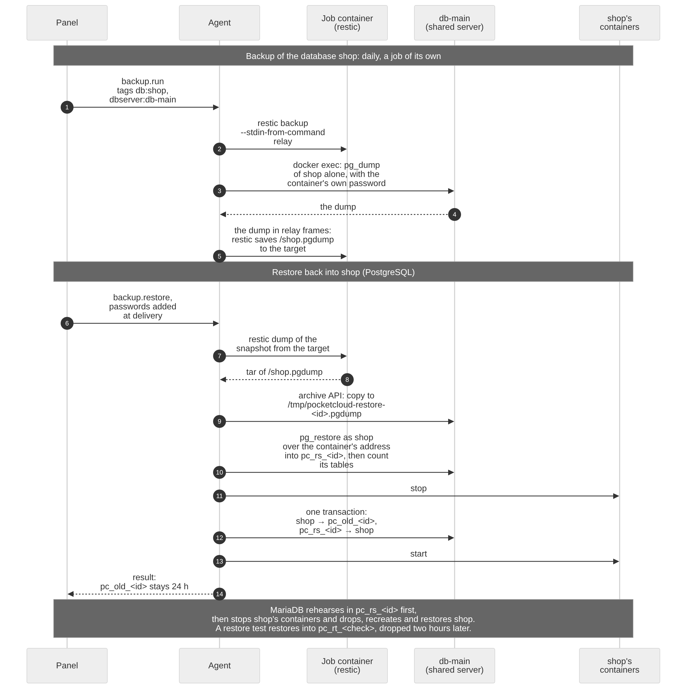

- **What it does.** Every ready database of a **shared** server gets a backup job of its own (origin and source kind `database`), daily by default, whose schedule, targets and retention follow per-server defaults unless the job sets its own; a database of a dedicated server stays its stack's business (its Backup cell shows the stack's `db_dump` job, and the Databáze KPI leaves it out). A run dumps that one database through #29's relay with the server's own client: PostgreSQL `pg_dump --format=custom --compress=0`, MariaDB `mariadb-dump` of one named database with one row per INSERT, so restic deduplicates; the snapshot is tagged `db:<name>` and `dbserver:<server>`. A database job restores on #30's record model three ways: back into the database (the application stopped, the name typed to confirm), into a new database, and a download as plain SQL. A restore runs as the database's **own user** over the container's address, so it cannot write any other database of the server (AC1). On PostgreSQL the restore in place goes into a scratch copy while the application runs and is swapped in atomically, keeping the old data 24 hours; on MariaDB a rehearsal into a scratch copy comes first, then drop, recreate, restore. Weekly **restore tests** (`backup_checks` rows of the kind `restore_test`) restore the newest dump into a temporary database `pc_rt_<check id>`, compare the tables, and raise `backup_restore_test_failed` (critical) when the backup could not be restored (AC2). Temporary databases are `databases` records with `temporary_until` in the reserved namespace `^pc_(rt|rs|old)_[a-z0-9]{15}$`, which a sweep drops. Every PHP site with a live release gets a job `<site>-files` (origin and source kind `site`) for its `shared/`, read-only, with `site_php.backup_exclude` as restic `--exclude`. There is no new collection; restic stays 0.17.3, only in job containers.
- **Names.**

  | Name | Value | What |
  |---|---|---|
  | `backup.CapabilityDatabase` | `backup.database` | the pseudo-capability of an agent that takes `BackupRun.extra_tags`, `site_dir`, `excludes`, `BackupRestore.database` and `BackupDump.sql_from`; the agent adds it to `capabilities()` beside `backup.run.panel` once it runs them. `backup.restore_test` and `db.database.discard` are gated by their command types |
  | `schema.SourceDatabase`, `schema.SourceSite` | `database`, `site` | `backup_jobs.source_kind` of a database's and a site's job |
  | `schema.JobDatabase`, `schema.JobSite` | `database`, `site` | `backup_jobs.origin` of the jobs the panel makes; `POST /backup-jobs` never makes them |
  | `schema.OwnSchedule`, `OwnTargets`, `OwnRetention` | `schedule`, `targets`, `retention` | what `backup_jobs.own_settings` lists: the settings a job set for itself; the others follow its server's `auto_backup_*` |
  | `schema.RestoreDatabase`, `schema.RestoreNewDatabase` | `database`, `new_database` | `backup_restores.mode` of a restore back into the database and into a new one |
  | `schema.DownloadSQL` | `sql` | `backup_restores.download_kind` of a dump downloaded as plain SQL |
  | `schema.CheckRestoreTest` | `restore_test` | `backup_checks.kind` of a restore test (reserved since #31) |
  | `schema.DefaultRestoreTestSchedule` | `20 5 * * 3` | the restore tests' schedule the migration sets: Wednesdays 05:20 UTC, after the automatic backups of 01:00–02:45 |
  | `schema.TemporaryDatabase` | `^pc_(rt\|rs\|old)_[a-z0-9]{15}$` | the temporary namespace |
  | `databases.TemporaryTest`, `TemporaryScratch`, `TemporaryPrevious` | `pc_rt_`, `pc_rs_`, `pc_old_` | a restore test's copy (`TestDatabaseName(check id)`), an in-place restore's scratch copy (`ScratchName(restore id)`), the data an in-place restore of PostgreSQL replaced (`PreviousName(restore id)`); `TemporaryOwner(name)` gives the prefix and the record id back |
  | `databases.ValidTemporaryName`, `databases.ReservedPrefix`, `databases.ReservedPrefixProblem` | | the strict namespace check; the refusal of a new name that starts with a prefix, "Names that start with pc_rt_, pc_rs_ or pc_old_ are PocketCloud's own temporary databases." (`ValidDatabaseName` lets such names pass) |
  | `databases.BackupFile(engine, db)`, `databases.FileDatabase(engine, file)` | `<db>.pgdump`, `<db>.sql` | the one file of a database's snapshot, `/<file>`, and the database a file name names |
  | `databases.StagedDir`, `databases.StagedName(engine, command id)` | `/tmp`, `pocketcloud-restore-<command id>.pgdump` or `.sql` | where a restore stages a dump in the server's container |
  | `backup.DbRestoreReplace`, `DbRestoreNew`, `DbRestoreTest` | `replace`, `new`, `test` | `BackupDbRestore.mode` |
  | `backup.TagDatabase`, `TagServer`, `TagSite`; `backup.DatabaseTags(db, server)`, `backup.SiteTags(site)` | `db:`, `dbserver:`, `site:` | the extra tags of a database's or a site's snapshot |
  | `backup.MaxExcludes` | 100 | the most `excludes` a run takes |
  | `backup.StepFetch`, `StepRehearse`, `StepDbRestore`, `StepSwap` | `fetch`, `rehearse`, `dbrestore`, `swap` | a database restore's progress steps besides #30's `check`, `stop`, `start`, `verify` |
  | `backup.Phase*` | `scratch`, `rehearsal`, `stopped`, `swapped`, `emptied`, `restored` | a database restore's phase in the agent's restore marker |
  | `backup.RestoreTestOK`, `backup.Test*`, `backup.TestFailures`, `backup.TestFailed(class)` | `ok`; the failure classes below | a restore test's answer |
  | `backup.AlertRestoreTestFailed`, `AlertRestoreTestUnverified`, `AlertTemporaryLeft` | `backup_restore_test_failed`, `backup_restore_test_unverified`, `db_temporary_left` | the alert rules |
  | `backup.EventRestoreTest{OK,Failed,Error,Skipped}`, `EventJobDisabled`, `EventTemporaryDropped`, `EventTemporaryFound` | `backup.restore_test_ok`, `…_failed`, `…_error`, `…_skipped`, `backup.job_disabled`, `db.temporary_dropped`, `db.temporary_found` | the events |
  | `backup.AutoSchedule(host id)` | `M H * * *` | a server's default schedule when `auto_backup_schedule` is empty: k = FNV-1a 32 of the host's id mod 8, H = 1 + k/4, M = 15 × (k mod 4), so 01:00–02:45 UTC, away from the label jobs' 03:00 and the integrity checks' Sunday 05:00 |
  | `backup.DbRestoreResult`, `RestoreTestResult`, `DbRestorePreview` (with `PreviewSnapshot`, `PreviewRoot`, `WouldStop`, `DbPreview`, `Space`, `StoppedApp`), `backup.ResultMap` | | the answers below; every key is always there, a list may be `null`; `ResultMap` turns one into the `map[string]any` the stream carries, as for checks |

- **Commands.** The panel creates them all; none can be requested through the API (their database passwords and target secrets come at delivery).

  | Type | Timeout | Queue | Ordering key | Settled by the agent | Agent worker slots |
  |---|---|---|---|---|---|
  | `backup.run` of a database's or a site's job | 12 h | 12 h | `backup:<target>`, as every run | no | `backup.run`, 2 |
  | `backup.restore` with `database`, real | 12 h | as #30 | `stack:<stack>` when `stack` is set (ordered with the stack's deploys, as `original`); else `site:<database.site>` (the key of the site's `site.*` commands); else `db:<container>/<database>` | yes | `backup.restore`, 2 |
  | `backup.restore` with `database`, preview (`dry_run`) | as #30 | as #30 | none | yes | `backup-read`, 4 (ephemeral) |
  | `backup.restore_test` | 6 h | 12 h | `db-test:<database.connection.container_id>` | no | `backup.restore_test`, 1 (the agent adds the limit; without it the longest prefix would be `backup.restore`) |
  | `db.database.discard` | 10 min | — | `db-test:<connection.container_id>`: never while a test of the server runs | no | `db.`, 3 |
  | `backup.dump` with `sql_from` | as #30 | as #30 | none | yes | `backup.dump`, 2 |
  | `db.database.drop` with `temporaries` | 1 h | — | none, as every drop | no | `db.`, 3 |

- **Proto** (`proto/pocketcloud/agent/v1/commands.proto`, additive; `gen/` regenerated per ADR 0005). `Command` oneof: `DbDatabaseDiscard db_database_discard = 183;` and `BackupRestoreTest backup_restore_test = 229;`.

  ```proto
  message BackupRun {        // … #29–#32's fields 1–13
    repeated string extra_tags = 14;   // db:<name>, dbserver:<server>, site:<name>: with any, forget selects by tags alone, --group-by ''
    string site_dir = 15;              // <site>/shared, or <site> for a classic site: mounted read-only at /srv/sites/<site_dir>
    repeated string excludes = 16;     // restic --exclude: absolute, clean, under the path backed up; at most 100
  }
  message BackupRestore {    // … #30's fields 1–14
    BackupDbRestore database = 15;     // sets neither original nor target_path; sets restore_id, job_tag, snapshot_id,
                                       // dry_run, overwrite (replace only), stack (the owner stack, if any), confirmed_stops
  }
  message BackupDump {       // … #30's fields 1–6
    string sql_from = 7;               // a shared PostgreSQL server's container, whose image converts the dump to SQL
  }
  message DbDatabaseDrop {   // … fields 1–4
    repeated string temporaries = 5;   // the database's pc_old_/pc_rt_ copies, dropped after the final dump and before the user
  }
  message BackupDbRestore {
    DbConnection connection = 1;       // container_id = db_servers.container_ref; admin_password added at delivery
    string database = 2;               // where it goes: the database, the new name, or pc_rt_<check id>
    string file = 3;                   // the snapshot's file: <db>.pgdump (postgres) or <db>.sql (mariadb)
    string mode = 4;                   // "replace" | "new" | "test"
    string user = 5;                   // the database's own user, who restores and owns what is restored
    string password = 6 [(pocketcloud.options.v1.sensitive) = true];  // that user's password, added at delivery
    string scratch = 7;                // replace: pc_rs_<restore id> (PostgreSQL's copy; MariaDB's rehearsal)
    string previous = 8;               // replace on PostgreSQL: pc_old_<restore id>
    repeated string stop_projects = 9;    // other stacks of the host whose env names ${secret:db/<db>}
    repeated string stop_containers = 10; // <site>-php, <site>-worker of a site's database
    string site = 11;                  // the site of a site's database, for ordering with site.* commands
  }
  message BackupRestoreTest {
    BackupRepository repository = 1;   // target_id and url stored; secrets at delivery
    string snapshot_id = 2;            // 64 hex
    string job_tag = 3;                // job:<id>
    string check_id = 4;               // the backup_checks row
    BackupDbRestore database = 5;      // mode "test"; database pc_rt_<check id>
    repeated string drop_before = 6;   // earlier pc_rt_ databases of this server whose tests ended, added at delivery
  }
  message DbDatabaseDiscard {
    DbConnection connection = 1;       // admin_password added at delivery
    repeated string names = 2;         // each ^pc_(rt|rs|old)_[a-z0-9]{15}$
    string revoke_from = 3;            // MariaDB: the user granted on them, if known
  }
  ```

- **Payloads**, as stored (no secret):

  ```jsonc
  // backup.run of a database's job: the database and its server are resolved at each run, never stored in the job
  {"run_id": "<run>", "repository": {"target_id": "<target>", "url": "<url>"},
   "stdin_container": "pcdb-main-db-1",            // the server's container_ref: the agent inspects it by name
   "stdin_command": ["sh", "-c", "<the engine's dump script, below>", "sh", "postgres", "shop"],
   "stdin_file_name": "shop.pgdump", "host_name": "<server>",
   "tags": ["pocketcloud", "job:<job>"], "extra_tags": ["db:shop", "dbserver:db-main"],
   "retention": {"daily": 7, "weekly": 4, "monthly": 6}}   // env stays empty
  // backup.run of a site's job
  {"run_id": "<run>", "repository": {…}, "site_dir": "wp/shared", "host_name": "<server>",
   "excludes": ["/srv/sites/wp/shared/wp-content/cache", "/srv/sites/wp/shared/wp-content/upgrade"],
   "tags": ["pocketcloud", "job:<job>"], "extra_tags": ["site:wp"], "retention": {…}}
  // classic mode: "site_dir": "wp", excludes /srv/sites/wp/shared/<p>, /srv/sites/wp/releases/*/<p> and /srv/sites/wp/.build
  // backup.restore back into a PostgreSQL database
  {"repository": {…}, "snapshot_id": "<64 hex>", "job_tag": "job:<job>", "restore_id": "<restore>",
   "dry_run": false, "overwrite": true, "stack": "shop", "confirmed_stops": ["shop-web-1"],
   "database": {"connection": {"container_id": "pcdb-main-db-1", "engine": "postgres", "admin_user": "postgres"},
     "database": "shop", "file": "shop.pgdump", "mode": "replace", "user": "shop",
     "scratch": "pc_rs_<restore>", "previous": "pc_old_<restore>", "stop_projects": ["reports"]}}
  // MariaDB: no "previous"; a site's database: "site": "wp", "stop_containers": ["wp-php", "wp-worker"], no "stack"
  // backup.restore into a new database: "mode": "new", "database"/"user" the new name, no overwrite, scratch, previous, stops
  // backup.restore_test: no drop_before, which the enricher adds
  {"repository": {…}, "snapshot_id": "<64 hex>", "job_tag": "job:<job>", "check_id": "<check>",
   "database": {"connection": {…}, "database": "pc_rt_<check>", "file": "shop.sql", "mode": "test", "user": "shop"}}
  // db.database.discard
  {"connection": {"container_id": "pcdb-maria-db-1", "engine": "mariadb", "admin_user": "root"},
   "names": ["pc_rt_<check>"], "revoke_from": "shop"}
  // backup.dump of a PostgreSQL job as SQL: #30's file download, and
  {…, "file_name": "shop.pgdump", "sql_from": "pcdb-main-db-1"}
  ```

  At delivery the enricher (`enrichBackup`, one per type; `backup.restore_test` joins `backupCommandTypes`) adds the target's secrets as for every backup command, then `completeDatabase` adds `connection.admin_password` (`db_servers.admin_password` of the server whose `container_ref` it is) and `password` (the user's `db_users.password`, or the new user's record for `new`), and refuses while the user's `pending_password` is set: "a rotation of X's password is under way". A restore test's stored command has no `drop_before`, one that has is refused as one that differs from its test; each delivery sets it to the server's earlier test copies as they are then (`earlierTestCopies`). `db.database.discard` takes the connection only. `checkRestoreDelivery` compares the payload before secrets are added, so `restorePayloadMatches` is unchanged.

- **The dump** (`databases.DumpCommand(engine, adminUser, database)`, in `stdin_command`). It runs in the shared server's container with the password of the container's own environment, which its Compose file sets from `${PC_ADMIN_PASSWORD}`, so a run carries none and `BackupRun.env` stays empty, as #29's dumps; PostgreSQL's local socket trusts the role anyway. The administrator (`root` / `postgres`) and the database are the positional `$1` and `$2`, never env values, which runs mask from 4 characters (`root`, `shop` would read `***`). Never `--databases` or `--all-databases`: the dump has no `CREATE DATABASE` and no `USE`, and #29's MySQL `--all-databases` dump restored would roll back every database of the server. The name must pass `ValidDatabaseName`, the administrator be a plain name.

  ```
  postgres: sh -c 'PGPASSWORD="${POSTGRES_PASSWORD:-}" exec pg_dump --format=custom --compress=0 --lock-wait-timeout=10min --username="$1" --dbname="$2"' sh postgres shop
  mariadb:  sh -c 'if command -v mariadb-dump >/dev/null 2>&1; then d=mariadb-dump; else d=mysqldump; fi; MYSQL_PWD="${MARIADB_ROOT_PASSWORD:-$MYSQL_ROOT_PASSWORD}" exec "$d" --user="$1" --single-transaction --routines --triggers --events --hex-blob --skip-extended-insert --no-autocommit --order-by-primary --skip-dump-date --default-character-set=utf8mb4 "$2"' sh root shop
  ```

  Beyond the issue's flags: `--skip-extended-insert` keeps a row's change on its own line, so restic's content-defined chunks find the rest again; `--order-by-primary` keeps the rows' order; `--skip-dump-date` keeps the footer; `--no-autocommit` keeps a restore of one-row INSERTs at one transaction per table; `--lock-wait-timeout=10min` stops a dump that would wait for ever. The dump runs with `docker exec` in the server's container and reaches restic through #29's relay (`pocketcloud-agent backup-tool relay` as restic's `--stdin-from-command`), which exits with the dump's code, so restic saves nothing for a failed dump: the documented deviation from restic running the dump itself, whose job would need the database's network, credentials and a client of the server's version. A dump job and a restore test's fetch job get no capabilities (a local target still adds its own and `NetworkMode none`).

- **Tags and retention.** `restic backup` gets `--tag` of `tags` + `extra_tags` (each passes `backupRunOf`'s tag checks). With any extra tag, `forget` selects `--tag pocketcloud,job:<id>` and groups with `--group-by ''`, so a move, which renames the server (`dbserver:`), leaves no group that is never pruned; without extra tags the arguments are #29's (`--group-by tags`). An agent without `backup.database` gets no database or site run at all (the panel refuses it), so it never splits groups. A database run also takes a read claim `db:<container>/<database>`; restic 0.17.3's `data_added_packed` becomes the run's `bytes_stored`.

- **Deduplication, and how far it goes.** restic cuts a dump into content-defined chunks of about 1 MiB, so a day's backup adds the chunks whose bytes changed. Rows added at the end of a table, and changes close to each other, add little; k row changes scattered over a 1 GB dump touch about 1 − e^(−k/1024) of its chunks (62 % at k = 1000), and only restic's compression of the new chunks bounds the growth then. MariaDB's dump keeps one row per line in primary key order, so a changed row changes its own line; PostgreSQL's custom format, uncompressed, writes a table's rows in the order they lie on disk, which updates and `VACUUM` can change. `--skip-extended-insert` makes MariaDB's dumps larger and their restores slower, which `--no-autocommit` limits. A run's `bytes_added` is what restic added before compression, its `bytes_stored` what the repository grew by; the target's `used_bytes` after a measure, or `du` of a local target's directory, shows the same from outside. #53's check on a real Docker Engine measures it on a database of about 1 GB of each engine over three simulated days, each with 1 % new rows, 0.5 % of the rows updated among the newest 5 %, the oldest 0.5 % deleted, 100 scattered single-row updates and, on PostgreSQL, `VACUUM`: each day's `bytes_added` must stay at most 25 % of `total_bytes`, and the repository must grow by at most 15 % of the database's size (`bytes_stored`, or else the `used_bytes` or `du` delta). For the record it also backs up uniform 1 % random updates, and in a scratch repository a MariaDB dump with the default extended INSERTs against `--skip-extended-insert` before and after deleting the oldest rows.

- **Scripts in the server's container** (`internal/databases/backup.go`; each a fixed `sh -c` with what varies in its environment, every password there, never on a command line; names in SQL are checked, then quoted). `Statements` runs SQL as the administrator on PostgreSQL's `postgres` database.

  | Function | Runs as | What |
  |---|---|---|
  | `CharsetSQL(db)`, `ParseCharset` | admin | MariaDB: the source's `default_character_set_name`, `default_collation_name`; a name that is not `^[a-z0-9_]{1,64}$` never reaches SQL (`DefaultCharset` utf8mb4 / utf8mb4_unicode_ci stands in) |
  | `ScratchSQL(engine, name, user, charset)` | admin | PG `CREATE DATABASE "<n>" OWNER "<user>"; REVOKE ALL ON DATABASE "<n>" FROM PUBLIC;` (as `CreateSQL`, so locale and owner are the original's); MariaDB `` CREATE DATABASE `<n>` CHARACTER SET <cs> COLLATE <coll>; GRANT ALL PRIVILEGES ON `<n>`.* TO '<user>'@'%'; ``. `<n>` must be `pc_rs_` or `pc_rt_`; it fails when the database exists |
  | `SwapSQL(db, scratch, previous)` | admin, PG | `SELECT pg_terminate_backend(pid) … WHERE datname IN ('<db>', '<scratch>') AND pid <> pg_backend_pid(); SET lock_timeout = '10s'; BEGIN; ALTER DATABASE "<db>" RENAME TO "<previous>"; ALTER DATABASE "<scratch>" RENAME TO "<db>"; COMMIT; ALTER DATABASE "<previous>" WITH ALLOW_CONNECTIONS false;` — scratch `pc_rs_<id>`, previous `pc_old_<id>` of one restore, db neither temporary nor PostgreSQL's own. On "is being accessed by other users" the agent runs it again, up to 5 times, 2 s apart; `ON_ERROR_STOP` rolls back. The agent runs this one form: both renames in one transaction, which PostgreSQL allows (`ALTER DATABASE … RENAME` is not refused in a transaction block, as `CREATE` and `DROP DATABASE` are) |
  | `RecreateSQL(db, charset)` | admin, MariaDB | `` DROP DATABASE IF EXISTS `<db>`; CREATE DATABASE `<db>` CHARACTER SET <cs> COLLATE <coll>; ``; grants survive the drop. Never a temporary or an engine's own name |
  | `TestDatabaseSQL(engine, name, user, charset)` | admin | `create` = `ScratchSQL` of `pc_rt_<check>`; `closing` after the count: PG `ALTER DATABASE "<n>" WITH ALLOW_CONNECTIONS false;`, MariaDB `` REVOKE ALL PRIVILEGES ON `<n>`.* FROM '<user>'@'%'; `` |
  | `DiscardSQL(engine, names, revokeFrom)` | admin | every name must be of the namespace. PG `DROP DATABASE IF EXISTS "<n>" WITH (FORCE);` each; MariaDB `revokes`, one `` REVOKE ALL PRIVILEGES ON `<n>`.* FROM '<u>'@'%'; `` per name, each run on its own with "no such grant" ignored, then `` DROP DATABASE IF EXISTS `<n>`; `` each |
  | `SettingsSQL(engine, db)` | admin, PG | the database's `pg_db_role_setting` entries, one `name=value` per line, which a restore does not carry |
  | `SessionsSQL(engine, db)` | admin | the client address of each session of the database but its own, one per line (PostgreSQL `local` for the socket): a preview counts those that are no address of a container it stops as `connections_other` |
  | `EndSessions(engine, admin, password, name)` | admin | ends the database's sessions but its own and prints how many: PG `SELECT count(pg_terminate_backend(pid)) FROM pg_stat_activity WHERE datname = '<n>' AND pid <> pg_backend_pid();`; MariaDB lists `information_schema.processlist` ids with `db = '<n>'` (but `CONNECTION_ID()`) and runs `KILL CONNECTION <id>` for each, skipping those that ended meanwhile; a list that fails fails it |
  | `CountBaseTables(engine, admin, password, db)` | admin, on `<db>` | PG `SELECT count(*) FROM information_schema.tables WHERE table_type = 'BASE TABLE' AND table_schema NOT IN ('pg_catalog', 'information_schema')`; MariaDB `… WHERE table_schema = DATABASE() AND table_type IN ('BASE TABLE', 'SYSTEM VERSIONED')`. `CountTables`, which counts views, stays for moves |
  | `CountDump(engine, file)` | the container's user | PG `list=$(pg_restore --list "$PC_FILE")` (a failure fails it: `incomplete`), then `awk '$4 == "TABLE" && $5 != "DATA" && $5 != "ATTACH" {n++} END {print n+0}'`; MariaDB `tail -c 4096 "$PC_FILE" \| grep -q '^-- Dump completed'` or "the dump is incomplete: it does not end as a whole dump does", then `grep -c '^CREATE TABLE ' "$PC_FILE" \|\| true` |
  | `RestoreAsUser(engine, user, password, db, file, definer)` | **the database's user**, over `addr="$(hostname -i \| cut -d' ' -f1)"` (refused when empty: on the socket the server would not check the password) | PG `exec pg_restore --no-password --host="$addr" --username="$PC_USER" --dbname="$PC_DATABASE" --single-transaction --exit-on-error --no-owner --no-privileges --no-tablespaces --no-publications --no-subscriptions --no-security-labels "$PC_FILE"`; MariaDB picks `mariadb` or `mysql`, adds `--sandbox` when the client's `--help` names it, and runs `"$client" $sb --host="$addr" --user="$PC_USER" --one-database --connect-timeout=10 "$PC_DATABASE" < "$PC_FILE"`; with `definer` (MariaDB into a new database) the file goes through `` sed -E '/^INSERT INTO /!s/DEFINER=`[^`]+`@`[^`]+`/DEFINER=`'"$PC_DEFINER"'`@`%`/g' `` first. Env: `PC_USER`, `PGPASSWORD` / `MYSQL_PWD` (the user's password), `PC_DATABASE`, `PC_FILE`, PG `PGCONNECT_TIMEOUT=10`, MariaDB `PC_DEFINER` (a plain name only). The file stays: MariaDB's rehearsal reads it twice |
  | `RemoveStaged(file)` | the container's user | `rm -f "$PC_FILE"`, only for `^/tmp/pocketcloud-restore-[A-Za-z0-9_-]{1,64}\.(pgdump\|sql)$`; always run, deferred |
  | `SweepStaged()` | the container's user | `find /tmp -maxdepth 1 -type f -name 'pocketcloud-restore-*' -mmin +1440 -exec rm -f {} +`, at the start of every restore and test |
  | `FreeSpace(dataDir)`, `ParseFreeSpace` | the container's user | `exec df -Pk -- "$PC_DATA_DIR" /tmp`, `PC_DATA_DIR` = `Engine.DataDirOf(image)`: the bytes available in each |
  | `Sandbox()` | the container's user | prints `yes` when the MariaDB client takes `--sandbox` |
  | `ParseCount` | | the number on a script's last line |

  Names are checked with `ValidDatabaseName` (databases, users) and `ValidTemporaryName` (temporary databases). Every `runScript` masks the administrator's and the user's passwords (from 4 characters), never `PC_DATABASE`.

- **Who restores** (AC1). Every restore and restore test runs the server's own client in the server's container as the database's own user (the `db_users` record whose `databases` holds it, of several the one named after it; never a user that is only named like the database, which may be another application's, as a user brought by a move can be; for a new database its new user), signed in with the password the panel keeps for that user, which the enricher adds as it delivers the command, over the container's own address, where the server checks the password; on PostgreSQL's local socket it would not. The user's privileges cover its database and the copies made for it (owned by it on PostgreSQL, granted to it on MariaDB), so a dump that names another database, such as a crafted `USE blog; DROP TABLE posts;` in a backup of `shop`, fails on privileges ("Access denied … 'blog'"), and nothing changed in place, as the scratch copy or the rehearsal took it; MariaDB's client also runs with `--one-database`, and with `--sandbox` where it has it. A PostgreSQL archive is restored with `--no-owner --no-privileges` by a user that never was an administrator, so nothing in it can `RESET ROLE` to one. The administrator signs in only for statements PocketCloud wrote, with names checked against their rules: creating, renaming, counting, ending sessions and dropping. A preview signs in as the user first, and a password the server no longer takes refuses the restore in place ("The panel's password of X no longer signs in on Y: restore into a new database."). What only a superuser can make, such as an untrusted extension or a MariaDB `DEFINER` of another user, cannot be restored this way: that is the isolation at work, and the weekly restore test shows it first.

- **A database restore** (`BackupRestore.database`, the agent's new `internal/agent/backupdb.go`). `checkRestore` takes exactly one of `original`, `target_path` or `database`; `database` needs `restore_id`, a mode of `replace` or `new`, `overwrite` for `replace`, and a `file` that `databases.FileDatabase` reads for the engine. The container `connection.container_id` must be running and labelled `pocketcloud.role=db`, as shared servers are, or: "Database restores go into a shared server's container only." The restore claims `db:<c>/<db>` for writing, and `db:<c>/<scratch>` and `db:<c>/<previous>` when set, `<c>` the inspected container's id, so that a dump (whose payload names the container by its name) and a restore agree; a running dump of the database holds its read claim, and a claim that conflicts names the database. `checkRestore` refuses a restore that sets none or two of them: "…to its original location, to a new folder or into a database: exactly one of them".
  - **Preview** (`dry_run`; ephemeral, a `backup-read` slot). A `ls --snapshot <id> --dir / --limit 20` job gives `in_snapshot` and the file's size; the backup tool's `ls` answer also carries the snapshot itself, `snapshot {id, time, paths, tags}` (a browse answers without it), whose time and paths the preview gives, and whose tags must hold the job's: "the snapshot X is not one of this job's". Execs in the server container give `ExistsSQL`, for `replace` the database's size (`StatsSQL`) and `CountBaseTables`, the sessions from outside what stops (`SessionsSQL` against the addresses of the containers it stops), PostgreSQL's `SettingsSQL`, `SignIn` as the user (only for `replace` of a database that exists: a new user does not exist yet, and `sign_in` stays false for `new`, which the panel does not hold against it), MariaDB's `Sandbox`, and `FreeSpace`. Its `notes` are sentences: "The settings of X are not in its dump, and the restored database does not have them: …." and "N sessions of X come from outside what the restore stops: they end when it puts the backup in place." `would_stop` comes from a generalised `affected(ctx, id, stacks, dests, named, claim)`: a container of any listed project counts; one whose name is in `named` counts even with `pocketcloud.role=site`, and only when it matches `^[a-z0-9][a-z0-9-]*-(php|worker)$`; every other role-labelled container is skipped, so the server's `db` container never stops. Needed: tmp = file + 256 MiB; data = 1.2 × max(database size, file) + 512 MiB for `replace` on PostgreSQL, MariaDB's rehearsal, and `new`. The answer (`backup.DbRestorePreview`):

    ```json
    {"dry_run":true,"snapshot":{"id":"<64 hex>","time":"<RFC 3339>","paths":["/shop.pgdump"]},
     "roots":[{"index":0,"source":"/shop.pgdump","destination":"database shop","in_snapshot":true,"exists":true,"entries":12}],
     "would_stop":[{"name":"shop-web-1","project":"shop","service":"web"}],"total_files":1,"total_bytes":1048576,
     "database":{"exists":true,"user_exists":true,"size_bytes":8388608,"tables":12,"connections_other":0,
                 "sign_in":true,"settings":["search_path=app"],"sandbox":false},
     "free":{"data":53687091200,"tmp":53687091200},"needed":{"data":10603200,"tmp":269484032},"notes":[]}
    ```

    `entries` is the tables the database has now; `notes` are sentences, as #30's. The panel's start refuses from the preview when the file is missing, `sign_in` is false, or `free` is below `needed`.
  - **Stage.** A backup-tool job runs `dump --snapshot S --path / --expect-tag job:J`; the agent reads the tar, takes its one regular file (its `path.Base` must be `file`; a second regular file refuses), and calls `CopyFileFrom(container, "/tmp", StagedName(engine, command id), tar reader, header size, 0o600)`. The room is checked as the tar's header gives the dump's size, before a byte is copied (`space`). Then `CountDump` gives `tables_expected` (a refusal is `incomplete`). `RemoveStaged` always runs, deferred; `SweepStaged` runs first.
  - **`replace` on PostgreSQL.** The restore marker (`restoreMarker`) gains `database: {container, engine, name, scratch, previous, phase, charset, collation}`, written before step 1. (1) Phase `scratch`: `ScratchSQL(scratch, user)`, `RestoreAsUser` into the scratch copy, `CountBaseTables(scratch)` must equal `tables_expected`. (2) Phase `stopped`: `affected(claim=true)`, `checkConfirmedStops`, `session.stop()` (#30's marker and restart policy `no`). What stops is checked against the confirmed stops twice: before anything is done, as #30's, and live again right before the stop, so a container that started meanwhile refuses the stop ("X started using the destination after the preview: preview again."). (3) `SwapSQL`, then phase `swapped`. (4) `startAgain(verify)`. A failure before (3) runs `EndSessions` and `DiscardSQL(scratch)`, starts what stopped, and fails "Nothing changed in <db>: …" ("…: the restore was stopped." after a cancel, "…: the restore ran out of time." at its time). Cancel is honoured until (3); after it: "The restore is putting the copy in place and finishes."
  - **`replace` on MariaDB.** (1) Phase `rehearsal`: `ScratchSQL(scratch, user)` with the source's `charset`, `RestoreAsUser` into it, count, `EndSessions`, `DiscardSQL(scratch, revoke_from=user)`. (2) Phase `stopped`, as above. (3) Phase `emptied`: `RecreateSQL`, `RestoreAsUser` into `<db>`, the count must equal. (4) Phase `restored`: `startAgain`. A failure in (3) puts the restart policies back **without starting**, removes the marker and answers `partial: true` with `app_left_stopped`, failing "The restore failed after <db> was emptied: it holds part of the backup, and <names> stay stopped. Restore again, then start them on their pages." (with nothing stopped: "The restore failed after <db> was emptied: it holds part of the backup. Restore again.").
  - **`new`** (both engines). `ExistsSQL` must find neither the database nor the user; `CreateSQL(engine, db, user, password)` with the delivered password; stage, count, `RestoreAsUser` as the new user (MariaDB with `definer` = the user); count. A name that is taken refuses before anything is made: "A database or user named X exists on <container> already: nothing was changed."; a later failure runs `DropManySQL([db], [user])` and answers `dropped: true`: "The restore into the new database X failed, and it was dropped again: …" (or, when the drop failed too, "The restore into the new database X failed: …"). Nothing stops.
  - **The answer** (`backup.DbRestoreResult`):

    ```json
    {"files_restored":1,"bytes_restored":1048576,"tables":12,"tables_expected":12,"previous":"pc_old_<restore>",
     "connections_ended":0,"app_stopped":[{"id":"<docker id>","name":"shop-web-1"}],"app_started":["shop-web-1"],
     "app_not_running":[],"start_errors":[],"partial":false,"app_left_stopped":[],"dropped":false,"interrupted":false,"log":"…"}
    ```
  - **`finishInterruptedRestores`** reads `marker.database.phase` before `startAgain`: `scratch` / `rehearsal` — nothing stopped, settled failed "Nothing changed", the panel's sweep drops the scratch copy; `stopped` — start again, failed "Nothing changed"; PG `swapped` / MariaDB `restored` — start again, settled **succeeded** with `interrupted: true`; MariaDB `emptied` — restart policies back without starting, failed with `app_left_stopped`.
  - **Progress steps**, in the order the web shows them, leaving out what a restore does not do: PostgreSQL in place `check`, `fetch`, `dbrestore` (into the copy), `stop`, `swap`, `start`, `verify`; MariaDB in place `check`, `fetch`, `rehearse` (into the copy, dropped again), `stop`, `dbrestore`, `start`, `verify`; into a new database `check`, `fetch`, `dbrestore`.
- **A restore test** (`backup.restore_test`, `handleBackupRestoreTest`). (1) Mode `test`; `database` is `^pc_rt_[a-z0-9]{15}$` with the suffix `check_id`; each `drop_before` is a `pc_rt_` name. (2) Claim `db:<c>/<temp>` for writing. (3) `ExistsSQL(temp)` must be false: a copy is never reused. (4) `DiscardSQL(drop_before)`; a drop that fails is logged, `dropped` stays empty and the test goes on. (5) `TestDatabaseSQL` create (with the character set of the dump's database on MariaDB), `SignIn` as the user into the copy (a refusal is `sign_in`), stage (the room checked at the tar's header: `space`), `CountDump`, `RestoreAsUser`, `CountBaseTables`, `TestDatabaseSQL` closing. The copy stays for the panel's sweep. A copy that exists, a claim that conflicts and a create that is refused are `container`; a fetch that fails otherwise than below is `unreachable`, and a snapshot forgotten or of another job `repository`. The answer (`backup.RestoreTestResult`), also with the error of a failed test:

  ```json
  {"status":"ok","failure":"","tables":12,"tables_expected":12,"bytes":1048576,"duration_ms":5400,
   "created":true,"dropped":["pc_rt_<an earlier check>"],"log":"…"}
  ```

  | `failure` (`backup.Test*`) | When | The row (`TestFailed`) |
  |---|---|---|
  | `damaged` | restic could not read the snapshot's data ("ciphertext verification failed", a pack or a blob not found) | `failed` |
  | `incomplete` | `CountDump` refused | `failed` |
  | `restore` | the client exited non-zero; the error holds its last 4 lines, passwords masked | `failed` |
  | `tables` | the counts differ | `failed` |
  | `unreachable`, `repository`, `locked` | from `repositoryError` and the lock classes | `error` |
  | `space`, `container`, `sign_in`, `interrupted` | too little room; the container is not a running shared server's; the user's password does not sign in; the agent restarted (the panel sets `interrupted` itself when the agent answers only "The agent restarted while running…", as for a run) | `error` |
- **The SQL download** (`backup.dump` with `sql_from`). MariaDB's file is SQL already and streams as it is. For PostgreSQL the agent inspects `sql_from` (running, `pocketcloud.role=db`, a postgres image) and creates a **conversion container** from that container's image id (so the same `pg_restore`): `Entrypoint ["pg_restore"]`, `Cmd ["--file=-","--no-owner","--no-privileges"]`, `User "postgres"`, `NetworkMode none`, `CapDrop ALL`, `SecurityOpt no-new-privileges`, `ReadonlyRootfs`, `Tmpfs /tmp`, `PidsLimit 64`, `LogConfig none`, `OpenStdin` and `StdinOnce`, `Tmpfs /tmp` `rw,noexec,nosuid,size=64m`, labels `pocketcloud.role=job`, `pocketcloud.command=<id>` and `pocketcloud.backup-target=<target>` (`cleanupBackupJobs` removes only a leftover with that last label). The source is checked before the panel is dialled. The restic dump job (path `/<db>.pgdump`) writes into its stdin through `Attach`; closing that connection ends the input; its `AttachOutput` goes to the `artifactWriter`. A non-zero exit of either aborts the upload. A pipe-written custom archive has no data offsets: one sequential conversion works, `-j` and `-L` never. Plain SQL from `pg_restore` 17.6 / 16.10 and later starts with `\restrict` (and ends with `\unrestrict`), which an older `psql` does not read: load it with a `psql` of those releases or later, or download the dump as stored and restore it with `pg_restore`. The live download path has no 1 GiB cap. In the panel, a download with `kind: "sql"` is for admins and database jobs only: its path is `/<file>` (`BackupFile`), its `download_name` `<db>-<YYYYMMDD-HHMM>.sql` (the snapshot's time), its `download_kind` `sql`; a PostgreSQL one stores the server's container in `roots` (`[{"container"}]`), from which `dumpPayload` sets `sql_from`, runs on the database server's host, whose agent has its image (the server of the job's database, or after a drop the shared server named `db_server_name`), and needs an agent with `backup.database` (409 "The agent of X cannot convert dumps to SQL yet: update it."); a MariaDB one needs nothing new. `streamDownload` sends it as `Content-Type: application/sql; charset=utf-8`; the rest, the ticket, the 120 seconds for the first bytes and the headers, is #30's download.
- **Records** (migration `1773000000_database_backups.go`; see docs/data-model.md). Reverting it deletes the automatic jobs (and with them their runs, restores and tests), the restores into databases and the SQL downloads of any job, and every restore test, then removes the fields and indexes and puts #31's slot index back.
  - `backup_jobs`: `origin` + `database`, `site`; `source_kind` + `database`, `site`; `database` (relation `databases`, one, **no cascade**: a drop clears it, and the job, its runs and its snapshots stay), `site` (relation `sites`, one, no cascade), `db_server_name` (text 48, for display after a drop), `own_settings` (json 1 KiB: any of `schedule`, `targets`, `retention`), `last_success_at` (date). Unique `idx_backup_jobs_database` on `database` where `database != ''`, unique `idx_backup_jobs_site` on `site` where `site != ''`.
  - `backup_runs`: `bytes_stored` (number, restic's `data_added_packed`).
  - `backup_restores`: `mode` + `database`, `new_database`; `download_kind` + `sql`; `database` (relation, no cascade), `database_name` (text 63), `previous` (text 63, `pc_old_<id>`), `tables` (number). The plan rides in `roots` (json 8 KiB), one root whose fields `restoreRoot` gains, each `omitempty`:

    ```json
    [{"source":"/shop.pgdump","container":"pcdb-main-db-1","engine":"postgres","admin_user":"postgres",
      "database":"shop","user":"shop","scratch":"pc_rs_<restore>","previous":"pc_old_<restore>",
      "stop_projects":["reports"],"stop_containers":["wp-php","wp-worker"],"site":"wp"}]
    ```

    A PostgreSQL SQL download stores `roots [{"container":"<sql_from>"}]`; `download_name` is `<db>-<YYYYMMDD-HHMM>.sql` (the snapshot's time), its path `/<file>`.
  - `backup_checks` (a restore test): `job` (relation `backup_jobs`, **cascade**), `database_name` (text 63), `snapshot_id` (text 64), `temporary` (text 63, `pc_rt_<row id>`), `tables_expected`, `tables_restored`, `dump_bytes` (numbers), `failure` (text 32, the classes above); `host` is the job's server, whose agent restores; `kind` `restore_test`. The slot index becomes unique `(kind, target, job, scheduled_at)` where `scheduled_at != ''`, so a target's integrity check and its jobs' tests share a slot; index `(job, created)`.
  - `hosts`: `auto_backup_schedule` (text 255, cron in UTC; empty = `backup.AutoSchedule(id)`), `auto_backup_targets` (relation `backup_targets`, at most 10, no cascade; none until an admin picks them), `auto_backup_retention` (json 1 KiB; null = daily 7, weekly 4, monthly 6).
  - `settings`: `restore_test_schedule` (text 100; the migration sets `20 5 * * 3`; empty turns the tests off).
  - `databases`: unchanged; `temporary_until` (since 1760000200) marks a temporary database, `owner_kind` `none`.
  - The audit ignores `databases.temporary_until` and `backup_jobs.last_success_at`; `backup_checks` are not audited.
- **Automatic jobs** (the panel's new `backup_auto.go`). `ensureDatabaseJob(id)` skips a database that is not `ready`, has `temporary_until`, has a temporary name (of the namespace, or only starting with one of its prefixes, such as `pc_rs_mine`), or whose server's `kind` is not `shared`; a database that has a job gets its job's `db_server_name` and `engine` kept in step with its server (a move); otherwise it creates `{name: freeJobName(server+"-"+db), host: server.host, source_kind: database, source: db, engine: postgres|mysql, database: id, db_server_name: server.name, origin: database, enabled: true, own_settings: []}` with the host's defaults (minus local targets of other servers), `problem` and `next_run_at`, as `audit.System("backups","panel")`; a unique violation is a concurrent hook that made it (accepted) or a name taken meanwhile (tried again with a new name, up to 3 times). `ensureSiteJob(site)` makes `<site>-files` (`freeJobName`, so `<site>-files-2` when the name is taken) once the site has `site_php` and `active_deployment`; its `source` is the directory it backs up, `<site>/shared` or a classic site's `<site>`, kept in step when the site's mode changes. Hooks run through `p.later.after(0, …)`: database create and an update of its `status`, `server`, `temporary_until` or `name` (a move refreshes `db_server_name`), a site's first `active_deployment`, a change of a site's PHP `mode`, deletes (`markGoneAutoJobs`), and `OnServe` (after the rest of the chain, so after #32's serve lock) plus the cron `pocketcloud_auto_backup_jobs` `23 * * * *` (`reconcileAutoJobs`: backfill, name repair, gone jobs). A job whose database or site went is disabled with `next_run_at` empty and the problem "Its database was dropped." / "Its site was removed."; the warning event `backup.job_disabled` ("The backup job X was disabled: its database was dropped. Its snapshots stay.") only for a job that was on, as `markOrphanedLabelJobs` writes the problem on one already off; its restore-test alerts are resolved by the jobs' update hook, which looks at the job as it is (off, or its database cleared), and #29's alerts of its runs through `sourceGone`. `sourceGone(job)` = `labelGone(job)` or an automatic job whose relation is empty; it replaces `labelGone` in the jobs' update hook, the run route, `backsUpTo`, `checkRunDelivery` and every retry (`planRetry`, `retryDueRun`, `handleRetryRun`, `planRetryAt`), so no run of a job whose source went is started or tried again, and `startJobRuns` starts nothing for one before `markGoneAutoJobs` has disabled it. A run resolves the database and its server each time: refused (class `source`, never retried) when the database is gone ("the database was dropped"), its server is gone ("the database's server is gone") or no longer shared ("the database X is no longer on a shared server"), or "the agent of X cannot back up databases one by one yet: update it" (a site's: "…cannot back up PHP sites' files yet…"); a database `creating` or `dropping` gets a skipped run "The database X is being created." / "The database X is being dropped." without an alert; an open restore of mode `database` of the database skips scheduled runs ("A restore into its data is under way on X.", #30's) and refuses runs by hand and retries ("A restore into its data is under way: back it up once it ends.") (`restoreWriting`). `POST …/run` also answers 409 for an agent without `backup.database` and while the database is being created or dropped. First delivery refuses "the database was dropped", "the site was removed" and "the database moved to another server since the run was queued" (`stdin_container` ≠ the current `container_ref`); a run refused for its database's move ends cancelled without an alert, as #29's run to a target taken out of its job. `noteJobRun` sets `last_success_at` to the `finished_at` of the newest run that succeeded. The run finisher hides the server's administrator's password and the user's `password` and `pending_password` besides the target's secrets, the longest first.
- **A server's defaults, and a job's own settings.** `hosts.auto_backup_schedule`, `auto_backup_targets` and `auto_backup_retention` are what the database and site jobs of a server follow. An empty schedule is `backup.AutoSchedule(host id)`, daily at a time between 01:00 and 02:45 UTC that spreads the servers; there are no targets until an admin picks them, so the jobs exist, say they have no target and do not run, and the Databáze page asks admins to choose; no retention is daily 7, weekly 4, monthly 6. A local target of another server is left out of a job's targets. `PUT /hosts/{id}/auto-backups` takes the three whole (a missing schedule is the default, missing targets none, a missing or null retention the default), saves them and, in the same transaction, gives every database or site job of the server the fields its `own_settings` does not list. The records API keeps a host's `auto_backup_*` as they are (`keepHostAutoBackups`), so no job falls behind its server. A `PATCH` of such a job that sets `schedule`, `targets` or `retention` adds the field to `own_settings`, even with the value it had, so later defaults leave it alone; `follow` takes it out again and copies the server's value, and wins over a value of the same field in the same body; `follow` of a manual or label job answers 400 "Only a database's or a site's job follows its server's settings.", and a name but those three "A job follows its server's schedule, targets or retention." What the job backs up, and its server, follow its database or site: the API refuses to change them, to add such a job, to turn one on whose database was dropped ("Its database was dropped: the job cannot be turned on again." / "Its site was removed: the job cannot be turned on again."), and to remove one while its database or site exists, as it would come back. Removing it once they are gone removes its runs; its snapshots stay in the repositories, as for every job. A database that is dropped and made again under its name gets a new job (`<server>-<db>-2`), the old one keeping the old snapshots.
- **A PHP site's `shared/`.** `ensureSiteJob` makes `<site>-files` (origin and source kind `site`, on the site's server) once the site has PHP settings and a live release: before its first deployment it has no `shared/`. A run sets `site_dir` to `<site>/shared`, or to `<site>` for a classic site, whose code is its own, and the agent mounts that subpath of the `pocketcloud-sites` volume read-only at `/srv/sites/<site_dir>`, the path the edge and PHP-FPM use (a volume subpath on Engine API 1.45 and later, a bind of the volume's directory before, as `sitesMount` does for PHP-FPM), with `DAC_OVERRIDE`, as `shared/` belongs to `www-data`; restic backs up `/srv/sites/<site_dir>`. `site_php.backup_exclude` becomes restic's `--exclude`: each path as `/srv/sites/<site>/shared/<path>`, and for a classic site also as `/srv/sites/<site>/releases/*/<path>` (a classic site keeps its shared paths in `shared/` too, linked into its one release), which also leaves out `/srv/sites/<site>/.build`; a path that is not clean and inside the site (`sites.ValidSharedPath`) is left out, each pattern once, at most `backup.MaxExcludes`; the agent checks each is absolute, clean and under the path backed up. The snapshots are tagged `site:<site>`. A run of a site's job needs an agent with `backup.database`, as a database's does. Removing the site leaves the job disabled ("Its site was removed.") with its snapshots; a run of it answers 409 "Its site was removed: its snapshots stay, and a restore into a directory brings them back." #30's folder restore brings `shared/` back into a new folder; a restore into the site's own `shared/` is left for later.
- **Restores in the panel** (the panel's new `backup_db_restores.go`, on #30's records and life cycle). `POST /backup-jobs/{id}/restores` takes the modes `database` and `new_database` from operators, and `databasePlan` builds their plan instead of #30's `originalPlan` and `pathPlan` (`originalPlan` still refuses a `db_dump` job). For `database`: the job's origin is `database`, and its database exists, is `ready` and is not temporary; the server is shared, `ready`, on the job's server, and its `admin_password` is known; no move claims the database, no rotation of its user's password is under way, and no other restore or test of it is open; the agent has `backup.database`. The user is the `db_users` record whose `databases` holds the database; `stack_name` is its owner stack's; a site's database adds `stop_containers` (`<site>-php`, `<site>-worker`) and `site`; `stop_projects` are the other stacks of the server whose env file names `${secret:db/<db>}`, found as a move finds them; `scratch` is `pc_rs_<restore id>`, and on PostgreSQL `previous` is `pc_old_<restore id>`. For `new_database`: the name passes `ValidDatabaseName` and `ReservedPrefix`, is free on the server as a database's secret must be and not claimed by a move, and no other open restore into a new database takes it; the server is the database's, or for a dropped database a shared server of the same engine on the job's server, and a PostgreSQL server must not be of an older major version than the server the dump was made on, while that server (`db_server_name` on the job's server) is still there to say: "The server X runs PostgreSQL N, older than the M the backup was made with: restore into a server of the same or a newer version." Other refusals of the plan: "A database is restored whole: pick no items.", "Choose the database server the new database goes on.", "A new database of this job goes on the server of its database.", "A database is restored onto a shared server of the job's server.", "The server X runs another engine than the job's dumps are of.", "The database (server) X is not ready.", "The panel does not know the credentials of X.", "The database X has no user the panel knows."; "A database named X exists on Y already." names the server that holds the name, as names are unique per host. The plan rides in `roots`; `restorePayload` builds `BackupRestore` with `stack` and `database` from it, and `checkRestoreDelivery` compares it as #30's. Both modes need an operator, at the start and at the first delivery. A restore's destination is its database (the record's id, or `<server>/<name>` for a new one), which another open restore of the same database overlaps, and a running backup of the job blocks the mode `database` as it blocks `original`. `/start` (`needsConfirm` is true for `database`) needs `confirm_overwrite: true` and `confirm_name` equal to `database_name`, refuses from the preview a dump that is not in the snapshot, a password that does not sign in (mode `database` only), a new name the server has already, and too little room of the data or of `/tmp` ("The server X has N free, and the restore needs about M."), works the plan out again and refuses one that changed since the preview ("What the restore writes or stops changed since its preview: preview it again."), and creates in one transaction the temporary records (`pc_rs_<id>`, and on PostgreSQL `pc_old_<id>`: status `creating`, `temporary_until` now + 13 h, the timeout and an hour), for `new_database` the `databases` record (`creating`, owner `none`) and the `db_users` record with a new sealed password and the secret `db/<name>`, and the command (`CreateIn`). When the restore ends, `databaseRestored` settles the records. Mode `database`, succeeded: the scratch record goes, `pc_old_<id>` becomes `ready` with `temporary_until` = finished + 24 h, the server's stats are asked for, and the restore keeps `tables`. Failed: the scratch record's `temporary_until` becomes now, for the sweep, and the `pc_old_` record goes unless the agent answered `previous` (the swap happened); a restore that never started leaves neither. `partial`: the database's `last_error` is the agent's sentence. Mode `new_database`: the database becomes `ready`; with `dropped: true`, or never started, its records go; with an outcome nobody knows it is `failed` with `last_error`. The restore record keeps `tables` and `previous`, and every text it keeps hides the database's passwords. The restore's `backup_restore` alert is keyed `<host>:database:<database id>` (`restoreDestinationKey` takes the new modes first; `<host>:database:<container>/<name>` once the restore has no database, as a failed restore into a new database whose records went): critical on a failure or with `app_left_stopped`, a warning when the application did not stay up. A restore of a database that went well also resolves the key of its name on its server, and a database's drop, which clears the relation in its restores, resolves the alerts keyed by its record.
- **What waits for a restore of a database.** While a restore of mode `database` is queued or running, its owner stack is held as for `original` (`restoreHoldingProject`), and so is every other stack its plan stops (`stop_projects`), whether or not it ran at the preview: edits, deploys, removal and `stack.*` commands, and the start, restart and removal of its containers, answer #30's "The stack X is being restored from a backup: this waits until that is done."; `site.*` commands of a site whose `<site>-php` a started restore stops, and the site's deploy, upload and rollback routes (which make them), answer "The site X is being restored from a backup: this waits until that is done."; rotate, clone, connect, drop, export and Adminer of the database are refused (`databaseFor`, `ownDatabaseFor`); a scheduled backup of the job is skipped, and a run by hand or a retry refused (`restoreWriting`), with "A restore into its data is under way on X." as #30's; and the server is not removed while restores or tests on it are open. While a restore of one of a shared server's databases, or a restore test, is queued or running in the server's container (`openOnServer`), the server is not updated ("A restore or a restore test on X is under way: update the server once it ends.", as its removal says "…: remove the server once it ends."), and its own stack, which a deploy would recreate under the restore, waits too: its deploys, as an update's or a redeploy's, its `stack.*` commands and every command of its containers answer "A restore or a restore test on X is under way: this waits until it ends." (`serverStackHeld`). The shared server's own container (`pocketcloud.role=db`) never stops: only the owner stack's running containers, a site's `<site>-php` and `<site>-worker` (by name, although they carry `pocketcloud.role=site`) and the other stacks whose env file names the database's secret. An application that keeps the password pasted in its own settings is not found and keeps running: PostgreSQL ends its sessions at the swap, and MariaDB's fail once the database is dropped.
- **Temporary databases** (the panel's new `db_temporaries.go`). A record is created in the transaction of the command that makes the database, so the record is the schedule: a restore's `pc_rs_<id>` (and PostgreSQL's `pc_old_<id>`) with `temporary_until` = now + 13 h, status `creating`; a test's `pc_rt_<id>` with now + 2 h. The sweep (cron `pocketcloud_db_temporaries` `* * * * *`; there is no pass at the start, as the agents must reconnect first anyway) takes records with `temporary_until != '' && temporary_until <= now && status != 'dropping'` whose owner (the check or the restore its name holds) is final, on a connected server, and in one transaction sets `dropping` and queues `db.database.discard {names:[name], revoke_from}` (the name checked against the namespace again). Success deletes the record (event `db.temporary_dropped`); failure sets `ready`, `last_error`, `temporary_until` = now + 10 min, and a second failure raises `db_temporary_left`. After a PostgreSQL restore in place succeeded, `pc_old_<id>` becomes `ready` with `temporary_until` = finished + 24 h, closed to connections; after a test, `pc_rt_<id>` becomes `ready` with finished + 2 h. A name of the namespace that `db.stats` reports on a shared server without a record becomes one (`ready`, owner `none`, now + 2 h, event `db.temporary_found`), as after a panel restored from an older backup; `syncDedicatedDatabases` skips such names. `newDatabase` and a restore into a new database refuse the prefixes (`ReservedPrefixProblem`); `ensureDatabaseJob` skips temporary records; rotate, clone, connect, drop, export and Adminer refuse a temporary database, and every action on a database refuses while a restore or test of it is open. A database's drop passes its temporary copies in `DbDatabaseDrop.temporaries`, sets their records `dropping`, and deletes them on success; a move refuses while it has some: "Drop the temporary copies of X first, or wait until <time>." Server removal counts only non-temporary databases and refuses while restores or tests on the server are open.
- **Restore tests in the panel** (the panel's new `backup_restore_tests.go`). Cron `pocketcloud_restore_tests` `* * * * *` runs `RunDueRestoreTests(now)`, under the checks' pass lock: at a due slot of `restore_test_schedule` (or the newest slot of the last 24 h that came before the panel started and after the #53 migration was applied, caught up once per job: a test of that slot is the mark, the panel keeps no flag), every eligible job (enabled, origin `database`, its database `ready` and not temporary, its server shared and `ready`, one succeeded run with a `snapshot_id`) gets `startRestoreTest`; one whose server is offline, whose agent lacks `backup.restore_test` (strictly: "The agent of X cannot test restores yet: update it."), whose user has `pending_password`, or a restore of whose database is open gets a `skipped` row with a reason and `retry_at`; one whose earlier test still runs is skipped without a retry ("The test before it was still going."). The open test is looked for again in the transaction that makes one, so two starts at once make one. The target is the one of the job's targets with a succeeded run whose newest test of the job is oldest (never tested first; ties in the job's order); the snapshot its newest succeeded run. One transaction makes the row (`kind` `restore_test`, `job`, `target`, `host` = the job's server, `trigger`, `status` `queued`, `scheduled_at` on the first attempt, `database_name`, `snapshot_id`, `temporary` `pc_rt_<row id>`, `dump_bytes` = the run's `total_bytes`, `attempt`, `retry_of`), the temporary record and the command (`QueueTimeout` 12 h); a unique violation (the slot was taken) is ignored. The command's `drop_before` is worked out as it is delivered, not as it is queued: the server's `pc_rt_` records but its own that are not being dropped and whose tests ended, their row or their command final (a finisher may not have kept the test yet). The copy's record becomes `ready` with `temporary_until` = finished + 2 h (the wall clock's) once its test ended; it goes at once when the agent answered `created: false` or the test never started, and stays the 2 h when its command ended without an answer after it started. Tests of one server run one at a time (`db-test:<container>`), and a server keeps at most its newest test copy: a test first drops the earlier `pc_rt_` copies whose tests ended (`drop_before`), those of the tests queued at its own slot before it too, as its ordering key delivers it only once they ended, and the sweep drops the last one two hours after its test. The outcome: succeeded → `ok`; `failure` in `damaged`, `incomplete`, `restore`, `tables` → `failed`; any other failure or a timeout → `error`; never started → `skipped`; cancelled → `cancelled`. The row keeps `started_at`, `finished_at`, `duration_ms`, `error` and `log` (redacted with the target's secrets and the database's passwords), the tables and `failure`. `error` and `skipped` retry after 1, 3, 6, 12, 24 h (`checkRetryAt`; at most 6 attempts, never for a manual test, never past the next slot). A retry that is due while its server is offline is an attempt of its own: a `skipped` test with the next attempt number, tried again within the same limits, so the job is unverified once its last attempt was skipped. Cron `pocketcloud_restore_tests_watch` `43 * * * *` runs `WatchRestoreTests`, the watchdog of `backup_restore_test_unverified`. The settings' request hooks hold `restore_test_schedule` to the route's rule through the record API too, as for `backup_check_schedule`. #31 becomes kind-aware: `settleChecks` / `lostCheck`, `noteTargetCheck`, `retryDueChecks` and `checksTurnedOff` take `kind = 'integrity'` (a test never sets `integrity_at`), `settleRestoreTests` settles the tests, and `pruneBackupChecks` matches `kind` and `job`.
- **Gates and roles.** The panel refuses a database or site run, a database restore, an SQL conversion and a test on an agent without `backup.database` (or without `backup.restore_test` for a test) with "…update it". Operators restore into the database and into a new one, start a test, run a backup and drop a temporary database; admins download as SQL, set a server's defaults, edit jobs and the test schedule. Delivery checks the requester's role again on first delivery, as #30's.
- **REST API** (`/api/pc`, signed in). Errors are sentences.

  | Route | Role | Body | Responses |
  |---|---|---|---|
  | `PUT /hosts/{id}/auto-backups` (new) | admins | `{"schedule": "15 1 * * *" \| "", "targets": [ids], "retention": {"daily", "weekly", "monthly", …} \| null}` | 200 `{"host", "jobs_changed"}`: in one transaction it saves the host, then every database or site job of the host takes the fields not in its `own_settings`, with `problem` and `next_run_at` again; audited as the requester. 400 `stacks.ScheduleProblem` / "The target X is a directory of its own server: only that server's jobs back up to it." / "Each count of the retention is between 0 and 10000."; 404 "The server does not exist." |
  | `POST /backup-jobs` | admins | as #29's | 400 "Database and site jobs come with their database or site." |
  | `PATCH /backup-jobs/{id}` | admins | as #29's, and `"follow": ["schedule" \| "targets" \| "retention"]`, which takes the field out of `own_settings` and copies the host's value; `schedule` / `targets` / `retention` set add the field to it | 400 "A database's job always backs up its database: change when, where or how long its backups are kept." / "A site's job always backs up its site: change when, where or how long its backups are kept." (any of `source_kind`, `source`, `host`, `stack`, `service`, `engine` changed) / "Its database was dropped: the job cannot be turned on again." |
  | `DELETE /backup-jobs/{id}` | admins | — | 409 "It would come back while its database exists: turn it off instead." / "It would come back while its site exists: turn it off instead." |
  | `POST /backup-jobs/{id}/run` | operators | — | as #29's; 409 "Its database was dropped: restore its snapshots into a new database." |
  | `POST /backup-jobs/{id}/restores` | operators | `{"target", "snapshot", "mode": "database"}` or `{"target", "snapshot", "mode": "new_database", "name", "server"?}` | as #30's (a draft, previewing); 400 "Only a database's job restores into a database." / the name's rules (`ValidDatabaseName`, `ReservedPrefixProblem`); 409 "The database was dropped: restore it into a new database." / "A restore of X is under way." / "A restore test of X is under way." / "A backup of X is running: restore when it ends." (#30's) / `restoreHoldMessage` / "A rotation of X's password is under way." / "A database named X exists on Y already." / "The agent of X cannot restore databases yet: update it." |
  | `POST /backup-restores/{id}/start` | operators | `{"confirm_overwrite", "confirm_name"}` | 409 "Type the database's name to confirm that its data is replaced." / "The dump is not in this snapshot." / "The panel's password of X no longer signs in on Y: restore into a new database." / "A database named X exists on Y already." / "The server Y has N free, and the restore needs about M." / "What the restore writes or stops changed since its preview: preview it again." |
  | `POST /backup-jobs/{id}/downloads` | admins | `{"target", "snapshot", "kind": "sql"}` | 201 `{"restore", "url"}`; 400 "Only a database's job downloads as SQL."; 409 offline, an old agent, or "The database's server is gone: download the dump as stored." |
  | `POST /backup-jobs/{id}/restore-test` (new) | operators | — | 202 `{"check": "<backup_checks id>", "command": "<command id>"}` (trigger `manual`, never retried); 400 "Only a database's job has restore tests."; 409 "The database of this job was dropped." / "No backup of X has succeeded yet." / "A restore test of X is under way." / "A restore of X is under way." / "The server X is offline: its agent runs the test." / "The agent of X cannot test restores yet: update it." / "A rotation of X's password is under way." |
  | `PUT /settings/backup-checks` | admins | as #31's, and `"restore_test_schedule"` | 200 as #31's, and `restore_test_schedule`, `next_restore_test_at`; 400 the checks' schedule sentences (`checkOftenProblem`: at most once a day). Turning the tests off clears their retries and resolves `backup_restore_test_unverified` |
  | `DELETE /databases/{id}` (a temporary database) | operators | — | 202 (a discard); 409 "Its restore test is still running." / "Its restore is still running." |

  A start of mode `database` needs `confirm_overwrite: true` and `confirm_name` equal to `database_name`; it creates the temporary records (and for `new_database` the `databases` record, `creating`, owner `none`, and the `db_users` record with a new sealed password, `db/<name>`) and the command in one transaction; the security audit entry `backup_restore` names the database and the server. `site.*` commands of a site whose `<site>-php` a started restore stops answer "The site X is being restored from a backup: this waits until that is done."
- **Alerts and events.**

  | Rule | Key | Severity | Raised | Resolved |
  |---|---|---|---|---|
  | `backup_restore_test_failed` | `<job>`, on the job's server | critical | a test `failed`: "The restore test of shop on db-main failed: <error>. The snapshot 3f2a9c1b of 18 Nov 01:30 from b2 could not be restored." | once no target of the job is still broken (its newest test that told, `ok` or `failed`, failed): an `ok` test of the broken target, or the broken targets leaving the job; an `ok` test of another target leaves it, naming the broken target's newest failed test; the job deleted, disabled, or its source gone |
  | `backup_restore_test_unverified` | `<job>`, on the job's server | warning (`keptSeverity` keeps an open critical) | an `error` / `skipped` test after its last retry; the hourly watchdog when a job with snapshots has no `ok` test within 2 × the longest gap of the schedule (`checkGaps`) + 1 day | an `ok` test of any target; the job deleted, disabled, or its source gone; tests turned off |
  | `db_temporary_left` | the temporary record's id | warning | its second failed discard | the record goes |
  | `backup_restore` (#30) | `<host>:database:<database id>` for both new modes (`<host>:database:<container>/<name>` for a restore whose database record went) | critical on failure or `app_left_stopped`; a warning when the application did not stay up | as #30 | as #30; a restore of the database that went well also resolves its name's key; the database's drop resolves its record's key |

  Events: `backup.restore_test_ok` (info), `backup.restore_test_failed` (critical), `backup.restore_test_error` (warning), `backup.restore_test_skipped` (info), `backup.job_disabled` (warning), `db.temporary_dropped` (info), `db.temporary_found` (info).
- **Audit and secrets.** Jobs and temporary records the panel makes or deletes are attributed to `audit.System("backups","panel")`; a PATCH and a host's defaults to the requester. Database passwords exist only in the enricher's delivered `BackupDbRestore.connection.admin_password` and `password` (and `DbDatabaseDiscard.connection.admin_password`), in exec environments, and, for dumps, in the server container's own environment. The run, restore and check finishers redact the database's passwords besides the target's.
- **The UI.**
  - **Databáze.** The KPI "Backups in 24 h" is n / m over the ready, non-temporary databases of shared servers: ok when every one was backed up, a warning with failures or databases without a target, off when there are none. Dedicated servers' databases are left out, unlike the design's 14 / 14. A shared server's card says when its databases are backed up, in local time, or that they have no target yet, and admins open the server's defaults from the side card of the selected server (the server's tile is a button itself): the schedule in UTC with its local time, the targets (a local target of its own server only), the retention, and how many jobs follow them. The table's Backup cell is a pill of the job's newest run, "OK · 01:30" in local time (with the date when it is older than today), with "restore test failed" after it when the newest completed test failed, and links to `/backups?job=<id>`; a dedicated server's database shows its stack's `db_dump` job ("by the job X"); a temporary database, or one without a job, shows "—". A site's database names its site in the App column, and a temporary database says what it is for and when it goes. The side column's backup card shows the job, when, where and how long, each as the server's or its own, the last backup and the restore test, with Back up now, Test the restore now and Restore… for operators (the restore drawer opens in place, with the job chosen) and Backup settings… for admins; a temporary database's card says that it goes by itself, with Drop now for operators.
  - **Backups.** A server's database jobs are one row that opens, with the worst state, a day strip summed over them, and how many were backed up in 24 hours. An automatic job's dialog shows what it backs up as facts, and a switch between the server's and its own for when, where and how long. The restore drawer offers a database job's modes: back into the database, into a new database (a name, and a server when the database was dropped), to a folder, and a download as SQL (or, for PostgreSQL, as stored); the preview says the dump's size, the tables now, the room, whether the user signs in, what else stops and whether the data as it is now stays, and Replace needs the database's name typed. A restore tests card beside the targets lists each database job's newest test, failed first, and `?test=<check>` opens one with its log; the integrity KPI also counts the restore tests that passed; a banner names failed restore tests; the checks' settings take the restore tests' schedule.
  - **PHP site.** The card of the shared files names the `<site>-files` job and its state, or says that the job comes with the first deployment; the database card has the database's Backup cell.
- **UI strings.** Every key is in web/src/i18n/en.json and cs.json; the Czech says "ty" (Czech plurals `_one` / `_few` / `_many` / `_other`, `_many` the decimal form; English `_one` / `_other`). `backups.restoreTests.status.*` and the restore steps are built at run time and listed explicitly, as `restoreKeys` does. Two keys of the design are renamed because #30 has them with other placeholders: `backups.restore.previewDbFree` (the design's `previewFree`) and `backups.restore.previewDumpMissing` (`previewMissing`). Czech says "snapshot", as the rest of cs.json does. The existing cs `db.sharedText` becomes "Obsluhuje aplikace na hostiteli {{host}} – každá se připojuje přes vlastní interní síť, bez otevřených portů a bez přístupu k ostatním aplikacím. Nová databáze se tu vytvoří i s vlastním uživatelem." ("serve" is "obsluhovat").

  | Key | en | cs |
  |---|---|---|
  | `db.kpiBackupsNote` (changed) | a dump of every database, each on its own | dump každé databáze zvlášť |
  | `db.kpiBackupsNone` | no database on a shared server yet | zatím žádná databáze na sdíleném serveru |
  | `db.kpiBackupsNoTarget` | _one "{{count}} database has no target" · _other "{{count}} databases have no target" | _one "{{count}} databáze nemá cíl" · _few "{{count}} databáze nemají cíl" · _many "{{count}} databáze nemá cíl" · _other "{{count}} databází nemá cíl" |
  | `db.backupHint` | Backups daily {{time}} · each database on its own | Zálohy denně {{time}} · každá databáze zvlášť |
  | `db.backupHintCron` | Backups {{schedule}} · each database on its own | Zálohy {{schedule}} · každá databáze zvlášť |
  | `db.backupHintMixed` | Backups at several times · each database on its own | Zálohy v různých časech · každá databáze zvlášť |
  | `db.backupHintNoTarget` | Backups have no target yet: choose one | Zálohy zatím nemají cíl: vyber ho |
  | `db.backupSettings` | Backup settings | Nastavení záloh |
  | `db.hostBackups.title` | Automatic backups on {{host}} | Automatické zálohy na serveru {{host}} |
  | `db.hostBackups.note` | Every database of a shared server on {{host}}, and every PHP site there, has a backup job of its own. Each job follows these settings unless it has its own. | Každá databáze sdíleného serveru na {{host}} i každý PHP web na něm má vlastní zálohovací úlohu. Každá úloha přebírá toto nastavení, pokud nemá vlastní. |
  | `db.hostBackups.schedule` | When (cron, UTC) | Kdy (cron, UTC) |
  | `db.hostBackups.scheduleDefault` | Empty: daily at {{time}}, this server's own time | Prázdné: denně v {{time}}, vlastní čas tohoto serveru |
  | `db.hostBackups.targets` | Where | Kam |
  | `db.hostBackups.targetsNone` | No target: the jobs wait until one is chosen. | Bez cíle: úlohy počkají, než nějaký vybereš. |
  | `db.hostBackups.retention` | Keep | Uchovat |
  | `db.hostBackups.follow` | _one "{{count}} job follows these settings" · _other "{{count}} jobs follow these settings" | _one "Toto nastavení přebírá {{count}} úloha" · _few "Toto nastavení přebírají {{count}} úlohy" · _many "Toto nastavení přebírá {{count}} úlohy" · _other "Toto nastavení přebírá {{count}} úloh" |
  | `db.hostBackups.saved` | _one "Saved: {{count}} job changed." · _other "Saved: {{count}} jobs changed." | _one "Uloženo: změnila se {{count}} úloha." · _few "Uloženo: změnily se {{count}} úlohy." · _many "Uloženo: změnilo se {{count}} úlohy." · _other "Uloženo: změnilo se {{count}} úloh." |
  | `db.backupCell.ok` | OK · {{time}} | OK · {{time}} |
  | `db.backupCell.failed` | Failed · {{time}} | Selhala · {{time}} |
  | `db.backupCell.skipped` | Skipped · {{time}} | Vynechána · {{time}} |
  | `db.backupCell.cancelled` | Stopped · {{time}} | Zastavena · {{time}} |
  | `db.backupCell.running` | Backing up… | Zálohuje se… |
  | `db.backupCell.queued` | Waiting | Čeká |
  | `db.backupCell.never` | Not yet | Zatím ne |
  | `db.backupCell.noTarget` | No target | Bez cíle |
  | `db.backupCell.off` | Off | Vypnuto |
  | `db.backupCell.viaJob` | by the job {{name}} | úlohou {{name}} |
  | `db.backupCell.viaJobNote` | A dedicated server is backed up by its stack's job; a PostgreSQL dump of it holds its POSTGRES_DB database only. | Vyhrazený server zálohuje úloha jeho stacku; dump PostgreSQL z něj obsahuje jen databázi z POSTGRES_DB. |
  | `db.backupCell.testFailed` | restore test failed | test obnovy selhal |
  | `db.siteApp` | web {{name}} | web {{name}} |
  | `db.temporary.test` | restore test of {{name}} · dropped {{when}} | test obnovy {{name}} · smaže se {{when}} |
  | `db.temporary.scratch` | restore of {{name}} · dropped when it ends | obnova {{name}} · smaže se po jejím konci |
  | `db.temporary.previous` | {{name}} before the restore · dropped {{when}} | {{name}} před obnovou · smaže se {{when}} |
  | `db.temporary.orphan` | left behind · dropped {{when}} | pozůstatek · smaže se {{when}} |
  | `db.temporary.dropping` | being dropped | maže se |
  | `db.temporary.title` | Temporary database {{name}} | Dočasná databáze {{name}} |
  | `db.temporary.text` | PocketCloud made this database for a restore or a restore test and drops it by itself at {{at}}. Nothing else can be done with it. | PocketCloud vytvořil tuto databázi pro obnovu nebo test obnovy a sám ji smaže v {{at}}. Nic jiného se s ní dělat nedá. |
  | `db.temporary.drop` | Drop now | Smazat hned |
  | `db.temporary.dropConfirm` | Drop {{name}} now? It cannot be undone. | Smazat {{name}} hned? Vrátit to nejde. |
  | `db.temporary.dropQueued` | {{name}} is being dropped. | {{name}} se maže. |
  | `db.backups.title` | Backups | Zálohy |
  | `db.backups.job` | Job | Úloha |
  | `db.backups.schedule` | When | Kdy |
  | `db.backups.targets` | Where | Kam |
  | `db.backups.retention` | Kept | Uchovává |
  | `db.backups.follows` | as set for {{host}} | podle nastavení serveru {{host}} |
  | `db.backups.own` | its own | vlastní |
  | `db.backups.last` | Last backup | Poslední záloha |
  | `db.backups.lastText` | {{when}} to {{target}}: dump {{size}}, {{added}} new | {{when}} do {{target}}: dump {{size}}, nových {{added}} |
  | `db.backups.never` | none yet | zatím žádná |
  | `db.backups.test` | Restore test | Test obnovy |
  | `db.backups.testState.ok` | _one "Passed {{when}} · {{count}} table" · _other "Passed {{when}} · {{count}} tables" | _one "Prošel {{when}} · {{count}} tabulka" · _few "Prošel {{when}} · {{count}} tabulky" · _many "Prošel {{when}} · {{count}} tabulky" · _other "Prošel {{when}} · {{count}} tabulek" |
  | `db.backups.testState.failed` | Failed {{when}}: {{error}} | Selhal {{when}}: {{error}} |
  | `db.backups.testState.error` | Did not complete {{when}}: {{error}} | Nedokončil se {{when}}: {{error}} |
  | `db.backups.testState.skipped` | Skipped {{when}}: {{error}} | Vynechán {{when}}: {{error}} |
  | `db.backups.testState.cancelled` | Stopped {{when}} | Zastaven {{when}} |
  | `db.backups.testState.running` | Restoring into {{name}} | Obnovuje se do {{name}} |
  | `db.backups.testState.queued` | Waiting for its server | Čeká na svůj server |
  | `db.backups.testNone` | None yet · next {{when}} | Zatím žádný · další {{when}} |
  | `db.backups.testOff` | Restore tests are off | Testy obnovy jsou vypnuté |
  | `db.backups.backupNow` | Back up now | Zálohovat teď |
  | `db.backups.testNow` | Test the restore now | Otestovat obnovu teď |
  | `db.backups.testQueued` | The restore test waits for its server: the newest backup goes into a temporary database, dropped two hours after the test. | Test obnovy čeká na svůj server: nejnovější záloha se obnoví do dočasné databáze, která se dvě hodiny po testu smaže. |
  | `db.backups.restore` | Restore… | Obnovit… |
  | `db.backups.edit` | Backup settings… | Nastavení záloh… |
  | `db.backups.pending` | Its backup job appears once the database is ready. | Úloha záloh se objeví, až bude databáze připravená. |
  | `db.backups.dedicated` | A dedicated server is backed up by its stack's jobs. | Vyhrazený server zálohují úlohy jeho stacku. |
  | `db.backups.dedicatedNone` | Its stack has no backup job. | Jeho stack nemá žádnou zálohovací úlohu. |
  | `backups.source.database` | {{tool}} · {{server}}/{{database}} | {{tool}} · {{server}}/{{database}} |
  | `backups.source.databaseGone` | {{server}}/{{database}} · dropped | {{server}}/{{database}} · smazaná |
  | `backups.source.site` | files of {{name}} · shared/ | soubory webu {{name}} · shared/ |
  | `backups.source.siteClassic` | files of {{name}} | soubory webu {{name}} |
  | `backups.sourceKind.database` | A database of a shared server | Databáze sdíleného serveru |
  | `backups.sourceKind.site` | Files of a PHP site | Soubory PHP webu |
  | `backups.sourceNote.database` | The server's own client dumps this one database, uncompressed, so that restic keeps only what changed. | Klient serveru vypíše tuto jednu databázi nekomprimovaně, aby restic ukládal jen změny. |
  | `backups.sourceNote.site` | What the site keeps outside its releases; its code comes back from its releases and sources. | Co si web drží mimo vydání; kód se obnoví z vydání a zdrojů. |
  | `backups.job.fromDatabase` | one job per database | úloha pro každou databázi |
  | `backups.job.fromSite` | made for its site | vytvořeno pro web |
  | `backups.job.databaseGone` | Its database was dropped: the job no longer runs, and its snapshots go into a new database. | Její databáze byla smazána: úloha už neběží a její snapshoty lze obnovit do nové databáze. |
  | `backups.job.siteGone` | Its site was removed: the job no longer runs, and its snapshots stay. | Její web byl odstraněn: úloha už neběží a její snapshoty zůstávají. |
  | `backups.job.automaticNote` | PocketCloud made this job for {{what}}: what it backs up and its server follow that. When, where and how long can follow {{host}}'s settings or be its own. | PocketCloud vytvořil tuto úlohu pro {{what}}: co zálohuje a na kterém serveru, určuje ono. Kdy, kam a jak dlouho může přebírat z nastavení serveru {{host}}, nebo mít vlastní. |
  | `backups.job.follows` | As set for {{host}} | Podle nastavení serveru {{host}} |
  | `backups.job.own` | Its own | Vlastní |
  | `backups.job.group` | _one "Databases on {{server}} · {{count}} job" · _other "Databases on {{server}} · {{count}} jobs" | _one "Databáze na {{server}} · {{count}} úloha" · _few "Databáze na {{server}} · {{count}} úlohy" · _many "Databáze na {{server}} · {{count}} úlohy" · _other "Databáze na {{server}} · {{count}} úloh" |
  | `backups.job.groupState` | {{ok}} of {{total}} backed up in 24 h | {{ok}} z {{total}} zálohováno za 24 h |
  | `backups.job.groupToggle` | Show each database | Ukázat každou databázi |
  | `backups.job.restoreTest` | Restore test: {{state}} | Test obnovy: {{state}} |
  | `backups.restore.mode.database.label` | Back into the database | Zpět do databáze |
  | `backups.restore.mode.database.note` | {{database}} on {{server}} is replaced by the backup. {{app}} stops for a while; the other databases on {{server}} are not touched. | Databáze {{database}} na serveru {{server}} se nahradí zálohou. {{app}} se na chvíli zastaví; ostatních databází na serveru {{server}} se obnova nedotkne. |
  | `backups.restore.mode.new_database.label` | Into a new database | Do nové databáze |
  | `backups.restore.mode.new_database.note` | On {{server}}, with a user and password of its own: connect it to a stack once it is ready. Nothing else changes. | Na serveru {{server}}, s vlastním uživatelem a heslem: až bude připravená, připoj ji ke stacku. Nic jiného se nezmění. |
  | `backups.restore.databaseNoApp` | no application | žádná aplikace |
  | `backups.restore.sqlLabel` | Download as SQL | Stáhnout jako SQL |
  | `backups.restore.sqlNote` | Plain SQL straight to your browser, made from the backup as it streams: keep this page open until it finishes. | Čisté SQL rovnou do prohlížeče, převáděné ze zálohy za běhu: nech tuto stránku otevřenou, dokud stahování neskončí. |
  | `backups.restore.rawLabel` | Download as stored, for pg_restore | Stáhnout tak, jak je uložená, pro pg_restore |
  | `backups.restore.newName` | Name of the new database | Název nové databáze |
  | `backups.restore.newNameHint` | Lowercase letters, digits and _, starting with a letter; at most 63. Its user gets the same name. | Malá písmena, číslice a _, na začátku písmeno; nejvýš 63 znaků. Stejně se bude jmenovat i její uživatel. |
  | `backups.restore.newNameReserved` (the web's own, beside the design's keys: the drawer refuses the prefixes before the panel does, with the panel's sentence) | Names that start with pc_rt_, pc_rs_ or pc_old_ are PocketCloud's own temporary databases. | Názvy začínající pc_rt_, pc_rs_ nebo pc_old_ patří dočasným databázím PocketCloudu. |
  | `backups.restore.newServer` | Database server | Databázový server |
  | `backups.restore.previewDump` | The backup holds a dump of {{size}} | Záloha obsahuje dump o velikosti {{size}} |
  | `backups.restore.previewTables` | _one "{{database}} has {{count}} table now" · _other "{{database}} has {{count}} tables now" | _one "{{database}} má teď {{count}} tabulku" · _few "{{database}} má teď {{count}} tabulky" · _many "{{database}} má teď {{count}} tabulky" · _other "{{database}} má teď {{count}} tabulek" |
  | `backups.restore.previewDbFree` | {{free}} free on {{server}}; the restore needs about {{needed}} | Na serveru {{server}} je volno {{free}}; obnova potřebuje asi {{needed}} |
  | `backups.restore.previewLowSpace` | {{server}} has too little room: restore into a new database elsewhere, or make room first. | Server {{server}} má málo místa: obnov do nové databáze jinde, nebo nejdřív uvolni místo. |
  | `backups.restore.previewDumpMissing` | The dump is not in this snapshot. | Dump v tomto snapshotu není. |
  | `backups.restore.previewExists` | A database named {{database}} exists on {{server}} already. | Databáze {{database}} už na serveru {{server}} existuje. |
  | `backups.restore.previewSignIn` | The panel's password of {{user}} no longer signs in on {{server}}, and the restore runs as that user. | Heslo uživatele {{user}}, které panel zná, se už na serveru {{server}} nepřihlásí, a obnova běží pod tímto uživatelem. |
  | `backups.restore.alsoStops` | Also stops {{names}}, whose settings use this database. | Zastaví také {{names}}, protože jejich nastavení tuto databázi používá. |
  | `backups.restore.previous` | The data as it is now stays on {{server}} as {{name}} for 24 hours. | Současná data zůstanou na serveru {{server}} jako {{name}} 24 hodin. |
  | `backups.restore.noPrevious` | No copy of the data as it is now stays: back up first if you may need it. | Kopie současných dat nezůstane: pokud je můžeš potřebovat, nejdřív zálohuj. |
  | `backups.restore.confirmDatabase` | Replace the database {{database}}? | Nahradit databázi {{database}}? |
  | `backups.restore.confirmDatabaseText` | _one "Everything {{database}} holds now is replaced by the backup of {{time}}. {{count}} container stops meanwhile and starts again." · _other "Everything {{database}} holds now is replaced by the backup of {{time}}. {{count}} containers stop meanwhile and start again." | _one "Vše, co databáze {{database}} teď obsahuje, nahradí záloha z {{time}}. Mezitím se zastaví a znovu spustí {{count}} kontejner." · _few "Vše, co databáze {{database}} teď obsahuje, nahradí záloha z {{time}}. Mezitím se zastaví a znovu spustí {{count}} kontejnery." · _many "Vše, co databáze {{database}} teď obsahuje, nahradí záloha z {{time}}. Mezitím se zastaví a znovu spustí {{count}} kontejneru." · _other "Vše, co databáze {{database}} teď obsahuje, nahradí záloha z {{time}}. Mezitím se zastaví a znovu spustí {{count}} kontejnerů." |
  | `backups.restore.confirmType` | Type {{database}} to confirm | Pro potvrzení napiš {{database}} |
  | `backups.restore.confirmDatabaseAction` | Replace {{database}} | Nahradit {{database}} |
  | `backups.restore.dbGone` | The database was dropped: restore it into a new one. | Databáze byla smazána: obnov ji do nové. |
  | `backups.restore.agentNoDatabase` | The agent of {{host}} cannot restore databases yet: update it. | Agent serveru {{host}} zatím neumí obnovovat databáze: aktualizuj ho. |
  | `backups.restore.tablesDone` | _one "{{count}} table restored, as many as the dump has" · _other "{{count}} tables restored, as many as the dump has" | _one "Obnovena {{count}} tabulka, stejně jako v dumpu" · _few "Obnoveny {{count}} tabulky, stejně jako v dumpu" · _many "Obnoveno {{count}} tabulky, stejně jako v dumpu" · _other "Obnoveno {{count}} tabulek, stejně jako v dumpu" |
  | `backups.restore.appLeftStopped` | {{names}} stay stopped: {{database}} holds only part of the backup. Restore again, then start them on their pages. | {{names}} zůstávají zastavené: {{database}} obsahuje jen část zálohy. Obnov znovu a pak je spusť na jejich stránkách. |
  | `backups.restore.step.fetch` | Copy the dump to the database server | Zkopírovat dump na databázový server |
  | `backups.restore.step.rehearse` | Rehearse the restore in a copy | Vyzkoušet obnovu na kopii |
  | `backups.restore.step.dbrestore` | Restore the database | Obnovit databázi |
  | `backups.restore.step.swap` | Put the restored copy in place | Vyměnit za obnovenou kopii |
  | `backups.restoreTests.title` | Restore tests | Testy obnovy |
  | `backups.restoreTests.note` | Weekly, the newest backup of each database goes into a temporary database on its server, which is dropped two hours later. | Jednou týdně se nejnovější záloha každé databáze obnoví do dočasné databáze na jejím serveru, která se o dvě hodiny později smaže. |
  | `backups.restoreTests.kpi` | restore tests {{ok}} / {{total}} OK · {{when}} | testy obnovy {{ok}} / {{total}} v pořádku · {{when}} |
  | `backups.restoreTests.off` | restore tests off | testy obnovy vypnuté |
  | `backups.restoreTests.none` | No restore test yet | Zatím žádný test obnovy |
  | `backups.restoreTests.next` | next {{when}} | další {{when}} |
  | `backups.restoreTests.retryAt` | next try {{time}} | další pokus {{time}} |
  | `backups.restoreTests.schedule` | Restore tests (cron, UTC; empty turns them off) | Testy obnovy (cron, UTC; prázdné je vypne) |
  | `backups.restoreTests.column.database` | Database | Databáze |
  | `backups.restoreTests.column.result` | Result | Výsledek |
  | `backups.restoreTests.column.when` | When | Kdy |
  | `backups.restoreTests.column.snapshot` | Snapshot | Snapshot |
  | `backups.restoreTests.column.tables` | Tables | Tabulky |
  | `backups.restoreTests.column.took` | Took | Trvání |
  | `backups.restoreTests.status.queued` | Waiting | Čeká |
  | `backups.restoreTests.status.running` | Restoring | Obnovuje se |
  | `backups.restoreTests.status.ok` | Passed | Prošel |
  | `backups.restoreTests.status.failed` | Failed | Selhal |
  | `backups.restoreTests.status.error` | Did not complete | Nedokončil se |
  | `backups.restoreTests.status.skipped` | Skipped | Vynechán |
  | `backups.restoreTests.status.cancelled` | Stopped | Zastaven |
  | `backups.restoreTests.banner` | _one "{{count}} restore test failed: that backup could not be restored" · _other "{{count}} restore tests failed: those backups could not be restored" | _one "{{count}} test obnovy selhal: tu zálohu nešlo obnovit" · _few "{{count}} testy obnovy selhaly: ty zálohy nešlo obnovit" · _many "{{count}} testu obnovy selhalo: ty zálohy nešlo obnovit" · _other "{{count}} testů obnovy selhalo: ty zálohy nešlo obnovit" |
  | `backups.restoreTests.bannerAction` | Show the restore tests | Ukázat testy obnovy |
  | `alert.backup_restore_test_failed` | {{name}}: a restore test failed | {{name}}: test obnovy selhal |
  | `alert.backup_restore_test_unverified` | {{name}}: no restore test passed lately | {{name}}: test obnovy dlouho neprošel |
  | `alert.db_temporary_left` | {{name}}: a temporary database was not dropped | {{name}}: dočasná databáze se nesmazala |
  | `phpSite.sharedBackup` | backed up by the job {{name}} · {{state}} | zálohuje úloha {{name}} · {{state}} |
  | `phpSite.sharedNotBackedUp` | not backed up yet: its job comes with the first deployment | zatím se nezálohuje: úloha vznikne s prvním nasazením |
  | `phpSite.databaseBackup` | Backup | Záloha |

  The web's types follow the records: `SourceKind` and `origin` gain `"database"` and `"site"`, `RestoreMode` `"database"` and `"new_database"`, `download_kind` `"sql"`, the restore steps `"fetch"`, `"rehearse"`, `"dbrestore"` and `"swap"` (in an order per engine), and `backupAlertRules` the three rules (`backup_restore_test_failed` and `backup_restore_test_unverified` link to `/backups?job=<job>`, `db_temporary_left` to `/databases`). Temporary databases are left out of every Databáze KPI and of the navigation's count (`temporary_until = ''`).

## Diagnostics

Detailed diagnostics live in a separate PocketBase plugin, `plugins/diagnostics`, registered the same way as PocketBase's own plugins (`diagnostics.MustRegister(app, diagnostics.Config{…})`). When it is disabled it adds no overhead.

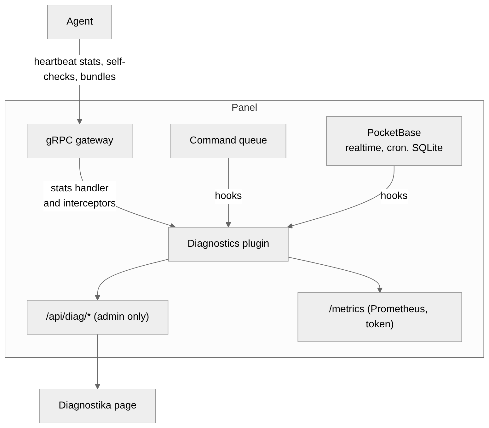

- **Collection** – a gRPC `stats.Handler` (connection begin/end, payload sizes, RPC timing) plus unary and stream interceptors (status codes, command ids); command-queue hooks (depth, dispatch and completion latency, retries, replays, timeouts); PocketBase internals (realtime clients, cron jobs, SQLite and WAL size); Go `runtime/metrics`.
- **Per agent** – connected since, remote address, TLS version and certificate expiry, RTT p50/p95, clock skew, messages and bytes in/out, reconnects with classified reasons (EOF, keepalive timeout, TLS error, revoked certificate), last error.
- **Storage** – in memory only: counters, histograms and a ring buffer of the last 500 message metadata entries per agent, 24 h window. Connection events also go to the `events` collection so they survive restarts. A connection is an agent's from its first call; a unary call ties it only once its request shows it is no probe (`Config.Probe`), so a connection whose only call is a `Heartbeat` probe (#32: `repoint`, the diagnostics' round trip) is neither counted nor stored as an event, while the trace still shows its messages.
- **Agent side** – heartbeats carry light runtime stats (goroutines, heap, worker pool, Docker API latency, free space on the agent volume); periodic self-checks (Docker socket, host mount, edge container, restic, time sync); `agent.diagnostics` builds a bundle uploaded with `UploadArtifact`; `agent.set_log_level` changes the log level for a limited time, after which it falls back to info (15 minutes when the command names none, at most a day).
- **Payload capture** – off by default. An admin can capture message payloads of one agent for 10 minutes; fields marked with a custom `sensitive` proto field option are always masked.
- **Output** – the Diagnostika page (System section of the UI), an optional token-protected Prometheus endpoint, and downloadable debug bundles (`diagnostic_bundles`, removed after seven days by a daily job).
- **Disconnects** – the gateway pings silent connections every 10 s with a 5 s timeout, so a cut network shows up within about 15 s, before the host is marked offline after 30 s.
- **Overhead** – about 300 ns per traced message (`BenchmarkInterceptor`; no allocation that stays). With 20 agents and a few messages per second each that is far below 0.01 % of one CPU. Memory is bounded by the ring buffers: an estimated 2–3 MB for 20 agents. A disabled plugin adds no interceptors and no routes.

## Change audit

Every configuration change is written to the append-only `audit_log` collection: who made it, from where, what exactly changed, and which command it caused.

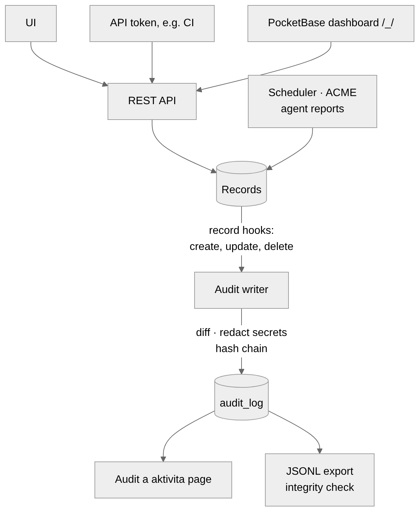

- **Scope** – configuration collections: hosts, stacks, sites, domains, DNS providers, certificates, backup targets and jobs, database servers and databases, scheduled tasks, users and roles, API tokens, alert rules, PocketCloud and PocketBase settings, collection schema. High-volume or derived data (inventory, metrics, events, diagnostics) is not audited; commands are shown from `commands` in their own tab.
- **Writer** – one component on PocketBase's execute hooks for the audited collections. The change and its entry are written in the same transaction, so a crash can never lose one without the other. It compares the record with the row in the database and stores field-level diffs; a deletion stores the last state. (`Record.Original()` is not enough: it stays blank for a record created in the same process, and a save does not refresh it.)
- **Actor** – PocketBase does not pass the request context to model hooks for API saves. So the request hooks remember the actor by the model being saved, and the transaction carries it on to nested saves such as cascade deletes. The actor (user, API token or superuser), IP, user agent and source (UI, API, PocketBase dashboard) come from the request; changes without a request are attributed to the component that made them (scheduler, ACME manager, agent report, migration).
- **Overhead** – about 1.1 ms per audited save on the 4-vCPU cloud VM used for the tests: 0.24–0.26 ms without the audit, 1.35–1.48 ms with it and the seal (`BenchmarkSave`, three runs of 300 saves). The seal adds about 0.1 ms of that. An earlier measurement on a faster machine gave 0.7 ms. A save that only touches live status, such as a heartbeat, adds one small read and no entry.
- **Secrets** – values of fields marked 🔒 never reach the audit; the entry only records that the field changed. The same goes for fields made from a secret, such as the user names of a site's password (`Redact` in `schema.Audited`).
- **Links** – an entry points to the command it caused (a saved stack → `stack.deploy`), to the revision (stack r7 → r8) and can carry a note from the user.
- **Integrity** – each entry stores `prev_hash` and `hash = SHA-256(prev_hash ‖ canonical JSON of the entry)` (RFC 8785). A daily job and the “Ověřit integritu” button verify the chain; a break raises an alert. Updates and deletions of audit entries are rejected in hooks, for superusers too; only retention removes old entries, and it first writes a checkpoint entry with the hash the chain continues from. The check starts at the newest checkpoint, which must lie inside the part it checks, with nothing older left.
- **Seal** – hashes alone show an edited entry, but not a removed newest one, and anyone with the database can recompute every hash after an edit. So the head of the chain, the seq and hash of the newest entry, is kept in its own table (`_pc_audit_head`, not a collection), written in the same transaction as the entry and sealed with an HMAC under a key derived from the master key, which is never in the database. The check reads one snapshot of the database, so entries written meanwhile are not mistaken for a break; nothing may come before the start of the chain, and every row must be part of it (two rows with one seq fail). Commands that run without the master key (every command loads it when its file is readable) leave the newest entries unsealed, keeping the last sealed point; the next write or start of the panel with the key seals them, unless what was sealed before has changed, and the seal then lists them as written without the key, which the audit page shows: entries someone added to the database would show up there. A retention checkpoint must be sealed: one that is unsealed or listed as written without the key fails, since it could move the start of the chain past sealed entries. Only an empty log is trusted unseen: its first entry creates the head, sealed when the key is there. A log that predates the seal or was only ever written without the key, and one whose seal was removed, fail the check until the owner runs `panel audit seal`, which refuses a chain whose hashes do not match, lists every entry no seal proved as written without the key and records itself as a security event; `panel audit verify` runs the check from the command line. The panel remembers how far it has seen the log sealed while it runs, so a log or head put back from an older copy, or a wiped log, fails the check until the next restart. Retention needs the key. Limits: entries written without the key are vouched for only by their hashes, so they may also have been rewritten before they were sealed; after a restart, an older copy of the log put back whole, or a log wiped together with the table of its head, cannot be told from the real thing. The JSONL export lets the chain be kept off-site against that. A panel restored from its own backup (#32) is recorded as a sealed `panel_restored` entry, written at its first start after `panel recover`: it names the backup's export, its time, and the seq and hash of the backup's newest entry, where the restored log resumes; what the old panel logged after the backup was made is lost with it (`entries_after_lost`).
- **Retention and export** – `audit.retention_days` (default 365); JSONL export with hashes from the UI or API, optionally pushed daily to a backup target to keep an off-site copy.
- **Revert** – objects with revisions (stacks) are reverted by deploying the old revision as a new one; other records get their previous non-secret values back as a new change. Reverts are audited like any other change.
- **Security events** – sign-ins and failed sign-ins, MFA changes, API tokens created, used and revoked, enrollment tokens, certificate revocations, terminal and Adminer sessions, diagnostics payload capture, recovery kits downloaded and checked, and a restore of the panel (#32). They form the Bezpečnost tab.

## Security model

- Trust boundaries: browser ↔ panel (HTTPS + PocketBase auth), agent ↔ panel (mTLS), panel ↔ external APIs (DNS, ACME, storage).
- A compromised agent can only act as its own host: it receives only its own commands and the secrets those commands need.
- Access to the Docker socket is root-equivalent on that host. This is inherent to managing Docker; the host root is mounted read-only and writes go through job containers with explicit mounts.
- Enrollment tokens are single use, short-lived, stored hashed and rate limited; the install command pins the panel CA.
- Terminal access is admin-only and audited; host shells are opt-in per agent.
- PHP containers run as `www-data`, see only their own site directory and have no Docker socket; each application reaches its database server over its own internal network with a user limited to its own database, and a restore of its database runs as that user, so a backup cannot write another application's database (#53, [ADR 0009](adr/0009-database-restores-run-as-the-database-user.md)).
- Adminer runs on the panel's origin, under its own path. Its sign-in needs no password from the browser and the panel's token never reaches it, but a flaw in Adminer that let data run as script would run next to the panel's UI, which keeps its token in local storage. Serving tools from a separate origin would remove that; until then the sessions are admin-only, short and audited.
- Roles: admin, operator, viewer. Automation (CI) uses scoped, expiring API tokens stored hashed; their use is attributed in the audit log.
- Configuration changes are audited with tamper-evident hash chaining (see [Change audit](#change-audit)).
- The panel's own backup (#32) is sealed on the panel with keys derived from the master key: the carrier server and whoever holds the repository's password can delete or roll back a snapshot, but neither forge one nor read its contents, the database or the manifest. They do read what PCPB1 leaves in the clear: each stored file's path and size (the names and times of database dumps, the names of uploads, record ids), the number of files, the export's time, and which files did not change between snapshots; and they can read every ordinary backup in that repository anyway. The master key leaves the panel only in the recovery kit, sealed with argon2id of a passphrase of at least 12 characters; downloading one needs the sign-in password, at most 5 attempts per 15 minutes per user, and the answer is not stored. The kit and its passphrase together are every secret of the panel, the CA's keys included. A start with another master key, on a database without its CA or with another CA than `POCKETCLOUD_EXPECT_CA_PIN` names, or beside another panel on one pb_data fails before anything is written. PocketBase's own restore is refused, as it would restart with whatever key is mounted. The first start after a restore gives the users' and superusers' tokens new secrets, ending every session from before the disaster. See [disaster-recovery.md](disaster-recovery.md#reference) for who can do what with the kit, a repository or the carrier.

A full threat model is tracked in the security review issue (milestone M5).
