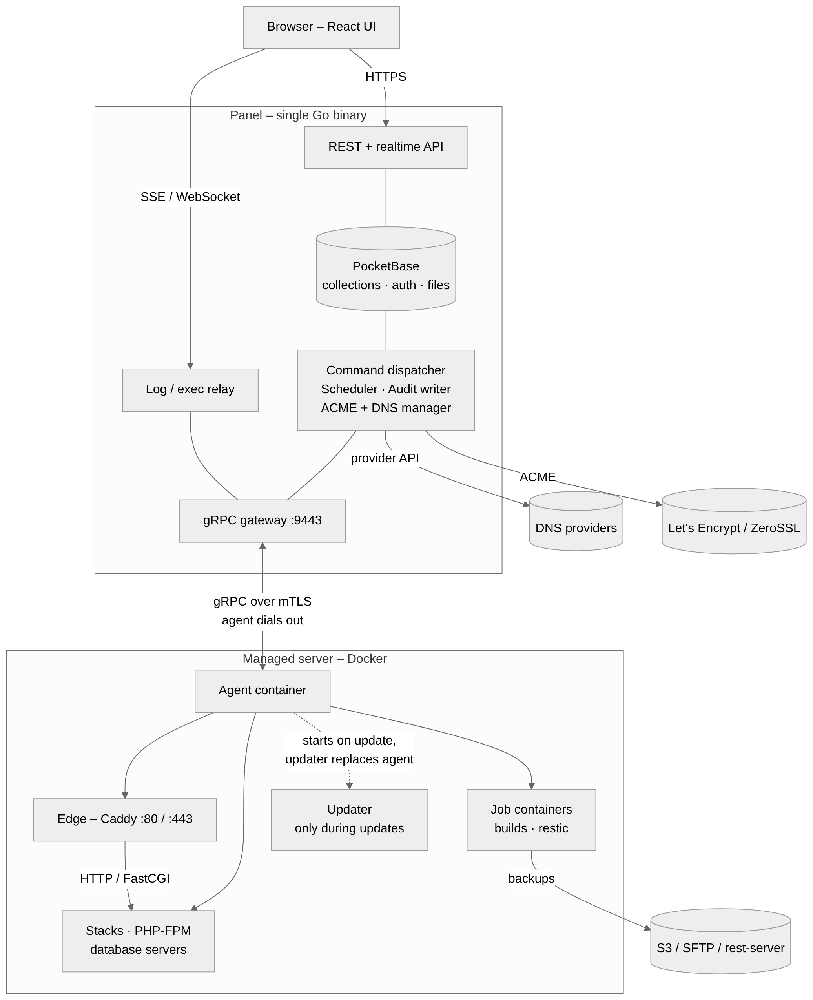
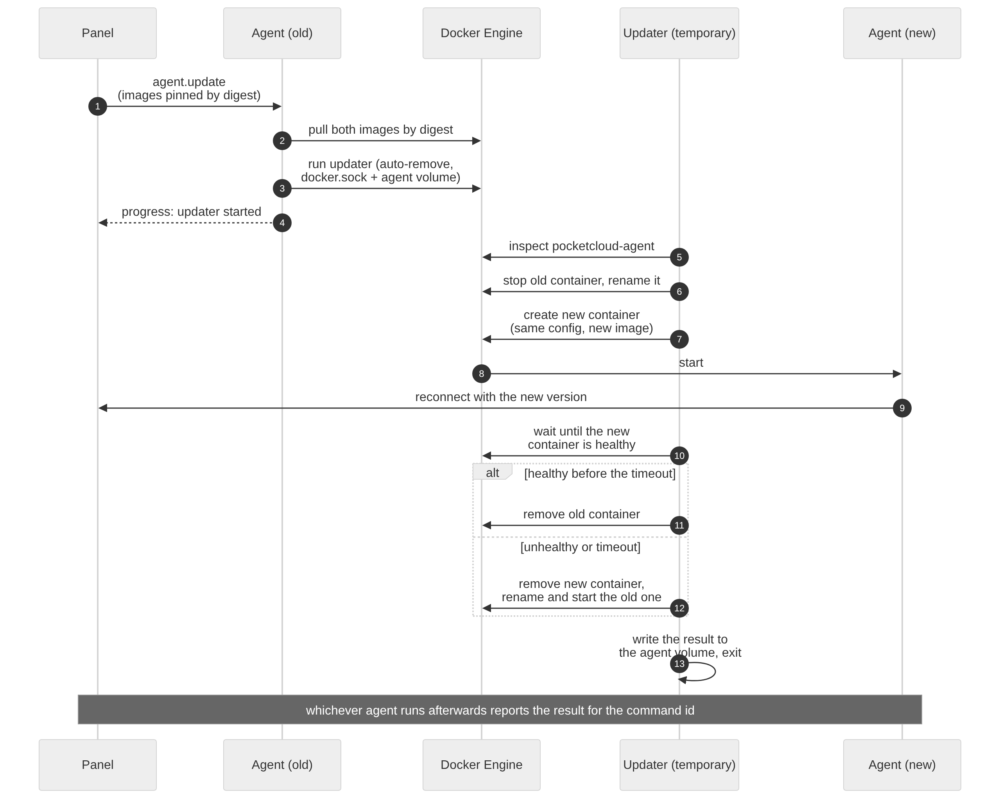
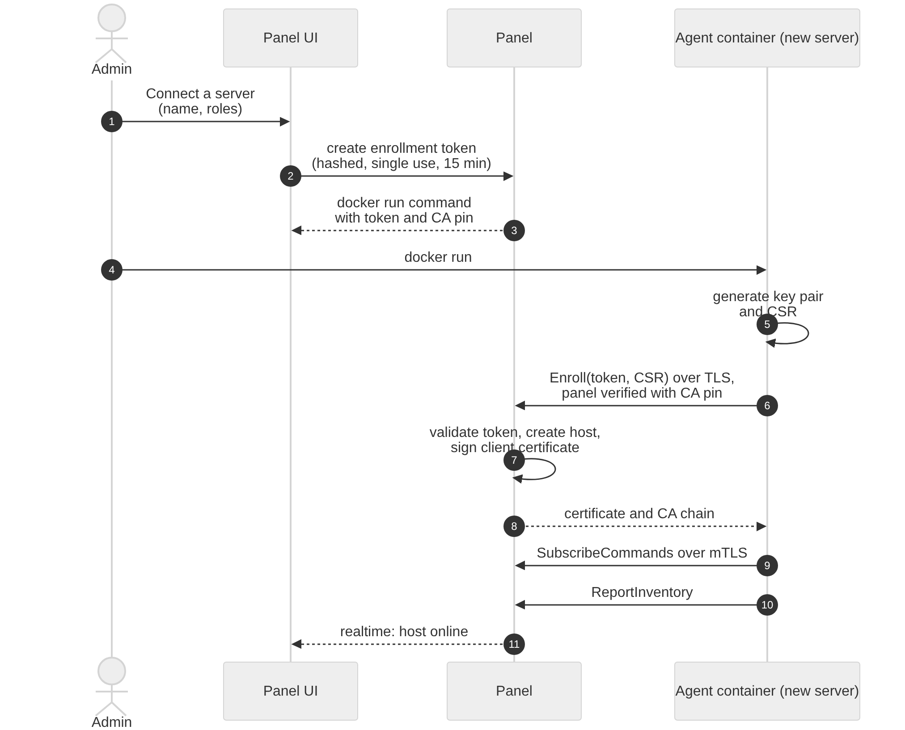
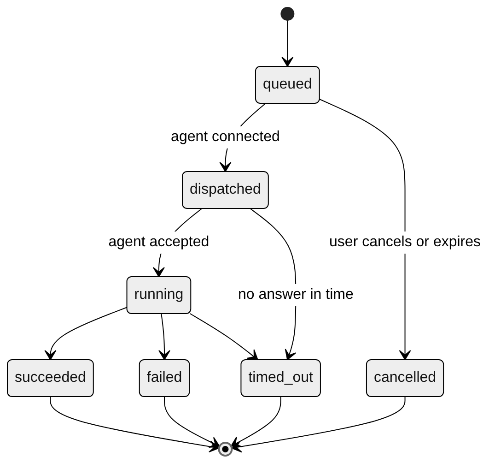
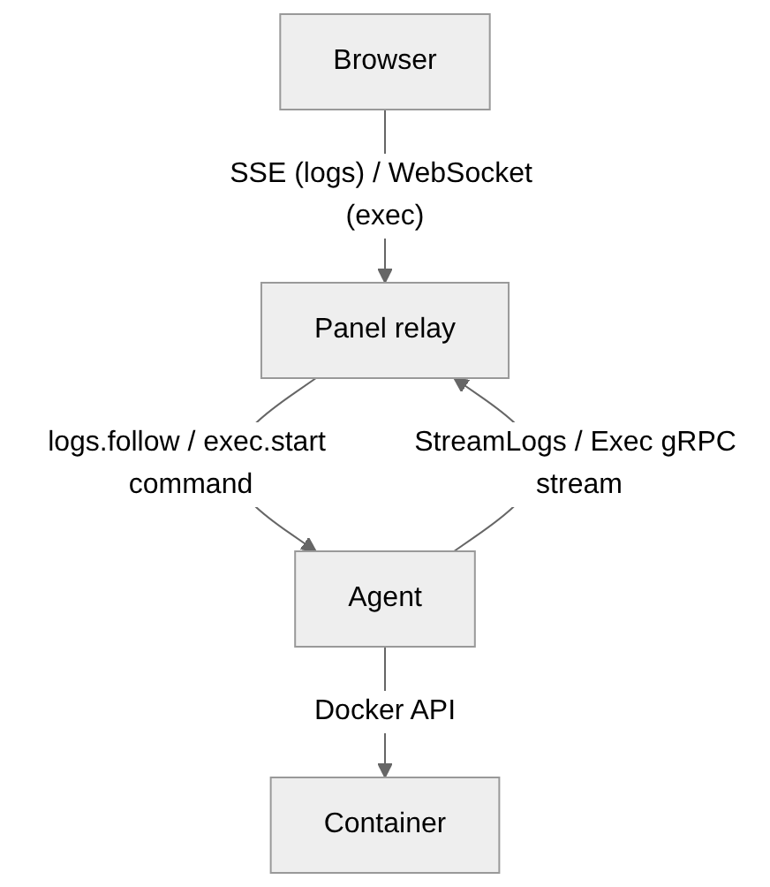
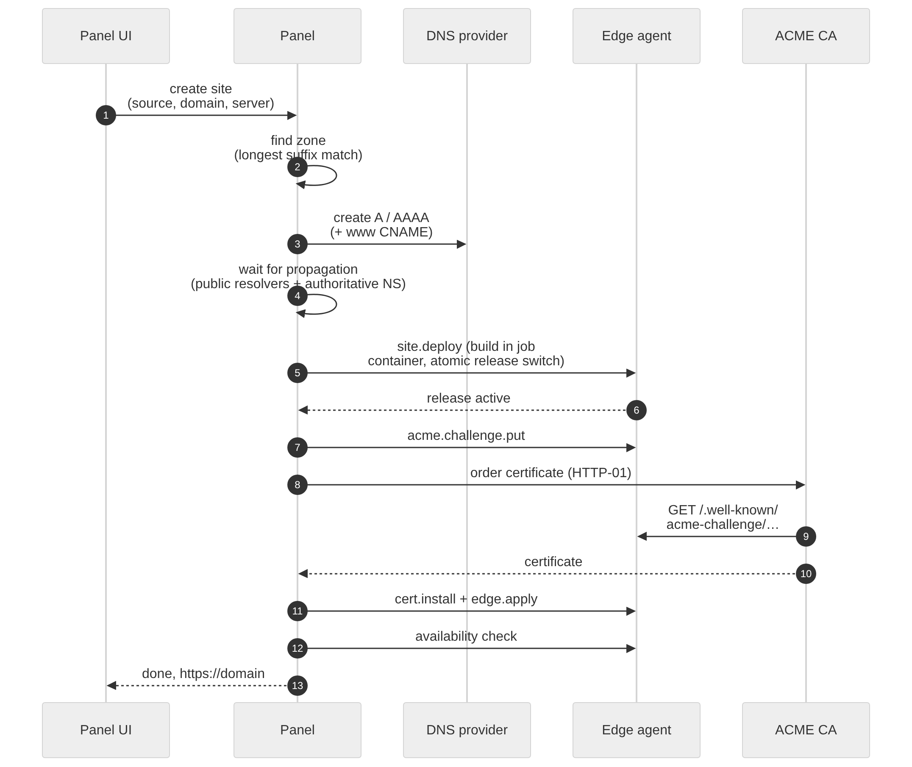
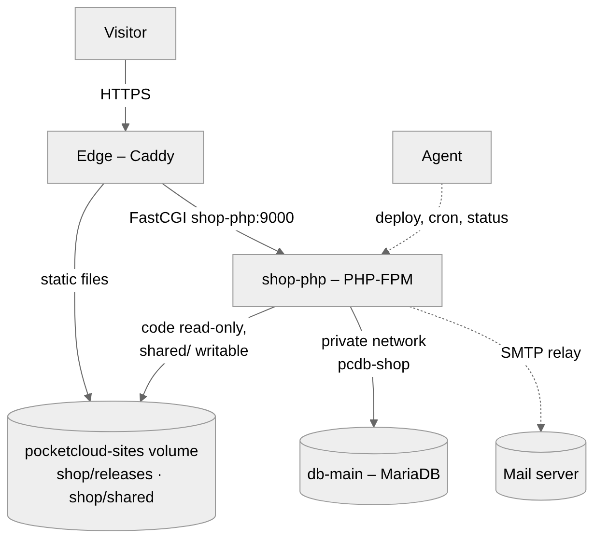
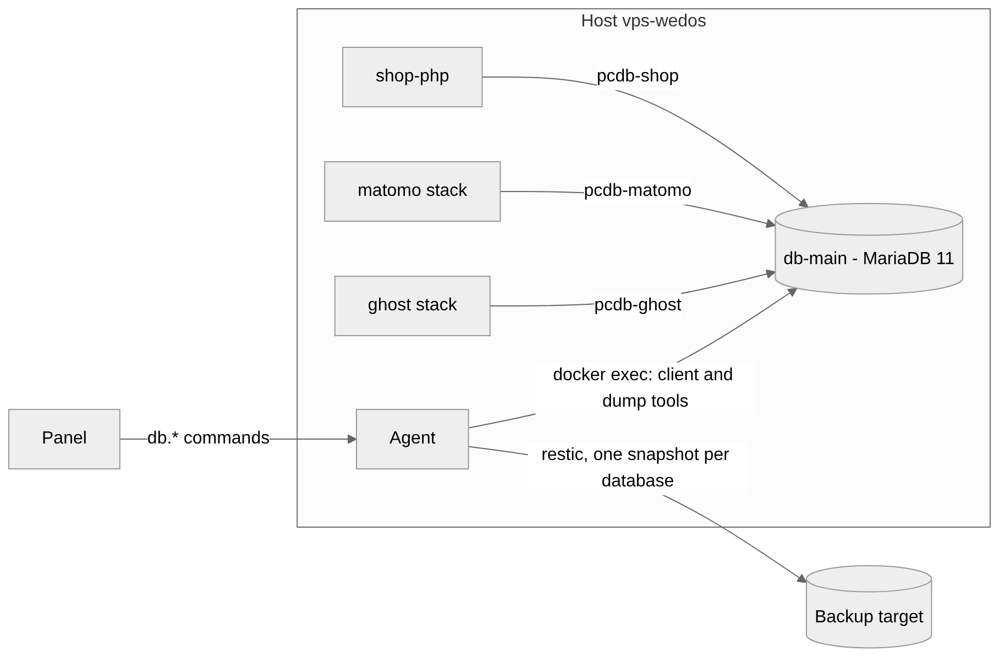
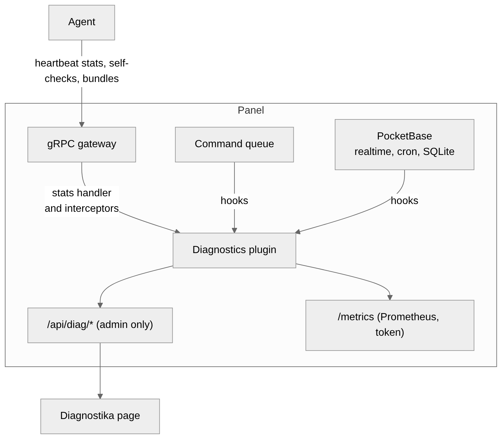
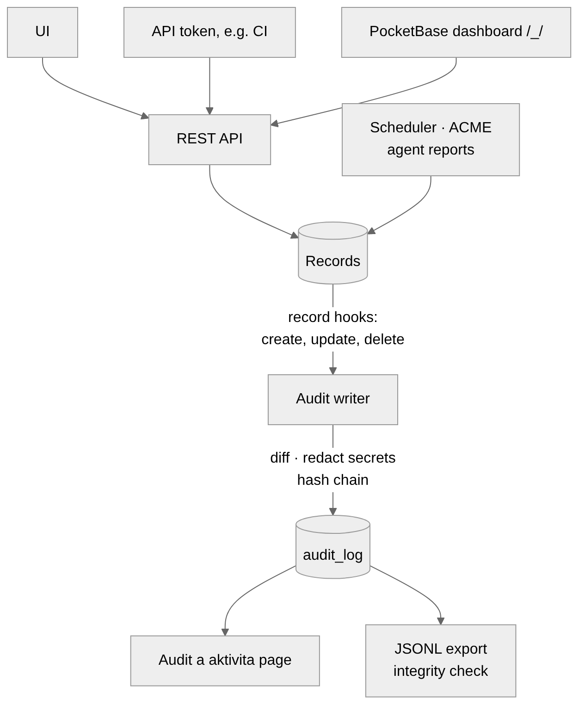

# Architecture

> Status: M0 and M1 are implemented. M2 – inventory and container actions, Compose stacks, live logs, metrics, the web terminal, the server page and database servers – is implemented, tested against `cmd/fakedocker` and `cmd/fakecompose`, and has run on a real Docker Engine (29.9, Ubuntu 24.04, amd64, cgroup v1) in a cloud VM, together with the agent's enrollment and updates; arm64, cgroup v2 and a host behind NAT are not checked yet. The edge proxy of M3 (#20) is implemented and tested against a fake of Caddy's admin API; the rest of M3 is planned. Sections about later milestones describe what is planned. Decisions are recorded as ADRs in [`adr/`](adr/).
>
> Diagrams are PNG renders of the Mermaid sources in [`diagrams/`](diagrams/), so they show up everywhere, including the GitHub mobile app. Edit the `.mmd` file and run [`diagrams/render.sh`](diagrams/render.sh).

PocketCloud has two binaries:

- **Panel** – one Go process: [PocketBase](https://pocketbase.io) embedded as a library (auth, collections, REST + realtime API, files, cron), the React UI, a gRPC gateway for agents, and the managers for commands, DNS, certificates and backups.
- **Agent** – a small container (`pocketcloud-agent`) on every managed server. It dials out to the panel, executes commands (Docker, Compose, edge proxy, site deploys, PHP and database containers, restic) and streams data back. It never replaces itself: updates are done by a short-lived **updater** container (`pocketcloud-updater`).



## Principles

1. **Agents dial out.** The panel never opens connections to servers. Servers behind NAT work and need no inbound ports (except 80/443 on servers with the `edge` role).
2. **The panel is the source of truth.** Agents keep only their identity and what they need to keep serving when the panel is down (edge config, certificates).
3. **Every action is a command.** UI actions and scheduled jobs create records in `commands`. The collection is both the command history and the delivery queue. Delivery is at-least-once; agents deduplicate by command id.
4. **Streams bypass the database.** Logs, terminal sessions and admin tool sessions are relayed agent → panel → browser and never stored in PocketBase. A command's output streams live the same way and is stored once, as a file of the command, when it ends.
5. **Secrets are encrypted at rest** with a master key kept outside the database, and are sent to an agent only inside the command that needs them.
6. **Everything on a server is a container.** The agent, the edge proxy, PHP runtimes, database servers, site builds, backup and restore jobs and the updater all run in Docker; the agent never updates itself in place.
7. **Every change is audited.** Configuration changes – from the UI, the API, the scheduler or the PocketBase dashboard – are written to an append-only, hash-chained audit log with field-level diffs.

## Ports

| Component | Port | Purpose |
|---|---|---|
| Panel | 443 (or behind a reverse proxy) | UI and REST/realtime API |
| Panel | 9443 | gRPC gateway for agents (mTLS) |
| Agent container | – | no inbound ports |
| Edge container (`edge` role) | 80, 443 | static and PHP sites, exposed containers |
| PHP-FPM and database containers | – | internal Docker networks only |

## Agent container

The agent ships as a multi-arch image (`ghcr.io/oldbear24/pocketcloud-agent`, linux/amd64 and linux/arm64) with the agent binary, the Docker CLI with the Compose plugin, and restic. It is started once with `docker run` (or a Compose snippet) and managed by PocketCloud afterwards.

| Mount | Mode | Why |
|---|---|---|
| `/var/run/docker.sock` | read-write | manage containers; start edge, job and updater containers |
| volume `pocketcloud-agent` → `/var/lib/pocketcloud` | read-write | identity (key, certificate), config, idempotency state, updater results |
| `/` → `/host` | read-only, `rslave` | host metrics (`/host/proc`, `/host/sys`), disk usage, reading host paths for backups |

- `rslave` lets mounts and unmounts on the host reach the agent's view, so the agent never holds on to a disk the host wants to detach. It needs `/` to be a shared mount, which systemd sets up; on hosts without systemd (Alpine, WSL) `docker run` refuses the mount until `mount --make-rshared /` has run, at every boot. Without it, an agent that ran before does not start again after a reboot: Docker says `/` is not a shared or slave mount.
- Host facts come through the `/host` mount. The addresses are read from `/host/proc/1/net`, the network namespace of the host's init rather than the agent container's, and skip Docker's and other container interfaces.
- First start reads `PANEL`, `CA_PIN`, `TOKEN`, `NAME` and `ROLES` from the environment, enrolls, and stores its identity in the volume. The token is single use, so leaving it in the container environment is harmless.
- The image `HEALTHCHECK` reports healthy only while the agent is connected to the panel; the updater relies on it.
- The agent labels everything it runs with `pocketcloud.role` (`agent`, `updater`, `edge`, `job`) so the inventory can recognise and protect these containers.
- Work that needs more access than the read-only host mount – writing restored files, building sites, backing up a volume – runs in short-lived **job containers** that mount exactly what they need.

## Agent updates

A container cannot safely replace itself: stopping its own container kills the process halfway through. The agent therefore starts a tiny, purpose-built `pocketcloud-updater` container (a static Go binary on `scratch`) that swaps the agent container and exits.



- Images are always pulled by digest; the panel release defines which agent and updater digests belong to it.
- The new container keeps the old one's environment, mounts, networks, restart policy and labels (recreate from inspect).
- If the updater itself dies mid-way, the old container still exists (stopped and renamed to `pocketcloud-agent-old`), and the panel shows the host as offline until it is back. To recover by hand:

  ```sh
  docker rm -f pocketcloud-agent; docker rename pocketcloud-agent-old pocketcloud-agent; docker start pocketcloud-agent
  ```
- The new agent must turn healthy within three minutes. One that exits, or keeps being restarted by the restart policy it took over, counts as failed at once, so a release that cannot start is rolled back in seconds.
- The updater writes its outcome to the agent volume (`updates/<command id>.json`), and whichever agent runs afterwards reports it for the command.
- Batch updates go one host at a time, and a failed update stops the batch.
- Restarting the agent does not need the updater – a plain `docker restart` from the agent is enough.

## Agent identity and enrollment

The panel runs an internal CA. Agents authenticate with client certificates; no passwords or API tokens live on servers.



- Certificate SAN `pocketcloud://host/<hostId>` identifies the host on every call.
- Agent certificates are valid for 180 days and renewed over the existing connection when 30 days remain (`RenewCertificate`). The previous certificate stays valid until the agent first calls with the new one, so a lost response cannot lock it out.
- Removing a host revokes its certificate. The serial denylist is checked on every call, so a revoked certificate stops working on connections that are already open too. A command stream is authenticated when it opens, so the removal also ends the host's open stream at once.
- Agents identify the panel by its pinned CA and the name `pocketcloud://panel`, not by host name ([ADR 0006](adr/0006-agents-pin-the-panel-ca.md)).

## gRPC API (v1)

The contract is in [`proto/pocketcloud/agent/v1`](../proto/pocketcloud/agent/v1). The generated Go code is committed ([ADR 0005](adr/0005-generated-code-is-committed.md)), and CI checks it and runs `buf breaking` against `main`.

| RPC | Kind | Purpose |
|---|---|---|
| `Enroll` | unary | token + CSR → client certificate (only RPC without client certificate) |
| `SubscribeCommands` | server stream | long-lived command delivery; request carries version, capabilities, recently finished ids |
| `ReportCommandUpdate` | unary | progress and results, idempotent by command id + sequence |
| `Heartbeat` | unary | every 10 s; vitals, RTT, clock skew |
| `ReportInventory` / `ReportEvents` | unary / client stream | Docker inventory and incremental events |
| `PushMetrics` | client stream | batched metrics |
| `StreamLogs` | client stream | log chunks for an active `logs.follow` |
| `Exec` | bidi stream | terminal sessions |
| `FetchArtifact` | server stream | agent downloads uploads and site releases |
| `UploadArtifact` | client stream | agent uploads diagnostics bundles, imported Compose files, SQL dumps and (later) restore downloads to the panel |
| `Relay` | bidi stream | admin-only connections to a temporary tool container (Adminer); opened by a command and bound to one browser session, like `Exec`. One stream carries every connection of the session, numbered by `conn_id` |
| `RenewCertificate` | unary | identity rotation |

Command payloads are a `oneof` per type: `container.*`, `image.*`, `stack.*`, `logs.*`, `exec.*`, `site.*` (static and PHP), `task.*` (scheduled tasks), `db.*`, `edge.*`, `cert.*`, `acme.*`, `backup.*`, `agent.*`. Each field is named after its type with dots as underscores. Agents advertise supported types in `capabilities`, which keeps old agents working while new command types are added; a type the agent does not support fails at once with a message saying so.

Fields holding secrets carry the `sensitive` option from `proto/pocketcloud/options/v1`, and message traces never show them.

## Command lifecycle



- The dispatcher reacts to new records (`OnRecordAfterCreateSuccess`) and to agent connects.
- Commands touching the same resource (stack, site, backup repository) run in order; others in parallel.
- After a reconnect the panel re-sends commands that were dispatched but never finished; the agent acknowledges ids it has already completed without running them again.
- A command runs **at most once**. The agent records a command in its volume before running it. If it was killed in the middle, the replay does not run the command again: it reports a failure saying the result may be incomplete. Whether to try again is up to whoever asked for it.
- Queued commands for an offline host expire after `command_queue_ttl_s`; dispatched and running ones time out per command type. No command stays open forever.
- The panel's own fields of a command (status, attempts, results) cannot be set through the API, and the state machine holds for every save, superusers included.
- Multi-step flows (new site, restore) are a parent command with children sharing a correlation id, which drives the progress timelines in the UI.

## Compose stacks

A stack is a Compose project on one host. The panel keeps its Compose file, its env file and its secrets; the agent has them only while it deploys.

- **Revisions** – a save that changes the files adds a `stack_revisions` entry. `current_revision` is the latest saved, `deployed_revision` the one that runs; a rollback deploys an old revision as a new one.
- **Validation** – the panel checks a file while it is edited (`internal/stacks` with compose-go) and points at the line of each problem; a relative bind mount gets a warning, because it would resolve inside the agent's volume. The agent checks again with `docker compose config` before it deploys.
- **Secrets** – values are sealed in `secrets`, their names listed in `secret_keys`. The env file may refer to them, and to the passwords of databases, as `${secret:name}`. The command's stored payload holds only the references: the panel adds the values when it delivers `stack.deploy`.
- **Deploy** – the agent writes `compose.yaml`, the env file and, if the stack uses database servers, `compose.pocketcloud.yaml` to `stacks/<name>/` on its volume, and runs `docker compose --project-name <name> … config`, `pull` when asked, and `up --detach --remove-orphans`. The env file holds the secrets only during the deploy; a clean copy replaces it afterwards, and on the next start if the agent died in between. Output streams to the command, with secret values of four or more characters masked.
- **Stop, down, restart** – use only the project name, so a missing secret cannot block them and projects started outside PocketCloud work too.
- **Import** – Compose projects already running on a host are found by their Compose labels in the inventory. `stack.import` reads the Compose file and `.env` through the read-only host mount and uploads them as an artifact, not in the command's result, because they may hold passwords. The panel moves variables with secret-looking names (password, secret, token, key, …) into sealed secrets, rewrites relative bind mounts to absolute paths so the data stays where it is, and saves the stack as `imported` until its first deploy. A project started from several Compose files, or without the label that names its file, cannot be imported, and the page says why.

## Logs and terminal



The streams are custom routes registered in `OnServe` that check the PocketBase auth token. Nothing that passes through them is stored: the database sees only the commands that open and close them.

- **Logs** – `/api/pc/hosts/{id}/logs` (chosen containers) and `/api/pc/stacks/{id}/logs` (every container of a stack) are server-sent events. The first viewer of a set of containers queues `logs.follow` with a random session id, and the agent opens `StreamLogs` with it, in batches of at most 200 lines. Later viewers share that stream and start with up to 1,000 recent lines. A viewer that reads too slowly loses lines instead of holding up the others, and is told how many. The stream starts with an `open` event, so the page shows it as live before the first line arrives. The last viewer to leave queues `logs.stop`.
- **Command output** – `/api/pc/commands/{id}/output` streams what a running command writes, such as a deploy, and ends with its final state; for a finished command it sends the stored output.
- **Terminal** – admins only. `POST /api/pc/hosts/{id}/terminal` checks what may be opened and returns a ticket that works once within 30 seconds, because a WebSocket cannot carry an `Authorization` header and a token in a URL ends up in logs. The browser opens `/api/pc/terminal/socket` with the ticket, the panel queues `exec.start`, and the agent joins with an `Exec` stream to `docker exec` with a TTY. The socket accepts the origin of the public URL and of `localhost` (for a Vite dev server), a session without input or output ends after 30 minutes, and its start and end are security events in the audit.
- **Host shells** – opt-in per agent (`HOST_SHELL_ENABLED=1`, stored as `host_shell_enabled`). The agent then starts a short-lived privileged helper container (`alpine`, host PID namespace) and runs `nsenter -t 1 -m -u -i -n -p -- /bin/sh -l` in it; the helper is removed with the session.

## Metrics

Every 10 seconds the agent samples the host (CPU, memory, load, network, usage of each mount) from `/host/proc` and `/host/sys`, and its running containers from the Docker API, and sends the batch with `PushMetrics`. The panel writes it to `pb_data/metrics.db`, outside PocketBase, and rolls it up to 1 minute and 1 hour ([ADR 0003](adr/0003-metrics-storage.md)). `/api/pc/metrics/hosts/{id}` and `…/containers/{docker id}` return a window of 1 hour, 24 hours or 7 days; the latest values stay on the `hosts` record from the heartbeat. A host's CPU is a share of all its cores; a container's is on the scale of `docker stats` and `top`, where 100 % is one core, so a busy container on a four-core host can show up to 400 %.

## Static sites, domains and TLS

Servers with the `edge` role run Caddy in its own container (`pocketcloud-edge`) managed by the agent, so agent updates never interrupt traffic ([ADR 0002](adr/0002-edge-proxy-integration.md)). The panel generates each edge's complete route table from sites, domains and container labels and sends it with `edge.apply`; the agent loads it through Caddy's admin API on a Unix socket, which keeps the last good config when a new one is invalid.

### Edge proxy

- **Image** – the official Caddy image, pinned by the digest of its multi-platform index in `internal/version` (`EdgeImage`, `EdgeVersion`, `EdgeDigest`), because the panel generates configs for exactly that version. CI loads the generator's golden configs into the pinned image with `caddy validate`. A panel release with a newer pin replaces every edge container on its next apply: each edge is down for a second or two.
- **Container** – created by the first `edge.apply`, named `pocketcloud-edge`, labelled `pocketcloud.role=edge` (protected like the agent), on the network `pocketcloud-edge`, publishing 80/tcp, 443/tcp and 443/udp (HTTP/3), with every capability dropped but binding low ports, without new privileges, restarted unless stopped. It runs `caddy run --resume`.
- **Shared directories** – the edge mounts four directories of the agent's own volume, and nothing else of it: `edge/run` (the admin socket), `edge/certs` and `edge/acme` (read-only), and `edge/config` (Caddy's autosave, so a new container resumes the last config by itself). They are volume subpaths on Engine 26 and newer, and binds of the volume's directory on older engines; after creating the container the agent checks that the engine mounted exactly that, as an engine that ignored a subpath would expose the agent's identity. The agent's own mounts stay as they were, so updates and the install command are unchanged.
- **Config** – the panel builds it from the edge's domains (`internal/edge`): port 80 answers ACME HTTP-01 challenges from `edge/acme` first, then redirects to HTTPS or serves the route; port 443 exists only when certificates are installed, loaded from files, with automatic HTTPS off, so Caddy never obtains or renews anything by itself. Routes are sorted by name, exact names before wildcards. `reverse_proxy` keeps WebSockets through a reload (`stream_close_delay` 24 h), there is no grace period, so requests under way finish, and Caddy's request metrics are on. The agent always sets its own admin block, so no config can move the admin API out of its reach.
- **Applying** – the panel sends `edge.apply` when a domain, a certificate or the edge role changes, and when a heartbeat shows the edge serving another config than the one it wants (the heartbeat carries its digest), as after a reinstall or a command that expired while the server was away. A certificate goes there with `cert.install` before the config that uses it; both are ordered by the edge's resource. A newer config replaces a queued one, and a config the edge refused is not sent again by itself: the server page's Apply again sends it anyway. Without the edge role the edge is removed, with its keys; the role cannot be taken while domains need it.
- **On the agent** – a refused config fails the command with Caddy's error and the old one stays active. A new image replaces the container, and the old one comes back if the new Caddy refuses the config. Ports already taken are named in the error, by the container that holds them when there is one, and the container that could not start is removed. The agent keeps the last config, brings back a missing or stopped edge when it starts, and puts upstream containers back on the edge's network when Compose recreates them. The edge's self-check reads the agent's own edge state, not the roles of its enrollment.
- **Domains** – a domain names its edge, a container of that server and its port, or a redirect, and its TLS: `auto` serves it over HTTPS when a certificate covers it, `off` keeps it on plain HTTP. HTTPS redirect, HSTS and compression are options. Until #25 a container reaches the edge's network through `edge.apply`'s list of upstreams, which the agent connects; containers on that network can reach each other.
- **Certificates** – until ACME (#23), admins upload a chain and its key (`POST /api/pc/certificates`): they must belong together, name hostnames and not have expired. The key is sealed and hidden from the API, and reaches an agent only inside the `cert.install` it needs, filled in at delivery. The files on an edge are named after the record and the leaf's fingerprint, so a renewal is a new config; `cert.remove` refuses files a config still uses, as Caddy would not start again without them.
- **Server page** – every route with the TLS state it is served with (valid until a date, expiring within 14 days, expired, being installed, or HTTP only), the edge's state and its requests per second.

Certificates are issued **centrally by the panel** with lego ([ADR 0001](adr/0001-acme-and-dns-libraries.md)), stored encrypted and distributed with `cert.install` to every edge that serves the names. One ACME account, wildcard reuse across servers, and a single place to see expiry.

- **HTTP-01**: the panel asks the edge agent to write the answer into the volume shared with Caddy, which serves it at `/.well-known/acme-challenge/<token>`.
- **DNS-01**: the panel creates the TXT record through the DNS provider API (required for wildcards and non-public names).
- Renewal 30 days before expiry; alert at 14 days or on failure.

New site provisioning (one parent command):



If the zone is not at a connected provider, the wizard shows the records to create at the registrar and polls until they resolve.

Site releases live on the `pocketcloud-sites` volume shared by the agent and the edge container (`<site>/releases/<n>` with a `current` symlink); builds run in job containers on the target host ([ADR 0004](adr/0004-site-build-location.md)); rollback switches the symlink without rebuilding.

LAN-only names use DNS rewrites (AdGuard Home, Pi-hole) and certificates from the internal CA.

## PHP sites

A PHP site is a site with `type = php`. Its code is deployed exactly like a static site (releases and a `current` symlink on the `pocketcloud-sites` volume); requests for PHP scripts are executed by a dedicated PHP-FPM container per site, everything else is served by the edge directly.



- **Runtime image** – `ghcr.io/oldbear24/pocketcloud-php:<version>-fpm`, built in CI from the official `php:<version>-fpm` images for every supported PHP version (currently 8.2–8.5; the UI warns before a version reaches end of life), multi-arch. It adds the common extensions (opcache, mysqli, pdo_mysql, pdo_pgsql, gd, intl, zip, exif, imagick, redis, bcmath), `msmtp` as `sendmail`, WP-CLI, Composer and a small status helper that reports the FPM pool and OPcache state. Sites that need more extensions use an image derived from it.
- **One container per site** – `<site>-php`, labelled `pocketcloud.role=site`, attached to the `pocketcloud-edge` network under the alias `<site>-php`. It runs as `www-data` with CPU and memory limits, without the Docker socket and without published ports. It mounts only its own site directory from the sites volume (Docker volume subpaths, Engine 26+) at the same path the edge uses (`/srv/sites/<site>`), read-only, with `shared/` mounted read-write on top; `open_basedir` is limited to the site directory and `/tmp`.
- **Edge route** – Caddy `php_fastcgi <site>-php:9000` with `root /srv/sites/<site>/current/<docroot>` and `resolve_root_symlink`, so switching a release is atomic and OPcache never mixes files from two releases.
- **Deployments** – the build runs in a job container from the same runtime image, so PHP version and extensions match production (`composer install --no-dev --optimize-autoloader`, optional asset build, optional release hook such as `php artisan migrate --force`). The edge and FPM pick up the new release when `current` switches; rollback switches it back. Persistent paths (`wp-content/uploads`, Laravel `storage/`, Nette `log/`) live in `<site>/shared/` and are symlinked into every release.
- **Configuration** – PHP version, FPM pool (`pm`, `pm.max_children`, `pm.max_requests`), `php.ini` overrides, environment variables and limits per site; secrets referenced as `${secret:…}` are resolved at deploy time. Changing the PHP version is deployed as a new release on the new image, so it can be rolled back with one click.
- **Classic mode** – for sites that update themselves (e.g. WordPress managed from wp-admin) the code directory can be writable without release history; backups then cover the whole site directory.
- **Scheduled tasks** – cron expressions per site (`wp cron event run --due-now`, `php artisan schedule:run`) are scheduled by the panel and executed by the agent with `docker exec` in the site's container; every run records exit code, duration and the tail of its output. Stacks use the same mechanism.
- **Mail** – outgoing mail goes through the SMTP relay configured in the panel (msmtp); sent and failed messages are counted on the site page.
- **Observability** – pool and OPcache statistics from the status helper, latency percentiles and the 5xx rate from the edge's JSON access log, the PHP error log streamed like container logs, WP-CLI or `artisan` through the web terminal as `www-data`.
- **Templates** – WordPress, Laravel and Nette presets set the document root, build steps, shared paths, cron entries, `php.ini` defaults and a health-check URL. WordPress in release mode gets `DISALLOW_FILE_MODS` and `DISABLE_WP_CRON`; core, plugin and theme updates are built as a new release with WP-CLI, so a broken update is one rollback away.

## Database servers

Applications on the same host share a database server instead of each running its own instance. Each application still gets its own database, its own user and its own network path to the server.



- **Servers** – a shared server is a stack of its own (`source` `db_server`) that the panel generates: one service from the official image of a series the panel offers (MariaDB 11.8 or 11.4, PostgreSQL 17, 18 or 16; the first of each is the default), its data in the volume `pcdb-<server>-data` (mounted at `/var/lib/postgresql` for PostgreSQL 18, which keeps its data in a directory of its major version), a health check, labelled `pocketcloud.role=db`, no published ports. The cache (`innodb_buffer_pool_size`, `shared_buffers`) is an eighth of the host's memory, from 128 MiB to 2 GiB; `max_connections` is 200 for MariaDB and 100 for PostgreSQL. The administrator's password is generated by the panel, sealed, and reaches the container as `${secret:db-admin/<server>}`, which only the server's own stack can use. A server is removed only once it holds no databases: its stack goes down, and its volume only when someone asks for that.
- **Dedicated servers** – database containers inside stacks (MariaDB, MySQL, PostgreSQL and its variants with extensions such as PostGIS, pgvector or VectorChord) are recognised by their image and offered for linking. The stack's Compose file suggests the administrator and the variable with the password; once linked, the server's databases are listed from its statistics as the stack's own: export and Adminer work, while users and passwords stay the stack's business. Unlinking leaves the container alone. A dedicated server without extensions says when a shared server of the same engine and the same or a newer major version runs on its host.
- **Networking** – each application that uses a server gets an internal network `pcdb-<stack>`. `db.network.attach` creates it and attaches the server under its name and the application's running containers. Every later deploy keeps them there through `compose.pocketcloud.yaml`, an override the panel generates with the network as external, and so does the server's own deploy, which joins every network of its applications; the agent creates the networks before Compose runs. Applications reach `db-main:3306`, but not each other.
- **Databases and users** – `db.database.create` creates a database and a user with privileges on that database only (PostgreSQL also revokes `PUBLIC`'s access), with a password the panel generates and keeps as the secret `db/<database>`; database names are unique per host. Connecting a stack adds `DB_HOST`, `DB_PORT`, `DB_NAME`, `DB_USER` and `DB_PASSWORD=${secret:db/<database>}` (and `DATABASE_URL` for PostgreSQL) to its env file as a new revision, attaches its network and redeploys it if it runs. References resolve per host: any stack of the host can name any database there, as operators manage every stack anyway.
- **Operations** – rotate a password (the new one waits in `pending_password` until the server has taken it, then the application is redeployed with it), clone a database, export it as gzipped SQL (uploaded with `UploadArtifact`, kept 7 days, admins only), drop it after a final dump that is kept 30 days; nothing is dropped when the dump fails. A drop also takes the variables the panel added out of the stack's env file, as a new revision, since a reference to the dropped database's secret would make the stack's next deploy fail; lines someone changed stay. The agent runs the server's own client inside its container with `docker exec`: passwords and SQL travel in the exec environment, never on a command line, and error messages are masked.
- **Adminer** – admins only, for 30 minutes. `db.adminer.start` starts `adminer:4`, listening on IPv4 because its default `[::]` fails where containers have no IPv6, on an internal network of its own (`pcadm-…`), which the server joins under its name and the agent joins to reach it, with a small plugin that signs in with credentials from the container's environment: the database's own user, or the administrator for a dedicated server. The panel serves it under `/api/pc/adminer/<session>/` through the `Relay` stream, one numbered connection per request. The link carries a one-time ticket that becomes an HttpOnly, SameSite=Strict cookie for that path, and the proxy passes on neither the panel's token nor that cookie. Nothing is published on a port and other containers cannot reach it; only processes on the host itself can, as with every Docker bridge network. The agent removes the container and network when the session ends, when the panel ends it (a panel restart ends every session), and on its next start whatever a previous run left behind.
- **Monitoring** – `db.stats` reports the server's version, size, connections and `max_connections`, and the size and connections of each database: hourly, and when an operator opens the server on the Databases page. Alerts on connection saturation and disk usage come with alerts (#34).
- **Consolidation** – a linked dedicated server without extensions moves into a shared server of the same engine and the same or a newer release series on its host (the major version for PostgreSQL, major.minor for MariaDB, whose 11.4 is older than 11.8). The panel loads the stack's Compose file as a deploy would, with its variables and secrets, and takes the user and password Compose gives the database service (an application that signs in as the administrator is refused: a shared server keeps that user for itself). It also loads the file with the override the stack will get after the move, and refuses the move when the service would not stay off (a `COMPOSE_PROFILES=*` turns on every profile) or another service would still need it, including through `extends`, merged mappings or a shared `network_mode`, `pid`, `ipc`, `uts` or `cgroup`. As every shared server answers to `db` on a stack's network, the name may lead to one server only: a move that would add a second one to a stack that reaches a server as `db`, either way round, is refused, and so is connecting such a stack to another server. `db.server.move` checks that each user signs in to the old server with the password it will keep, over the container's own address where the server checks passwords, that no database or user of the same name waits on the target and that the move names every database the server has (and, for PostgreSQL, that the application keeps no tables in `postgres`, which a shared server keeps for itself), stops the containers of the stack's Compose project as they are at that moment, and for each database dumps it to the agent's volume, creates it on the target with the application's user and password, copies the dump into the target container through the archive API, restores it as that user, and compares the number of tables. A failure drops what the move created and starts the application again; the move keeps the first 2000 characters of the error. Before each create the agent checks the target again, as a create would quietly reuse a database of the same name. Until the last database is copied, a timeout or an agent shutdown undoes the move, as does too little time left before the command's deadline to finish; from then on it finishes, and the panel does not cancel a move once it has left the queue. A gzipped copy of each database stays with the panel for 30 days. The old container then gets the restart policy `no` and leaves its networks, so that nothing reaches the old data even if it is started, and the panel refuses to start it from the table; while a move runs, it refuses changes to the stack's files and secrets, its removal, deploys and commands of the stack and of the servers' own stacks, starts of their containers, new databases for the stack or under a name the move claims on the target, another move claiming the same names, and changes to the moving databases and to the other databases of the stack, as those would deploy it. The panel then points the database and its user at the shared server, marks the password as the application's own, and deploys the stack again: its override puts the old database service in the profile `pocketcloud-moved`, which nothing activates, so Compose leaves its container stopped on `up`, `stop` and `down`; drops it from `depends_on` (`!override`, or `!reset []` when nothing is left); and puts the application on `pcdb-<stack>`, where the shared server also answers to the old service's name and container name. The application's settings stay as they were. A restart of the stack by name names the other services, as `compose restart` alone would start the stopped container too. Seven days later the panel removes the old container, asking again each day until the inventory no longer shows it; its volume stays. A stack that did not run before the move is not deployed after it; its next deploy keeps the old database stopped. A move whose command ended without the panel recording how, as when the panel stopped in between, is marked failed a minute later instead of holding up the next one.
- **Upgrades** – Update pulls the newest image of a shared server's series and recreates its container with the same data; MariaDB upgrades its system tables as it starts (`MARIADB_AUTO_UPGRADE`). The panel asks the server its version 15 seconds after any deploy of it. A new major version of PostgreSQL is a new server: each database moves there with `db.server.move`, keeping its user, password and secret, and the stack is deployed again. The stack's variables are switched to the new server only where its env file holds all the lines the panel wrote for that database; otherwise the move is refused, as the application would go on looking for the old server. So is a move that would leave a variable, or a setting of a service as Compose resolves it, pointing at the old server once the application leaves it (as a URL's host, after `@` or `host=`, or as the value of a setting whose name says it holds a host), one of a database whose secret another stack refers to, and one during a rotation of any password of the stack. Dropping a database later drops its user only when that user owns nothing else; one that owns more, as an application's own user that came with several databases does, stays and loses its privileges on the dropped database, which MariaDB would otherwise keep for a later database of the name. An application that reaches its databases under the name of its old database service keeps that name: all its databases on the server move together, and the new server answers to the name on the application's network. The old server drops its copies, the databases first and then their users, so that a later database of the same name there cannot quietly reuse one, and leaves the application's network once it serves the application nothing.
- **Not built yet** – per-database backups come with M4.

## Backups

- The panel owns targets, credentials, repository passwords and schedules; agents run restic.
- Docker volumes are backed up by short-lived job containers that mount the volume read-only; host paths are read through the read-only `/host` mount; restores run in job containers with only the destination mounted read-write.
- `backup.run` carries repository URL, credentials, sources and optional pre-hooks (database dumps via `restic backup --stdin-from-command`).
- Every database on a database server gets its own dump job (`mariadb-dump --single-transaction` or `pg_dump --format=custom --compress=0`, uncompressed so restic can deduplicate), tagged with the database name, so one application can be restored without touching the others. Restore tests restore the latest dump into a temporary database that is dropped after two hours.
- PHP sites back up their `shared/` directory; code is reproducible from releases and sources.
- Retention with `restic forget --prune`; weekly `restic check --read-data-subset`.
- The panel backs up its own `pb_data`; the master key is exported separately. Restoring the panel keeps the CA, so agents reconnect without re-enrollment.

## Diagnostics

Detailed diagnostics live in a separate PocketBase plugin, `plugins/diagnostics`, registered the same way as PocketBase's own plugins (`diagnostics.MustRegister(app, diagnostics.Config{…})`). When it is disabled it adds no overhead.



- **Collection** – a gRPC `stats.Handler` (connection begin/end, payload sizes, RPC timing) plus unary and stream interceptors (status codes, command ids); command-queue hooks (depth, dispatch and completion latency, retries, replays, timeouts); PocketBase internals (realtime clients, cron jobs, SQLite and WAL size); Go `runtime/metrics`.
- **Per agent** – connected since, remote address, TLS version and certificate expiry, RTT p50/p95, clock skew, messages and bytes in/out, reconnects with classified reasons (EOF, keepalive timeout, TLS error, revoked certificate), last error.
- **Storage** – in memory only: counters, histograms and a ring buffer of the last 500 message metadata entries per agent, 24 h window. Connection events also go to the `events` collection so they survive restarts.
- **Agent side** – heartbeats carry light runtime stats (goroutines, heap, worker pool, Docker API latency, free space on the agent volume); periodic self-checks (Docker socket, host mount, edge container, restic, time sync); `agent.diagnostics` builds a bundle uploaded with `UploadArtifact`; `agent.set_log_level` changes the log level for a limited time, after which it falls back to info (15 minutes when the command names none, at most a day).
- **Payload capture** – off by default. An admin can capture message payloads of one agent for 10 minutes; fields marked with a custom `sensitive` proto field option are always masked.
- **Output** – the Diagnostika page (System section of the UI), an optional token-protected Prometheus endpoint, and downloadable debug bundles (`diagnostic_bundles`, removed after seven days by a daily job).
- **Disconnects** – the gateway pings silent connections every 10 s with a 5 s timeout, so a cut network shows up within about 15 s, before the host is marked offline after 30 s.
- **Overhead** – about 300 ns per traced message (`BenchmarkInterceptor`; no allocation that stays). With 20 agents and a few messages per second each that is far below 0.01 % of one CPU. Memory is bounded by the ring buffers: an estimated 2–3 MB for 20 agents. A disabled plugin adds no interceptors and no routes.

## Change audit

Every configuration change is written to the append-only `audit_log` collection: who made it, from where, what exactly changed, and which command it caused.



- **Scope** – configuration collections: hosts, stacks, sites, domains, DNS providers, certificates, backup targets and jobs, database servers and databases, scheduled tasks, users and roles, API tokens, alert rules, PocketCloud and PocketBase settings, collection schema. High-volume or derived data (inventory, metrics, events, diagnostics) is not audited; commands are shown from `commands` in their own tab.
- **Writer** – one component on PocketBase's execute hooks for the audited collections. The change and its entry are written in the same transaction, so a crash can never lose one without the other. It compares the record with the row in the database and stores field-level diffs; a deletion stores the last state. (`Record.Original()` is not enough: it stays blank for a record created in the same process, and a save does not refresh it.)
- **Actor** – PocketBase does not pass the request context to model hooks for API saves. So the request hooks remember the actor by the model being saved, and the transaction carries it on to nested saves such as cascade deletes. The actor (user, API token or superuser), IP, user agent and source (UI, API, PocketBase dashboard) come from the request; changes without a request are attributed to the component that made them (scheduler, ACME manager, agent report, migration).
- **Overhead** – about 1.1 ms per audited save on the 4-vCPU cloud VM used for the tests: 0.24–0.26 ms without the audit, 1.35–1.48 ms with it and the seal (`BenchmarkSave`, three runs of 300 saves). The seal adds about 0.1 ms of that. An earlier measurement on a faster machine gave 0.7 ms. A save that only touches live status, such as a heartbeat, adds one small read and no entry.
- **Secrets** – values of fields marked 🔒 never reach the audit; the entry only records that the field changed.
- **Links** – an entry points to the command it caused (a saved stack → `stack.deploy`), to the revision (stack r7 → r8) and can carry a note from the user.
- **Integrity** – each entry stores `prev_hash` and `hash = SHA-256(prev_hash ‖ canonical JSON of the entry)` (RFC 8785). A daily job and the “Ověřit integritu” button verify the chain; a break raises an alert. Updates and deletions of audit entries are rejected in hooks, for superusers too; only retention removes old entries, and it first writes a checkpoint entry with the hash the chain continues from. The check starts at the newest checkpoint, which must lie inside the part it checks, with nothing older left.
- **Seal** – hashes alone show an edited entry, but not a removed newest one, and anyone with the database can recompute every hash after an edit. So the head of the chain, the seq and hash of the newest entry, is kept in its own table (`_pc_audit_head`, not a collection), written in the same transaction as the entry and sealed with an HMAC under a key derived from the master key, which is never in the database. The check reads one snapshot of the database, so entries written meanwhile are not mistaken for a break, and nothing may come before the start of the chain. Commands that run without the master key (every command loads it when its file is readable) leave the newest entries unsealed, keeping the last sealed point; the next write or start of the panel with the key seals them, unless what was sealed before has changed, and the seal then lists them as written without the key, which the audit page shows: entries someone added to the database would show up there. A head that has never been sealed is trusted only by the process that created it, which seals it at once; a head whose seal was removed fails the check. Retention needs the key. Limits: entries written without the key are vouched for only by their hashes; a log first written entirely without the key cannot be sealed later; and a copy of an older log, put back whole, cannot be told from the real thing. The JSONL export lets the chain be kept off-site against that.
- **Retention and export** – `audit.retention_days` (default 365); JSONL export with hashes from the UI or API, optionally pushed daily to a backup target to keep an off-site copy.
- **Revert** – objects with revisions (stacks) are reverted by deploying the old revision as a new one; other records get their previous non-secret values back as a new change. Reverts are audited like any other change.
- **Security events** – sign-ins and failed sign-ins, MFA changes, API tokens created, used and revoked, enrollment tokens, certificate revocations, terminal and Adminer sessions, diagnostics payload capture. They form the Bezpečnost tab.

## Security model

- Trust boundaries: browser ↔ panel (HTTPS + PocketBase auth), agent ↔ panel (mTLS), panel ↔ external APIs (DNS, ACME, storage).
- A compromised agent can only act as its own host: it receives only its own commands and the secrets those commands need.
- Access to the Docker socket is root-equivalent on that host. This is inherent to managing Docker; the host root is mounted read-only and writes go through job containers with explicit mounts.
- Enrollment tokens are single use, short-lived, stored hashed and rate limited; the install command pins the panel CA.
- Terminal access is admin-only and audited; host shells are opt-in per agent.
- PHP containers run as `www-data`, see only their own site directory and have no Docker socket; each application reaches its database server over its own internal network with a user limited to its own database.
- Adminer runs on the panel's origin, under its own path. Its sign-in needs no password from the browser and the panel's token never reaches it, but a flaw in Adminer that let data run as script would run next to the panel's UI, which keeps its token in local storage. Serving tools from a separate origin would remove that; until then the sessions are admin-only, short and audited.
- Roles: admin, operator, viewer. Automation (CI) uses scoped, expiring API tokens stored hashed; their use is attributed in the audit log.
- Configuration changes are audited with tamper-evident hash chaining (see [Change audit](#change-audit)).

A full threat model is tracked in the security review issue (milestone M5).
